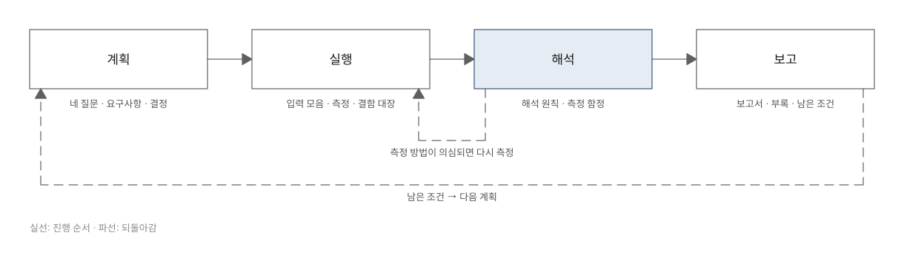

# 검증 가이드 (Verification Guide)

검증할 내용을 네 질문으로 묶고, 계획·실행·해석·보고 네 단계로 진행하게 돕는 Claude Code · Codex 플러그인입니다. "AI가 짠 코드라 불안하다"는 우려부터 "이 숫자를 믿어도 되나"라는 질문까지, 검증 작업에서 되풀이되는 판단을 지침·양식·스크립트로 고정했습니다.

> 영어 안내: [README.en.md](README.en.md) · 변경 내역: [CHANGELOG.md](CHANGELOG.md)

처음 보는 용어는 [용어 풀이](docs/glossary.md)에 모아 두었습니다.

## 무엇을 해결하나요?

라이브러리 하나를 서비스에 넣기 전에 "오류는 없나, 빠른가, 안전한가, 앞으로도 계속 검증되나"에 근거를 들어 답해야 했습니다. 그래서 iOS·Android 두 플랫폼의 공용 입력 모음(여러 플랫폼이 함께 쓰는 테스트 입력 묶음, 코퍼스라고도 부름)을 맞추고 퍼징(입력을 무작위로 바꿔 대량으로 넣고 이상 동작을 찾는 테스트)을 돌렸습니다. 이어서 실기기(시뮬레이터·에뮬레이터가 아닌 실제 기기)에서 성능을 재고, 위협 모델(무엇을 지키고 공격이 어디로 들어오는지 정리한 표)을 세우고, 보고서를 만들었습니다.

그 과정에서 같은 실수를 여러 번 했습니다. 한 번 잰 값으로 결론을 내렸고, 측정 구간을 고정해 끊김 시간 비율(1초 동안 늦게 표시된 시간의 합)을 희석했고, 도구가 낸 "0건"을 "문제없음"으로 읽었습니다.

이 플러그인은 그때 정리한 방법과 교훈을 담아, 다른 프로젝트에서 같은 것을 처음부터 다시 배우지 않게 합니다. 수치는 프로젝트마다 다르지만, **무엇을 어떤 순서로 확인하고 숫자를 어떻게 읽어야 하는지**는 같습니다.

## 네 질문

검증할 내용은 네 질문으로 나눕니다. 질문마다 확인할 것과 주로 쓰는 방법이 다릅니다(표 1).

*표 1. 네 질문과 주된 방법*

| ID | 질문 | 주된 방법 |
|---|---|---|
| Q1 오류 | 다양한 입력·악의적인 입력·중간 상태 입력에서 크래시·멈춤·오표시가 없는가 | 공용 입력 모음, 두 구현 비교(차등 테스트), 시드 고정 퍼징, 극단 입력 |
| Q2 성능 | 실제 조건에서 지연·끊김·메모리·크기가 기준 안인가, 저사양 기기에서도 그런가 | 실기기 Release 빌드 반복 측정, 외부 기준, 도구 교차 확인 |
| Q3 보안 | 신뢰할 수 없는 입력이 코드 실행·외부 요청·자원 고갈로 이어지지 않는가 | 위협 모델 → 공격 입력 동적 검증 → 정적 분석·의존성 감사·SBOM·새니타이저 |
| Q4 유지보수 | 검증이 자동으로 반복되는가, 코드가 관리할 수 있는 수준인가 | CI 게이트, 커버리지 기준, 복잡도 분포, 결함 대장 |

표의 방법 이름은 처음 보면 낯설 수 있습니다. 차등 테스트는 같은 입력을 두 구현에 넣어 결과를 비교하는 테스트입니다. 시드(난수 생성의 시작값)를 고정해 퍼징하면 같은 무작위 입력열을 언제든 다시 만들 수 있습니다. 극단 입력은 수백 단계 중첩처럼 구조가 극단적인 입력입니다.

Release 빌드는 최적화를 켠 배포용 빌드, 외부 기준은 플랫폼 제작사·공식 문서가 정한 판정 기준, CI 게이트는 실패하면 병합을 막는 자동 검사입니다. 나머지 용어도 [용어 풀이](docs/glossary.md)에 한두 문장으로 풀어 두었습니다.

## 빠르게 시작하기

### 1. 설치하기

#### 방법 A. AI에게 요청하기

Claude Code나 Codex 세션에서 이렇게 말합니다.

> `Jimmy-Jung/verification-guide` 마켓플레이스를 추가하고 `verification-guide` 플러그인을 설치해줘.

#### 방법 B. 설치 명령 직접 실행하기

```sh
# Claude Code
claude plugin marketplace add Jimmy-Jung/verification-guide
claude plugin install verification-guide@verification-guide

# --marketplace 옵션이 있는 Claude Code에서는 한 줄 (2.1.301에서 확인)
claude plugin install verification-guide --marketplace Jimmy-Jung/verification-guide
```

Codex에서는 저장소를 받은 뒤 `.agents/plugins/marketplace.json`을 로컬 마켓플레이스로 등록합니다. 자세한 절차는 OpenAI의 플러그인 문서를 따릅니다.

#### 방법 C. 설치 없이 한 세션만 써 보기

저장소를 받아 플러그인 폴더를 지정하면, 설치하지 않고 그 세션에서만 플러그인을 쓸 수 있습니다.

```sh
git clone https://github.com/Jimmy-Jung/verification-guide.git
claude --plugin-dir ./verification-guide
```

### 2. 요청하기

설치하면 `verify` 스킬 하나가 생깁니다. 이 스킬은 요청을 계획·실행·해석·보고 가운데 한 단계로 분류하고, 단계별 체크리스트와 참고 지침·양식·스크립트로 안내합니다.

평소처럼 말하면 스킬이 자동으로 불립니다. 직접 부르려면 `/verification-guide:verify`를 입력합니다. 요청 예시는 다음과 같습니다.

- "우리 SDK를 서비스에 넣기 전에 검증 계획을 세워줘. 팀장님이 AI가 짠 코드라 걱정이래."
- "iPad에서 hitch 12 ms/s 나왔는데 1번 쟀어. 기준 미달로 써도 돼?"
- "semgrep 0건, osv-scanner 0건이야. '취약점 없음'이라고 써도 돼?"
- "결함 대장 양식 줘." / "검증 보고서 목차 잡아줘."

## 이렇게 활용하세요

대표적인 쓰임은 검증 계획 세우기, 측정값 해석하기, 보고서 만들기 세 가지입니다.

### 검증 계획 세우기

스킬은 먼저 네 질문을 프로젝트의 언어로 다시 씁니다. 이어서 현재 상태(테스트 수·커버리지·성능 기록·CI·쓸 수 있는 기기와 환경)를 실제로 확인하게 한 뒤, 질문마다 방법과 도구를 고릅니다.

결과는 [계획 양식](skills/verify/templates/plan.md)에 채웁니다. 완료 기준이 있는 요구 사항 표와 의사코드 수준의 설계가 여기에 들어갑니다. 실기기·도구 설치·결함 수정 범위·퍼징 규모처럼 사용자가 정해야 할 항목은 모아서 한 번에 묻습니다.

### 측정값 해석하기

"이 숫자를 믿어도 되나"라는 질문에는 해석 원칙 일곱 가지로 답합니다. 중앙값과 범위, 반복 횟수, 실기기 Release 절댓값과 시뮬레이터 Debug 상대값, 외부 기준과 회귀 방지 기준(프로젝트가 스스로 정한 값), "0건"의 범위, 정의가 다른 지표끼리 비교하지 않기, 원리가 다른 도구로 교차 확인하기입니다.

또 실제 보고서를 낸 다음 날 드러난 측정 함정 일곱 가지([3장 성능](docs/03-performance.md#6-측정-함정과-대응))를 측정 전에 점검하게 합니다. 원칙의 자세한 설명은 [1장 원칙과 해석](docs/01-principles.md)에 있습니다.

### 보고서 만들기

수치는 원시 결과 → 집계 스크립트 → CSV → 표·그래프의 한 방향으로만 만듭니다. 결함 대장·재현 명령·원시 데이터 위치는 부록으로 붙이고, "남은 조건과 확인하지 않은 범위" 절을 반드시 둡니다.

관리자용·발표용·논문형 파생본을 만드는 규칙도 있습니다.

## 결과를 읽을 때

플러그인이 내는 판단에는 신뢰도 표기가 붙습니다. 네 등급의 뜻은 다음과 같습니다.

- **확인**: 스크립트로 다시 실행해 같은 판정이 나왔습니다.
- **잠정**: 1회 측정·1기기·측정 구간 미통제처럼 근거가 약합니다.
- **가능성 높음**: 트레이스(프로파일러가 실행 중 일어난 일을 기록한 파일) 관찰에서 추론했고, 공개 문서로 확정되지 않았습니다.
- **미확인**: 환경을 확보하지 못해 실행하지 않았습니다.

"0건"에는 항상 도구의 시야가 붙습니다. 예를 들어 "semgrep 규칙 255개 기준 지적 0건"처럼 씁니다.

측정 방법을 나중에 고쳤다면 첫 판 수치와 재측정 수치를 구분하고 보정 방향을 함께 적습니다. 테스트 쪽 보정(기한 완화·재측정 규칙)도 결함 대장에 남겨, 결과가 좋아진 이유가 코드 수정인지 테스트 완화인지 가릴 수 있게 합니다.

## 동작 구조

검증은 계획 → 실행 → 해석 → 보고 순서로 진행합니다(그림 1). 해석하다가 측정 방법이 의심되면 실행으로 돌아가 다시 재고, 보고서에 남긴 조건은 다음 계획의 입력이 됩니다.



*그림 1. 계획·실행·해석·보고 네 단계와 되돌아가는 경로*

저장소는 에이전트가 읽는 부분(`skills/verify/`)과 사람이 읽는 부분(`docs/`)으로 나뉩니다.

```
verification-guide/
├── skills/verify/   # 에이전트가 읽는 부분 (Claude Code · Codex 공통)
│   ├── SKILL.md                    #   모드 4개, 원칙 10개, 체크리스트, 참고 파일 지도
│   ├── references/                 #   압축 지침 10편 (원칙·Q1~Q4·결함 대장·보고서·도구 지도·플랫폼별 명령)
│   ├── templates/                  #   계획·보고서·결함 대장·도구 설명·공용 입력 모음 계약 양식
│   └── scripts/                    #   fixtures_manifest · coverage_gate · bench_collect (표준 라이브러리만)
├── docs/                           # 사람이 읽는 부분 (설치본에 포함되지만 스킬은 여기에 의존하지 않음)
│   ├── 01-principles.md            #   1장 원칙과 해석 — 숫자를 읽는 법과 예상 질문
│   ├── 02-correctness.md           #   2장 오류(Q1) — 공용 입력 모음·차등 테스트·퍼징·극단 입력
│   ├── 03-performance.md           #   3장 성능(Q2) — 측정 설계와 측정 함정 7종
│   ├── 04-security.md              #   4장 보안(Q3) — 위협 모델·공격 입력·정적 분석
│   ├── 05-maintenance.md           #   5장 유지보수(Q4) — 커버리지·복잡도·CI 분할
│   ├── 06-records-and-reports.md   #   6장 기록과 보고 — 결함 대장·계획·수치 파이프라인·보고서 문구
│   ├── tools/                      #   도구 문서 5편 — iOS 테스트·품질, iOS 성능·안전, Android 테스트·품질, Android 성능, 공통 보안·규모
│   ├── glossary.md                 #   용어 풀이
│   ├── assets/                     #   도식·그래프·도구 화면 스크린샷과 다시 만들기 안내
│   └── case-study/richmarkdown.md  #   실제 적용 사례(수치는 전부 여기)
├── evals/                          # claude plugin eval 케이스
└── tests/                          # pytest — 스크립트 self-test, 매니페스트·문서 일관성
```

스킬은 요청을 받으면 `SKILL.md`를 읽고, 그 단계에 필요한 `references/` 파일만 한두 개 더 엽니다. `docs/tools/`의 도구 문서는 사람용이라 에이전트 컨텍스트에 들어가지 않습니다.

대신 `references/tools.md`에 같은 도구의 한 줄 해석과 함정을 표로 정리해 두었고, 테스트가 두 쪽의 도구 목록이 어긋나지 않는지 검사합니다.

iOS와 Android용 스킬은 나누지 않았습니다. 핵심 방법(차등 테스트·공용 입력 모음·같은 시드의 퍼징)이 두 플랫폼을 함께 전제하기 때문입니다. 플랫폼마다 다른 명령과 함정만 `references/platform-ios.md`·`platform-android.md`로 나눴습니다.

## 문서 지도

사람이 읽는 문서는 1~6장, 도구 문서 5편, 용어 풀이, 적용 사례로 이루어져 있습니다. 처음이라면 1장에서 숫자를 읽는 원칙을 잡고, 지금 답해야 하는 질문의 장(2~5장)으로 넘어갑니다. 보고서를 쓸 때는 6장을 봅니다. 도구 문서는 처음부터 읽기보다, 장에서 도구 이름이 나올 때 그 도구의 절로 건너가 읽는 쪽이 편합니다.

*표 2. 문서 지도*

| 문서 | 내용 |
|---|---|
| [1장 원칙과 해석](docs/01-principles.md) | 검증 원칙, 해석 원칙(중앙값과 범위, 반복 횟수, 외부 기준, "0건"의 범위), 결론의 신뢰도 표기, 예상 질문과 답 |
| [2장 오류](docs/02-correctness.md) | 공용 입력 모음, 차등 테스트, 속성 기반 퍼징, 극단 입력, 렌더 검사, 최소·최신 OS, 결함을 고칠지 기록만 할지의 판단 |
| [3장 성능](docs/03-performance.md) | 측정 원칙, 지표와 체감, 판정 기준의 출처, 교차 확인, 측정 함정 7종, 재측정 설계 |
| [4장 보안](docs/04-security.md) | 위협 모델, 공격 입력 동적 검증, 정적 분석·의존성 감사·SBOM·새니타이저 |
| [5장 유지보수](docs/05-maintenance.md) | 커버리지 CI 게이트, 복잡도 분포, CI 분할 기준, 브랜치 보호 |
| [6장 기록과 보고](docs/06-records-and-reports.md) | 계획 문서, 결함 대장, 수치 파이프라인, 보고서 목차, 보고서 문구 모음 |
| [iOS 테스트·품질 도구](docs/tools/ios-testing.md) | Swift Testing, XCTest, XCUITest와 접근성 감사, xccov, SwiftLint |
| [iOS 성능·안전 도구](docs/tools/ios-performance.md) | XCTest 성능 지표, Instruments와 xctrace, xcprof, AddressSanitizer, ThreadSanitizer |
| [Android 테스트·품질 도구](docs/tools/android-testing.md) | JUnit, AndroidX Test와 Espresso, Accessibility Test Framework, Kover, JaCoCo, Android lint |
| [Android 성능 도구](docs/tools/android-performance.md) | Jetpack Microbenchmark·Macrobenchmark, dumpsys gfxinfo, Perfetto |
| [공통 보안·규모 도구](docs/tools/common-security-quality.md) | semgrep, osv-scanner, npm audit, cdxgen과 CycloneDX, lizard, scc |
| [적용 사례](docs/case-study/richmarkdown.md) | iOS·Android Markdown 렌더러 검증 사례(2026-10)와 실측 수치 |
| [용어 풀이](docs/glossary.md) | 문서에 나오는 용어의 쉬운 풀이 |
| [그림 다시 만들기](docs/assets/README.md) | 도식·그래프를 다시 만드는 방법, 스크린샷의 출처와 공개 전 확인 |

## 스크립트

세 스크립트는 Python 3 표준 라이브러리만 쓰고, 모두 `--self-test`로 스스로 점검할 수 있습니다. 각각 공용 입력 모음의 해시 대조, 커버리지 기준 검사, 벤치마크 로그 집계를 맡습니다.

```sh
S=skills/verify/scripts
python3 $S/fixtures_manifest.py Tests/Fixtures                 # 정본: 해시 목록 생성
python3 $S/fixtures_manifest.py --check path/to/copy           # 사본: 대조, 불일치면 종료 코드 1
python3 $S/coverage_gate.py coverage.json --module Core=0.90 --total 0.80   # xccov JSON
python3 $S/coverage_gate.py core/build/reports/kover/report.xml --module core=0.90   # Kover/JaCoCo XML
python3 $S/bench_collect.py bench.log --out results.json --table           # BENCH 줄 집계
```

## 개발

저장소를 고친 뒤에는 다음 명령으로 확인합니다.

```sh
python3 -B -m pytest                      # 스크립트 self-test + 매니페스트·문서 일관성
claude plugin validate --strict .         # 매니페스트 검사
claude plugin eval . --trust-plugin       # eval 4케이스 (모델 호출 비용 발생, evals/README.md)
```

릴리스할 때는 `VERSION`·`.claude-plugin/plugin.json`·`.codex-plugin/plugin.json`·`.agents/plugins/marketplace.json`의 버전을 함께 올리고, 바뀐 내용을 `CHANGELOG.md`에 적습니다. 플러그인 이름은 공개한 뒤에는 바꾸지 않습니다.

## 라이선스

MIT. [LICENSE](LICENSE)
