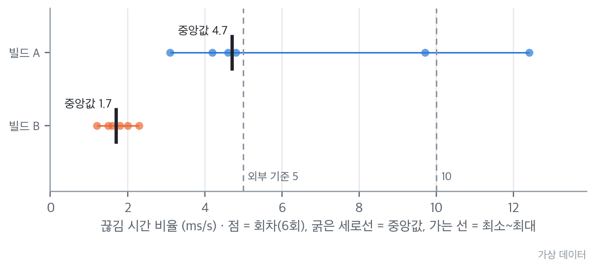

# 원칙과 해석 — 숫자를 어떻게 읽고, 어디까지 믿는가

> **요약.** 이 장은 검증 가이드 전체(2~6장과 도구 문서)의 출발점으로, 검증을 설계할 때 지키는 원칙 네 가지와 도구가 달라도 숫자를 같은 방식으로 읽게 하는 해석 원칙 일곱 가지를 설명합니다. 측정값은 잴 때마다 흔들리고 도구마다 보는 범위가 다르므로, 숫자 하나를 결론으로 옮기기 전에 반복 횟수·측정 환경·기준의 출처·도구의 시야를 함께 확인해야 합니다. 핵심 판단 기준은 중앙값과 범위를 함께 보고, 외부 기준과 회귀 방지 기준을 나누고, "0건"에는 도구의 시야를 붙이고, 결론마다 확인·잠정·가능성 높음·미확인 가운데 하나로 신뢰도를 표기하는 것입니다. 한계도 있습니다. 반복 횟수의 기본값은 통계적 보장이 아니라 비용과 목적으로 정한 값이고, 두 구현이 같은 방식으로 틀린 경우처럼 이 원칙으로도 드러나지 않는 범위가 남습니다.

처음 보는 용어는 [용어 풀이](glossary.md)에 모아 두었습니다.

에이전트용 압축판: `skills/verify/references/principles.md`

## 차례

- [1. 들어가며 — "이 숫자를 믿어도 되나요?"](#1-들어가며--이-숫자를-믿어도-되나요)
- [2. 검증 원칙](#2-검증-원칙)
- [3. 해석 원칙](#3-해석-원칙)
- [4. "0건" 문구 규칙](#4-0건-문구-규칙)
- [5. 결론의 신뢰도 표기](#5-결론의-신뢰도-표기)
- [6. 예상 질문과 답](#6-예상-질문과-답)
- [7. 한계와 보완](#7-한계와-보완)
- [8. 적용 사례](#8-적용-사례)
- [참고문헌](#참고문헌)

## 1. 들어가며 — "이 숫자를 믿어도 되나요?"

검증 결과를 리뷰에 올리면 "이 숫자를 믿어도 되나요?"라는 질문을 자주 받습니다. 실기기에서 한 번 잰 끊김 시간 비율(1초 동안 늦게 표시된 시간의 합)이 기준을 넘었을 때 곧바로 "기준 미달"이라고 써도 되는지, 정적 분석과 의존성 감사가 모두 0건이면 "취약점 없음"이라고 써도 되는지 같은 질문입니다.

두 질문의 답은 숫자 자체보다 숫자를 만든 조건에 있습니다. 몇 번 쟀는지, 어떤 빌드와 기기에서 쟀는지, 기준은 누가 정했는지, 도구가 무엇을 보고 무엇을 보지 못하는지에 따라 같은 숫자도 다른 결론이 됩니다.

이 장은 그 조건을 따지는 순서를 정리하며, 2~6장의 방법과 도구 문서가 공통으로 기대는 출발점입니다. 2절은 검증을 설계할 때 지키는 원칙 네 가지를, 3·4절은 숫자를 읽을 때 적용하는 해석 원칙 일곱 가지와 거기에 딸린 규칙(반복 횟수 기본값, 판정 기준의 출처 표기, "0건" 문구)을 다룹니다. 5절은 결론의 신뢰도 표기를, 6절은 리뷰에서 바로 꺼내 쓸 수 있게 일반화한 예상 질문과 답을 모읍니다.

## 2. 검증 원칙

검증 원칙은 측정을 시작하기 전에 검증의 뼈대를 정하는 규칙입니다. 네 원칙은 차례로 무엇을 검증할지, 어떻게 반복할지, 수치를 어디에 모을지, 찾은 결함을 어떻게 닫을지에 답합니다.

### 2.1 출처가 아닌 결과의 검증

우려의 출발점이 "AI 도구로 작성한 코드"였더라도, 누가 썼는지만으로는 코드가 어떤 입력에서 어떻게 동작하는지 알 수 없습니다. 사람이 쓴 코드에도 같은 종류의 결함이 생깁니다.

그래서 질문을 "누가 썼나"에서 "어떤 입력에서 크래시·오표시·끊김·보안 문제가 생기는가"로 바꿉니다. 질문을 네 가지(Q1 오류, Q2 성능, Q3 보안, Q4 유지보수)로 고정하면 작성 주체와 상관없이 같은 방법으로 답할 수 있습니다.

### 2.2 다시 실행할 수 있는 검증

한 번 손으로 확인한 결과는 다음 수정에서 깨져도 알 수 없습니다. 그래서 테스트·벤치마크·정적 분석을 스크립트로 고정합니다. 그중 빠르고 결과가 늘 같은(결정적인) 검사는 CI에서 커밋마다 돌리고, 실기기·계측·UI 검사는 릴리스 전에 수동으로 돌립니다.

"AI가 짠 코드"라는 우려에 가장 강하게 답하는 것은 일회성 수치가 아니라 반복해서 실행되는 검증 파이프라인입니다. 다만 실기기 측정은 다시 잴 때마다 값이 흔들리므로, "같은 숫자"가 아니라 "같은 판정"이 나오는지를 봅니다.

### 2.3 수치의 단일 출처

원시 결과(벤치마크 JSON·커버리지·정적 분석 결과·결함 대장)는 집계 스크립트가 CSV 한 벌로 모으고, 그래프는 이 CSV만 읽습니다. 본문 표도 CSV에서 옮기고 출처를 적습니다. 여기서 결함 대장은 찾은 결함을 번호·발견 경로·수정·회귀 테스트와 함께 모은 목록입니다.

이렇게 하면 여러 번 잰 값 가운데 유리한 값만 골라 쓸 여지가 없어집니다. 자세한 파이프라인은 [6장 기록과 보고의 수치 파이프라인](06-records-and-reports.md#4-수치-파이프라인)에 있습니다.

### 2.4 발견에서 회귀 고정까지의 한 묶음

결함을 찾으면 네 단계를 한 묶음으로 처리합니다. ① 가장 짧은 재현 입력을 만들고, ② 원인을 고치고, ③ 그 입력을 회귀 테스트 입력(고친 결함이 다시 생기면 걸리도록 남겨 두는 최소 재현 입력)이나 수정 전에 실패하는 테스트로 저장하고, ④ 전체 검증을 다시 실행합니다.

회귀 테스트 입력은 커밋마다 CI에서 다시 검사합니다. 고치기만 하고 회귀 테스트를 남기지 않으면 다음 수정에서 같은 결함이 돌아와도 알아채지 못합니다.

## 3. 해석 원칙

검증 원칙이 측정의 뼈대라면, 해석 원칙은 측정이 끝난 뒤 숫자를 결론으로 옮기는 규칙이고, 도구가 달라도 똑같이 적용합니다. 일곱 원칙 가운데 이 절은 숫자를 읽는 여섯 원칙을 다루고, 규칙이 딸린 원칙(반복 횟수·판정 기준)에는 원칙 바로 뒤에 기본값과 표기 규칙을 붙였습니다. 일곱 번째 원칙인 "0건"의 범위는 문구 규칙과 함께 4절에서 다룹니다.

### 3.1 중앙값과 범위

같은 입력이라도 잴 때마다 값이 흔들립니다. 그래서 대푯값으로 평균 대신 중앙값(크기순으로 놓았을 때 가운데 값)을 쓰고, 범위(최솟값~최댓값)를 함께 적습니다.

중앙값은 한 번 튄 값에 끌려가지 않습니다. 세 번 중 두 번이 0이고 한 번이 크게 튀면 평균은 튄 값의 3분의 1이 되지만 중앙값은 0입니다. 다만 3회로는 튄 값이 드문 일인지 자주 있는 일인지 알 수 없으므로 튄 값을 따로 적습니다.

두 값은 서로 다른 것을 말합니다. 중앙값은 보통의 실행을, 범위는 가장 나빴던 실행을 보여 주므로, 범위가 판정 구간 여러 개에 걸치면 중앙값 하나로 판정하지 않습니다. 중앙값은 "좋음"인데 범위가 "조사 필요"와 "나쁨"까지 걸쳐 있다면, 그 불안정성이 판정의 일부입니다.

그림 1의 빌드 A가 이런 경우로, 중앙값은 기준 안에 있지만 범위가 세 판정 구간에 걸칩니다. 반대로 빌드 B처럼 범위 전체가 한 구간 안에 머물 때만 중앙값 하나로 판정합니다.

*그림 1. 두 빌드의 끊김 시간 비율 6회 측정 중앙값과 범위(가상 예시)*

### 3.2 반복 횟수의 근거

그렇다면 몇 번을 재야 할까요? 3회는 한 번 튄 값에 중앙값이 끌려가지 않는 최소 횟수일 뿐이고, 이때 범위의 신뢰도는 낮습니다.

1회 값끼리의 비교는 결론으로 쓰지 않습니다. 오전에 1회, 오후에 1회 잰 값이 다르면 회귀인지 단순한 변동인지 가를 근거가 없기 때문입니다. 빌드를 비교할 때는 같은 날 같은 기기에서 두 빌드를 번갈아 6회 이상 잽니다.

측정 종류별 기본 횟수는 표 1과 같습니다.

*표 1. 측정 종류별 기본 반복 횟수와 근거*

| 측정 | 기본 반복 | 근거 |
|---|---:|---|
| 함수 단위 마이크로 벤치마크(실기기 Release) | 10회 | 예열 뒤 분포가 안정됨. 플랫폼 도구의 기본값이 더 크면 그 값을 따름(예: 50회) |
| 화면 시나리오 트레이스(스크롤·스트리밍·실행) | 3회 이상, 빌드 비교는 6회 | 녹화·자동화 비용이 큼. 3회는 범위 신뢰도가 낮음 |
| 극단 입력(수백 단계 중첩처럼 구조가 극단적인 입력) 처리 시간 | 3회 중앙값 | 같은 입력도 몇 % 흔들림 |
| 앱 실행 시간 | 5회 | 콜드·웜 실행을 구분해 기록함 |

이 횟수는 통계적 보장이 아니라 비용과 목적으로 정한 값입니다. 화면 시나리오는 한 번에 15~60초 녹화와 UI 자동화가 필요해 3회로 시작하고, 빌드 비교처럼 작은 차이를 봐야 할 때 6회로 늘립니다. 그러니 횟수를 적었다면 왜 그 횟수인지도 함께 적습니다.

### 3.3 실기기 Release 절댓값과 시뮬레이터 Debug 상대값

Debug 빌드는 컴파일러 최적화를 끈 개발용 빌드이고, Release 빌드는 최적화를 켠 배포용 빌드입니다. 시뮬레이터는 개발 머신의 CPU에서 돌기 때문에, 같은 입력의 처리 시간이 시뮬레이터 Debug에서는 실기기(시뮬레이터·에뮬레이터가 아닌 실제 기기) Release의 몇 배로 나오는 일이 흔합니다.

그래서 시뮬레이터 Debug 값은 "이전보다 느려졌나"를 볼 때만 쓰고, 사용자 체감은 실기기 Release 값으로 말합니다. 출시 연도·칩 세대가 다른 두 기기의 값도 플랫폼 우열로 읽지 않습니다.

### 3.4 외부 기준과 회귀 방지 기준

판정 기준은 출처에 따라 두 종류로 나눕니다. 외부 기준은 플랫폼 제작사·공식 문서가 정한 기준이고, 회귀 방지 기준은 프로젝트가 스스로 정한 값입니다.

외부 기준은 먼저 찾아 인용하고, 어느 문서의 어느 기준인지 함께 밝힙니다. 예를 들어 끊김 시간 비율에는 Apple Tech Talk의 기준[1]과 Xcode Organizer의 기준[2]이 따로 있습니다. 이처럼 같은 지표에 외부 기준이 둘 이상이면 어느 쪽을 썼는지와 다른 쪽 기준값을 함께 적습니다. 독자가 다른 문서의 숫자와 비교할 때 기준이 다르면 결론이 뒤집히기 때문입니다.

반면 커버리지 하한, 시간 상한, CI 게이트(실패하면 병합을 막는 자동 검사) 임계값 같은 회귀 방지 기준은 "사용자에게 충분히 빠르다"의 근거가 아닙니다. "나빠지면 CI를 실패시키는" 장치로 읽어야 합니다. 두 종류를 섞어 쓰면 프로젝트가 정한 값이 외부 기준처럼 보입니다.

기준의 출처를 밝혔더라도 숫자만 옮겨 적으면 독자가 오해할 여지가 남습니다. 그래서 판정표를 만들 때 다음 네 가지를 함께 지킵니다.

- 어느 백분위(값을 크기순으로 놓았을 때 그 비율만큼이 이 값 이하인 지점. P90이면 90%)를 쓸지는 외부 기준이 아니라 프로젝트가 정합니다. 판정에 쓴 백분위 밖의 긴 꼬리(P95·P99)도 함께 싣습니다.
- 주사율에서 계산한 프레임 예산(한 프레임에 쓸 수 있는 시간, 1,000 ÷ Hz)은 기기가 적응형 주사율을 쓰면 근삿값입니다.
- 메모리는 절대 상한 대신 추세로 봅니다. 시나리오가 끝난 뒤에도 계속 늘면 누수 징후이고, 늘었다가 그대로 유지되면 캐시일 가능성이 있습니다. 누수를 계측하지 않았다면 "반복 시 누적 여부 미확인"으로 적습니다.
- 기준을 두지 않은 지표(실행 시간·크기 등)는 값과 구성만 기록하고 판정표에서 뺍니다. 기준 없이 판정표에 넣으면 독자는 통과로 읽습니다.

### 3.5 정의가 다른 지표의 비교 금지

다른 도구, 다른 정의로 얻은 두 값을 "두 배 느리다"처럼 읽지 않습니다. 스크롤을 잰 도구의 프레임 시간과 스트리밍을 잰 도구의 CPU 프레임 시간은 정의가 다르므로, 각각을 자기 기준인 프레임 예산과 비교한 결과만 의미가 있습니다.

플랫폼마다 지표가 다를 때도 마찬가지입니다. iOS의 끊김 시간 비율(ms/s)과 Android의 프레임 시간 백분위[3]는 단위와 뜻이 다르므로, 판정표에서 각자의 기준 옆에만 둡니다.

### 3.6 원리가 다른 도구의 교차 확인

핵심 지표는 표본 추출·구간 기록·반복 측정처럼 오차가 생기는 방식이 서로 다른 도구 두세 개로 같은 구간을 잽니다. 값이 1% 안에서 맞으면 한 도구의 버릇이 아니라고 볼 수 있습니다.

반대로 값이 상식과 어긋나면 그 자체가 신호입니다. 요약 도구가 낸 inclusive 시간(하위 함수까지 포함한 시간)이 측정 구간(지표를 계산하는 시간 범위)의 길이에 가깝게 나오면, 실제 시간이 아니라 추정치일 가능성을 의심합니다.

교차 확인을 건너뛴 지표에서 나중에 보정할 일이 생깁니다. 실제로 어떤 보정을 했는지는 [3장 성능의 측정 함정](03-performance.md#6-측정-함정과-대응)에 있습니다.

## 4. "0건" 문구 규칙

도구를 겹쳐 쓰는 일은 숫자를 읽을 때뿐 아니라 "아무것도 찾지 못했다"는 결과를 읽을 때도 필요합니다. 해석 원칙의 일곱 번째는 이 결과를 읽는 법입니다. 도구가 아무것도 찾지 못했다는 결과는 "문제가 없다"가 아니라 "이 도구가 보는 범위에서 발견이 없었다"는 뜻이므로, "0건"은 반드시 도구의 시야를 붙여 씁니다.

표 2는 결과별로 쓰는 문구를 모은 것입니다. 표에 나오는 새니타이저는 실행 중 메모리 오류와 데이터 경합을 잡도록 빌드에 검사 코드를 넣는 컴파일러 기능이고, 퍼징은 입력을 무작위로 바꿔 대량으로 넣고 이상 동작을 찾는 테스트입니다. 플랫폼 간 비교는 iOS·Android 결과가 같은지 맞춰 보는 일로, 패리티(parity)라고도 합니다.

*표 2. 결과별 "0건" 문구*

| 결과 | 쓰는 문구 |
|---|---|
| 정적 분석 0건 | 사용한 규칙이 아는 패턴이 코드에 없다. 논리 오류와 규칙 밖 패턴은 모른다 |
| 의존성 감사 0건 | 검사 시점에 공개 취약점 DB에 오른 문제가 없다. 공개되지 않은 취약점은 모른다 |
| 새니타이저 0건 | 테스트가 실제로 실행한 경로 가운데 새니타이저로 컴파일한 코드에서 탐지되지 않았다. 미리 빌드된 바이너리·시스템 프레임워크 내부·실행하지 않은 경로·메모리 누수는 범위 밖이다 |
| 접근성 감사 0건 | 도구가 읽을 수 있는 화면 요소에서 실패가 없었다. 실제 보조 기술(VoiceOver·TalkBack 같은 화면 낭독기)을 쓸 때의 사용감은 모른다 |
| 퍼징 무크래시 | 생성기가 만든 N건에서 크래시가 없었다 |
| 플랫폼 간 비교 일치 | 두 구현이 같은 결과를 냈다. 둘이 같은 방식으로 틀린 경우는 드러나지 않는다 |

한 도구가 전체를 보지 못하므로 같은 질문에 원리가 다른 도구를 겹쳐 씁니다. 보안이라면 코드 모양은 정적 분석으로, 공개 취약점은 의존성 감사로, 실제 실행은 공격 입력으로, 메모리는 새니타이저로 봅니다. 목적은 한 도구의 시야 밖이 다른 도구의 시야 안에 들어오게 하는 데 있습니다.

## 5. 결론의 신뢰도 표기

숫자를 해석해 결론을 냈다면, 그 결론이 어떤 근거에서 나왔는지를 네 등급으로 표기합니다.

- **확인**: 스크립트로 다시 실행해 같은 판정이 나왔습니다.
- **잠정**: 1회 측정, 1기기, 또는 측정 구간·시작 위상(작업 시작 시각이 화면 갱신 신호, 곧 vsync 주기의 어느 지점에 걸리는지)을 통제하지 않은 결과입니다. 이유를 함께 적습니다. 측정 방법을 나중에 고쳤다면 첫 판의 통과 판정도 잠정으로 읽습니다.
- **가능성 높음(likely)**: 트레이스(프로파일러가 실행 중 일어난 일을 시간순으로 기록한 파일) 관찰에서 추론한 규칙이고, 공개 문서로 확정되지 않았습니다. 계측기의 집계 규칙(어떤 프레임을 끊김으로 세는지)이나 시스템의 코어 배치처럼 제작사가 공개하지 않은 동작을 설명한 내용이 여기에 들어갑니다.
- **미확인**: 환경을 확보하지 못해 실행하지 않았습니다. 코드 검토나 일부 실행의 성공을 이 범위까지 넓혀 해석하지 않습니다.

"확인"과 "잠정"을 구분하지 않으면 독자는 모든 결론을 "확인"으로 읽습니다. "미확인"을 빼면 독자는 범위 밖도 통과로 읽습니다.

## 6. 예상 질문과 답

다음 질문과 답은 리뷰에서 바로 꺼내 쓸 수 있게 일반화한 것입니다. 답은 리뷰 자리에서 말할 수 있는 두세 문장으로 줄였고, 자세한 설명은 답마다 붙인 링크에 있습니다.

### 6.1 AI가 쓴 테스트로 AI가 쓴 코드를 검증해도 의미가 있나요?

같은 쪽이 코드와 기댓값을 함께 만들면 같은 착각을 공유할 수 있으므로, 기댓값을 직접 적지 않아도 되는 방법을 중심에 둡니다. 서로 다른 상위 라이브러리를 쓰는 두 구현에 같은 입력(공개 명세 예제 포함)을 넣어 비교하는 차등 테스트, 입력과 상관없이 지켜야 할 성질만 보는 퍼징, 플랫폼 제작사의 외부 기준이 그것이며, 차이가 난 입력은 공개 명세의 문장으로 어느 쪽이 맞는지 판정합니다. 다만 두 구현이 같은 설계를 따르는 계층에 함께 들어간 착오는 드러나지 않을 수 있으므로, 그 사실을 보고서에 적습니다. 자세한 설명은 [2장 오류 1절](02-correctness.md#1-들어가며--입력마다-정답을-적을-수-없을-때)에 있습니다.

### 6.2 커버리지가 N%면 버그가 없다는 뜻인가요?

아닙니다. 커버리지는 테스트가 실행한 줄의 비율일 뿐 결과가 맞는지 검사했다는 뜻이 아니어서, 커버리지가 90%를 넘는 모듈에서도 퍼징으로 만든 입력으로 플랫폼 간 비교를 하면 결함이 여럿 나오는 일이 실제로 있습니다. 정확성의 근거는 플랫폼 간 비교·퍼징의 성질 검사·회귀 테스트 입력에서 찾고, 커버리지는 테스트가 닿지 않은 곳을 찾는 지표로 씁니다. 자세한 설명은 [5장 유지보수 1절](05-maintenance.md#1-들어가며--커버리지가-높으면-버그가-없는가), [2.5절 커버리지가 말해 주지 않는 것](05-maintenance.md#25-커버리지가-말해-주지-않는-것)에 있습니다.

### 6.3 왜 두 구현의 결과를 서로 비교했나요?

입력마다 정답을 사람이 적어 두기 어려워서, 서로 다른 라이브러리를 거친 두 결과의 차이를 단서로 삼고, 차이가 나면 명세로 어느 쪽이 맞는지 판정해 고칩니다. 두 구현이 같은 설계로 함께 틀린 경우는 찾지 못하며, 회귀 테스트 입력과 성질 검사로 일부만 보완합니다. 자세한 설명은 [2장 오류 4절](02-correctness.md#4-차등-테스트플랫폼-간-비교)에 있습니다.

### 6.4 퍼징 횟수는 어디서 나온 숫자인가요?

통계적 보장이 아니라 용도와 실행 시간으로 정한 규모입니다. CI 규모는 커밋마다 감당할 수 있는 실행 시간에, 수동 규모는 계획 단계의 추정에 맞춰 릴리스 전에 돌리도록 정했고, 실측 시간이 추정과 달라 조정하더라도 큰 규모에서만 나오는 결함이 있을 수 있으므로 수동 규모는 없애지 않습니다. 횟수를 늘려도 새로 찾는 결함은 로그 곡선처럼 점점 줄어들기 때문에, 횟수보다 변형의 다양성과 실패 입력의 최소화가 효과를 좌우합니다. 자세한 설명은 [2장 오류 5.3절](02-correctness.md#53-실행-규모)에 있습니다.

### 6.5 기기 두 대로 충분한가요?

충분하다고 보지 않으며, 보고서에도 도입 조건으로 적습니다. 고성능 기기 한 대에서 잰 값은 일반 기기나 저사양 기기의 값으로 옮겨 읽을 수 없고, 저사양 기기를 추가하면 고성능 기기에서는 보이지 않던 회귀가 나오기도 합니다. 측정을 스크립트로 만들어 두면 기기를 확보했을 때 같은 명령으로 다시 잴 수 있습니다. 자세한 설명은 [3장 성능의 저사양 기기 포함](03-performance.md#74-저사양-기기-포함)에 있습니다.

### 6.6 0건이면 안전한가요?

0건은 해당 도구의 규칙과 공개 취약점 데이터베이스의 범위에서 발견이 없었다는 뜻이고, 특정 언어 전용 공개 규칙이 적으면 정적 분석 0건에서 알 수 있는 것은 거의 없습니다. 그래서 위협 모델(무엇을 지키는지, 믿을 수 없는 데이터가 어디로 들어와 무엇을 노리는지 정리한 표·그림)로 위협을 먼저 나열하고, 위협마다 공격 입력을 실제로 넣어 막히는지 확인합니다. 서버 보안이나 앱 서비스 코드처럼 검증 범위 밖인 것은 범위 밖이라고 적습니다. 자세한 설명은 [4절 "0건" 문구 규칙](#4-0건-문구-규칙), [4장 보안 2절](04-security.md#2-위협-모델)에 있습니다.

### 6.7 측정 방법을 나중에 고쳤다면 수치를 믿을 수 있나요?

어떤 함정은 값을 라이브러리에 유리하게, 어떤 함정은 불리하게 움직였으므로 보정 방향을 항목마다 적고, 고친 측정 코드로 다시 재서 판정이 바뀌었는지 확인합니다. 측정 방법과 무관한 결과(정확성·보안·함수 단위 벤치마크)는 보정 대상이 아니라고 적습니다. 첫 판 수치와 재측정 수치를 구분해 두면 독자가 어느 쪽을 믿을지 스스로 고를 수 있습니다. 자세한 설명은 [3장 성능의 측정 함정](03-performance.md#6-측정-함정과-대응)에 있습니다.

### 6.8 결함이 많이 나왔다면 품질이 나쁜 것 아닌가요?

"결함 N건"에는 테스트 쪽 보정, 상위 라이브러리와의 차이, 승인 예외(차이를 알고도 이유를 기록하고 허용한 항목), 결함이 아니라고 확인한 항목까지 들어 있어서, 수만으로는 검증이 깊었는지 코드가 나빴는지 알 수 없습니다. 그래서 영향이 컸던 항목(크래시·시간 폭증·오표시)을 따로 세고, 고친 결함마다 재현 입력이나 회귀 테스트가 있는지 적습니다. 둘을 가르는 것은 결함 대장의 발견 경로와 영향 열입니다. 자세한 설명은 [6장 기록과 보고의 결함 대장](06-records-and-reports.md#3-결함-대장)의 결함 대장 절에 있습니다.

## 7. 한계와 보완

이 원칙들은 숫자를 잘못 읽을 위험을 줄이지만 없애지는 못합니다. 남는 한계와 그 보완 방법은 다음과 같습니다.

첫째, 반복 횟수의 기본값(표 1)은 통계적으로 보장된 값이 아닙니다. 3회로는 범위의 신뢰도가 낮으므로 횟수와 그 이유를 함께 적고, 작은 차이를 판정해야 할 때는 같은 날 번갈아 6회 이상 잽니다.

둘째, 기댓값 없이 검증하는 방법(차등 테스트, 퍼징의 성질 검사)은 두 구현이 같은 방식으로 틀린 경우를 드러내지 못합니다. 회귀 테스트 입력과 성질 검사로 일부를 보완하고, 남는 범위는 보고서에 적습니다.

셋째, 계측기의 집계 규칙이나 시스템의 코어 배치처럼 제작사가 공개하지 않은 동작은 관찰로만 설명할 수 있습니다. 이런 설명은 "가능성 높음"으로 두고, 원리가 다른 도구로 교차 확인해 한 도구의 버릇에 판정이 기대지 않게 합니다.

넷째, 고성능 기기에서 얻은 결론은 저사양 기기에 그대로 적용할 수 없습니다. 확보하지 못한 기기는 "미확인"으로 남기고, 기기를 확보하면 같은 스크립트로 다시 잴 수 있게 둡니다.

## 8. 적용 사례

자세한 수치와 맥락: [RichMarkdown 적용 사례](case-study/richmarkdown.md)

- iOS 콜드 실행 hitch는 3회 중 2회가 0, 1회가 23.1 ms/s여서 평균은 약 7.7, 중앙값은 0이었고, 튄 값을 따로 적었습니다. UIKit 20 Hz 스트리밍은 중앙값 5.5 ms/s였지만 범위 4.7~12.7 ms/s가 Apple 판정 구간 세 개에 모두 걸쳤습니다.
- 50 KiB 파싱은 시뮬레이터 Debug의 CI 게이트에서 78.7 ms, iPad Pro M5 Release에서 11.5 ms였고, 앞의 값은 회귀 방지에만 썼습니다. iPad 11.5 ms와 Galaxy S20 Ultra 58.8 ms는 칩 세대가 달라 플랫폼 우열로 읽지 않았습니다.
- 끊김 시간 비율의 판정 기준은 Apple Tech Talk의 5·10 ms/s[1]를 썼고, Xcode Organizer가 쓰는 10·25·50 ms/s 기준[2]과 다르다는 점도 함께 적었습니다. Android 120 Hz 프레임 예산 8.33 ms는 적응형 주사율 기기라 근삿값으로 적었습니다.
- 두 저장소의 `main`에 보호 규칙이 없어 커버리지·파싱 CI 게이트가 병합을 강제로 막지 않는다고 적었습니다.
- 보강 전 Core 커버리지 94.8%에서 퍼징 기반 플랫폼 간 비교가 Core 결함 대부분을 찾았고, 결함 75건 가운데 테스트 쪽 보정 9건과 상위 파서 차이·승인 예외 9건을 따로 세었습니다.

## 참고문헌

[1] Apple, "Explore UI animation hitches and the render loop", Tech Talks 10855, [developer.apple.com](https://developer.apple.com/videos/play/tech-talks/10855/). 끊김 시간 비율과 5·10 ms/s 기준.

[2] Apple, "Understanding hitches in your app", Xcode 문서, [developer.apple.com](https://developer.apple.com/documentation/xcode/understanding-hitches-in-your-app). 렌더 루프와 프레임 수명, Organizer Hitches 지표 기준(10·25·50 ms/s).

[3] Android Developers, "Capture Macrobenchmark metrics", Jetpack Macrobenchmark 문서, [developer.android.com](https://developer.android.com/topic/performance/benchmarking/macrobenchmark-metrics). 프레임 시간 지표의 정의와 백분위 출력.
