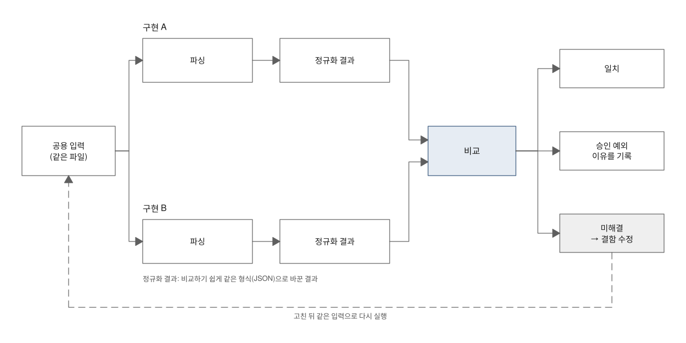
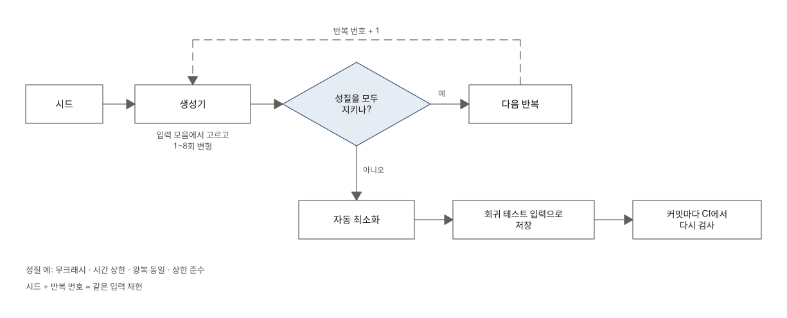

# 오류 검증 — 입력마다 정답을 적지 않고 오류를 찾는 법

> **요약.** 이 문서는 "어떤 입력에서 크래시·멈춤·글자 손실·오표시·플랫폼 간 차이가 생기는가"라는 질문, 곧 검증의 네 질문 가운데 Q1 오류에 답하는 방법을 설명합니다. 입력이 수천 건이면 입력마다 정답을 사람이 미리 적어 두기 어려우므로, 두 구현의 결과를 비교하는 차등 테스트와 항상 지켜야 할 성질을 검사하는 속성 기반 퍼징을 중심에 둡니다. 규모가 만드는 문제는 극단 입력으로, 파서 뒤의 화면 경로는 렌더 수준 검사로, 시스템 구성 요소의 차이는 최소·최신 OS 실행으로 따로 확인합니다. 판정은 일치율이 아니라 "분류되지 않은 차이 0건"과 "이유를 기록한 승인 예외"로 합니다. 두 구현이 같은 방식으로 틀리면 드러나지 않고, 그런 경우를 따로 판정해 줄 기준이 없다는 한계는 보고서에 그대로 적습니다.

처음 보는 용어는 [용어 풀이](glossary.md)에 모아 두었습니다.

에이전트용 압축판: `skills/verify/references/correctness.md`

## 차례

- [1. 들어가며 — 입력마다 정답을 적을 수 없을 때](#1-들어가며--입력마다-정답을-적을-수-없을-때)
- [2. 방법 선택의 기준](#2-방법-선택의-기준)
- [3. 공용 입력 모음의 계약](#3-공용-입력-모음의-계약)
- [4. 차등 테스트(플랫폼 간 비교)](#4-차등-테스트플랫폼-간-비교)
- [5. 속성 기반 퍼징](#5-속성-기반-퍼징)
- [6. 극단 입력](#6-극단-입력)
- [7. 렌더 수준 검사](#7-렌더-수준-검사)
- [8. 최소·최신 OS 실행](#8-최소최신-os-실행)
- [9. 결함을 고칠지 기록만 할지의 판단](#9-결함을-고칠지-기록만-할지의-판단)
- [10. 한계와 보완](#10-한계와-보완)
- [11. 적용 사례](#11-적용-사례)
- [참고문헌](#참고문헌)

## 1. 들어가며 — 입력마다 정답을 적을 수 없을 때

텍스트를 해석해 화면에 그리는 라이브러리를 iOS와 Android에 하나씩 만들었다고 해 봅시다. 테스트 입력이 수천 건으로 늘면 곧 이런 질문을 만납니다. 입력마다 "올바른 결과"를 사람이 미리 적어 둘 수 있을까요?

현실적으로는 어렵습니다. 수천 건의 기대 결과를 적는 시간도 문제지만, 그렇게 적은 기댓값 자체가 틀릴 수 있습니다. 특히 코드와 기댓값을 같은 쪽(같은 사람, 같은 AI 도구)이 만들면 둘이 같은 착각을 공유합니다. 이런 어려움을 이 문서에서는 **기댓값 문제**라고 부릅니다.

그래서 이 문서는 주로 기댓값을 직접 적지 않아도 판정할 수 있는 방법을 고릅니다. 같은 입력을 서로 다른 두 구현에 넣어 차이를 찾거나, 입력이 무엇이든 지켜야 할 성질을 검사합니다. 여기에 규모·화면·OS처럼 이 두 방법이 닿지 않는 곳을 맡는 검사를 더합니다.

2절은 상황별로 방법을 고르는 기준을, 3절은 모든 방법이 함께 쓰는 테스트 입력의 계약을 다룹니다. 4절부터 8절까지는 방법마다 왜 필요한지, 어떻게 하는지, 결과를 어떻게 판정하는지, 무엇을 보지 못하는지를 차례로 설명합니다. 2절부터 9절까지는 에이전트용 압축판과 순서가 같아서 두 문서를 오가며 읽을 수 있습니다.

## 2. 방법 선택의 기준

상황에 따라 고르는 방법은 표 1과 같습니다. 첫 행이 이 문서의 중심이고, 나머지 행은 첫 행의 방법이 닿지 않는 곳을 채웁니다.

*표 1. 상황별 정확성 검증 방법*

| 상황 | 방법 | 이유 |
|---|---|---|
| 입력마다 정답을 사람이 적기 어렵다 | 차등 테스트 + 속성 기반 퍼징 | 기댓값 없이 "두 구현의 차이"와 "항상 지켜야 할 성질"로 판정합니다 |
| 공개 명세가 있다 | 명세 예제를 공용 입력 모음에 넣기 | 경계 사례의 다양성을 외부에서 빌립니다. 명세 작성자가 고른 입력이라 우리가 떠올리지 못한 모양이 들어 있습니다 |
| 스택 넘침이나 처리 시간의 제곱 증가(O(n²))가 의심된다 | 극단 입력 | 퍼징의 변형은 국소적이라 수백 단계 중첩이나 수만 개 반복을 만들지 못합니다 |
| 파서는 맞는데 화면이 틀릴 수 있다 | 스트리밍 동등성·렌더 스냅샷·접근성 감사 | 화면을 그리는 경로는 파서와 코드가 다릅니다 |
| 선언한 최소 OS가 있다 | 최소·최신 OS 실행 | 시스템 구성 요소(URL 파서·WebView)가 버전마다 다르게 동작합니다 |

한 방법이 다른 방법을 대신하지 않습니다. 방법끼리 서로의 빈자리를 어떻게 메우는지는 10절에 정리합니다.

## 3. 공용 입력 모음의 계약

모든 방법은 테스트 입력(테스트에 넣는 고정 입력 파일, fixture)에서 출발합니다. 여러 플랫폼·저장소가 함께 쓰는 테스트 입력 묶음을 이 문서는 공용 입력 모음이라고 부릅니다. 코퍼스(corpus)라고도 합니다.

여러 플랫폼이 같은 입력을 읽어야 결과를 비교할 수 있으므로, 입력을 모으기 전에 공용 입력 모음의 계약부터 정합니다. 양식은 [skills/verify/templates/fixture-contract.md](../skills/verify/templates/fixture-contract.md)에 있습니다[1].

### 3.1 입력 범주

공용 입력 모음은 표 2처럼 서로 다른 위험을 겨냥한 범주로 나눕니다.

*표 2. 공용 입력 모음의 범주*

| 범주 | 내용과 이유 |
|---|---|
| 공개 명세 예제 | 가장 큰 몫입니다. 명세의 기대 출력과 대조하지 않고 크래시와 시간 상한만 검사한 뒤 차등 테스트의 입력으로 씁니다 |
| 도메인 경계 | 제품이 다루는 입력의 특수 구간(수식·표·코드 블록 등)의 경계입니다 |
| 유니코드 | 결합 문자, 오른쪽에서 왼쪽으로 쓰는 문자, ZWJ(글자를 이어 붙이는 보이지 않는 문자), BOM(파일 맨 앞의 바이트 순서 표시), CRLF(Windows식 줄바꿈), 너비 없는 문자입니다. 글자 수와 바이트 수가 다른 곳에서 범위 계산이 틀립니다 |
| 스트리밍 중간 상태 | 닫히지 않은 구조입니다. 조각으로 도착하는 입력은 언제든 중간에서 끊깁니다 |
| 보안 입력 | 링크 스킴과 HTML입니다. 정확성 쪽 실행에서는 크래시만 보고, 판정은 보안 검증이 맡습니다 |
| 극단 입력 | 크기·개수의 상한 근처 입력입니다. 생성 규칙으로 만드는 대규모 극단 입력은 6절에서 따로 다룹니다 |
| 회귀 | 결함마다 남기는 가장 짧은 재현 입력(회귀 테스트 입력)입니다. 검증이 진행될수록 늘어납니다 |

명세 예제를 기대 출력과 대조하지 않는 이유는 제품이 명세의 출력 형식(예: HTML)을 내지 않기 때문입니다. 대조는 하지 못해도, 명세 작성자가 고른 경계 사례의 다양성은 그대로 얻습니다.

### 3.2 정본 한 곳

정본(모든 저장소가 기준으로 삼는 원본)은 한 저장소에만 둡니다. 다른 저장소는 SHA-256 해시(파일 내용이 한 바이트만 바뀌어도 달라지는 지문)를 [`fixtures_manifest.py --check`](../skills/verify/scripts/fixtures_manifest.py)로 대조한 뒤 씁니다[2].

두 저장소가 사본을 각자 고치면, 결과 차이가 코드 때문인지 입력 때문인지 구분할 수 없습니다. 그래서 해시 대조를 양쪽 CI에서 커밋마다 돌립니다.

### 3.3 기대 조건

명세 예제를 뺀 범주는 입력마다 기대 결과나 기대 조건을 사이드카 파일(입력 파일 옆에 두는 짝 파일)로 둡니다. "크래시 없음"만으로는 오표시를 잡지 못하기 때문입니다.

### 3.4 러너 출력과 정규화 결과

각 플랫폼의 러너(테스트 입력을 읽어 처리하고 결과를 파일로 남기는 테스트 코드)는 블록 종류·순서·글자·범위·링크·크기만 남긴 플랫폼 중립 JSON을 냅니다. 이렇게 비교하기 쉽게 같은 형식으로 바꾼 결과를 정규화 결과라고 부릅니다.

픽셀이 아니라 구조를 비교하는 이유는 간단합니다. 폰트·렌더러가 다르면 픽셀은 당연히 다르지만, 구조는 같아야 합니다.

러너와 비교의 뼈대는 계획 단계에서 의사코드로 고정합니다. 구현이 이 뼈대와 달라지면 그 차이가 곧 "계획보다 줄어든 범위"가 됩니다. 다음 의사코드는 러너가 입력마다 하는 일과 마지막 비교 단계를 보여 줍니다.

```
for fixture in fixtures/**/*.md:
    expected = sibling(fixture, ".expected.json")      # 있으면 구조 대조
    doc      = parse(fixture, limits)                  # 플랫폼별 파서
    assert no_throw and elapsed < budget[category]
    norm     = normalize(doc)                          # 블록 종류·순서·범위·크기만 남김
    if expected: assert norm == expected
    write out/<platform>/<name>.json

parity_report = diff(out/ios, out/android)             # 일치 / 승인 예외 / 미해결 차이
```

## 4. 차등 테스트(플랫폼 간 비교)

차등 테스트(differential testing)는 같은 입력을 서로 다른 두 구현에 넣고 결과를 비교하는 테스트입니다. iOS와 Android의 결과가 같은지 맞춰 보는 플랫폼 간 비교가 대표적인 예이고, 이 비교를 패리티(parity)라고도 부릅니다.

### 4.1 원리와 독립성

차등 테스트는 기댓값 문제를 피하는 첫 번째 방법입니다. 두 구현의 차이는 오류 후보이므로, 수천 건 전부가 아니라 차이가 난 입력만 골라 명세·지원 계약과 대조하면 됩니다. 다만 일치한다고 해서 정답이 증명되지는 않습니다.

효과는 두 구현이 얼마나 독립적인지에 달려 있습니다. 두 구현이 서로 다른 상위 라이브러리(우리 코드가 가져다 쓰는 외부 라이브러리, 예: 서로 다른 파서)를 쓰는 부분에서 차이가 가장 잘 드러납니다.

반대로 같은 설계를 두 언어로 옮긴 계층은 설계 자체의 착오를 함께 안고 있습니다. 그 계층의 오류는 두 쪽이 같이 틀려 드러나지 않을 수 있습니다. 어느 계층이 독립적이고 어느 계층이 아닌지를 보고서에 적어야 독자가 결과의 범위를 압니다.

### 4.2 절차

그림 1은 차등 테스트 한 바퀴를 보여 줍니다. 같은 입력을 두 구현이 처리해 정규화 결과를 만들고, 비교 결과를 일치·승인 예외(차이를 알고도 이유를 기록하고 허용한 항목)·미해결 차이로 나눕니다. 미해결 차이는 고친 뒤 같은 입력으로 다시 돌립니다.



*그림 1. 차등 테스트의 비교와 판정 흐름*

절차는 네 단계입니다.

1. 양쪽 러너가 `<out>/<platform>/<name>.json`을 냅니다.
2. 비교 스크립트가 결과를 **일치 / 승인 예외 / 미해결 차이**로 나눕니다. 미해결 차이가 하나라도 있으면 종료 코드 1을 냅니다.
3. 미해결 차이는 결함 후보입니다. 명세·지원 계약과 대조해 "고칠 결함", "승인 예외(이유 기록)", "상위 라이브러리 차이(기록만)" 중 하나로 판정합니다.
4. 승인 예외 목록(`parity-exceptions.json` 등)에는 항목마다 ID와 이유를 둡니다. 이유 없는 예외는 두지 않습니다.

### 4.3 미해결 차이의 판정

미해결 차이를 판정하는 기준의 예는 표 3과 같습니다. 여기서 D 항목은 결함 대장(찾은 결함을 번호·발견 경로·수정·회귀 테스트와 함께 모은 목록)의 상위 라이브러리 차이 영역을 가리킵니다[3].

*표 3. 미해결 차이의 모양별 판정 예*

| 차이의 모양 | 판정 | 처리 |
|---|---|---|
| 한쪽에서 글자가 사라지거나 가림 문자가 보인다 | 고칠 결함 | 원인이 상위 라이브러리여도 우리 쪽에서 보정합니다 |
| 같은 글자를 한쪽은 표로, 한쪽은 문단으로 본다 | 상위 라이브러리 차이 | D 항목으로 기록하고 명세상 어느 쪽이 맞는지 적습니다 |
| 지원 계약에서 의도적으로 다르게 두기로 했다 | 승인 예외 | ID와 이유를 예외 목록에 둡니다 |
| 한쪽 러너가 입력을 건너뛰었다 | 러너 결함 | 비교 이전 단계의 문제입니다. 예상 ID 집합 검사로 찾습니다 |

가림 문자는 파서가 특정 구간을 건드리지 않도록 잠시 바꿔 넣은 문자입니다. 복원되지 않고 화면에 남으면 사용자에게 그대로 보이므로 첫 행처럼 고칠 결함으로 판정합니다.

### 4.4 한계

차등 테스트의 한계는 보고서에 그대로 적습니다.

- **같은 방식으로 틀리면 드러나지 않습니다.** 결함마다 기대 결과를 적어 둔 회귀 테스트 입력과 퍼징의 성질 검사로 일부 보완합니다. 하지만 두 구현이 함께 틀린 경우를 잡아 줄 독립된 정답 판정 기준(결과가 맞는지 따로 판단해 주는 기준, 오라클)은 없습니다. 이 사실을 명시합니다.
- **비교기의 정규화가 의미 차이를 지울 수 있습니다.** 예를 들어 URL 전체를 퍼센트 디코딩한 뒤 비교하면, `/a%2Fb`와 `/a/b`처럼 의미가 다를 수 있는 주소를 같게 봅니다. 비교기가 무엇을 같게 보는지도 한계로 적습니다.
- **양쪽 출력의 합집합만 비교하면 함께 빠진 입력은 찾지 못합니다.** 두 러너가 모두 어떤 입력을 건너뛰면 그 입력은 비교 대상에서 조용히 사라집니다. 그래서 예상 ID 집합과 건수를 따로 확인합니다.

## 5. 속성 기반 퍼징

퍼징(fuzzing, 퍼즈 테스트)은 입력을 무작위로 바꿔 대량으로 넣고 이상 동작을 찾는 테스트입니다. 사람이 떠올리지 못한 입력 조합을 기계가 만들어 준다는 점이 장점입니다.

그런데 무작위로 만든 입력은 정답 출력을 미리 알 수 없습니다. 그래서 입력이 무엇이든 항상 지켜야 할 성질을 정해 두고 매번 검사하는 속성 기반 테스트(property-based testing)를 함께 씁니다. 기댓값 문제를 피하는 두 번째 방법입니다.

그림 2는 퍼징 한 바퀴를 보여 줍니다. 시드(seed, 난수 생성의 시작값)로 만든 변형 입력이 성질 검사를 통과하지 못하면 입력을 최소화해 회귀 테스트 입력으로 저장합니다. 저장된 입력은 이후 커밋마다 CI에서 다시 검사됩니다.



*그림 2. 퍼징의 실패 입력이 회귀 테스트 입력이 되는 순환*

### 5.1 지켜야 할 성질

검사할 성질의 예는 다음과 같습니다.

- 크래시 없음
- 입력 하나의 처리 시간이 상한 안
- 보호했다가 복원한 결과가 원문과 바이트 단위로 같음
- 범위·인코딩 경계 준수
- 상한을 넘는 입력에서 진단 발생
- 입력의 어느 앞부분(prefix)을 넣어도 크래시 없음
- 조각을 누적한 최종 결과와 전체를 한 번에 처리한 결과가 같음
- 편집 N회 뒤 되돌리기(undo) N회를 하면 원본과 같음

프로젝트마다 성질은 다르지만, "정답을 몰라도 검사할 수 있는 문장"이어야 한다는 조건은 같습니다.

의사코드로 쓰면 성질 하나가 `assert` 한 줄이고, 실패 처리 규칙이 마지막 줄입니다. 다음 의사코드는 시드 고정부터 실패 입력 저장까지 퍼징 한 번의 흐름을 보여 줍니다.

```
rng = SeededRandom(seed)                                # 시드는 로그에 남겨 재현
repeat N (CI 10_000 / 수동 100_000):
    base    = rng.pick(corpus)
    mutated = mutate(base, rng)                         # 삽입·삭제·복제·구분자 삭제·줄바꿈·prefix
    assert parse(mutated) finishes < budget
    assert restore(protect(mutated)) == mutated         # 바이트 동일
    assert doc.respects(limits)
    for cut in cutpoints(mutated): assert parse(mutated[:cut]) no crash
    assert parse(mutated) == final(streamingAppend(chunks(mutated, size ∈ {1, 7, 64, 1024})))
    model = load(mutated); edits = randomEdits(model, k)
    apply(edits); undo(k); assert model == load(mutated)
on failure: save minimize(mutated) → fixtures/regressions/<seed>-<n>.md
```

### 5.2 입력 변형과 시드

**변형의 종류.** 변형은 여섯 가지입니다. 기호 삽입(도메인 기호와 유니코드 특수 문자 풀에서 하나), 한 글자 삭제, 짧은 구간 복제, 구분자 하나 삭제, 줄바꿈 변형, 앞부분만 남기기(스트리밍 중간 상태와 비슷한 모양)입니다.

결함 발견율은 횟수를 늘릴수록 로그 곡선처럼 점점 덜 늘어난다고 봅니다. 그래서 횟수보다 **변형 종류의 다양성과 실패 입력의 최소화**를 효과를 좌우하는 요인으로 삼습니다.

**시드 고정.** SplitMix64 같은 결정적 생성기(같은 시작값이면 항상 같은 난수열을 내는 생성기)를 쓰고, 시드를 로그에 남깁니다. 시드가 같으면 입력열도 같으므로, 실패가 나면 시드와 반복 번호만으로 같은 입력을 다시 만들 수 있습니다.

두 플랫폼이 같은 알고리즘과 시드로 바이트 단위까지 같은 입력열을 만들면, 퍼징 결과도 입력별로 차등 테스트가 됩니다. 퍼징과 플랫폼 간 비교는 이 지점에서 합쳐집니다.

### 5.3 실행 규모

CI는 커밋마다 감당할 수 있는 시간 안에 끝나는 규모(예: 1만 회)로, 릴리스 전 수동 실행은 보고서에 싣는 규모(예: 10만 회)로 시작하고 실측 시간을 보며 조정합니다. 큰 규모에서만 나오는 결함이 있을 수 있으므로 수동 규모를 건너뛰지 않습니다.

### 5.4 결과 판정

**실패 처리.** 테스트가 실패 입력을 자동으로 최소화해 `fixtures/regressions/<seed>-<n>`에 저장합니다. 저장된 입력은 회귀 범주의 테스트 입력이 되어 다음 커밋부터 일반 테스트로 실행됩니다.

**잔여 차이 분류.** 플랫폼 간 비교의 일치율이 99%를 넘어도 남은 1%가 결함인지는 알 수 없습니다. 그래서 잔여 차이를 원인별로 분류하는 스크립트를 두고, **분류되지 않은 차이 0건**을 판정 조건으로 삼습니다.

분류하는 과정에서 결함이 추가로 나오는 일이 흔합니다. 일치율은 진행 상황을 보여 줄 뿐이고, 판정은 분류 결과로 합니다.

**시간 상한의 흔들림.** 공유 CI 러너가 잠시 느려지면 입력당 시간 상한을 넘을 수 있습니다. 상한을 넘으면 같은 입력을 3회 다시 재서 가장 빠른 값으로 판정합니다. 입력 자체가 느리면 세 번 모두 넘으므로 그대로 실패합니다.

이 완화는 결함 대장에 테스트 쪽 보정(T)으로 기록합니다. 그래야 결과가 좋아진 이유가 코드 수정인지 테스트 완화인지 구분됩니다.

### 5.5 한계

실행 횟수는 통계적 보장이 아니라 용도와 실행 시간으로 정한 숫자입니다. "N회에서 크래시 없음"은 생성기가 만든 입력의 범위 안에서만 의미가 있습니다.

변형이 국소적이라는 점도 한계입니다. 수백 단계 중첩처럼 규모가 만드는 문제는 퍼징으로 만들기 어려워 6절의 극단 입력이 맡습니다. 또 성질 검사는 성질로 적어 둔 것만 확인하므로, 두 플랫폼이 같은 방식으로 틀린 출력은 4.4절의 한계를 그대로 공유합니다.

## 6. 극단 입력

극단 입력(pathological input)은 정상 사용에서는 드물지만 구조가 극단적인 입력입니다. 목록 수백 단계 중첩, 기호 수만 개, 수백 KB짜리 한 줄처럼 생성 규칙으로 만듭니다. 보안 쪽에서 보면 극단 입력은 [보안 위협 모델](04-security.md)의 자원 고갈(Q3) 위협, 곧 비정상적으로 길거나 의도적으로 조작된 입력을 대신 시험합니다.

### 6.1 퍼징과 따로 두는 이유

퍼징과 따로 두는 이유는 규모입니다. 퍼징의 변형은 한 글자 삽입·삭제나 짧은 구간 복제처럼 국소적이라 수만 개 반복이나 수백 단계 중첩을 만들기 어렵습니다.

스택 넘침과 처리 시간의 제곱 증가(입력이 2배가 되면 시간이 4배가 되는 O(n²) 동작)는 이런 규모에서만 드러납니다.

### 6.2 측정 조건과 그 이유

측정 조건마다 이유를 붙입니다.

- **Release 빌드**: 컴파일러 최적화를 끈 Debug 빌드(개발용 빌드)는 시간이 크게 부풀어 보입니다. 같은 입력이 Debug에서 수십 배 느린 사례가 흔하므로, Debug 값으로 "느리다"고 판정하지 않습니다. 판정은 최적화를 켠 배포용 빌드인 Release 빌드로 합니다.
- **실제 실행 스레드와 같은 스택 크기**: 파싱이 도는 스레드와 같은 스택 크기에서 재야 스택 넘침 크래시가 그대로 재현됩니다. 테스트 스레드의 기본 스택이 더 크면 크래시가 숨습니다.
- **3회 중앙값**: 같은 입력도 잴 때마다 몇 % 흔들리므로, 세 번 잰 값의 중앙값(가운데 값)을 쓰고 작은 차이는 해석하지 않습니다.
- **수정 전후 같은 조건 비교**: 개선된 입력뿐 아니라 느려진 입력도 드러나게 하고, 그 결과를 보고서에 함께 적습니다. 정확성 보정에는 비용이 따르고, 그 비용을 숨기면 다음 최적화의 근거가 사라집니다.

### 6.3 판정과 한계

판정은 크래시가 없는지, 입력별 시간 예산 안에 드는지로 합니다. 수정 전후 비교는 판정과 별도로 개선과 악화를 함께 보여 줍니다.

극단 입력은 생성 규칙으로 만든 모양만 확인합니다. 규칙에 없는 모양의 극단 구조는 이 방법으로 드러나지 않으므로, 어떤 생성 규칙을 썼는지 보고서에 적어 범위를 밝힙니다.

## 7. 렌더 수준 검사

파서 결과가 맞아도 화면에 잘못 그릴 수 있습니다. 화면을 그리는 경로는 파서와 코드가 다르므로, 세 가지 검사를 따로 둡니다.

### 7.1 스트리밍 동등성

답변을 조각으로 흘려 그리는 경로와 한 번에 그리는 경로는 코드가 다릅니다. 둘이 다르면 스트리밍이 끝난 화면과 같은 답변을 다시 연 화면이 달라집니다.

그래서 조각으로 흘려 그린 최종 결과가 한 번에 그린 결과와 같은지 봅니다. 조각 크기를 여러 개(1·7·64·1024 등)로 바꿔 가며 비교합니다. 여러 UI 프레임워크를 지원하면 각각 확인하고, 최신 입력이 먼저 반영되는 게시 순서도 봅니다.

이 검사는 화면 구조를 비교할 뿐 픽셀을 비교하지는 않습니다. 구조가 같아도 다르게 보이는 결함은 다음의 렌더 스냅샷이 맡습니다.

### 7.2 렌더 스냅샷

대표 입력을 라이트·다크 모드와 글자 크기별로 그린 이미지를, 기준 이미지와 허용 오차 안에서 비교합니다. 다크 모드 전용 결함처럼 구조 비교로는 보이지 않는 결함이 여기서 나옵니다.

스냅샷이 없는 플랫폼은 "스트리밍 동등성으로 화면 구조만 비교했다"고 범위를 적습니다.

### 7.3 자동 접근성 감사

플랫폼이 제공하는 감사 API로 화면 요소를 검사합니다[4], [5]. 감사는 정해진 규칙만 보므로 누락된 접근성 특성이나 글자 대비 부족은 잡지만, 스크린 리더로 실제로 듣고 조작해 보는 확인을 대신하지 못합니다.

감사가 읽지 못하는 화면 요소(예: 일부 선언형 UI의 글자 대비)도 있습니다. 그 부분은 "출시 전 사람 확인"으로 남기고 보고서에도 그렇게 적습니다.

## 8. 최소·최신 OS 실행

지원한다고 선언한 최소 OS에서는 URL 파서나 WebView 같은 시스템 구성 요소가 최신 OS와 다르게 동작합니다. 최신 OS에서는 시스템 UI 동작이 바뀝니다. 그래서 핵심 테스트를 최소 OS와 최신 OS 양쪽에서 돌립니다.

우리 코드는 그대로인데 시스템 쪽 차이 때문에 링크가 글자로 보이거나 다이어그램이 원문으로 표시되는 결함은 이 실행에서만 나옵니다.

CI가 고르는 OS(보통 설치된 최신 시뮬레이터)와 로컬에서 최종 검증한 OS가 다르면, 최신 OS 쪽 빈틈은 CI 첫 실행에서야 드러납니다. 그래서 데모·UI 테스트는 두 OS에서 미리 확인합니다.

실기기(시뮬레이터·에뮬레이터가 아닌 실제 기기)를 확보하지 못한 OS는 "시뮬레이터만"이라고 적고, 실기기가 아니라는 한계를 보고서의 남은 조건에 둡니다.

<a id="결함을-고칠지-기록만-할지"></a>

## 9. 결함을 고칠지 기록만 할지의 판단

차등 테스트와 퍼징이 내놓는 차이가 모두 결함은 아닙니다. 고칠지 기록만 할지는 다음 두 기준으로 정합니다.

1. 원인이 우리 코드인지 상위 라이브러리인지
2. 사용자에게 글자 손실·가림 문자·크래시가 보이는지

상위 라이브러리가 원인이라도 사용자에게 보이면 우리 쪽에서 보정해 고칩니다. 예를 들어 상위 라이브러리의 위치 보고 오류로 글자가 사라지거나 그 자리에 가림 문자가 보인다면, 라이브러리를 고칠 수 없더라도 우리 코드에서 바로잡는 편이 맞습니다.

반면 명세 해석 차이로 같은 글자를 표로 볼지 문단으로 볼지만 달라진다면 상위 라이브러리 차이로 기록합니다([결함 대장](06-records-and-reports.md)의 D 영역)[3]. 상위 저장소가 바뀌면 다시 확인합니다.

## 10. 한계와 보완

방법마다 보지 못하는 곳은 각 절의 끝에 적었습니다. 이 절에서는 방법들이 서로의 빈자리를 어떻게 메우는지, 그리고 모두 써도 남는 빈자리가 무엇인지 정리합니다.

방법들은 맡은 영역이 다릅니다. 차등 테스트는 두 구현이 다르게 동작하는 곳을, 퍼징은 사람이 떠올리지 못한 입력을, 극단 입력은 규모가 만드는 문제를, 렌더 수준 검사는 파서 뒤의 경로를, 최소·최신 OS 실행은 우리 코드 밖의 차이를 맡습니다.

그래서 한 방법의 빈자리는 다른 방법이 일부 메웁니다. 두 구현이 함께 틀리는 경우는 회귀 테스트 입력의 기대 결과와 성질 검사가, 퍼징이 만들지 못하는 규모는 극단 입력이, 구조 비교가 보지 못하는 화면 결함은 렌더 스냅샷이 맡습니다.

그래도 남는 빈자리가 있습니다. 두 구현이 같은 방식으로 틀린 경우를 판정할 독립된 기준이 없다는 점, 비교기가 같게 보는 차이, 자동 감사가 대신하지 못하는 사람 확인, 실기기를 확보하지 못한 OS입니다. 이 항목은 보고서의 "남은 조건"에 그대로 적습니다.

## 11. 적용 사례

자세한 수치와 맥락: [RichMarkdown 적용 사례](case-study/richmarkdown.md)

- 공용 입력 모음 847건(CommonMark 0.31.2 명세 예제 652건 포함)을 iOS·Android가 같은 해시로 읽었습니다. CommonMark는 Markdown 해석 규칙을 정한 공개 명세입니다. 플랫폼 간 비교의 최종 결과는 비교 대상 829건 중 일치 825·승인 예외 4·미해결 0이었습니다. 이 과정에서 찾아 고친 결함이 26건이고, Core 결함 대부분이 여기서 나왔습니다.
- 퍼징 10만 회에서 정규화 결과 99,591건(99.6%)이 일치했고, 잔여 409건을 분류하는 과정에서 결함 8종이 추가로 드러났습니다. 고친 뒤 409건은 모두 상위 파서 규칙 차이 5종으로 설명되어, 분류되지 않은 차이가 0건입니다.
- 극단 입력 25종이 크래시 1건(중첩 목록 65단계에서 SIGBUS)과 처리 시간 폭증 2건(297 ms → 18 ms, 94 ms → 1.9 ms)을 찾았습니다. Release 조건을 고집한 이유는 같은 입력이 Debug 테스트 빌드에서 12.9초, Release에서 약 300 ms였기 때문입니다.
- 렌더 스냅샷 40장이 다크 모드에서 블록 수식이 원문으로 보이던 결함을 찾았고, 접근성 감사가 수식 뷰의 접근성 특성 누락과 글자 대비 부족을 찾았습니다.
- 최소 OS 실행이 iOS 16 URL 파서의 규격 밖 글자 실패와 깨진 포트 수용, Android System WebView 93 미만의 `Object.hasOwn` 부재를 찾았습니다. 최신 OS 쪽 빈틈은 CI 첫 실행에서 UI 테스트 3개 실패로 드러났습니다.

## 참고문헌

[1] 검증 가이드, "공용 입력 코퍼스 계약", 계약 양식, [skills/verify/templates/fixture-contract.md](../skills/verify/templates/fixture-contract.md). 범주·정본·기대 조건·러너 출력 규칙.

[2] 검증 가이드, "fixtures_manifest.py", 보조 스크립트, [skills/verify/scripts/fixtures_manifest.py](../skills/verify/scripts/fixtures_manifest.py). 공용 입력 모음의 파일·바이트·SHA-256 목록 생성과 `--check` 대조.

[3] 검증 가이드, "기록과 보고", 설명 문서, [docs/06-records-and-reports.md](06-records-and-reports.md). ID 체계(D·T 영역 포함)와 상위 라이브러리 차이를 기록만 하는 이유.

[4] 검증 가이드, "XCUITest와 접근성 감사", 도구 문서, [docs/tools/ios-testing.md](tools/ios-testing.md#4-xcuitest와-접근성-감사--앱을-실제로-조작하는-ui-테스트와-화면의-접근성-문제를-자동으로-찾는-감사). iOS `performAccessibilityAudit`과 감사가 대신하지 못하는 확인.

[5] 검증 가이드, "Accessibility Test Framework", 도구 문서, [docs/tools/android-testing.md](tools/android-testing.md#4-accessibility-test-framework--android-화면의-접근성-문제를-규칙으로-자동-검사하는-라이브러리). Android 접근성 규칙 검사와 읽지 못하는 화면 요소.
