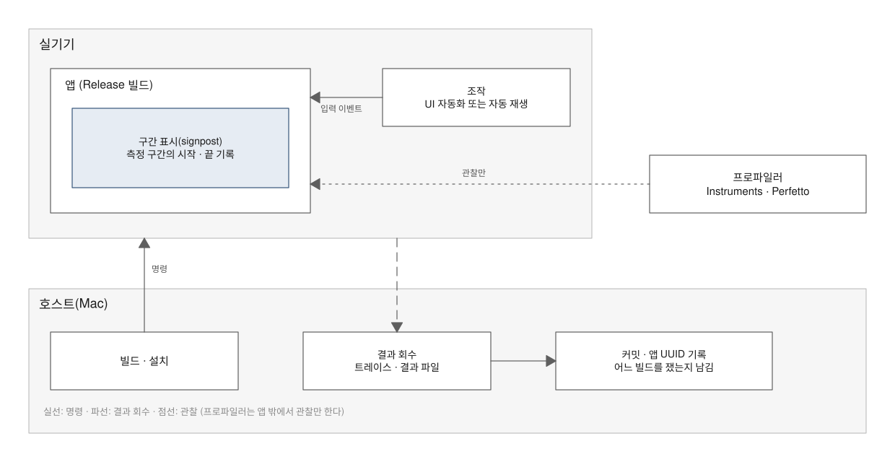
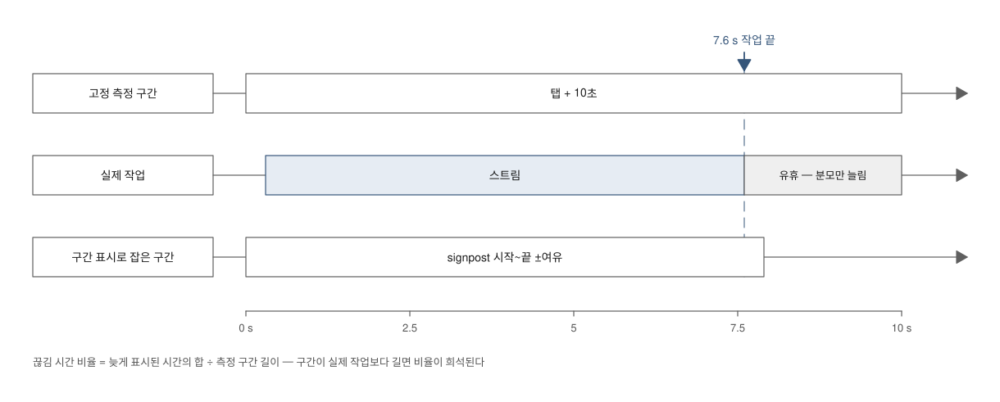
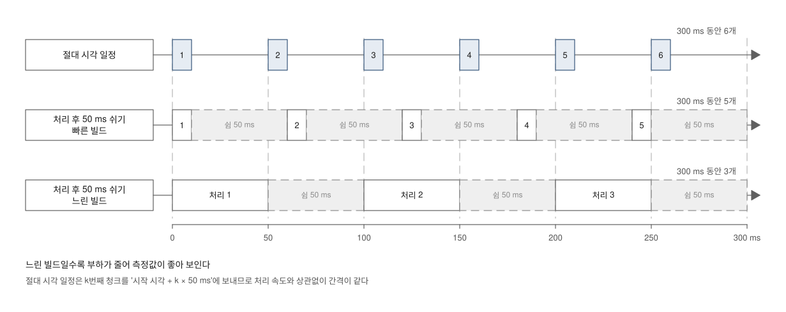
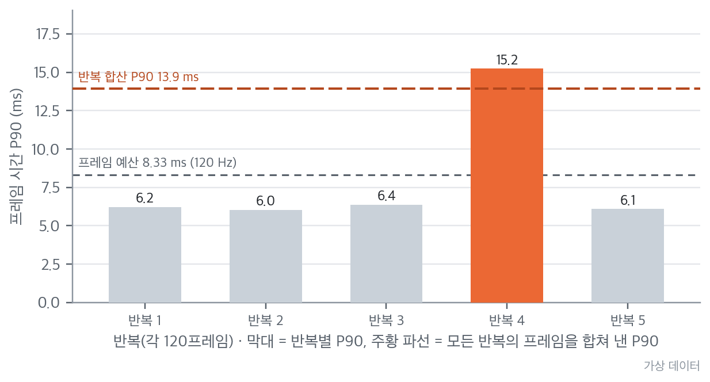
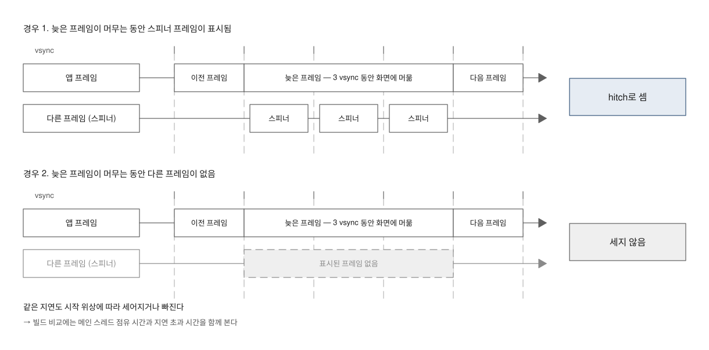

# 성능 검증 — 어떤 값을 재고, 어떤 기준과 비교하고, 어디까지 믿는가

> **요약.** 이 문서는 "실제 긴 입력·스트리밍·스크롤에서 지연·끊김·메모리가 기준 안인가"라는 질문, 곧 검증의 네 질문 가운데 Q2 성능에 답하려고 측정을 어떻게 설계하는지 설명합니다. 절대 성능은 실기기 Release 빌드에서 반복해 잰 값의 중앙값과 범위로만 말하고, 지표마다 사용자가 겪는 현상과 판정 기준의 출처를 짝지어 둡니다. 측정 도구와 측정 방식 자체도 틀릴 수 있으므로 핵심 구간은 원리가 다른 도구로 교차 확인하고, 실제로 빠졌던 측정 함정 일곱 가지를 증상·원인·대응·판정 영향과 함께 정리합니다. 개선 전후 비교는 같은 날 번갈아 재며 저사양 기기를 포함합니다. 고정 프레임 예산이 근사라는 점, 시작 위상을 보정하지 않은 비교를 인과로 단정할 수 없다는 점, 계측기의 hitch 집계 규칙은 트레이스 관찰로 추론한 것이라는 점, 교차 확인하지 않은 지표는 나중에 보정될 수 있다는 점은 한계로 적습니다.

처음 보는 용어는 [용어 풀이](glossary.md)에 모아 두었습니다.

에이전트용 압축판: `skills/verify/references/performance.md`

## 차례

- [1. 들어가며 — 시뮬레이터에서 빠르면 사용자 기기에서도 빠를까](#1-들어가며--시뮬레이터에서-빠르면-사용자-기기에서도-빠를까)
- [2. 측정 원칙](#2-측정-원칙)
- [3. 지표와 사용자 체감의 대응](#3-지표와-사용자-체감의-대응)
- [4. 판정 기준의 출처](#4-판정-기준의-출처)
- [5. 도구 교차 확인](#5-도구-교차-확인)
- [6. 측정 함정과 대응](#6-측정-함정과-대응)
  - [6.1 측정 구간과 부하](#61-측정-구간과-부하)
  - [6.2 측정 대상 밖 비용](#62-측정-대상-밖-비용)
  - [6.3 집계와 계측기](#63-집계와-계측기)
  - [6.4 공통 교훈](#64-공통-교훈)
- [7. 빌드 비교(재측정) 설계](#7-빌드-비교재측정-설계)
- [8. 측정 전 점검표](#8-측정-전-점검표)
- [9. 한계와 보완](#9-한계와-보완)
- [10. 적용 사례](#10-적용-사례)
- [참고문헌](#참고문헌)

## 1. 들어가며 — 시뮬레이터에서 빠르면 사용자 기기에서도 빠를까

개발 머신의 시뮬레이터에서 긴 입력을 스크롤해 보니 매끄러웠다고 해 봅시다. 사용자 기기에서도 그럴까요? 시뮬레이터는 개발 머신의 CPU에서 돌고, 개발 중에 쓰는 Debug 빌드는 컴파일러 최적화가 꺼져 있습니다. 그 값이 빠르든 느리든 사용자 기기의 체감과는 연결되지 않습니다.

실기기에서 쟀다고 끝나지도 않습니다. 한 번 잰 값으로는 측정 변동과 회귀를 구분하지 못하고, 측정 구간(지표를 계산하는 시간 범위)·부하·집계 방식을 잘못 잡으면 같은 앱이 더 좋게도, 더 나쁘게도 보입니다. 성능 검증에서는 무엇을 재느냐만큼 어떻게 재고 어디까지 믿느냐가 중요합니다.

이 문서는 "실제 긴 입력·스트리밍·스크롤에서 지연·끊김·메모리가 기준 안인가"라는 질문(Q2)에 답하는 측정 설계를 다룹니다. 2절은 측정 원칙, 3·4절은 지표와 판정 기준의 출처를 다룹니다. 5절은 측정 도구가 틀리는 경우를, 6절은 측정 방식이 틀려 실제로 빠졌던 함정 일곱 가지를 함정마다 풀어 씁니다. 7절은 개선 전후를 비교하는 재측정 설계, 8절은 측정 직전에 확인할 점검표입니다.

## 2. 측정 원칙

이 절은 어떤 값을 인용할 수 있는지, 몇 번 재야 하는지, 측정을 어떻게 구성하고 기록하는지, 그 기록을 어디까지 믿는지를 차례로 다룹니다. 끝으로 이 원칙을 계획 단계의 의사코드로 고정하는 법을 보입니다.

### 2.1 인용할 수 있는 값

**절대 성능은 실기기 Release 값만 인용합니다.** 실기기는 시뮬레이터·에뮬레이터가 아닌 실제 기기이고, Release 빌드는 컴파일러 최적화를 켠 배포용 빌드입니다. 1절에서 본 것처럼 시뮬레이터·에뮬레이터 값과 Debug 빌드 값은 사용자 기기의 체감과 연결되지 않습니다.

시뮬레이터 Debug 값은 같은 조건끼리의 상대 비교("이전보다 느려졌나")와 회귀 방지 기준에만 씁니다. 회귀 방지 기준은 프로젝트가 정한 값으로, 나빠지면 CI 게이트(커밋·PR마다 자동으로 돌고 실패하면 병합을 막는 검사)를 실패시키는 장치입니다. 퍼징 실행 시간처럼 호스트(개발 머신)에서 잰 값도 제품 속도가 아니라 "그 규모를 감당할 수 있는가"만 말해 줍니다.

**출시 연도·칩 세대가 다른 두 기기의 값을 플랫폼 우열로 읽지 않습니다.** 플랫폼을 평가하는 근거는 두 기기의 절댓값 비교가 아니라, 각 플랫폼 안에서 처리 시간이 입력 크기에 비례하는지와 메인 스레드 밖에서 처리되는 구조인지입니다.

### 2.2 반복 측정

**한 번 잰 값으로 결론을 내지 않습니다.** 반복 횟수와 중앙값·범위(가운데 값과 최솟값~최댓값)를 함께 적고, 1회 값끼리의 비교는 결론으로 쓰지 않습니다.

오전에 한 번 잰 값과 오후에 한 번 잰 값이 다르면 회귀일 수도 있고 측정 변동일 수도 있습니다. 1회 값만으로는 둘을 가를 근거가 없습니다. 반복 횟수의 기본값과 근거는 [해석 원칙](01-principles.md)[1]에 있습니다.

### 2.3 측정 구성: 조작·관찰·기록

그림 1은 이 소절의 원칙을 한데 모은 측정 구성입니다. 실기기에 설치한 Release 앱은 구간 표시를 남기고, 앱 조작은 UI 자동화나 자동 재생이 맡으며, 프로파일러는 밖에서 관찰만 합니다. 빌드·설치·결과 회수와 커밋 기록은 측정을 지휘하는 호스트가 맡습니다.



*그림 1. 실기기 성능 측정 구성*

**측정만을 위한 코드를 넣지 않습니다.** 대신 제품에 원래 있는 가벼운 구간 표시(signpost: 앱 코드가 "여기서 시작, 여기서 끝"을 기록하는 표시)를 측정 구간과 교차 확인에 씁니다. iOS의 os_signpost, Android의 `Trace` 섹션이 이런 표시입니다.

측정용 코드를 추가하면 측정 대상이 제품과 달라지고, 그 코드가 남으면 제품의 비용이 됩니다.

**앱 조작은 UI 자동화가 맡고, 프로파일러는 밖에서 관찰합니다.** 다만 UI 자동화가 켜는 접근성 모드 자체가 메인 스레드에 비용을 더하므로, **자동화 없이 자동 재생하는 시나리오**를 따로 둡니다. 보조 기술(VoiceOver 같은 화면 낭독기)을 쓰지 않는 사용자에게는 없는 비용을 라이브러리 비용으로 세지 않기 위해서입니다. 이 비용이 실제로 얼마나 컸는지는 [함정 3](#함정-3-ui-자동화의-접근성-모드)에서 다룹니다.

**측정 조건을 자동으로 남깁니다.** 기기·OS·빌드 구성·기기 상태(충전·열·저전력)·커밋 SHA·앱/dSYM UUID를 결과와 함께 기록합니다. dSYM은 앱의 디버그 심볼 파일이고, UUID는 빌드마다 달라지는 식별자입니다. "어느 빌드로 쟀는지"를 결과만 보고 알 수 있어야 나중에 재측정 결과와 비교할 수 있습니다.

### 2.4 기록을 그대로 믿지 않기

**도구가 기록한 상태 플래그를 사실로 읽지 않습니다.** 벤치마크 라이브러리가 `cpuLocked=true`를 남겼어도, 클럭을 실제로 고정한 실행 기록이 없으면 그 값은 라이브러리가 스스로 판정한 값일 뿐입니다. 별도 기록이 없으면 그렇게 적습니다.

**열 상태가 높을 때 잰 값은 참고값으로 분리합니다.** 기기가 뜨거우면 클럭이 내려가 값이 나빠집니다. 이런 값은 버리지 않고 "참고값"으로 표시해 둡니다.

플래그나 열 상태가 아니라 측정 방식 자체가 기록을 비트는 경우도 있습니다. 그런 경우는 [6절](#6-측정-함정과-대응)에서 함정별로 다룹니다.

### 2.5 측정 설계의 의사코드

계획 단계에서는 측정 설계를 의사코드로 고정합니다. 어느 시나리오를 어느 도구로 재고 무엇을 저장하는지가 구현 전에 드러나고, 나중에 실제로 교차 확인한 지표와 하지 않은 지표를 이 뼈대와 대조할 수 있습니다.

다음 의사코드는 iOS와 Android에서 시나리오별로 쓸 도구와 남길 기록을 보여 줍니다. 각 도구의 쓰임은 도구 문서[2]–[6]에 있습니다.

```
iOS:
    measure(metrics: [Clock, Memory, CPU], iterations: 10)
        for parse(1·10·50·256 KiB), 도메인 연산, view render(fixture)
    baseline 저장 ; gate: p50 회귀 > 10% → 실패              # 시뮬레이터 Debug, 상대값
    xctrace record (Time Profiler + Animation Hitches + Allocations)
        for scenario in [scroll, streaming 20 Hz, cold launch, 갱신] on 실기기 Release
    size: archive + App Thinning Size Report, 선택 모듈 on/off 조합

Android:
    Microbenchmark(parse sizes, 도메인 연산) → JSON(median·p99·allocs)
    Macrobenchmark(StartupTiming cold/warm, FrameTiming scroll·streaming) → JSON
    perfetto record → jank·CPU 분석
    size: apkanalyzer(AAR, 데모 APK 선택 모듈 on/off)

교차 확인: XCTest Clock ↔ xctrace, Microbenchmark ↔ Perfetto     # 같은 시나리오 두 도구 값을 한 표에
결과마다: 기기·OS·빌드 구성·기기 상태·커밋 SHA·앱/dSYM UUID 자동 기록
```

## 3. 지표와 사용자 체감의 대응

지표 하나는 사용자가 겪는 현상 하나에 대응하게 고릅니다. 현상과 연결되지 않는 지표는 "좋아졌다"고 말해도 사용자에게 무엇이 좋아졌는지 설명할 수 없습니다. 표 1은 보고서에 그대로 두는 대응표입니다.

*표 1. 지표와 사용자가 겪는 현상의 대응*

| 지표 | 사용자가 겪는 현상 | 측정 방법 | 판정 기준(출처) |
|---|---|---|---|
| 처리 지연(입력 크기별) | 긴 입력을 표시할 준비까지 걸리는 시간 | 함수 단위 벤치마크, 입력 크기 4단 이상 | 회귀 방지 기준(시뮬레이터 Debug) + 실기기 값 기록 |
| 화면 끊김(iOS, 끊김 시간 비율 ms/s) | 스크롤·갱신 중 화면이 툭툭 끊겨 보이는 현상 | 프로파일러의 hitch 계측 | 외부 기준: 플랫폼 제작사가 안내한 구간 |
| 프레임 시간 백분위(Android) | 같은 현상 | 프레임 타이밍 도구 | 외부 기준: 주사율에서 계산한 프레임 예산(근사) + 프로젝트가 고른 백분위 |
| 메모리 | 오래 쓸수록 무거워지거나 앱이 종료되는 현상 | 프로세스 메모리 사용량(footprint) 시계열 | 추세: 작업이 끝난 뒤 계속 늘지 않는지 |
| 앱 실행 시간 | 앱을 열고 첫 화면이 보이기까지 걸리는 시간 | 실행 시간 측정 도구, 콜드·웜 구분 | 기준 없음(기록만) |
| 앱 크기 | 다운로드·설치 용량 | App Thinning 크기 보고서·패키지 크기, 선택 모듈 조합별 | 기준 없음(구성 기록) |

화면 끊김(hitch)은 프레임이 제때 화면에 나가지 못해 툭 끊겨 보이는 현상입니다. 끊김 시간 비율(hitch time ratio)은 화면이 제때 그려지지 못한 시간을 1초당 ms로 나타낸 값입니다.

백분위 P90은 값을 크기순으로 놓았을 때 90%가 이 값 이하라는 뜻입니다. 프레임 시간 P90이라면 전체 프레임의 90%가 그 시간 안에 끝났다는 뜻입니다.

같은 "끊김"이라도 플랫폼마다 도구와 정의가 다르므로, 두 플랫폼의 값을 한 축에 놓고 비교하지 않습니다. 한 플랫폼 안에서도 스크롤을 잰 도구와 스트리밍을 잰 도구가 다르면 "스트리밍이 스크롤보다 두 배 느리다"처럼 읽지 않고, 각 값을 자기 기준과만 비교합니다.

## 4. 판정 기준의 출처

판정 기준은 가능한 한 외부 기준(플랫폼 제작사·공식 문서가 정한 판정 기준)을 씁니다. 기준을 직접 정하면 결과에 맞춰 유리하게 정했다는 의심을 받을 수 있기 때문입니다.

- **외부 기준을 먼저 찾고 어느 문서의 어느 기준인지 적습니다.** 같은 지표에 기준이 둘이면(예: 기술 발표의 엄격한 기준과 모니터링 대시보드의 느슨한 기준) 사용한 쪽과 다른 쪽의 값을 함께 적습니다. 숫자를 인용할 때 어느 기준인지 함께 말해야 독자가 다른 문서와 비교할 수 있습니다. iOS 끊김 시간 비율의 두 기준과 그 출처는 Instruments 도구 문서[2]에 정리돼 있습니다.
- **프레임 예산은 1,000 ÷ 주사율입니다.** 프레임 예산은 한 프레임에 쓸 수 있는 시간으로, 120 Hz면 8.33 ms입니다. 측정 기기가 적응형 주사율이면 고정 예산은 근사라고 적습니다.
- **백분위 선택은 프로젝트의 선택입니다.** P90으로 판정하면 나머지 10%의 긴 프레임은 판정에 들어가지 않습니다. 그래서 판정에 쓴 백분위 밖의 꼬리(P95·P99)도 그래프에 함께 싣습니다.
- **공식 문서가 끊김과 직접 연결하는 지표가 따로 있으면 그 값도 싣습니다.** 예를 들어 마감 초과 시간(frame overrun)이 그런 지표라면, 판정에 쓴 CPU 프레임 시간은 근사임을 밝힙니다. Android Macrobenchmark에서는 `frameOverrunMs`가 이 값입니다[5].
- **프로젝트가 정한 CI 게이트 값은 "회귀 방지 기준"으로 부릅니다.** 시뮬레이터 Debug 파싱 상한 같은 값은 사용자 체감 기준이 아니라, 같은 환경에서 크게 느려지는 회귀를 CI가 잡는 장치입니다.
- **메모리는 절대 상한 대신 추세를 봅니다.** 작업이 끝난 뒤에도 계속 늘면 누수 징후이고, 늘었다가 유지되면 캐시일 가능성이 큽니다. 누수 계측을 따로 하지 않았으면 "반복 시 누적 여부 미확인"으로 적습니다.
- **기준을 두지 않은 지표(앱 실행 시간·앱 크기)는 값과 구성만 기록하고 판정표에서 뺍니다.**

## 5. 도구 교차 확인

측정 도구 자체가 틀릴 가능성도 확인합니다. 방법은 핵심 구간 하나를 원리가 다른 도구 2~3개로 재는 것입니다.

표본 추출(Time Profiler), 구간 기록(signpost), 반복 시계 측정(XCTest Clock·Microbenchmark)은 오차가 생기는 방식이 서로 다릅니다[2], [3], [4]. 그래서 세 값이 1% 안에서 맞으면, 어느 한 도구의 버릇이 만든 숫자가 아니라고 볼 수 있습니다.

반대로 값이 상식과 어긋나면 그 자체가 신호입니다. 요약 도구가 낸 inclusive 시간(하위 호출까지 포함한 시간)이 측정 구간 길이에 가깝게 나오면, 그 값은 시간이 아니라 추정치일 가능성이 큽니다. 이 경우는 [함정 7](#함정-7-요약-도구의-inclusive-시간)에서 자세히 봅니다.

계획에 "시나리오 × 도구 2종"을 넣었다면, 실제로 교차 확인한 지표와 하지 않은 지표를 보고서에서 구분합니다. 나중에 보정이 나오는 곳은 교차 확인을 건너뛴 지표입니다. 한 도구의 값을 그대로 쓴 지표는 그 도구의 측정 구간 길이·집계 방식·집계 규칙의 영향을 그대로 안고 있습니다.

## 6. 측정 함정과 대응

교차 확인을 건너뛴 지표가 실제로 어떻게 보정되는지는 한 검증 보고서의 후속 점검에서 드러났습니다. 보고서를 낸 다음 날, 스트리밍 경로를 개선하려고 화면 끊김의 원인을 다시 들여다봤을 때입니다.

트레이스(프로파일러가 실행 중 일어난 일을 시간순으로 기록한 파일)를 다시 내보내 지표를 재계산하고, 반복별 트레이스를 하나씩 열었습니다. 분석과 별도로 돌린 검토용 에이전트도 같은 트레이스로 수치를 다시 계산해 확인했습니다.

그 결과 스트리밍 측정 방법의 가정 몇 가지가 틀렸다는 사실이 드러났습니다. 보정이 필요했던 지표는 모두 교차 확인을 하지 않은 것이었고, 함수 단위 벤치마크처럼 원리가 다른 도구로 교차 확인한 지표는 보정 대상이 아니었습니다.

함정마다 "보고서에 쓴 해석 → 다시 확인한 사실 → 바뀐 해석과 영향" 순서로 기록했고, 판정이 어느 쪽으로 움직였는지 숨기지 않았습니다. 보정의 방향이 항목마다 다르므로 "방법을 고쳤으니 전부 다시 믿어야 한다"도, "전부 못 믿는다"도 맞지 않습니다.

표 2는 일곱 함정이 값과 판정을 어느 쪽으로 움직였는지 모은 것입니다. 6.1~6.3절은 함정이 생긴 단계별로 묶어 증상, 원인, 알아챈 방법, 대응, 판정에 미친 영향을 차례로 설명하고, 6.4절은 공통 교훈을 정리합니다.

*표 2. 함정별로 값이 움직인 방향과 판정에 미친 영향*

| 함정 | 값이 움직인 방향 | 판정에 미친 영향 |
|---|---|---|
| 1. 고정 측정 구간 | 끊김을 작게 보이게 함(라이브러리에 유리) | 판정 유지, 미달 폭 확대 |
| 2. 상대 sleep 일정 | 느린 빌드의 끊김을 작게 보이게 함 | 빌드 비교의 개선 효과 축소 |
| 3. UI 자동화의 접근성 모드 | 라이브러리 비용을 크게 보이게 함(불리) | 함정 1과 반대 방향이라 순 효과를 재측정으로 확인 |
| 4. 데모 화면 비용 혼입 | 라이브러리 비용을 크게 보이게 함(불리) | 개선 적용 후 재측정 결과로 판정 변경 |
| 5. 반복 합산 백분위 | 이상 반복 하나가 P90을 끌어올림 | 원인 설명 철회, 판정 보류 |
| 6. hitch 수의 회차 변동 | 시작 위상에 따라 크게 갈림 | 통과·미달 판정 모두 잠정 |
| 7. 요약 도구의 inclusive 시간 | 실제 시간 대신 추정치를 냄 | 본문 미인용이라 영향 없음 |

### 6.1 측정 구간과 부하

처음 두 함정은 측정의 틀에서 생겼습니다. 비율의 분모가 되는 측정 구간과 앱에 주는 부하가 측정 대상이 아니라 시계와 처리 속도에 따라 정해진 경우입니다.

#### 함정 1. 고정 측정 구간

스트리밍 화면의 끊김 시간 비율을 "탭 + 10초"로 고정한 측정 구간에서 계산했습니다. 그런데 빠른 기기에서는 스트림이 이 구간보다 먼저 끝났습니다.

측정 구간이 작업보다 길면 작업이 끝난 뒤의 유휴 시간이 분모에 들어가 비율이 희석됩니다. 반대로 느린 기기에서는 작업이 구간보다 길어 뒷부분이 잘립니다. 고정 구간은 기기에 따라 서로 반대 방향으로 틀리는 셈입니다.

근본 원인은 분모를 누가 정하느냐에 있습니다. 비율 지표(초당 ms)는 분모에 따라 값이 바뀌는데, 고정 구간은 분모를 측정 대상이 아니라 시계가 정하게 합니다. 그림 2는 같은 작업을 두 방식으로 쟀을 때 분모가 어떻게 달라지는지 보여 줍니다.



*그림 2. 고정 측정 구간과 구간 표시 기반 측정 구간의 분모 차이*

이 문제는 트레이스에서 앱이 기록한 스트리밍 구간의 시작과 끝을 읽으면서 드러났습니다. 실제 스트리밍 구간이 고정 구간보다 2초 넘게 짧았고, 실제 구간으로 다시 계산한 값은 보고서 값보다 모두 비슷한 비율로 컸습니다.

그래서 앱이 기록하는 구간 표시의 시작~끝을 측정 구간으로 씁니다[7]. 양 끝에 여유가 필요하면 상수로 두고 그 값을 명시합니다. 구간을 시계가 아니라 작업이 정하게 하는 것입니다.

이 함정은 끊김을 실제보다 작게 보여 줬으므로 라이브러리에 유리한 쪽으로 틀렸습니다. 이미 기준 미달로 판정한 항목이었기 때문에 판정은 바뀌지 않고 미달 폭만 커졌습니다. 희석 비율은 [적용 사례](#10-적용-사례)에 있습니다.

#### 함정 2. 상대 sleep 일정

데모 앱의 재생 루프는 청크(스트림으로 보내는 조각) 간격을 "청크를 처리한 뒤 N ms 쉬기"로 정해 두었습니다. 겉보기에는 일정한 간격 같지만, 실제 간격은 처리 시간만큼 늘어납니다.

처리 시간이 쉬는 시간 앞에 더해지므로 처리가 느린 빌드일수록 실제 간격이 길어집니다. 그러면 목표 전송 속도(예: 20 Hz)보다 낮은 속도로 보내게 되고, 느린 빌드일수록 부하가 줄어드는 셈입니다. 빌드를 비교하면 느린 빌드가 오히려 유리해지는 구조입니다.

그림 3은 같은 청크를 두 일정으로 보냈을 때 간격이 어떻게 달라지는지 보여 줍니다. 300 ms 동안 절대 시각 일정은 청크 6개를 보내지만, "처리 후 50 ms 쉬기" 일정은 빠른 빌드에서 5개, 느린 빌드에서 3개만 보냅니다. 상대 일정은 처리가 느릴수록 간격이 늘고, 절대 시각 일정은 빌드 속도와 상관없이 같은 간격을 지킵니다.



*그림 3. 상대 sleep 일정과 절대 시각 일정의 청크 간격 비교*

이 차이는 청크 도착 시각을 트레이스에서 읽어 실제 간격을 계산하면서 드러났습니다. 실제 간격은 목표 간격보다 길었고, 빌드마다 달랐습니다.

그래서 청크 일정을 절대 시각 기준으로 바꿉니다. n번째 청크를 "시작 시각 + n × 간격"에 보내면 빌드 속도와 상관없이 같은 부하를 줍니다.

이 함정은 느린 빌드의 부하를 줄였으므로 느린 빌드의 끊김을 실제보다 작게 보여 주는 쪽으로 틀렸습니다. 빌드 비교에서는 개선 효과를 작게 보이게 합니다.

### 6.2 측정 대상 밖 비용

측정의 틀이 맞아도 측정 대상이 아닌 코드의 비용이 측정값에 섞일 수 있습니다. 다음 두 함정이 그런 경우로, 하나는 측정 도구가 켠 기능이고 다른 하나는 라이브러리를 보여 주려고 만든 데모 화면입니다.

#### 함정 3. UI 자동화의 접근성 모드

보고서는 "UI 자동화가 화면을 조회하는 접근성 호출이 메인 스레드에서 수백 ms를 차지한다"라고 적었습니다. 이 문장에는 두 가지 문제가 겹쳐 있었습니다.

첫째, 그 수백 ms는 함수 이름에 특정 문자열이 들어간 스택 프레임(화면 프레임이 아니라 호출 스택의 함수 한 칸)을 넓게 센 과대 집계였습니다. UI 자동화가 화면을 직접 조회하는 비용은 수십 ms였고, 그마저 스트림이 시작되기 전에만 일어났습니다.

둘째, 진짜 비용은 다른 곳에 있었습니다. UI 테스트가 앱을 구동하면 접근성 모드가 켜지고, 선언형 UI 프레임워크는 스트림이 도는 동안 메인 스레드 시간의 두 자릿수 %를 접근성 트리 유지에 씁니다. 보조 기술을 쓰지 않는 사용자에게는 없는 비용입니다.

이 사실은 이름 문자열로 모은 합계를 의심해 스택 프레임을 하나씩 분류하면서 드러났습니다. 직접 조회는 작았고, 대신 접근성 트리를 갱신하는 스택 프레임이 스트림 내내 깔려 있었습니다.

대응으로 2.3절에서 말한 자동 재생 시나리오(접근성 꺼짐)를 추가하고, 두 시나리오의 값을 함께 냅니다. "접근성 호출 비용"을 이름 문자열로 과대 집계하지도 않습니다. 다만 접근성 모드의 트리 유지 비용이 실제 보조 기술을 쓸 때와 같은 부하인지는 따로 확인하지 않았으므로 그 점을 보고서에 적습니다.

일반 사용자 기준으로 보면 이 함정은 라이브러리 비용을 실제보다 무겁게 잰 요인이라 라이브러리에 불리한 쪽이었습니다. 그런데 함정 1의 희석은 반대 방향으로 작용했고, hitch는 메인 스레드 시간에 비례하지도 않습니다. 그래서 두 효과의 순 방향을 메인 스레드 시간만으로 계산하지 않고 재측정으로 확인했습니다.

#### 함정 4. 데모 화면 비용 혼입

보고서는 스트리밍 hitch를 라이브러리 스트리밍 경로의 개선 과제로 보고, 메인 스레드 상위 비용으로 라이브러리의 게시(publish) 단계를 들었습니다. 그러나 상위 비용의 상당 부분은 라이브러리가 아니라 데모 화면의 몫이었습니다.

데모 화면에서 청크마다 바뀌는 상태 카운터가 화면 전체(툴바·세그먼트 컨트롤)를 다시 그리게 했고, 게시할 때마다 실행되는 하단 스크롤이 그래프 갱신을 동기적으로 한 번 더 일으켰습니다. 둘을 합치면 hitch 구간 메인 스레드 시간의 상당 부분이 데모 화면 몫이었습니다.

짧은 테스트 입력에서는 라이브러리 블록 뷰의 body 계산이 표본의 거의 0%였습니다. 다만 글자 배치·측정 비용은 본문 글자와 데모 화면 글자를 나눠 세지 않았으므로, 라이브러리 몫이 0이라고 말할 수는 없습니다.

이 구분은 표본을 호출 스택으로 분류해 라이브러리 심볼과 데모 심볼을 나누면서 드러났습니다. 상위 비용은 데모 쪽에 있었습니다.

대응으로 데모 화면의 상태 표시를 본문과 분리하고 하단 스크롤 방식을 바꿉니다. 그리고 데모 변경만 따로 되돌린 빌드로 재측정해 데모 몫과 라이브러리 몫을 가립니다. 짧은 입력만으로 "라이브러리 비용이 작다"라고 일반화할 수 없으므로 긴 테스트 입력도 추가합니다.

이 함정은 데모 화면 몫의 hitch까지 라이브러리 탓으로 돌렸으므로 라이브러리에 불리한 쪽이었습니다. 라이브러리·데모 개선을 함께 적용하고 다시 잰 결과로 판정을 바꿨습니다.

### 6.3 집계와 계측기

마지막 세 함정은 측정을 제대로 했어도 숫자를 모으고 읽는 단계에서 생겼습니다. 도구가 반복을 합치는 방식, 계측기가 hitch를 세는 규칙, 요약 도구가 시간을 만드는 방식이 각각 값을 비틀었습니다.

#### 함정 5. 반복 합산 백분위

스트리밍 프레임 시간의 P90이 프레임 예산을 넘었고, 보고서는 그 원인을 갱신마다 일어나는 재파싱·재배치로 설명했습니다.

그런데 매크로 벤치마크 도구는 반복 N회의 프레임을 모두 합쳐 백분위를 냅니다. 반복 하나의 프레임은 전체의 1/N이므로, 그 반복의 프레임이 거의 다 느리면 합산 상위 10%가 모두 그 반복에서 나옵니다. 그 결과 합산 P90은 이상 반복의 중앙값과 거의 같아지고, 나머지 반복의 P90과는 멀어집니다.

그림 4는 이 구조를 가상 예시로 보여 줍니다. 다섯 번 중 반복 4만 느린데도 반복을 합쳐 낸 P90(13.9 ms)이 프레임 예산 8.33 ms를 넘고, 나머지 네 반복의 P90(6.0~6.4 ms)과는 멀리 떨어집니다.



*그림 4. 반복별 P90과 합산 P90의 비교(가상 예시)*

이상 반복의 원인은 그래픽 버퍼가 밀려 빈 버퍼를 받아 오는 호출이 막히는 현상(BufferQueue stuffing)이었습니다[5]. 이 현상은 재측정에서도 무작위로 나타났습니다. 또 이 지표에 들어간 프레임 대부분은 데모의 스피너만 도는 가벼운 프레임이라 백분위를 낮추는 쪽으로 작용합니다.

이 사실은 반복별 트레이스를 하나씩 열어 반복마다 P90을 구하면서 드러났습니다. 하나만 크게 높았고, 합산 P90이 그 값과 거의 같았습니다.

대응으로 반복별 트레이스를 열어 분포를 확인하고, 보고서에 "합산 P90"임을 밝힙니다. 콘텐츠 갱신 프레임과 스피너 프레임을 나눠 보고, 4절에서 말한 마감 초과 시간(`frameOverrunMs`)도 함께 싣습니다[8].

원인 설명은 이 지표로 뒷받침되지 않아 철회했고, 판정은 어느 쪽으로도 단정하지 않고 보류했습니다.

이상 반복이 무작위로 나타나므로 "통과"로 바꿀 근거가 없습니다. 나머지 반복이 예산 안이라는 것도 스피너 프레임의 희석과 마감 초과 프레임의 존재 때문에 확정할 수 없습니다. 번갈아 돌린 교차 측정도 없었습니다.

#### 함정 6. hitch 수의 회차 변동

같은 빌드, 같은 작업량(표시 프레임 수와 메인 스레드 사용량이 비슷함)인데도 hitch 수가 회차마다 한 자릿수에서 80건대까지 갈렸습니다. 첫 판 보고서의 3회 측정에서도 메인 스레드 사용량은 비슷한데 hitch 수와 비율이 두세 배씩 갈렸습니다.

두 규칙이 겹친 것이 원인이라고 판단했습니다. 둘 다 트레이스 관찰에서 추론한 것이고, 제작사 문서[9]가 계측기의 집계 규칙을 이 수준까지 설명하지 않으므로 신뢰도는 "가능성 높음(likely)"입니다.

첫째 규칙은 시작 위상의 고정입니다. 화면 갱신 신호(vsync)는 디스플레이가 다음 프레임을 받을 준비가 됐다고 알리는 주기 신호이고, 시작 위상은 작업 시작 시각이 이 주기의 어느 지점에 걸리는지를 말합니다. 청크 일정이 vsync 간격의 정수배이면 스트림의 시작 위상이 한 회차 내내 고정됩니다.

이때 무거운 업데이트가 vsync 직후의 위험한 구간에서 시작하면 다음 렌더 패스를 놓쳐 프레임이 늦게 표시됩니다. 시작 위상은 실행마다 우연히 정해지므로, 위험한 구간에 걸린 회차와 비껴간 회차로 결과가 갈립니다.

둘째 규칙은 목격자 규칙입니다. 계측기는 늦은 앱 프레임이라고 해서 모두 hitch로 세지는 않았습니다. 계측기가 hitch로 센 늦은 프레임은 모두, 그 프레임이 화면에 남아 있는 동안 다른 프레임(앱 업데이트 없이 그려진 스피너 프레임)이 표시된 경우였습니다. 그런 프레임이 없었던 늦은 앱 프레임은 하나도 hitch로 세지 않았습니다.

그림 5의 두 경우 모두 늦은 앱 프레임이 vsync 세 칸 동안 화면에 머물지만, 계측기는 그 사이 스피너 프레임이 표시된 첫 번째 경우만 hitch로 셉니다. 같은 지연이라도 시작 위상에 따라 이런 목격자 프레임이 생기기도 하고 생기지 않기도 하므로, 계측기가 hitch로 세기도 하고 빼기도 합니다.



*그림 5. 시작 위상과 목격자 규칙에 따라 갈리는 hitch 집계*

두 규칙은 회차별 hitch 수와 청크 일정의 시작 위상을 나란히 놓으면서 드러났습니다. hitch 수는 시작 위상에 따라 갈렸습니다. 늦은 프레임마다 화면에 머무는 동안 다른 프레임이 표시됐는지 대조하자, 결과가 목격자 조건과 일치했습니다. 같은 회차들의 메인 스레드 점유 시간(busy ms/s)은 서로 몇 % 안에 있어서, hitch 수의 차이를 작업량 차이로는 설명할 수 없었습니다.

그래서 끊김 시간 비율(hitch ms/s) 하나로 빌드를 비교하지 않습니다. 외부 기준과 비교하려고 끊김 시간 비율은 계속 내되, 원리가 다른 두 지표를 함께 봅니다.

하나는 메인 스레드 점유 시간입니다. 스트림 구간에서 메인 스레드가 1초 동안 일한 시간으로, 시작 위상과 무관하게 회차 간 변동이 작습니다.

다른 하나는 지연 초과 시간(late excess ms/s)입니다. 앱 프레임 가운데 `round(화면 수명 ÷ 기준 vsync 간격) > 2`인 것만 골라, 각 수명에서 vsync 두 칸을 뺀 값을 모두 더하고 구간 길이로 나눕니다. 다른 프레임이 표시됐는지와 상관없이 세므로 목격자 규칙의 영향을 받지 않습니다.

지연 초과 시간을 계산할 때 기준 주사율로는 구간 표시에 남긴 최대 주사율을 먼저 쓰고, 없으면 프레임 간격에서 추정합니다. 그래서 기준 주사율이 그 순간의 실제 주사율과 다를 수 있습니다.

하네스(측정 대상을 같은 조건으로 실행·조작하는 측정용 코드와 스크립트 묶음)는 스트림 시작을 vsync에 맞추고, 시드(난수 생성의 시작값)로 정한 무작위 오프셋을 더합니다. 다만 같은 시드가 스레드 깨어남 지연까지 같게 만들지는 않으므로, 실측한 시작 위상을 따로 기록합니다.

결국 hitch 수와 끊김 시간 비율은 작업량을 그대로 비추지 않고, 시작 위상과 화면의 다른 움직임을 거쳐 걸러진 값입니다. 시작 위상 고정은 청크 일정이 있는 스트리밍에서 확인한 것이고, 스크롤·화면 진입·앱 실행에도 같은 크기의 변동이 있는지는 확인하지 않았습니다. 그러므로 고친 하네스로 다시 재기 전까지는 미달뿐 아니라 통과 판정도 3회 측정에 기댄 잠정 판정으로 읽는 편이 정확합니다.

#### 함정 7. 요약 도구의 inclusive 시간

트레이스 요약 도구의 JSON에서 한 함수의 inclusive 시간이 측정 구간 길이에 가까운 값으로 나왔습니다.

그 값은 표본 비율에 구간 길이를 곱해 만든 추정치이지 실제 시간이 아니었습니다[10], [11]. 런루프(이벤트를 기다리며 계속 도는 메인 스레드의 반복 루프)처럼 구간 내내 호출 스택에 있는 함수는 비율이 1에 가까우므로 구간 길이와 거의 같은 값이 나옵니다.

알아챈 계기는 5절에서 말한 대로 값이 상식과 어긋났다는 점입니다.

대응으로 요약 도구의 JSON에서는 비율만 상대 비중으로 읽고, 시간은 표본 추출 프로파일러(1 kHz 표본)의 값으로 읽습니다. 도구별 내용은 xcprof 도구 문서[12]에 있습니다.

보고서 본문은 이 값을 인용하지 않았으므로 수치에는 영향이 없었습니다. 측정 자체가 아니라 도구 출력을 읽는 쪽의 보정이라는 점에서 앞의 여섯 함정과 성격이 다릅니다.

### 6.4 공통 교훈

일곱 함정의 공통점은 측정 구간·부하·집계 방식이 측정 대상과 무관한 변수에 좌우됐다는 것입니다. 측정 구간은 실제 작업에, 부하는 절대 시각에, 집계는 반복 단위에 맞춰야 측정 대상만 남습니다.

이 교훈은 측정 전에 점검할 수 있는 문장으로 줄일 수 있고, 8절 점검표에도 반영돼 있습니다.

- **측정 구간은 작업이 정합니다.** 시계로 구간을 정하면 유휴 시간이 들어오거나 작업이 잘립니다(함정 1).
- **부하는 절대 시각으로 줍니다.** 처리 시간에 따라 부하가 바뀌면 느린 빌드가 유리해집니다(함정 2).
- **측정 환경이 켜는 것까지 셉니다.** UI 자동화가 켜는 접근성 모드나 진단 도구(UI API를 메인 스레드 밖에서 부르는 실수를 찾는 Xcode의 Main Thread Checker 등)는 끄거나, 켜지 않은 시나리오를 따로 둡니다(함정 3).
- **데모와 라이브러리를 심볼로 가릅니다.** 측정 대상 밖의 코드가 메인 스레드를 쓰면 라이브러리 비용이 가려지거나 부풀려집니다(함정 4).
- **집계는 반복 단위로 확인합니다.** 합산 백분위는 이상 반복 하나에 끌려갑니다(함정 5).
- **계측기의 집계 규칙을 의심합니다.** 작업량이 같은데 값이 크게 갈리면 지표가 작업량이 아닌 무언가를 세고 있다는 뜻입니다. 원리가 다른 보조 지표를 함께 냅니다(함정 6).
- **값이 상식과 어긋나면 그 자체가 신호입니다.** 교차 확인을 건너뛴 지표에서 보정할 일이 생깁니다(함정 7).
- **보정 방향을 항목마다 적습니다.** 유리한 쪽으로 틀린 것과 불리한 쪽으로 틀린 것을 구분해야 독자가 어느 판정을 다시 봐야 하는지 압니다.

## 7. 빌드 비교(재측정) 설계

개선 전후를 비교하는 재측정은 한 번 재는 측정과 설계가 다릅니다. 두 빌드의 차이만 남기고 날짜·순서·시작 시점·기기 같은 다른 변수는 지워야 하기 때문입니다.

### 7.1 같은 날 번갈아 재기

두 빌드를 같은 날 같은 기기에서 6회씩, 회차마다 실행 순서를 바꿔 가며 잽니다. 이렇게 순서를 돌려 어느 빌드도 특정 순번에 몰리지 않게 짜는 배치를 라틴 방진이라고 합니다.

날짜가 다른 두 측정을 비교하면 기기 상태와 OS 변화가 빌드 효과와 섞입니다. 한 빌드를 연속으로 다 재고 나서 다른 빌드를 재면, 시간에 따른 기기 온도 변화가 빌드 차이로 둔갑합니다.

### 7.2 같은 회차에는 같은 시드

같은 회차의 두 빌드에는 같은 시드를 줘서 예정 시작 오프셋을 맞추고, 회차별 짝 차이(같은 회차에서 두 빌드 값의 차이)를 구합니다. 예정 시작 오프셋은 vsync 주기 안에서 작업을 시작할 지점입니다.

다만 [함정 6](#함정-6-hitch-수의-회차-변동)에서 본 것처럼 같은 시드여도 실제 시작 위상은 다를 수 있습니다. 그래서 실측한 시작 위상을 따로 기록하고 "보정하지 않았다"고 적습니다.

### 7.3 관측 판정과 개선 효과의 분리

기준과 비교하는 판정은 관측한 중앙값으로 합니다. "개선 효과"는 같은 회차의 짝 차이로 보아 6회 중 몇 회에서 값이 줄었는지로 요약하되, 절반 이하면 효과가 확실하지 않다고 씁니다. 시작 위상을 보정하지 않았다면 인과로 단정하지 않습니다.

결과 표는 표 3처럼 판정 지표와 개선 지표를 열로 나눠 둡니다.

*표 3. 판정과 개선 효과를 나눠 적는 결과 표 양식*

| 기기 · 시나리오 | 판정 지표 전 → 후 | 짝 차이 중앙값 | 줄어든 회차 | 판정 |
|---|---:|---:|---:|---|
| 고성능 기기 · 시나리오 A | … → … | … | n/6 | 통과 / 미달 |
| 저사양 기기 · 시나리오 A | … → … | … | n/6 | 미달, 개선 / 미달, 악화 |

"판정"은 후 값을 외부 기준과 비교한 결과이고, "줄어든 회차"는 개선 효과의 근거입니다. 같은 표에 두되 열을 나눠야 "통과했으니 개선됐다"로 읽히지 않습니다. 저사양 기기는 통과하지 못해도 개선됐을 수 있고, 고성능 기기는 통과했어도 개선 효과가 불확실할 수 있습니다.

### 7.4 저사양 기기 포함

고성능 기기 한 대로는 놓치는 회귀가 있습니다. 고성능 기기에서 통과한 개선이 저사양 기기에서는 오히려 값을 나쁘게 만들 수 있기 때문입니다.

### 7.5 되돌린 빌드로 원인 좁히기

원인은 개선 단계를 하나씩 되돌린 빌드를 같은 방식으로 재서 좁힙니다. 되돌렸더니 더 나빠지면 그 변경은 원인이 아니고, 좋아지면 악화에 기여한 변경입니다. 표 4는 이 결과를 적는 형식입니다.

*표 4. 되돌린 빌드로 원인을 좁히는 결과 표 양식*

| 되돌린 변경 | 비교 기준 | 짝 차이 중앙값 | 읽은 결과 |
|---|---|---:|---|
| 변경 X를 이전 방식으로 | 최종 빌드 | 양수 | 더 나빠짐, 원인 아님 |
| 변경 Y를 복원 | 복원 전 후보 빌드 | 음수 | 좋아짐, 악화에 기여 |

되돌렸더니 좋아진 변경이 "메인 스레드 일을 줄인 변경"이라면, 일의 양이 아니라 일을 처리하는 속도가 바뀌었는지 봅니다. 표본 추출 프로파일러가 표본마다 어느 코어에서 찍혔는지 기록한다면, 메인 스레드가 고성능 코어에서 실행된 비율이 그 단서입니다.

다만 코어 배치 변화(고성능 코어 비율)처럼 공개된 규칙이 없는 설명은 관찰과 맞아도 "가능성 높음"으로 둡니다.

### 7.6 교훈

메인 스레드 점유 시간이 줄었다고 끊김도 줄었다고 판단하지 않습니다. 일이 줄자 시스템이 스레드를 효율 코어로 옮겨, 갱신 한 번의 처리 시간이 오히려 길어지는 경우가 실제로 있습니다.

끊김은 프레임 단위 지표로, 저사양 기기를 포함해 확인합니다. 다음 개선은 평균이 아니라 갱신 한 번의 최대 비용을 줄이는 쪽을 봅니다.

## 8. 측정 전 점검표

다음 점검표는 2~7절의 원칙을 측정 직전에 확인할 항목으로 줄인 것입니다. 보고서나 계획 문서에 그대로 붙여 쓸 수 있습니다.

```
측정 전 점검:
- [ ] 실기기 Release 빌드, 기기 상태(충전·열·저전력) 기록
- [ ] 측정 구간 = 앱 구간 표시 (고정 시간 구간 아님)
- [ ] 부하 일정 = 절대 시각 기준
- [ ] UI 자동화 켜짐/꺼짐 시나리오 둘 다
- [ ] 반복 횟수와 순서(번갈아) 결정
- [ ] 결과에 커밋 SHA·앱/dSYM UUID·시드·실측 시작 위상 자동 기록
- [ ] 판정 지표 외에 보조 지표(busy·late excess·P95/P99·마감 초과) 함께 저장
- [ ] 핵심 구간 하나는 원리가 다른 도구로 교차 확인
- [ ] 저사양 기기 포함 여부 결정, 없으면 "미확인"으로 적을 준비
```

## 9. 한계와 보완

측정을 잘 설계해도 남는 한계가 있습니다. 이 문서가 권하는 보완은 한계를 숨기지 않고 보고서에 적는 것입니다.

첫째, 판정 기준 자체가 근사인 경우가 있습니다. 적응형 주사율 기기의 고정 프레임 예산, 끊김과 직접 연결되지 않는 CPU 프레임 시간, 판정에 쓴 백분위 밖의 꼬리가 그렇습니다. 근사임을 밝히고 마감 초과 시간과 P95·P99를 함께 싣습니다.

둘째, 측정 변동과 인과를 완전히 떼어 놓지 못합니다. 같은 시드를 줘도 실제 시작 위상은 다를 수 있습니다. 그래서 개선 효과는 줄어든 회차 수로만 요약하고, 시작 위상을 보정하지 않은 비교는 인과로 단정하지 않습니다.

셋째, 공개된 규칙이 없는 설명은 확정할 수 없습니다. 코어 배치 변화를 근거로 한 설명과 함정 6의 두 규칙(시작 위상 고정, 목격자 규칙)은 트레이스 관찰과 맞아도 "가능성 높음"에 머뭅니다. 제작사가 집계 규칙을 공개하지 않는 한 확정할 수 없으므로, 그 규칙에 기대지 않는 보조 지표(메인 스레드 점유 시간, 지연 초과 시간)를 함께 내서 보완합니다.

넷째, 재지 않은 것은 판정할 수 없습니다. 누수 계측을 하지 않았으면 "반복 시 누적 여부 미확인", 저사양 기기가 없으면 "미확인"으로 적습니다. 교차 확인하지 않은 지표는 나중에 보정될 수 있다고 구분해 둡니다.

확인 범위가 좁은 항목도 같은 방식으로 적습니다. 함정 3·4·6에서 확인하지 못한 범위(실제 보조 기술을 쓸 때의 부하, 데모와 라이브러리의 글자 배치 비용 구분, 스트리밍 밖의 시작 위상 영향)는 보고서에 확인하지 않은 범위로 남깁니다.

다섯째, 6절의 일곱 함정은 한 보고서의 후속 점검에서 드러난 것입니다. 다른 기기·도구·시나리오에는 다른 함정이 있을 수 있습니다. 그러니 이 목록은 측정 전 점검의 최소 범위로 쓰고, 새로 찾은 함정은 같은 흐름(증상·원인·알아챈 방법·대응·판정에 미친 영향)으로 덧붙입니다.

## 10. 적용 사례

자세한 수치와 맥락: [RichMarkdown 적용 사례](case-study/richmarkdown.md)

- iPad Pro 11형(M5)에서 50 KiB 파싱 50회 구간을 Time Profiler 592 ms, os_signpost 591.3 ms, XCTClockMetric 587.7 ms로 재어 세 값이 1% 안에서 맞았습니다. 보고서에 실린 교차 확인은 이 구간 하나였고, 교차 확인하지 않은 스트리밍 끊김 측정에서 보정이 나왔습니다.
- iPad Pro M5에서 스트림은 7.6~7.7초에 끝났고, "탭 + 10초" 고정 측정 구간의 유휴 꼬리 약 2.4~2.6초가 분모에 들어가 끊김 시간 비율이 약 1.35배 희석됐습니다. 실제 구간으로 다시 계산하면 SwiftUI 15.9 → 약 21.6 ms/s, UIKit 5.5 → 약 7.7 ms/s였고, 판정 구간은 그대로였습니다.
- "접근성 호출 약 420 ms"는 과대 집계였고, 직접 조회는 40~47 ms, 접근성 모드의 트리 유지 비용은 SwiftUI에서 스트림 중 메인 스레드의 약 11~12%(164~194 ms)였습니다.
- 1.1 KB 테스트 입력에서 데모의 상태 카운터가 hitch 구간 메인 스레드의 20~30%, 하단 스크롤이 약 14%를 썼고, 라이브러리 블록 뷰의 body 계산은 거의 0%였습니다. 약 6 KB의 긴 테스트 입력을 추가했습니다.
- Android Macrobenchmark의 반복별 P90은 7.63·13.59·7.54·7.04·7.52 ms였고, 합산 P90 12.97 ms는 이상 반복의 중앙값 12.96 ms와 거의 같았습니다. 프레임의 약 64%는 스피너만 도는 프레임이었습니다.
- 같은 빌드 5회의 스트림 구간 hitch 수는 83·4·8·82·5건이었고 시작 위상은 3.9·6.6·6.1·5.0·0.1 ms였으며, 메인 스레드 점유 시간은 서로 약 7% 안에 있었습니다. 목격자 프레임이 없었던 늦은 앱 프레임(M5 31개, iPad 8세대 68개) 가운데 계측기가 hitch로 센 것은 하나도 없었습니다.
- xcprof JSON의 `inclusive_ms`는 10.4초 측정 구간에서 `__CFRunLoopRun` 하나에 8,512 ms를 냈고, 이를 단서로 이 값이 추정치임을 확인했습니다.
- 정확성 보정 뒤 실기기 재측정이 50 KiB 파싱 회귀(11.8 → 16.9 ms)를 잡았습니다. 트리 순회 4회를 1회로 합쳐 11.5 ms로 되돌렸고, 퍼징·테스트 입력의 출력이 바이트 단위로 같은지 확인했습니다.
- 고친 측정 하네스로 두 빌드를 같은 날 6회씩 번갈아 잰 결과, iPad Pro M5는 네 시나리오 모두 5 ms/s 미만이었습니다. 반면 iPad 8세대(A12, 60 Hz)는 16~74 ms/s로 모두 기준을 넘었고, SwiftUI 긴 답변은 개선 전보다 나빠졌습니다. 메인 스레드의 고성능 코어 비율이 약 81%에서 약 23~29%로 떨어진 관찰이 설명과 맞지만 "가능성 높음"으로 둡니다.
- Android는 개선 전후 각 2회를 번갈아 돌리지 않았고 마감을 놓친 프레임 수도 뚜렷하게 줄지 않아, 스트리밍 판정을 보류했습니다.

## 참고문헌

[1] 검증 가이드, "원칙과 해석", 설명 문서, [docs/01-principles.md](01-principles.md). 반복 횟수 기본값, 판정 기준의 출처 규칙.

[2] 검증 가이드, "Instruments와 xctrace", 도구 문서, [docs/tools/ios-performance.md](tools/ios-performance.md#3-instruments와-xctrace--앱이-도는-동안-cpu-표본프레임-hitch메모리구간을-한-타임라인trace에-기록하고-분석하는-도구). Time Profiler·Hitches·os_signpost 계측과 끊김 시간 비율의 두 판정 기준(Apple Tech Talk 10855, "Understanding hitches in your app").

[3] 검증 가이드, "XCTest 성능 지표", 도구 문서, [docs/tools/ios-performance.md](tools/ios-performance.md#2-xctest-성능-지표--같은-블록을-반복-실행해-시간cpu메모리앱-실행-시간의-분포를-얻는-measure). `measure`와 `XCTClockMetric` 등 반복 시계 측정.

[4] 검증 가이드, "Jetpack Microbenchmark", 도구 문서, [docs/tools/android-performance.md](tools/android-performance.md#2-jetpack-microbenchmark--android-함수-하나를-실기기에서-반복-실행해-시간과-할당-수를-재는-라이브러리). Android 함수 단위 반복 측정과 `cpuLocked` 기록.

[5] 검증 가이드, "Jetpack Macrobenchmark", 도구 문서, [docs/tools/android-performance.md](tools/android-performance.md#3-jetpack-macrobenchmark--앱을-밖에서-조작하며-실행-시간과-프레임-시간을-재는-라이브러리). 실행 시간·프레임 시간 측정과 `frameOverrunMs`, 반복 합산 백분위와 BufferQueue stuffing 사례.

[6] 검증 가이드, "Perfetto", 도구 문서, [docs/tools/android-performance.md](tools/android-performance.md#5-perfetto--android-기기에서-일어난-일을-시간축으로-보고-sql로-묻는-추적-도구). Android 추적 기록과 분석.

[7] Apple, "Recording Performance Data", os 문서, [developer.apple.com](https://developer.apple.com/documentation/os/recording-performance-data). `os_signpost`로 구간을 기록하는 방법.

[8] Android Developers, "Capture Macrobenchmark metrics", Jetpack Macrobenchmark 문서, [developer.android.com](https://developer.android.com/topic/performance/benchmarking/macrobenchmark-metrics). `frameDurationCpuMs`·`frameOverrunMs`의 정의와 백분위 출력.

[9] Apple, "Understanding hitches in your app", Xcode 문서, [developer.apple.com](https://developer.apple.com/documentation/xcode/understanding-hitches-in-your-app). 렌더 루프, 커밋·렌더 hitch, 프레임 수명.

[10] Axiom 프로젝트, "xcprof Reference (Structured xctrace Capture and Analysis)", Axiom 문서, [charleswiltgen.github.io](https://charleswiltgen.github.io/Axiom/reference/xcprof-ref). xcprof의 analyze 출력과 시간 필드의 뜻.

[11] Axiom 프로젝트, "tools/xcprof/analyze.go"(커밋 e8d66c4), GitHub, [github.com](https://github.com/CharlesWiltgen/Axiom/blob/e8d66c430a6f09c823ed7db0fb8ccd8d19dbb4bf/tools/xcprof/analyze.go#L92). `inclusive_ms` 계산식.

[12] 검증 가이드, "xcprof", 도구 문서, [docs/tools/ios-performance.md](tools/ios-performance.md#4-xcprof--xctrace로-녹화한-cpu-profiler-트레이스를-함수별-비중과-메인-스레드-요약으로-풀어-주는-서드파티-도구). `inclusive_ms`·`self_ms`가 추정치라 비율만 읽는 이유.
