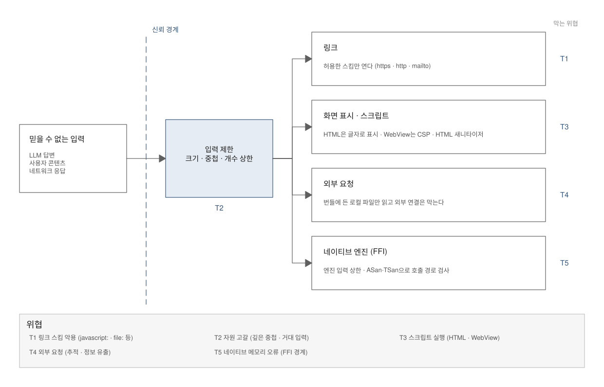

# 보안 검증 — 위협마다 방어와 검증을 붙이고 "0건"의 범위를 읽는 법

> **요약.** 이 문서는 "신뢰할 수 없는 입력이 앱 안에서 코드 실행·외부 통신·자원 고갈·메모리 오류로 이어질 수 없는가"라는 질문, 곧 검증의 네 질문 가운데 Q3 보안에 답하는 방법을 설명합니다. 도구가 낸 "0건"은 그 도구가 보는 범위에서만 의미가 있으므로, 도구보다 위협 모델을 먼저 세워 위협마다 방어·검증·범위 밖을 채웁니다. 보안 판단의 주된 근거는 공격 입력을 실제로 넣어 보는 동적 검증이고, 정적 분석·의존성 감사·SBOM·새니타이저는 각자 다른 질문에 답하는 보조 근거입니다. 그래서 결론도 "안전하다"가 아니라 "나열한 위협에 방어와 검증이 있고, 범위 밖은 이것이다"라는 형태가 되며, 이런 보고서 문구는 기록과 보고 문서에 모았습니다.

처음 보는 용어는 [용어 풀이](glossary.md)에 모아 두었습니다.

에이전트용 압축판: `skills/verify/references/security.md`

## 차례

- [1. 들어가며 — semgrep이 0건이면 안전할까](#1-들어가며--semgrep이-0건이면-안전할까)
- [2. 위협 모델](#2-위협-모델)
- [3. 공격 입력 동적 검증](#3-공격-입력-동적-검증)
- [4. 정적 분석·의존성 감사·SBOM의 역할 구분](#4-정적-분석의존성-감사sbom의-역할-구분)
- [5. 새니타이저의 범위](#5-새니타이저의-범위)
- [6. 공급망 고정](#6-공급망-고정)
- [7. 한계와 보완](#7-한계와-보완)
- [8. 적용 사례](#8-적용-사례)
- [참고문헌](#참고문헌)

## 1. 들어가며 — semgrep이 0건이면 안전할까

CI에서 정적 분석 도구 semgrep이 "0건"을 냈다고 해 봅시다. 이 앱은 안전할까요? 그 0건은 "semgrep이 가진 규칙이 아는 패턴이 코드에 없다"는 뜻입니다. 해당 언어 전용 규칙이 몇 개뿐이라면 0건은 거의 아무것도 말해 주지 않습니다.

의존성 감사나 새니타이저의 0건도 마찬가지입니다. 도구는 저마다 자기 시야 안에서만 답하므로, 0건을 모아 놓기만 해서는 시야 밖의 위협이 다뤄졌는지 알 수 없습니다.

그래서 이 문서는 도구보다 위협 모델을 먼저 세우고, 도구마다 어떤 질문에 답하고 무엇을 보지 못하는지를 나눠 설명합니다. 질문은 "신뢰할 수 없는 입력이 앱 안에서 코드 실행·외부 통신·자원 고갈·메모리 오류로 이어질 수 없는가"(Q3)이고, "0건"을 읽는 법에 특히 지면을 씁니다.

## 2. 위협 모델

### 2.1 도구보다 먼저 세우는 이유

위협 모델은 무엇을 지키는지, 신뢰할 수 없는 데이터가 어디로 들어와 무엇을 노릴 수 있는지를 먼저 정리한 표·그림입니다. 도구보다 이것을 먼저 세우는 이유는, 도구가 낸 "0건"이 그 도구가 보는 범위에서만 의미가 있기 때문입니다.

위협을 먼저 나열해야 위협마다 방어와 검증이 붙어 있는지, 빈칸이 없는지 확인할 수 있습니다. 도구부터 돌리면 도구가 보지 않는 위협은 아예 질문에서 빠집니다.

### 2.2 출발 가정

출발 가정은 **외부 입력(LLM 답변·사용자 콘텐츠·네트워크 응답)은 신뢰할 수 없다**는 것입니다. 입력 내용을 앱이 통제하지 못하므로, 악의적인 링크·스크립트·극단 입력이 들어올 수 있다고 보고 방어와 검증을 설계합니다.

### 2.3 위협 모델 그림

위협 모델 그림은 보통 그림 1과 같은 구조입니다. 신뢰할 수 없는 입력이 신뢰 경계(앱이 통제하지 못하는 데이터가 앱 안으로 들어오는 경계)를 넘으면 입력 제한부터 거칩니다. 그다음 네이티브 텍스트 뷰·외부 엔진·WebView처럼 성격이 다른 경로로 나뉩니다.

경로마다 그 경로에서 생길 수 있는 위협과 이를 막는 방어가 붙습니다. 그림 1은 링크·스크립트·외부 요청·네이티브 엔진 경로마다 방어와 검증이 따로 붙는 모습을 보여 줍니다.

*그림 1. 신뢰 경계와 경로별 방어·검증을 담은 위협 모델*

### 2.4 위협 모델 표 양식

그림을 표로 옮기면 표 1과 같습니다. 행은 프로젝트에 맞게 바꾸고, 열은 그대로 둡니다.

*표 1. 위협 모델 표 양식*

| ID | 위협 | 진입 경로 | 방어 | 검증 방법 | 범위 밖 |
|---|---|---|---|---|---|
| T1 | 링크 스킴 악용 | 콘텐츠 안 링크 | 허용 스킴 목록(https·http·mailto) | 보안 테스트 입력 N건 + 퍼징 | — |
| T2 | 자원 고갈 | 극단 입력 | 크기·중첩·개수 상한 | 극단 입력 N종의 시간 예산 | — |
| T3 | 스크립트 실행 | HTML·WebView 콘텐츠 | 네이티브는 HTML을 글자로, WebView는 CSP·엄격 모드·HTML 새니타이저 | 공격 입력 N종: 실행 없음·설정 변경 거부 | — |
| T4 | 외부 요청 | WebView·이미지 | 번들 로컬 파일만, 외부 연결 차단 | 외부 요청 0건 검사 | — |
| T5 | 네이티브 메모리 오류 | FFI 경계(Rust·C 엔진) | 엔진 입력 상한 | ASan·TSan으로 호출 경로 실행 | 미리 빌드된 엔진 내부, JNI 경로 |

표의 몇몇 용어는 이런 뜻입니다.

- **CSP**(Content Security Policy): 웹 페이지가 실행·로드할 수 있는 스크립트와 리소스의 출처를 제한하는 브라우저 규칙입니다.
- **엄격 모드**: WebView 안에서 도는 라이브러리가 제공하는, 기능을 제한하는 보안 설정입니다.
- **HTML 새니타이저**: 위험한 태그·속성을 걸러 내는 라이브러리(예: DOMPurify)입니다. 5절의 새니타이저(컴파일러 기능)와는 다릅니다.
- **FFI**(Foreign Function Interface): 한 언어로 쓴 코드가 다른 언어로 만든 코드를 부르는 경계입니다. **JNI**(Java Native Interface)는 Android의 Kotlin·Java 코드가 C·C++ 같은 네이티브 코드를 부르는 FFI입니다.

중요한 것은 열입니다. "방어"와 "검증 방법"이 모두 채워져야 그 위협을 다룬 것이고, **"범위 밖" 열은 비워 두지 않습니다.** 검증이 닿지 않는 곳을 표에 적어야 독자가 "0건"의 범위를 압니다.

### 2.5 다른 검증과의 연결

위협 모델의 각 행은 다른 검증과 이어집니다. T2 자원 고갈은 정확성 검증의 [극단 입력](02-correctness.md#6-극단-입력)이 대신 확인하고[10], T1 링크 스킴은 보안 테스트 입력과 퍼징이 함께 확인합니다.

같은 입력이 정확성과 보안 두 질문에 함께 답하는 것은 자연스러운 일입니다. 그 사실을 표에 적어 두면 됩니다.

## 3. 공격 입력 동적 검증

### 3.1 설정 검토만으로 부족한 이유

설정이 올바르게 되어 있다는 것과 실제 공격 입력이 막힌다는 것은 다른 질문입니다. 설정 검토만으로는 설정이 적용되지 않는 경로나 설정을 우회하는 입력을 알 수 없습니다.

그래서 설정 검토와 별도로 공격 입력을 실제로 넣어 결과를 확인합니다. 보안 판단의 주된 근거는 이 동적 검증입니다.

### 3.2 공격 입력 모음

공격 입력 모음은 표 2처럼 위협별로 구성합니다.

*표 2. 위협별 공격 입력의 예*

| 노리는 위협 | 공격 입력의 예 |
|---|---|
| 스크립트 실행 | 스크립트 태그, 이벤트 속성(`onerror`), 클릭 콜백 |
| 보안 설정 변경 | 설정 덮어쓰기 지시자(`%%{init}%%` 류: 본문 안에서 보안 설정을 바꾸려는 지시) |
| 외부 요청 | 외부 이미지·리소스 |
| 자원 고갈 | 거대 입력(다이어그램의 간선, 곧 노드를 잇는 선 수백 개) |
| 링크 스킴 악용 | javascript·data·file·tel·sms 스킴, IDN(국제화 도메인 이름) 동형 문자(모양이 같은 다른 문자로 주소를 흉내 내는 것) |
| 네이티브 메모리 오류 | FFI 악성 입력(불균형·상한+1·깊은 중첩·UTF-8이 아닌 바이트) |

WebView 안에서 스크립트로 그리는 콘텐츠(다이어그램 등)가 있다면, 그 콘텐츠가 스크립트 실행과 외부 요청으로 이어질 수 있는 가장 직접적인 경로입니다. 그래서 그런 콘텐츠가 공격 입력 모음의 중심이 됩니다.

### 3.3 판정

기대하는 판정은 실행 없음, 설정 변경 거부, 외부 요청 0건, 상한으로 거부, 크래시 없이 원문 그대로 표시(fallback)입니다. 입력마다 어떤 판정을 기대하는지 사이드카 파일(입력 파일 옆에 두는 짝 파일)에 적습니다.

### 3.4 WebView 설정 기준표의 고정

WebView 설정은 기준표로 만들어 회귀 테스트로 고정합니다. 기준표에는 JS 범위, 파일·콘텐츠 접근, 창 열기, 내비게이션 정책, 브리지(웹 코드가 앱 코드를 부르는 통로) 노출을 두고, 테스트가 현재 설정과 대조합니다.

나중에 누군가 설정을 느슨하게 바꾸면 이 테스트가 실패합니다.

### 3.5 정확성 검증에서 나온 보안 강화

정확성 검증에서 보안 강화가 나오기도 합니다. 예를 들어 퍼징의 플랫폼 간 비교에서, 주소 안의 보이지 않는 서식 문자를 두 플랫폼이 다르게 다룬다는 사실이 드러날 수 있습니다. 그러면 그런 문자가 있는 주소는 링크로 만들지 않도록 정책을 바꿀 수 있습니다.

이런 변경은 결함 대장에 보안(S) 항목으로 적어 발견 경로를 남깁니다[11].

### 3.6 한계와 줄어든 규모의 기록

동적 검증은 넣어 본 입력의 범위에서만 답합니다. 그래서 계획보다 줄어든 규모는 숨기지 않습니다. 목표가 50건이었는데 18건만 넣었다면 그대로 적고, 줄어든 이유와 남은 입력은 "남은 조건"으로 넘깁니다.

## 4. 정적 분석·의존성 감사·SBOM의 역할 구분

표 3의 도구들은 서로 다른 질문에 답하므로, 하나가 다른 하나를 대신하지 못합니다.

*표 3. 도구별로 답하는 질문과 대신할 수 없는 이유*

| 도구 | 답하는 질문 | 대신할 수 없는 이유 |
|---|---|---|
| 정적 분석(semgrep 등)[1] | 우리 코드에 알려진 위험 패턴이 있는가 | 규칙에 있는 패턴만 봅니다. 언어별 공개 규칙 수를 로그에서 확인해 적습니다. Swift·Kotlin 전용 공개 규칙은 적어서 보조 근거로만 씁니다 |
| 의존성 감사(osv-scanner·npm audit)[2], [3] | 외부 라이브러리 버전에 공개 취약점이 있는가 | 검사 시점의 데이터베이스 기준입니다. 커밋마다 재검사하는 저장소와 수동으로 한 번 검사한 저장소를 구분해 적습니다 |
| SBOM(cdxgen·CycloneDX)[4] | 제품에 무엇이 들어 있는가 | 안전 판정이 아닙니다. 새 취약점이 공개되었을 때 영향을 받는지 바로 확인하는 근거입니다 |
| 린터 보안 규칙(SwiftLint analyze·Android lint)[5], [6] | 플랫폼 고유 문제가 있는가 | 스타일·플랫폼 특화 규칙이라 언어 공통 보안 패턴은 보지 못합니다 |

SBOM(Software Bill of Materials)은 제품에 들어간 구성 요소 목록입니다.

### 4.1 정적 분석의 "0건" 읽기

정적 분석은 코드를 실행하지 않고 규칙과 맞춰 보는 방법입니다. 그래서 새로운 유형의 결함이나 논리 오류는 규칙에 없으면 드러나지 않습니다.

"정적 분석 0건"은 "사용한 규칙이 아는 패턴이 코드에 없다"로 읽고, 적용된 규칙 수를 함께 적습니다. 규칙이 몇 개 안 되면 0건은 거의 아무것도 말해 주지 않습니다.

### 4.2 오탐 처리와 도구가 한 일의 기록

오탐(실제 문제가 아닌데 걸린 결과)은 근거와 함께 억제 주석(`nosemgrep: <규칙>`)으로 남깁니다. 주석 없이 규칙을 끄면 다음 사람은 왜 꺼졌는지 모릅니다.

정적 분석이 실제로 코드를 바꾼 사례(예: CI 액션의 버전 태그를 커밋 SHA로 고정)는 보고서에 적어 도구가 한 일을 보여 줍니다.

### 4.3 의존성 감사의 시점

의존성 감사는 검사 시점에 공개된 취약점만 봅니다. CI에서 커밋마다 다시 도는 저장소는 이후에 공개되는 취약점도 잡지만, 보고서를 쓸 때 한 번만 돌린 저장소는 감사를 다시 돌려야 확인됩니다. 이 차이를 보고서에 적습니다.

## 5. 새니타이저의 범위

### 5.1 새니타이저가 잡는 것

새니타이저는 실행 중 메모리 오류(AddressSanitizer, ASan)와 데이터 경합(ThreadSanitizer, TSan)을 잡도록 빌드에 검사 코드를 넣는 컴파일러 기능입니다[7], [8]. 이렇게 빌드한 코드는 테스트가 도는 동안 오류를 검사합니다. 전체 테스트는 ASan 빌드와 TSan 빌드로 한 번씩 돌립니다.

메모리 안전 언어로 쓴 코드가 C 인터페이스로 외부 엔진을 부르는 FFI 경계가 있다면, 언어의 안전 보장이 닿지 않는 그 경계가 주된 대상입니다.

### 5.2 "0건"의 범위

**0건의 범위는 좁혀 읽습니다.** 검사 코드는 소스로 빌드한 코드와 래퍼(wrapper, 엔진을 감싸 부르는 우리 쪽 코드)의 호출 경로에만 들어갑니다.

미리 빌드된 바이너리, 시스템 프레임워크 내부, 실행하지 않은 경로, 메모리 누수는 범위 밖입니다. 미리 빌드된 바이너리의 예로는 XCFramework(여러 Apple 플랫폼용으로 미리 빌드한 바이너리를 묶은 배포 형식)나 AAR(Android 라이브러리 배포 형식) 안의 .so(네이티브 공유 라이브러리)가 있습니다.

그러므로 0건은 "엔진에 넘기고 돌려받는 메모리의 모든 접근이 검사됐다"는 뜻이 아닙니다. 새니타이저는 실행된 경로만 검사하므로 커버리지와 함께 읽습니다.

### 5.3 주된 방어는 입력 상한

그래서 FFI 경계의 주된 방어는 **입력 상한**(수식 길이·이미지 한 변·픽셀 수)이고, 새니타이저는 보조 확인입니다. 위협 모델 표의 T5 행에도 그렇게 적습니다.

### 5.4 부수 발견

Debug·ASan 빌드는 스택 프레임이 커져 깊은 입력에서 스택이 넘칠 수 있습니다. 이런 발견은 결함 대장에 적고, Release 빌드에도 영향이 있는지 따로 확인합니다.

Release에 영향이 없어도 고칠 가치가 있습니다. 테스트 빌드에서 크래시가 나면 그 테스트가 끝까지 돌지 못하기 때문입니다.

## 6. 공급망 고정

공급망은 우리 코드가 가져다 쓰는 외부 코드와 도구가 제품에 들어오는 경로입니다. 이 경로는 다음 세 가지로 고정합니다.

- 외부 JS·WASM(WebAssembly, 브라우저에서 도는 바이너리 형식) 번들은 저장소에 고정하고, 초기 코드 해시를 테스트로 잠급니다. CDN에서 매번 받으면 내용이 바뀌어도 알 수 없습니다.
- CI 액션은 버전 태그 대신 커밋 SHA로 고정합니다. 태그는 다른 커밋으로 옮겨질 수 있습니다.
- 라이선스 목록과 THIRD_PARTY 고지(제품에 포함한 외부 구성 요소와 라이선스를 알리는 파일)를 SBOM과 대조합니다. SBOM에는 있는데 고지에 없는 것, 고지에는 있는데 SBOM에 없는 것을 찾습니다.

보고서에 쓸 문구는 [기록과 보고](06-records-and-reports.md#6-보고서-문구-모음)[11]에 모았고, "0건" 문구 규칙은 [해석 원칙](01-principles.md#4-0건-문구-규칙)[9]에 있습니다.

## 7. 한계와 보완

이 문서의 방법은 모두 "나열한 위협"과 "도구의 시야" 안에서만 답합니다. 위협 모델에 없는 위협은 어떤 도구로도 질문되지 않으므로, 위협 모델의 빈칸이 곧 검증의 빈칸입니다.

근거마다 시야도 다릅니다. 동적 검증은 넣어 본 공격 입력에, 정적 분석은 적용한 규칙에, 의존성 감사는 검사 시점의 데이터베이스에, 새니타이저는 소스로 빌드해 실행한 경로에 한정됩니다.

이 한계는 다음과 같이 보완합니다. 위협 모델 표의 "범위 밖" 열을 채우고, 의존성 감사처럼 시점에 묶인 검사는 커밋마다 다시 돌립니다. 새니타이저 결과는 커버리지와 함께 읽고, FFI 경계는 입력 상한으로 막습니다. 그래도 남는 범위(미리 빌드된 엔진 내부, 실행하지 않은 경로, 줄어든 공격 입력 규모)는 보고서의 "남은 조건"에 적습니다.

## 8. 적용 사례

자세한 수치와 맥락: [RichMarkdown 적용 사례](case-study/richmarkdown.md)

- 위협 다섯 가지(링크 스킴 악용·자원 고갈·스크립트 실행·외부 요청·네이티브 메모리 오류)를 먼저 나열하고, 각각 보안 테스트 입력 28건과 퍼징, 극단 입력 25종, Mermaid(텍스트로 다이어그램을 그리는 라이브러리) 공격 입력 18종, 외부 요청 0건 검사, ASan·TSan 실행으로 검증했습니다. 공격 입력은 목표 50건보다 적은 18건(18종)이었고, 그 사실을 그대로 적었습니다.
- semgrep은 iOS 0건이었지만 Swift 전용 규칙이 2개뿐이었고, Android 6건은 모두 데모 앱의 스크린샷 자동화 화면이었습니다. 그래서 정적 분석을 보조 근거로, 공격 입력 동적 검증을 주된 근거로 적었습니다.
- 퍼징의 플랫폼 간 비교가 주소 안의 보이지 않는 서식 문자 처리 차이를 드러내, 그런 문자가 있으면 링크로 만들지 않도록 바꿨습니다. 정적 분석은 CI 액션의 버전 태그를 커밋 SHA로 고정하게 했습니다.
- iOS 패키지 테스트 362개를 ASan·TSan으로 각각 돌려 0건이었지만, 수식 엔진은 미리 빌드된 XCFramework라 Rust 내부는 범위 밖이었고 Android JNI 경로는 실행하지 않았습니다. 재실행에서는 Debug 빌드의 스택 여유 부족을 부수적으로 찾았습니다.
- 의존성 감사는 iOS CI에서 커밋마다 돌지만, Android는 보고서를 쓸 때 한 번 수동으로 실행했습니다.

## 참고문헌

[1] 검증 가이드, "semgrep", 도구 문서, [docs/tools/common-security-quality.md](tools/common-security-quality.md#2-semgrep--코드를-실행하지-않고-규칙과-맞춰-위험한-모양을-찾는-도구). 규칙 기반 정적 분석, 언어별 규칙 수, `nosemgrep` 억제.

[2] 검증 가이드, "osv-scanner", 도구 문서, [docs/tools/common-security-quality.md](tools/common-security-quality.md#3-osv-scanner--의존성-목록을-공개-취약점-데이터베이스와-대조하는-도구). 의존성 목록과 공개 취약점 데이터베이스 대조.

[3] 검증 가이드, "npm audit", 도구 문서, [docs/tools/common-security-quality.md](tools/common-security-quality.md#4-npm-audit--프로젝트의-npm-의존성에-알려진-취약점이-있는지-묻는-명령). npm 의존성의 알려진 취약점 조회.

[4] 검증 가이드, "cdxgen과 CycloneDX", 도구 문서, [docs/tools/common-security-quality.md](tools/common-security-quality.md#5-cdxgen과-cyclonedx--앱에-무엇이-들어-있는지-표준-형식의-목록으로-남기는-도구). 표준 형식의 SBOM 생성.

[5] 검증 가이드, "SwiftLint", 도구 문서, [docs/tools/ios-testing.md](tools/ios-testing.md#6-swiftlint--swift-소스의-스타일-문제와-위험한-관용구를-규칙으로-찾는-린터). Swift 소스의 스타일·위험 관용구 규칙 검사.

[6] 검증 가이드, "Android lint", 도구 문서, [docs/tools/android-testing.md](tools/android-testing.md#7-android-lint--앱을-실행하지-않고-소스리소스빌드-파일의-구조적-문제를-찾는-정적-검사-도구). Android 소스·리소스·빌드 파일 정적 검사.

[7] 검증 가이드, "AddressSanitizer", 도구 문서, [docs/tools/ios-performance.md](tools/ios-performance.md#5-addresssanitizer--범위-밖-접근해제-후-사용-같은-메모리-손상을-테스트가-도는-동안-잡아내는-컴파일러-기능). 메모리 오류 검사와 계측 범위.

[8] 검증 가이드, "ThreadSanitizer", 도구 문서, [docs/tools/ios-performance.md](tools/ios-performance.md#6-threadsanitizer--동기화-없이-두-스레드가-같은-메모리에-접근하는-데이터-경합을-테스트가-도는-동안-찾는-컴파일러-기능). 데이터 경합 검사와 계측 범위.

[9] 검증 가이드, "원칙과 해석", 설명 문서, [docs/01-principles.md](01-principles.md). "0건" 문구 규칙.

[10] 검증 가이드, "오류 검증", 설명 문서, [docs/02-correctness.md](02-correctness.md). 극단 입력과 퍼징.

[11] 검증 가이드, "기록과 보고", 설명 문서, [docs/06-records-and-reports.md](06-records-and-reports.md). 결함 대장의 ID 체계(보안 S·메모리 안전 M 영역 포함)와 보고서 문구 모음.
