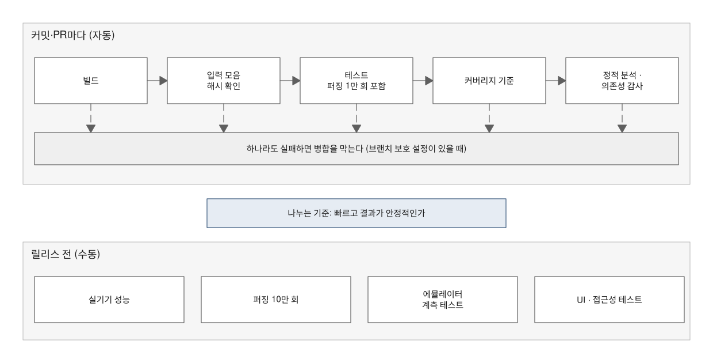

# 유지보수 검증 — 검증이 저절로 반복되게 하려면 무엇이 필요한가

> **요약.** 이 문서는 "검증이 자동으로 반복되는가, 코드가 사람이 관리할 수 있는 수준인가"라는 질문, 곧 검증의 네 질문 가운데 Q4 유지보수에 답하는 방법을 설명합니다. 커버리지와 복잡도는 테스트가 닿지 않은 곳과 관리 부담의 경향을 보여 줄 뿐, 결함이 적다는 근거는 되지 못합니다. CI 게이트에는 빠르고 결과가 안정적인 검사만 넣고, 실기기 측정·계측 테스트·대규모 퍼징은 릴리스 전 수동 실행으로 나눕니다. 수동으로 옮긴 검사가 놓치는 회귀와, 브랜치 보호가 없으면 CI 실패가 병합을 강제로 막지 못한다는 사실도 보고서에 함께 적습니다.

처음 보는 용어는 [용어 풀이](glossary.md)에 모아 두었습니다.

에이전트용 압축판: `skills/verify/references/maintenance.md`

## 차례

- [1. 들어가며 — 커버리지가 높으면 버그가 없는가](#1-들어가며--커버리지가-높으면-버그가-없는가)
- [2. 커버리지 게이트](#2-커버리지-게이트)
- [3. 복잡도 분포](#3-복잡도-분포)
- [4. CI 게이트 분할 기준](#4-ci-게이트-분할-기준)
- [5. 수동 실행 잡](#5-수동-실행-잡)
- [6. 시간에 민감한 검사](#6-시간에-민감한-검사)
- [7. 브랜치 보호 확인](#7-브랜치-보호-확인)
- [8. 한계와 보완](#8-한계와-보완)
- [9. 적용 사례](#9-적용-사례)
- [참고문헌](#참고문헌)

## 1. 들어가며 — 커버리지가 높으면 버그가 없는가

커버리지가 90%를 넘으면 버그가 없다고 말할 수 있을까요? 코드 리뷰나 도입 검토 자리에서 자주 나오는 질문입니다. 답은 "아니요"이지만, 그렇다고 커버리지가 쓸모없는 지표는 아닙니다.

Q4는 두 가지를 묻습니다. 하나는 "코드가 사람이 이해하고 고칠 수 있는 수준인가"이고, 다른 하나는 "오늘 통과한 검증이 다음 커밋에서도 저절로 다시 도는가"입니다. 앞의 질문에는 커버리지·복잡도 같은 지표가 답합니다. 뒤의 질문에는 CI 게이트(커밋·PR마다 자동으로 돌고 실패하면 병합을 막을 수 있는 검사)와 수동 실행 잡(job, 사람이 직접 시작하는 CI 작업 단위)이 답합니다.

이 문서는 지표를 읽는 법(2·3절), 검사를 커밋마다 돌릴지 릴리스 전에 돌릴지 나누는 기준(4~6절), 그 CI 게이트가 실제로 병합을 막는지 확인하는 법(7절)을 차례로 다룹니다. 지표마다 무엇을 말해 주지 않는지도 지표 자체만큼 자세히 적습니다.

## 2. 커버리지 게이트

커버리지는 테스트가 실행한 코드 줄의 비율입니다. iOS는 xccov[1], Android는 Kover[2]·JaCoCo[3] 같은 도구로 잽니다. 이 값이 기준에 못 미치면 CI가 실패하게 두는 장치를 커버리지 게이트라고 부릅니다.

### 2.1 모듈별 기준

기준은 모듈마다 따로 둡니다. 모든 입력이 지나가는 핵심 모듈(파서·코어)에는 높은 기준(예: 90%)을, 전체에는 그보다 낮은 기준(예: 80%)을 둡니다.

핵심 모듈을 더 엄격하게 보는 이유는 두 가지입니다. 이 모듈은 호스트(개발 머신)나 JVM에서 빠르게 테스트할 수 있어 높은 기준을 유지하기 쉽고, 여기서 생긴 결함은 모든 사용자에게 닿습니다.

### 2.2 중복 집계와 파일별 최댓값

같은 소스가 여러 테스트 번들에 정적 링크되면, 커버리지 보고서에 같은 파일이 여러 번 나타납니다. 번들마다 실행한 줄이 달라 한 파일에 값이 여러 개 생기므로 **파일별 최댓값**을 씁니다.

이 규칙은 사람이 기억할 일이 아니라 커버리지 게이트 스크립트에 들어 있어야 합니다. 이 플러그인의 `coverage_gate.py`[4]도 xccov JSON을 읽을 때 파일별 최댓값을 씁니다.

### 2.3 CI가 실행하는 범위와 합친 값

CI가 돌리지 않는 테스트까지 합친 값과 CI 기준값은 구분해 적습니다. 에뮬레이터에서 돌리는 계측 테스트(앱을 실제로 띄워 실행하는 테스트)까지 합치면 값이 더 높게 나오지만, CI는 그 테스트를 돌리지 않습니다. 그래서 커밋마다 지키는 기준은 CI가 실제로 실행하는 범위로만 정합니다.

### 2.4 기준값의 근거

기준값의 근거는 스크립트 상수 옆 주석과 보고서에 적습니다. 근거 없는 숫자는 두지 않습니다.

90%가 왜 90%인지 설명하지 못하면, 그 숫자는 "지금보다 나빠지지 않게" 막는 회귀 방지 기준 역할만 할 뿐 품질 기준이 되지 못합니다.

### 2.5 커버리지가 말해 주지 않는 것

커버리지는 줄이 실행됐다는 뜻이지, 그 줄의 결과가 맞는지 검사했다는 뜻이 아닙니다. 실제로 커버리지가 90%를 넘는 모듈에서도 플랫폼 간 비교(iOS·Android 결과가 같은지 맞춰 보는 일, 패리티라고도 부름)와 퍼징(입력을 무작위로 바꿔 대량으로 넣고 이상 동작을 찾는 테스트)이 결함을 여럿 찾는 일이 있습니다.

그래서 커버리지는 "테스트가 아직 닿지 않은 곳"을 찾는 지표로 씁니다. 결과가 맞다는 근거는 플랫폼 간 비교, 퍼징의 성질 검사, 회귀 테스트 입력(고친 결함이 다시 생기면 걸리도록 남겨 두는 최소 재현 입력)에서 찾습니다.

## 3. 복잡도 분포

순환 복잡도는 함수 안의 독립적인 실행 경로 수입니다. 대략 if·반복문·case 같은 분기 지점 수에 1을 더한 값이고, 높을수록 이해하고 테스트하기 어렵습니다.

함수별 순환 복잡도는 lizard[5]로, 코드 규모는 scc[6]로, 스타일 위반은 린터(SwiftLint[7]·Android lint[8])로 모읍니다.

### 3.1 평균 대신 분포

평균 하나만 보면 소수의 복잡한 함수가 가려집니다. 그래서 중앙값, 임계값(예: 16) 이상인 함수 수, 최댓값을 함께 적습니다.

### 3.2 가장 복잡한 함수의 설명

가장 복잡한 함수 한두 개는 따로 설명합니다. 어떤 분기가 쌓여 복잡해졌는지, 그리고 어떤 검증(퍼징 입력의 플랫폼 간 비교, 회귀 테스트 입력)이 그 경로를 지나는지 적습니다.

예를 들어 상위 라이브러리의 오류를 유형별로 보정하는 함수라면, 높은 복잡도는 그 보정에 드는 비용입니다. 이때 관리할 수 있다는 근거는 복잡도 숫자가 아니라 퍼징이 그 경로를 실제로 지난다는 사실입니다. 설명하지 않고 넘어간 나머지 함수의 수도 함께 적습니다.

### 3.3 복잡도가 말해 주지 않는 것

복잡도·줄 수·린트 위반은 관리 부담이 어느 쪽으로 가는지 보여 주는 경향일 뿐, 결함 수가 아닙니다. 이 지표만으로 "버그가 적다"고 말하지 않습니다.

## 4. CI 게이트 분할 기준

검사를 커밋마다 돌릴지 릴리스 전에 돌릴지 가르는 기준은 하나입니다. **빠르고 결정적인가**, 즉 금방 끝나고 같은 코드라면 언제 돌려도 같은 결과가 나오는가입니다.

이 기준이 중요한 이유는 신뢰입니다. 커밋 검사가 실패했을 때 그 실패가 코드 문제를 안정적으로 가리켜야 병합 판단의 근거로 쓸 수 있습니다. 실행마다 다른 이유로 실패하는 검사가 섞여 있으면 사람들은 실패를 무시하기 시작하고, 그때부터 CI 게이트는 의미를 잃습니다.

그림 1과 표 1은 이 기준으로 검사를 나눈 결과입니다. 빠르고 결과가 안정적인 검사는 커밋마다 자동으로 돌아 실패하면 병합을 막고, 실기기 측정·계측 테스트·대규모 퍼징은 릴리스 전에 사람이 돌립니다.

*그림 1. 커밋마다 도는 CI 게이트와 릴리스 전 수동 검사의 분할(실패가 병합을 강제로 막는 것은 브랜치 보호를 설정한 경우에 한함, 7절)*

*표 1. 커밋마다 도는 검사와 릴리스 전 수동 검사*

| 커밋마다(자동) | 릴리스 전(수동 잡) |
|---|---|
| 빌드, 공용 입력 모음 해시 검사, 단위 테스트(퍼징 1만 회 포함), 커버리지 게이트, 정적 분석, 의존성 감사 | 실기기 성능, 퍼징 10만 회, 에뮬레이터 계측 테스트, 데모 UI·접근성 테스트, 최소 OS 실행 |

표 1의 공용 입력 모음은 여러 플랫폼·저장소가 함께 쓰는 테스트 입력 묶음(코퍼스)입니다. 해시 검사는 저장소마다 가진 사본이 정본(기준이 되는 원본)과 같은 파일인지 SHA-256으로 대조하며, 이 플러그인의 `fixtures_manifest.py`[9]가 이 일을 합니다.

### 4.1 수동 잡으로 옮긴 검사의 대가

공유 가상 머신에서 실행마다 다른 이유로 실패하는 UI 테스트(WebView 초기화·접근성 감사·입력 지연의 시간 초과)는 로컬에서 통과하는지 확인한 뒤 수동 잡으로 옮깁니다.

대신 그만큼 커밋마다 잡히지 않는 회귀가 생깁니다. 그래서 어떤 회귀가 수동 잡에서만 잡히는지 보고서에 적습니다.

### 4.2 CI의 OS와 최소 OS

CI는 스스로 고른 OS(설치된 최신 시뮬레이터)에서 돌기 때문에, 최소 지원 OS에서만 생기는 결함은 CI에서 재현되지 않습니다. 그래서 두 OS의 재현 조건을 구분하고, 최소 OS 전용 결함의 회귀 테스트는 어디서 확인하는지 따로 적습니다.

### 4.3 진행 중 실행을 취소하는 설정

새 push가 진행 중인 실행을 취소하는 설정(`cancel-in-progress`)을 쓰면 그 사실을 적습니다. 이 설정에서는 중간 커밋의 검사 결과가 남지 않을 수 있습니다.

### 4.4 실측 시간이 추정보다 짧을 때

수동으로 돌리던 규모의 검사가 계획 때 추정보다 훨씬 빨리 끝나면, 커밋마다 도는 CI 게이트로 옮길지 다시 판단합니다. 옮기지 않기로 했다면 그 사실도 적습니다.

## 5. 수동 실행 잡

수동 검사는 `workflow_dispatch`(GitHub Actions에서 사람이 직접 실행을 시작하는 트리거)의 입력(예: `ui_tests`)으로 켜는 잡으로 둡니다.

수동 잡은 돌리는 것을 잊기 쉽습니다. 그래서 무엇이 수동인지, 마지막으로 언제 어느 커밋에서 돌렸는지를 검수 기록에 남기고, 릴리스 체크리스트에 수동 잡 실행을 항목으로 넣습니다.

## 6. 시간에 민감한 검사

입력당 시간 상한 같은 검사는 공유 러너가 잠깐 느려지기만 해도 흔들립니다. 그래서 상한을 넘은 입력은 3회 다시 재서 가장 빠른 값으로 판정하고, 세 번 모두 넘을 때만 실패시킵니다. 이렇게 하면 CI 게이트의 의미를 지키면서 환경 지연에 덜 흔들립니다.

그래도 진짜 회귀는 그대로 잡힙니다. 입력 자체가 느리면 세 번 모두 상한을 넘기 때문입니다.

다만 이 규칙은 테스트를 느슨하게 하므로 결함 대장에 T 항목(테스트·측정 쪽 보정)으로 기록합니다[10]. 이 기록을 숨기면 결과가 좋아진 이유가 코드 수정인지 테스트 완화인지 구분할 수 없습니다.

## 7. 브랜치 보호 확인

CI가 돈다는 것과 CI 실패가 병합을 **강제로** 막는다는 것은 다릅니다. 그래서 저장소 설정을 직접 조회해 확인합니다. `gh api repos/<o>/<r>/branches/main`의 `protected` 값과 저장소 ruleset(브랜치에 거는 병합 규칙 묶음)을 봅니다.

보호가 없으면 "현재는 사람이 실패 상태를 보고 판단하며, 강제 CI 게이트가 아니다"라고 적습니다. 강제로 막으려면 필수 상태 검사와 브랜치 보호를 설정해야 한다는 점은 남은 조건에 둡니다.

이 문장은 보고서의 "게이트"라는 말이 독자에게 강제 차단으로 읽히지 않게 하려고 넣습니다.

보고서에 쓸 문구는 [기록과 보고](06-records-and-reports.md#6-보고서-문구-모음)[10]에 모았습니다.

## 8. 한계와 보완

이 문서의 장치는 각자 답하는 범위가 좁습니다. 표 2는 장치마다 알려 주는 것과 알려 주지 않는 것, 그 빈자리를 메우는 방법을 모은 것입니다.

*표 2. 유지보수 지표·장치의 한계와 보완*

| 지표·장치 | 알려 주는 것 | 알려 주지 않는 것 | 보완 |
|---|---|---|---|
| 커버리지 | 테스트가 닿지 않은 코드 | 실행한 줄의 결과가 맞는지 | 플랫폼 간 비교, 퍼징의 성질 검사, 회귀 테스트 입력 |
| 복잡도·규모·린트 | 관리 부담의 경향 | 결함 수 | 가장 복잡한 함수의 분기 원인과 그 경로를 지나는 검증의 기록 |
| 커밋마다 도는 CI 게이트 | 빠르고 결정적인 검사의 통과 여부 | 수동 잡으로 옮긴 검사의 회귀, 최소 OS 전용 결함 | 수동 잡 실행 기록, 릴리스 체크리스트 |
| CI 실패 표시 | 검사를 통과하지 못한 커밋 | 병합이 실제로 막혔는지 | 브랜치 보호·필수 상태 검사 설정 확인 |

결국 Q4의 답은 지표 하나로 나오지 않습니다. 표 2의 장치를 각자의 한계와 함께 적어 둘 때 독자가 "어디까지 자동으로 지켜지는가"를 스스로 판단할 수 있습니다.

## 9. 적용 사례

자세한 수치와 맥락: [RichMarkdown 적용 사례](case-study/richmarkdown.md)

- iOS CI는 Core 90%·전체 80%, Android CI는 Core 90%를 기준으로 두었고, 최종 iOS는 Core 97.9%·전체 92.1%였습니다. 그러나 보강 전에도 Core 커버리지는 94.8%였고, 그 뒤 퍼징 입력의 플랫폼 간 비교가 Core 결함 대부분을 찾았습니다. 이것이 커버리지를 정확성의 근거로 쓰지 않은 이유입니다.
- 두 플랫폼 모두 복잡도 중앙값은 2, 16 이상인 함수는 각각 7개(최대 28·34)였고, 가장 복잡한 함수 두 개(상위 파서 위치 오류의 유형별 보정, 구분자 종류별 분기)만 설명했습니다.
- iOS 데모 UI 테스트는 공유 가상 머신에서 매번 다른 이유로 실패해 수동 잡으로 옮겼습니다. 그 대가로 편집기·WebView·데모 UI 회귀와 iOS 16 전용 동작은 수동 실행에서만 확인합니다.
- 퍼징 10만 회의 실측 시간은 iOS 124초·Android 10.2초로 계획 추정(10~20분)보다 짧았지만 커밋마다 도는 CI 게이트로 옮기지 않았습니다. 퍼징 입력당 상한 0.5초를 넘으면 3회 다시 재는 규칙은 T 항목으로 기록했습니다.
- 양쪽 `main`은 `protected: false`이고 ruleset도 없어, CI 실패가 병합을 강제로 막지 않는다고 적었습니다.

## 참고문헌

[1] 검증 가이드, "xccov — xcresult의 코드 커버리지를 타깃·파일·함수·줄 단위로 읽는 Xcode 명령행 도구", 도구 문서, [docs/tools/ios-testing.md](tools/ios-testing.md#5-xccov--xcresult의-코드-커버리지를-타깃파일함수줄-단위로-읽는-xcode-명령행-도구).

[2] 검증 가이드, "Kover — JVM 단위 테스트가 Kotlin 코드의 어느 줄을 실행했는지 재는 커버리지 플러그인", 도구 문서, [docs/tools/android-testing.md](tools/android-testing.md#5-kover--jvm-단위-테스트가-kotlin-코드의-어느-줄을-실행했는지-재는-커버리지-플러그인).

[3] 검증 가이드, "JaCoCo — 에뮬레이터 계측 테스트가 실행한 줄을 재는 커버리지 도구(AGP 내장)", 도구 문서, [docs/tools/android-testing.md](tools/android-testing.md#6-jacoco--에뮬레이터-계측-테스트가-실행한-줄을-재는-커버리지-도구agp-내장).

[4] 검증 가이드, "coverage_gate.py — 모듈별·전체 커버리지 기준 검사 스크립트", [skills/verify/scripts/coverage_gate.py](../skills/verify/scripts/coverage_gate.py).

[5] 검증 가이드, "lizard — 함수마다 갈림길이 몇 개인지 세어 복잡도를 재는 도구", 도구 문서, [docs/tools/common-security-quality.md](tools/common-security-quality.md#6-lizard--함수마다-갈림길이-몇-개인지-세어-복잡도를-재는-도구).

[6] 검증 가이드, "scc — 언어별 코드·주석·빈 줄 수를 세어 코드 규모를 재는 도구", 도구 문서, [docs/tools/common-security-quality.md](tools/common-security-quality.md#7-scc--언어별-코드주석빈-줄-수를-세어-코드-규모를-재는-도구).

[7] 검증 가이드, "SwiftLint — Swift 소스의 스타일 문제와 위험한 관용구를 규칙으로 찾는 린터", 도구 문서, [docs/tools/ios-testing.md](tools/ios-testing.md#6-swiftlint--swift-소스의-스타일-문제와-위험한-관용구를-규칙으로-찾는-린터).

[8] 검증 가이드, "Android lint — 앱을 실행하지 않고 소스·리소스·빌드 파일의 구조적 문제를 찾는 정적 검사 도구", 도구 문서, [docs/tools/android-testing.md](tools/android-testing.md#7-android-lint--앱을-실행하지-않고-소스리소스빌드-파일의-구조적-문제를-찾는-정적-검사-도구).

[9] 검증 가이드, "fixtures_manifest.py — 공용 입력 모음의 파일 목록과 SHA-256을 만들고 대조하는 스크립트", [skills/verify/scripts/fixtures_manifest.py](../skills/verify/scripts/fixtures_manifest.py).

[10] 검증 가이드, "기록과 보고", [docs/06-records-and-reports.md](06-records-and-reports.md). 결함 대장의 테스트·측정 쪽 보정(T) 영역과 보고서 문구 모음.
