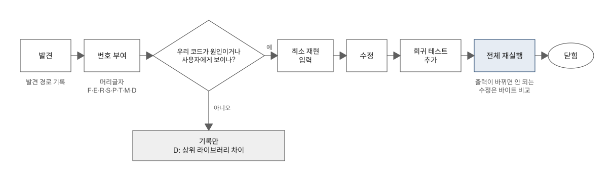
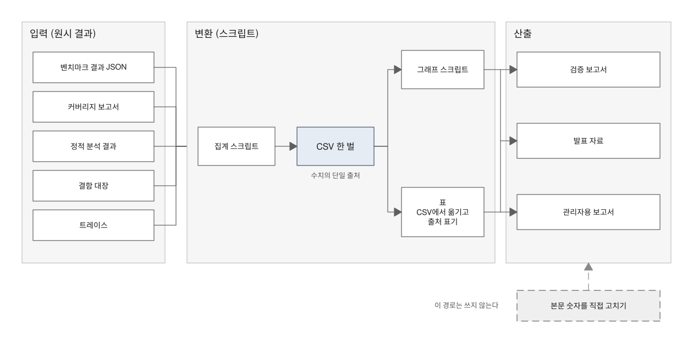

# 기록과 보고 — 검증 결과를 어떻게 남기고, 믿을 수 있게 전달하는가

> **요약.** 이 문서는 검증 방법 자체가 아니라 그 결과를 남기고 믿을 수 있게 전달하는 장치를, 검증하는 순서대로 다룹니다. 검증 전에는 계획 문서에 원칙·요구사항·결정을 고정하고, 검증 중에는 찾은 결함을 발견 경로·수정·회귀 테스트와 함께 결함 대장 하나에 모읍니다. 테스트 쪽 보정과 상위 라이브러리 차이도 머리글자를 달리해 같은 대장에 두어, 독자가 "결함 N건" 안에 무엇이 섞였는지 직접 셀 수 있게 합니다. 보고서의 모든 숫자는 원시 결과에서 집계 스크립트를 거쳐 CSV 한 벌로 모인 뒤에만 그래프·표·파생본으로 나가고, 보고서는 논문과 같은 순서로 쓰되 근거보다 넓게 읽히는 문구를 범위가 드러나는 문구로 바꿉니다. 이 장치들은 기록끼리 어긋나지 않게 할 뿐 찾지 못한 결함이나 원시 결과의 측정 오류까지 보증하지는 않으므로, 그 한계는 보고서의 남은 조건에 따로 적습니다.

처음 보는 용어는 [용어 풀이](glossary.md)에 모아 두었습니다.

에이전트용 압축판: `skills/verify/references/report.md`, `skills/verify/references/defect-ledger.md`

## 차례

- [1. 들어가며 — 손으로 옮긴 숫자를 믿을 수 있는가](#1-들어가며--손으로-옮긴-숫자를-믿을-수-있는가)
- [2. 계획 문서](#2-계획-문서)
- [3. 결함 대장](#3-결함-대장)
- [4. 수치 파이프라인](#4-수치-파이프라인)
- [5. 보고서 목차](#5-보고서-목차)
- [6. 보고서 문구 모음](#6-보고서-문구-모음)
- [7. 한계와 보완](#7-한계와-보완)
- [8. 적용 사례](#8-적용-사례)
- [참고문헌](#참고문헌)

## 1. 들어가며 — 손으로 옮긴 숫자를 믿을 수 있는가

보고서 숫자를 누가 손으로 옮겼다면 믿을 수 있을까요? 같은 값이 요약과 본문 표, 발표 자료에 조금씩 다르게 적혀 있다면 독자는 어느 쪽도 믿지 않습니다.

검증을 잘해도 결과를 기록하고 전달하는 과정에서 신뢰를 잃을 수 있습니다. 결과를 본 뒤에 원칙을 정하면 결과에 맞춰 정하게 되고, 여러 번 잰 값 중 유리한 값만 골라 적을 여지도 생깁니다. 찾은 결함을 "N건"이라는 숫자 하나로만 전하면, 그 안에 무엇이 섞였는지 아무도 셀 수 없습니다.

이 문서는 그 여지를 줄이는 장치를 일하는 순서대로 설명합니다. 검증 전에 쓰는 계획 문서(2절), 검증하는 동안 결함을 모으는 결함 대장(3절), 모든 숫자를 한 출처에서 꺼내는 수치 파이프라인(4절), 논문 구성을 따르는 보고서 목차(5절), 보고서에 쓸 문구(6절) 순서입니다.

이 문서에서 "N절"은 이 문서의 절을, "보고서 N절"은 검증 보고서의 절을 가리킵니다.

## 2. 계획 문서

### 2.1 계획 문서의 목차

계획 문서는 검증을 시작하기 전에 씁니다. 목차는 계획 문서 템플릿[1]을 따르며, 표 1과 같습니다.

*표 1. 계획 문서의 목차*

| 절 | 담는 것 |
|---|---|
| 0 | 배경·목표·원칙 |
| 1 | 현재 상태(실측 표, 가용 환경 표) |
| 2 | 요구사항(2-1 보고서가 답할 질문, 2-2 프로젝트 보강 요구사항 FR, 2-3 보고서 요구사항 RR, 2-4 제약) |
| 3 | 검증 설계(의사코드) |
| 4 | 작업 단계 |
| 5 | 보고서 목차 초안 |
| 6 | 확정된 결정 |
| 7 | 리스크 |
| 8 | 도구 설명 |
| 9 | 진행 체크리스트 |

### 2.2 원칙을 먼저 적는 이유

계획 단계에서 정하는 원칙은 보통 네 가지입니다.

1. 모든 수치는 실제 실행 결과만 쓰고, 환경·날짜·커밋·원시 데이터 경로를 함께 적으며, 추정값은 "추정"으로 표기한다.
2. 핵심 지표는 서로 다른 도구 두 가지로 교차 확인한다.
3. 확인하지 않은 범위와 미해결 결함은 숨기지 않고 "남은 조건" 절에 적는다.
4. 모든 검증은 스크립트와 CI로 다시 실행할 수 있어야 한다.

이 원칙은 결과가 불리하게 나왔을 때 보고서를 어떻게 쓸지 미리 해 두는 약속입니다. 결과를 본 뒤에 원칙을 정하면 결과에 맞춰 정하게 됩니다.

### 2.3 요구사항을 세 층으로 나누는 이유

보고서가 답할 네 질문(Q1 오류·Q2 성능·Q3 보안·Q4 유지보수)은 독자의 우려에서 나옵니다. 프로젝트 보강 요구사항(FR)은 그 질문에 답하려면 코드 쪽에 무엇이 있어야 하는지를, 보고서 요구사항(RR)은 문서 쪽에 무엇이 있어야 하는지를 적습니다.

FR마다 완료 기준을 적어 "했다"와 "다 했다"를 구분합니다.

### 2.4 검증 설계를 의사코드로 적는 이유

러너·측정·보안·보고서 빌드와 퍼징(입력을 무작위로 바꿔 대량으로 넣고 이상 동작을 찾는 테스트)의 흐름을 의사코드로 쓰면, 구현하기 전에 무엇을 비교하고 무엇을 저장하는지가 드러납니다. 한 줄짜리 `assert`가 성질 하나이고, `on failure` 줄이 실패 처리 규칙입니다.

구현이 의사코드와 달라지면 그 차이가 곧 "계획보다 줄어든 범위"가 됩니다.

### 2.5 사용자 결정의 고정

사용자 결정이 필요한 항목은 한 번에 묻고, 계획 문서 6절(확정된 결정)에 날짜와 함께 고정합니다. 대상은 양식, 결함 수정 범위, 커밋·태그, 도구 설치, 기기, 회사명 언급 여부, 퍼징 규모처럼 검증 도중에 바뀌면 결과 해석이 달라지는 항목입니다.

결정이 바뀌면 바뀐 날짜와 함께 덧붙입니다.

## 3. 결함 대장

계획 문서가 검증 전에 해 두는 약속이라면, 결함 대장은 검증하는 동안 쌓는 기록입니다. 찾은 결함을 번호·발견 경로·수정·회귀 테스트와 함께 한 목록에 모읍니다.

검증을 마쳤더니 대장에 수십 건이 쌓였다면 품질이 나쁜 걸까요? 반대로 몇 건뿐이라면 안심해도 될까요? 숫자 하나만 보고는 어느 쪽도 답할 수 없습니다.

대장에는 크래시처럼 사용자에게 큰 영향을 주는 결함도, 테스트의 시간 상한을 조정한 기록도, 상위 라이브러리의 해석 차이도 함께 들어갑니다. 무엇이 몇 건인지 나눠 보여야 독자가 숫자를 제대로 읽습니다.

대장은 검증 방법이 실제로 일했다는 증거이기도 합니다. 항목마다 어떤 방법으로 찾았는지 적어 두면, "이 방법을 왜 썼나"라는 질문에 찾은 결함으로 답할 수 있습니다.

대장이 제 역할을 하는지 가르는 기준은 두 가지입니다. 독자가 "결함 N건" 안에 무엇이 섞여 있는지 직접 셀 수 있어야 하고, 고친 결함마다 회귀 테스트가 있어야 합니다.

### 3.1 결함 처리 흐름

그림 1은 결함 하나가 대장에 들어와 닫히기까지의 흐름입니다. 결함은 발견 경로와 함께 번호를 받고, 최소 재현 → 수정 → 회귀 테스트 → 전체 재실행 순서로 닫힙니다. 상위 라이브러리의 명세 해석 차이는 고치지 않고 기록만 합니다.



*그림 1. 결함 한 건의 처리 흐름*

갈림길은 번호를 받은 직후에 있습니다. 원인이 우리 코드이거나 사용자에게 보이는 문제라면 고치는 흐름으로 가고, 사용자에게 보이지 않는 상위 라이브러리의 해석 차이라면 D로 기록만 합니다(3.7절).

고치는 흐름의 순서에도 이유가 있습니다. 결함을 일으키는 가장 짧은 입력을 먼저 만들어야 원인을 좁힐 수 있습니다. 또 그 입력으로 만든 테스트가 수정 전에 실패하는지 확인해야, 그 테스트가 결함을 정말 잡는다고 말할 수 있습니다. 마지막 전체 재실행은 수정이 다른 곳을 깨뜨리지 않았는지 확인하는 단계입니다(3.6절).

결함 처리 규칙은 계획 단계의 사용자 결정(2.5절)으로 정합니다. 예를 들어 "발견한 결함은 전부 기록하고, 짧은 시간 안에 고칠 수 있으면 반영하며, 나머지는 남은 조건으로 보낸다" 같은 규칙입니다. 나중에 "전부 고친다"처럼 결정이 바뀌면 바뀐 날짜와 함께 남깁니다.

### 3.2 ID 체계

ID의 머리글자는 영역을, 번호는 발견 순서를 나타냅니다(예: `F-01`). 영역이 달라도 대장은 하나만 두고 머리글자로 구분합니다(표 2).

*표 2. 결함 ID의 머리글자와 영역*

| 머리글자 | 영역 | 예 |
|---|---|---|
| F | 제품 결함(코어·파서·로직) | 크래시, 오표시, 처리 시간 폭증 |
| E | 편집기·입력 처리 | 캐럿 이동, undo |
| R | 표시·번들·호환 | 다크 모드, WebView 버전 |
| S | 보안·공급망 | 링크 정책, CI 액션 고정 |
| P | 성능 | 회귀, 재생성 비용 |
| T | 테스트·측정 쪽 보정 | 시간 상한 완화, 재측정 규칙, CI 환경 |
| M | 메모리 안전 | 새니타이저 발견 |
| D | 상위 라이브러리 차이·승인 예외 | 명세 해석 차이(기록만) |

영역을 나누는 기준은 "누가 고치는가"보다 "무엇이 바뀌는가"입니다. 제품 코드가 바뀌면 F·E·R·S·P·M, 테스트나 측정 하네스(측정을 자동으로 돌리는 테스트 코드)가 바뀌면 T, 아무것도 바꾸지 않고 기록만 하면 D입니다.

D의 승인 예외는 차이를 알고도 이유를 기록하고 허용한 항목입니다. M의 새니타이저는 실행 중 메모리 오류(ASan)나 데이터 경합(TSan)을 잡도록 빌드에 검사 코드를 넣는 컴파일러 기능입니다.

### 3.3 테스트 쪽 보정(T)을 같은 대장에 두는 이유

이 체계의 핵심은 테스트 쪽 보정(T)까지 같은 대장에 둔다는 점입니다. 테스트를 느슨하게 하거나 측정 규칙을 바꾼 기록을 숨기면, 결과가 좋아진 이유가 코드 수정인지 테스트 완화인지 구분할 수 없습니다.

제품 결함과 같은 표에 두되 머리글자를 달리하면, 독자는 "결함 N건" 안에 무엇이 섞여 있는지 바로 셀 수 있습니다.

### 3.4 대장의 열 구성

대장은 7열이고, 열 순서는 [templates/defect-ledger.csv](../skills/verify/templates/defect-ledger.csv) 템플릿을 따릅니다(표 3)[2].

*표 3. 결함 대장의 7열*

| 열 | 내용 |
|---|---|
| id | 영역 머리글자와 번호(예: `F-01`) |
| title | 한 줄 증상 |
| found_by | 발견 경로(퍼징 플랫폼 간 비교 · 극단 입력 · 최소 OS 실행 · 렌더 스냅샷 · 접근성 감사 · 실기기 재측정 · 새니타이저 · CI 첫 실행 · 사전 알려짐) |
| impact | 사용자 영향(크래시 · 글자 손실 · 오표시 · 지연 · 없음) |
| fix | 수정 커밋, 또는 "기록만"과 그 이유 |
| regression | 회귀 테스트 입력의 경로나 테스트 이름. 기록만 한 항목은 비움 |
| status | 수정 · 기록 · 보류(조건) |

`found_by`의 퍼징 플랫폼 간 비교는 퍼징으로 만든 대량의 입력을 두 플랫폼에 넣고 결과를 맞춰 본 경로입니다. 플랫폼 간 비교는 iOS·Android 결과가 같은지 맞춰 보는 일로, 패리티(parity)라고도 부릅니다.

극단 입력은 수백 단계 중첩이나 수만 개 반복처럼 정상 사용에서는 드물지만 구조가 극단적인 입력입니다. 회귀 테스트 입력은 고친 결함이 다시 생기면 걸리도록 남겨 두는 최소 재현 입력입니다.

`impact`에는 원인이 아니라 사용자가 보는 것을 적습니다. "상위 파서 위치 오류"는 원인이고, "글자 손실"이 영향입니다. 결함을 고칠지 기록만 할지 정하는 기준도 이 열에서 읽힙니다.

`regression`이 비어 있는 수정 항목은 없어야 합니다. 고쳤는데 회귀 테스트 입력이 없으면, 다음 수정에서 같은 결함이 돌아와도 알아채지 못합니다.

### 3.5 발견 경로를 적는 이유

항목마다 그 결함을 찾은 방법을 적으면, 각 검증 방법이 실제로 결함을 찾았다는 근거가 됩니다. 보고서에 "방법 → 찾은 결함" 표를 만들 수 있고, 어떤 방법이 어떤 종류의 결함에 강한지도 드러납니다.

예를 들어 플랫폼 간 비교가 오표시를, 극단 입력이 크래시와 처리 시간 폭증을, 최소 OS 실행이 시스템 차이를, 실기기 재측정이 성능 회귀를 찾았다는 표가 있다고 합시다. 이 표가 "이 방법들을 왜 썼나"라는 질문에 가장 짧게 답합니다.

검증 전부터 알려진 결함은 이 표에서 빼고 `found_by`에 "사전 알려짐"으로 표시합니다. 그 결함은 검증 방법이 찾은 것이 아니기 때문입니다. 다만 수정은 같은 규칙을 따라, 수정 전에 실패하는 테스트를 먼저 만들고 고칩니다.

"CI 첫 실행"도 발견 경로입니다. 로컬에서 통과한 테스트가 CI의 다른 OS나 공유 러너에서 실패하면, 그 실패는 테스트 쪽 보정(T) 대상이거나 최신 OS에서만 생기는 결함입니다. 어느 쪽인지 판정해 적습니다.

### 3.6 수정 후 재실행과 출력 동일성

고친 뒤에는 세 가지를 확인합니다.

1. 수정 전에 실패하던 테스트가 수정 후 통과하는지 확인합니다. 테스트가 먼저 실패했다는 기록이 없으면 그 테스트가 결함을 잡는지 알 수 없습니다.
2. 출력을 바꾸면 안 되는 수정(성능 최적화, 스택 프레임 분리)은 퍼징 입력 전체와 공용 입력 모음 전체의 정규화 결과가 수정 전과 **바이트 단위로 같은지** 비교합니다. 같다면 수정으로 빨라지거나 안정적으로 바뀌었어도 결과는 그대로라는 근거가 됩니다.
3. 전체 검증을 다시 돌려 다른 곳이 깨지지 않았는지 확인합니다.

2번의 공용 입력 모음은 여러 플랫폼·저장소가 함께 쓰는 테스트 입력 묶음으로, 코퍼스(corpus)라고도 부릅니다. 정규화 결과는 비교하기 쉽게 JSON 같은 한 가지 형식으로 바꾼 결과입니다.

### 3.7 상위 라이브러리 차이의 기록

두 구현이 쓰는 오픈소스 라이브러리의 명세 해석 차이는 고치지 않고 D로 기록합니다. 우리 코드가 아니고, 한쪽에 맞추면 다른 쪽 라이브러리의 동작과 어긋나기 때문입니다. 어떤 차이를 고치고 어떤 차이를 기록만 할지는 [정확성 해설 9절](02-correctness.md#9-결함을-고칠지-기록만-할지의-판단)[3]의 기준으로 정하고, 기록만 하더라도 사용자 영향은 그대로 적습니다(6절).

## 4. 수치 파이프라인

결함 대장과 측정 결과가 쌓였다면, 이제 이 기록에서 보고서의 숫자를 꺼낼 차례입니다. 결함 대장도 수치 파이프라인에 들어가는 원시 결과 가운데 하나입니다.

보고서의 숫자가 어디서 나와 어떻게 검수되는지는 그림 2와 같습니다. 원시 결과는 집계 스크립트를 거쳐 CSV 한 벌로 모이고, 그래프·표·파생본은 모두 그 CSV에서만 나옵니다. 본문 숫자를 직접 고치는 경로는 두지 않습니다.



*그림 2. 원시 결과에서 보고서·파생본까지의 수치 파이프라인*

같은 흐름을 단계별 스크립트와 산출물로 적으면 다음과 같습니다.

```
원시 결과(xcresult · trace · 벤치 JSON · 정적 분석 JSON · 커버리지 · 결함 대장)
  → scripts/report/collect.py   → data/*.csv          # 단일 출처. 없는 원시 파일은 건너뛰고 stderr에 적는다
  → scripts/report/charts.py    → assets/charts/*.png # CSV만 읽는다
  → 도식 빌드 스크립트           → assets/diagrams/*.svg
  → report.md                                          # 본문 표는 CSV에서 옮기고 출처 명시
  → 저장소 사본 (경로 치환, 공개 사본 규칙)
  → docx · pptx · pdf (문서 스킬)
  → 검수: 본문 수치 ↔ CSV 대조, 링크·이미지 검사, 렌더 확인
```

이렇게 하는 이유는 여러 번 잰 값 중 유리한 값만 골라 쓸 여지를 줄이고, 수치의 출처를 한곳으로 모으기 위해서입니다. 그래프가 원시 결과를 직접 읽으면 그래프의 숫자와 표의 숫자가 다른 경로로 나와 어긋날 수 있습니다. 그래프가 CSV만 읽게 하면 CSV 하나만 검수하면 됩니다.

### 4.1 재현 가능성 확인

같은 원시 결과로 두 스크립트를 다시 돌려, CSV는 바이트 단위로, 그래프는 픽셀 단위로 같은지 확인합니다. 그 사실은 보고서 2.1절에 적습니다.

### 4.2 자동 생성과 수동 전사의 구분

자동으로 생성한 부분과 손으로 옮긴 부분은 구분해 적습니다. Markdown 본문 표를 CSV에서 손으로 옮겼다면 그렇게 적습니다.

스크립트에 상수로 적은 값(보강 전 테스트 수 등)도 밝힙니다. 상수는 다시 실행해도 바뀌지 않으므로 재현의 증거가 되지 않습니다.

### 4.3 파이프라인 밖의 경로

나중에 추가한 그래프를 원시 결과에서 직접 읽는 별도 스크립트로 만들었다면, 그 사실을 적습니다. 파이프라인 밖의 경로는 검수 범위가 다르기 때문입니다.

### 4.4 원시 결과의 위치

원시 결과가 작성자 기기에만 있으면, 부록 C(5.4절)에 그 사실과 공유 방법을 적습니다. 팀이 직접 대조하려면 원시 결과를 공유 위치로 옮겨야 합니다.

### 4.5 공개 사본 규칙

공개 저장소에 두는 사본에서는 회사명, 개인 이름(저자 표기 제외), 이메일, 로컬 절대 경로, 볼륨 이름, 내부 장치 식별자를 지웁니다. 공개 저장소 이름과 실기기 모델명은 남깁니다.

경로 치환은 스크립트로 하고, 치환한 뒤 남은 항목이 없는지 grep으로 검사합니다.

## 5. 보고서 목차

숫자를 꺼내는 경로가 정해졌다면, 그 숫자를 담을 보고서의 틀을 정합니다.

### 5.1 논문 구성과의 대응

보고서는 보고서 템플릿[4]의 목차를 따르며, 이 목차의 절은 논문 구성의 각 부분에 대응합니다(표 4). 논문 양식을 따르는 이유는 독자가 "무엇을 물었고, 어떻게 쟀고, 무엇이 나왔고, 어디까지 믿을 수 있는가"를 정해진 자리에서 찾을 수 있기 때문입니다.

*표 4. 보고서 목차와 논문 구성의 대응*

| 논문 구성 | 보고서 절 | 담는 것 |
|---|---|---|
| 초록 | 0 요약 | 결론, 조건부 권고, 남은 리스크 표 |
| 서론 | 1 배경과 범위 | 1.1 검증 질문, 1.2 대상·범위 밖 |
| 방법 | 2 검증 방법, 3 테스트 보강 | 2.1 파이프라인, 2.2 테스트 계층, 2.3 도구, 2.4 실행 환경 / 테스트 규모, 공용 입력 모음, 퍼징, 플랫폼 간 비교 |
| 결과 | 4~7 질문별 결과 | 4 Q1 정확성·견고성, 5 Q2 성능(측정 구성 → 지표별 → 교차 확인 → 판정표), 6 Q3 보안(위협 모델 → 정적·의존성 → 동적 → 메모리), 7 Q4 유지보수(커버리지, 복잡도, CI) |
| 논의(타당성 위협) | 8 남은 조건과 확인하지 않은 범위 | 측정하지 않은 기기·OS, 자동 감사의 한계, 연동하지 않은 환경, 계획보다 줄어든 범위, 측정 방법 보정 이력 |
| 결론 | 9 결론 | 결론과 조건부 권고 |
| 참고문헌 | 참고문헌 | 본문에서 [1]처럼 번호로 인용한 문헌 |
| 부록 | 부록 A·B·C | A 결함 대장, B 재현 명령, C 원시 데이터 위치 |

논의 자리에 오는 타당성 위협(threats to validity)은 결과를 잘못 해석하거나 넓게 일반화하게 만들 수 있는 조건입니다. 보고서에서는 "남은 조건과 확인하지 않은 범위" 절이 이 역할을 맡습니다.

### 5.2 요약과 남은 조건

요약에는 결론, 조건부 권고, 남은 리스크 표를 둡니다. 요약만 읽는 독자도 "무엇이 통과했고 무엇이 조건인가"를 한 장에서 볼 수 있어야 하기 때문입니다.

"남은 조건과 확인하지 않은 범위" 절은 반드시 둡니다. 이 절이 없는 보고서는 범위를 숨긴 것으로 읽힙니다.

### 5.3 판정표

판정표(보고서 5.8절 등)에서는 플랫폼마다 값을 각자의 기준 옆에만 둡니다. 정의가 다른 지표를 한 축에 놓지 않는다는 [해석 원칙](01-principles.md)[5] 때문입니다.

### 5.4 부록 구성

부록은 본문 결론을 다른 사람이 다시 확인할 수 있게 하는 자료입니다.

- **A 결함 대장**: 3절의 7열(표 3)을 그대로 쓰고, 영역별 소계를 둡니다.
- **B 재현 명령**: 공용 입력 모음 출력, 플랫폼 간 비교, 퍼징(시드·규모), CI 게이트, 정적 분석, 측정 스크립트의 명령을 적습니다. 시드는 난수 생성의 시작값으로, 같으면 같은 입력열이 나옵니다. 환경 변수를 넘기는 방식(예: `TEST_RUNNER_` 접두사)까지 적습니다. "부록 B의 명령으로 다시 만들 수 있다"는 문장이 성립하려면 명령이 빠짐없이 있어야 합니다.
- **C 원시 데이터 위치**: 저장소 안에 있는지 밖에 있는지 구분하고, 작업 폴더 키를 적습니다. 저장소 밖이면 어떻게 받을 수 있는지 적습니다.

### 5.5 표기 규칙

- **수치 옆**: 환경(기기·OS·빌드 구성)·반복 횟수·날짜·커밋을 적습니다. 추정값은 "추정"으로 표기합니다.
- **캡션**: 표 앞에 `*표 N. …*`, 그림 뒤에 `*그림 N. …*`를 명사형으로 둡니다. 그림 안에는 제목을 넣지 않습니다. 직접 실행했거나 직접 캡처한 그림이면 그 사실과 날짜를 캡션에 적습니다.
- **절 제목**: 명사형으로 씁니다. 질문형 소제목은 관리자용 파생본의 우려 절에만 씁니다.
- **절 참조**: "N절"은 자기 문서, "보고서 N절"은 보고서를 가리킨다고 1절에 정의합니다. 해설·도구 문서는 보고서를 자주 인용하므로, 이 약속이 없으면 헷갈립니다.

기기를 적는 법과 나중에 고친 측정 방법을 적는 법은 다른 보고서 문구와 함께 6절의 표 5에 모았습니다.

### 5.6 독자별 파생본

같은 검증 결과라도 독자에 따라 구성을 달리합니다. 다만 파생본의 수치는 모두 같은 CSV에서 나옵니다.

- **관리자용 도입 검토 보고서**: 독자는 팀장·실장·임원입니다. 요약은 서술형 초록으로, 우려 네 가지는 질문형 소제목으로 씁니다. 대안 비교는 "실측 없는 일반론"이라고 밝혀 실측한 내용과 섞이지 않게 합니다. 인력 체제와 결정 요청 문구는 사용자 결정에 따릅니다.
- **발표(pptx)**: 18~22장으로 만들고, 결론·조건·리스크를 앞에, 근거를 뒤에 둡니다.
- **논문형(docx·pdf)**: 국문 초록·영문 Abstract·서론·배경·설계·방법·결과·논의(타당성 위협)·결론·참고문헌·부록 순서입니다. 1단 편집에 번호식 참고문헌을 씁니다. "논의(타당성 위협)"가 보고서의 "남은 조건"에 대응합니다.

파생본끼리 숫자가 다르면 독자는 어느 쪽도 믿지 않습니다. 모든 파생본이 CSV 하나에서 숫자를 가져오게 하는 것이 유일한 방어입니다.

### 5.7 방법 해설·도구 문서(선택)

보고서와 별도로 "무엇을, 어떻게, 왜 그렇게 검증했나"를 풀어 쓴 해설과 도구별 설명 문서(도구 문서 템플릿[6])를 두면, 리뷰 질문에 바로 답할 수 있습니다.

"AI가 쓴 테스트로 AI 코드를 검증하면 의미 있나", "커버리지 N%면 버그 없나", "기기 두 대로 충분한가" 같은 질문은 보고서 본문보다 해설에서 답하는 편이 자연스럽습니다. 그래서 해설 끝에 예상 질문과 답 절을 둡니다. 이 플러그인의 `docs/` 아래 문서들이 그 해설에 해당합니다.

## 6. 보고서 문구 모음

틀과 숫자가 같아도 문장 하나가 독자의 판단을 바꿉니다. "결함 N건", "안전하다" 같은 짧은 문장은 틀린 말이 아니어도 근거보다 넓게 읽히기 쉽습니다. 그래서 보고서에는 근거의 무게와 범위가 드러나게 씁니다.

표 5는 해설 문서 곳곳에서 다룬 보고서 문구를 상황별로 모은 것입니다. 도구가 낸 "0건"을 쓰는 문구는 [해석 원칙의 "0건" 문구 규칙](01-principles.md#4-0건-문구-규칙)[5]에 있으므로 여기서 반복하지 않습니다. 결론마다 붙이는 신뢰도 표기도 같은 문서에 있습니다.

*표 5. 상황별 보고서 문구*

| 상황 | 쓰지 않을 문구 | 쓸 문구 |
|---|---|---|
| 결함 건수 | "결함 N건" 한 숫자만 | 전체 건수와 함께, 그 안의 테스트 쪽 보정(T)·상위 라이브러리 차이(D)·결함이 아니라고 확인한 항목, 영향이 컸던 항목(크래시·처리 시간 폭증·오표시)의 건수 |
| 고친 결함 | 수정 여부만 | 결함마다 재현 입력이나 회귀 테스트가 있는지와, 그 회귀 테스트를 다시 검사하는 곳(커밋마다 CI 또는 릴리스 전 수동 잡) |
| 상위 라이브러리 차이로 글자가 바뀜 | "같은 글자를 보존한다" | 기록만 한 차이라도 드러나는 사용자 영향(예: 문자 참조 원문을 U+FFFD로 바꿈) |
| 보안 근거 | 도구 목록만 나열 | "보안 판단의 주된 근거는 공격 입력 동적 검증이고 정적 분석은 보조 근거다" |
| 보안 결론 | "안전하다" | "나열한 위협에는 방어와 검증이 있고, 범위 밖은 이것이다" |
| 검증 범위 밖(서버 보안·앱 서비스 코드 등) | 범위를 밝히지 않은 결론 | 보고서 1절에서 밝힌 범위 밖과, 라이브러리 검증은 라이브러리의 범위에서만 답한다는 문장 |
| CI 구성 | 저장소별 차이를 뺀 그림 | "커밋마다 도는 CI 게이트"와 "릴리스 전 수동 검사"를 그린 그림 하나와, 저장소별 차이(의존성 감사가 한쪽 저장소에서만 자동으로 도는 경우 등)·두 저장소를 한 그림에 묶었다는 사실을 적은 캡션 |
| 테스트 수 | 플랫폼끼리의 비교 | 플랫폼마다 규모가 얼마나 늘었는지 |
| 커버리지 값 | 범위 없는 "커버리지 N%" | "N%(CI가 실행하는 범위)" 또는 "N%(계측 테스트 포함)" |
| 기기 | "최신 세대" | "iPad Pro 11형(M5, 2025년 10월 출시, iPadOS 26.6.2)"처럼 모델·칩·출시 시기·OS 버전 |
| 나중에 고친 측정 방법 | 재측정 수치만 | 첫 판 수치와 재측정 수치의 구분, 보정 방향(라이브러리에 유리했는지 불리했는지) |

왼쪽 문구를 피하는 이유는 상황마다 조금씩 다릅니다.

결함 수를 큰 숫자 하나로만 쓰면 독자는 품질이 나쁘다고 읽고, 작은 숫자만 쓰면 숨겼다고 읽습니다. 그래서 전체 건수와 영향이 컸던 항목의 건수를 둘 다 적습니다. 고친 결함의 회귀 테스트를 다시 검사하는 곳은 [유지보수 해설](05-maintenance.md#4-ci-게이트-분할-기준)[7]의 구분에 맞춰 적습니다.

상위 라이브러리 차이는 기록만 하더라도 영향을 줄여 쓰지 않습니다. 문자 참조(코드 번호나 이름으로 글자를 나타내는 표기)의 원문을 U+FFFD(깨진 글자 자리에 들어가는 대체 문자)로 바꾸는 경우처럼 글자 보존이 깨지면, "같은 글자를 보존한다"고 말하지 않습니다.

보안 근거를 목록으로만 나열하면 독자는 모든 근거를 같은 무게로 읽습니다. 라이브러리 검증은 라이브러리의 범위에서만 답하므로, 범위 밖은 결론보다 먼저 보고서 1절에서 밝힙니다.

테스트 수는 규모가 얼마나 늘었는지 보여 주지만, 플랫폼마다 세는 방식이 달라 서로 비교하지 않습니다. 기기를 "최신 세대"라고 쓰면 1년 뒤에 읽는 독자에게는 최신이 아닙니다.

측정 방법을 나중에 고쳤다면 첫 판과 재측정을 구분해 두어야 독자가 어느 수치를 믿을지 스스로 고를 수 있습니다.

## 7. 한계와 보완

이 문서의 장치는 기록이 서로 어긋나지 않고 범위가 드러나게 하는 데까지 답합니다. 기록에 빠진 것이 없는지, 기록된 값이 옳은지는 따로 확인해야 합니다.

대장은 찾은 결함만 담으므로, 대장이 짧다고 결함이 적다는 뜻은 아닙니다. 발견 경로 표도 각 방법이 무엇을 찾았는지는 보여 주지만, 무엇을 놓쳤는지는 보여 주지 않습니다. 확인하지 않은 범위는 보고서의 "남은 조건과 확인하지 않은 범위" 절(5.2절)에 따로 적습니다.

영역 분류에는 사람의 판단이 들어갑니다. 같은 항목을 다른 기준으로 묶으면 영역별 건수가 달라질 수 있으므로, 보고서에 여러 집계를 실을 때는 집계마다 분류 기준을 밝힙니다.

D 항목은 상위 라이브러리의 현재 동작에 기댄 판정입니다. 상위 저장소가 바뀌면 대응 관계를 다시 확인해야 하고, 그 전까지는 기록한 시점의 판정으로 읽습니다.

수치 파이프라인은 숫자끼리 어긋나지 않게 해 줄 뿐, 원시 결과가 맞는지는 보증하지 않습니다. 측정 방법에 문제가 있으면 CSV도 그래프도 같은 오류를 일관되게 담습니다. 그래서 측정 방법을 나중에 고쳤다면 첫 판 수치와 재측정 수치를 구분하고 보정 방향을 적습니다(6절).

손으로 옮긴 표, 스크립트 상수, 파이프라인 밖의 그래프는 재실행으로 확인되지 않는 부분입니다. 이 부분은 밝혀 두는 데서 끝내지 않고, 검수 단계에서 본문 수치와 CSV를 대조해 따로 확인합니다.

원시 결과가 작성자 기기에만 있으면 다른 사람은 재현을 확인할 수 없습니다. 부록 C의 공유 방법대로 원시 결과를 옮기기 전까지는, 재현 가능성을 작성자 한 사람이 확인한 결과로 읽어야 합니다.

## 8. 적용 사례

자세한 수치와 맥락: [RichMarkdown 적용 사례](case-study/richmarkdown.md)

- 계획 문서는 검증 시작일에 양식, 결함 수정 범위(전부 수정), 커밋과 태그, 도구 설치, 실기기 4대, 회사명 미언급, 퍼징 규모(CI 1만 회 + 수동 10만 회)의 7건을 날짜와 함께 고정했습니다.
- 결함 대장에는 75개 항목이 들어갔고, 그중에는 테스트 쪽 보정 9건, 상위 파서 차이·승인 예외 9건, 결함이 아니라고 확인한 항목도 들어 있습니다. 영향이 컸던 것은 크래시 1건, 처리 시간 폭증 2건, iOS 화면 오표시였습니다.
- 발견 경로 표에서 퍼징 플랫폼 간 비교·잔여 차이 분류가 오표시 다수와 보안 강화 1건을, 극단 입력이 크래시와 처리 시간 폭증을, 최소 OS 실행이 iOS 16·API 30 전용 결함을, 렌더 스냅샷이 다크 모드 결함을, 실기기 재측정이 파싱 회귀를, 새니타이저 재실행이 Debug 빌드의 스택 부족을 찾았습니다.
- 성능 최적화와 스택 프레임 분리 뒤에는 퍼징 10만 회와 공용 입력 모음 전체의 출력이 수정 전과 바이트 단위로 같은지 비교했습니다.
- 상위 파서 차이 중 8자리 숫자 문자 참조를 U+FFFD로 대체하는 항목은 글자 보존이 깨지므로 그렇게 적었습니다. 퍼징 잔여 차이 409건은 모두 D 항목 5종에 대응되어, 대응되지 않는 차이는 0건입니다.
- `collect.py`가 CSV 14개를, `charts.py`가 그래프 12장을 만들었고, 같은 원시 결과로 다시 돌려 CSV는 바이트 단위, 그래프는 픽셀 단위로 같음을 확인했습니다. 나중에 추가한 스트리밍 전후 그래프는 원시 `metrics.json`을 직접 읽는 별도 경로라고 적었습니다.
- Markdown 본문 표는 CSV에서 손으로 옮겼고, 발표·논문 본문 수치 가운데 테스트 수와 보강 전 커버리지는 스크립트 상수라고 밝혔습니다. 원시 결과는 작성자 기기의 외장 작업 폴더에만 있어 부록 C에 공유 방법을 적었습니다.
- 파생본은 Markdown 보고서, 관리자용 도입 검토 보고서, 발표 자료, 논문형 문서였고, 모두 같은 CSV에서 수치를 가져왔습니다.
- 측정 방법을 고친 뒤 보고서 본문을 갱신하면서 첫 판 수치와 재측정 수치를 구분하고, 보정 방향을 항목마다 적었습니다.

## 참고문헌

[1] 검증 가이드, "계획 문서 템플릿", [skills/verify/templates/plan.md](../skills/verify/templates/plan.md).

[2] 검증 가이드, "결함 대장 템플릿", [skills/verify/templates/defect-ledger.csv](../skills/verify/templates/defect-ledger.csv).

[3] 검증 가이드, "오류 검증", [docs/02-correctness.md](02-correctness.md).

[4] 검증 가이드, "검증 보고서 템플릿", [skills/verify/templates/report.md](../skills/verify/templates/report.md).

[5] 검증 가이드, "원칙과 해석", [docs/01-principles.md](01-principles.md).

[6] 검증 가이드, "도구 문서 템플릿", [skills/verify/templates/tool-card.md](../skills/verify/templates/tool-card.md).

[7] 검증 가이드, "유지보수 검증", [docs/05-maintenance.md](05-maintenance.md).
