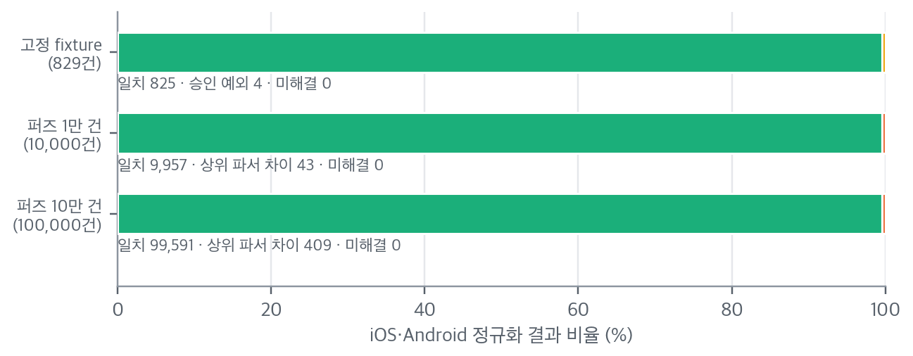
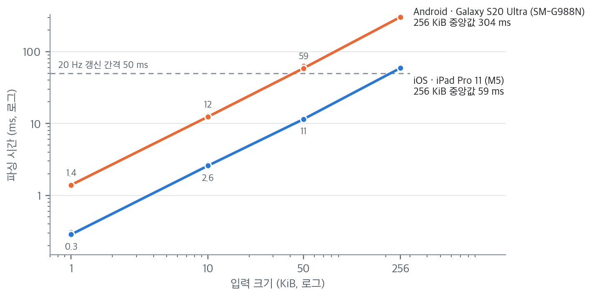
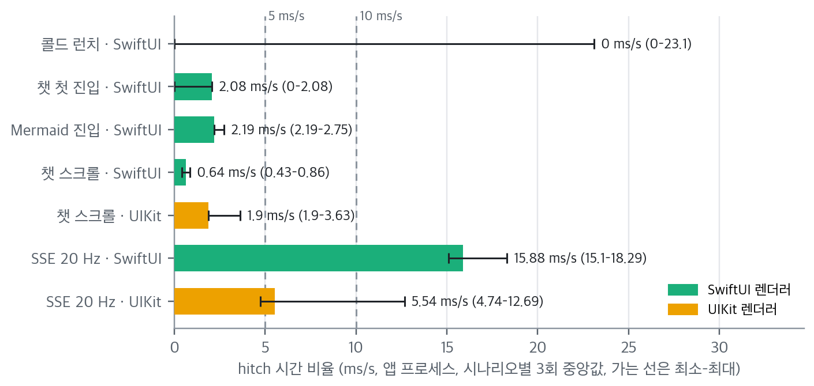
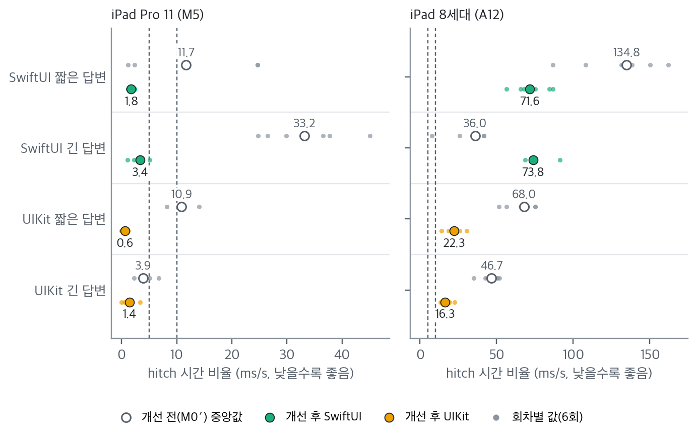
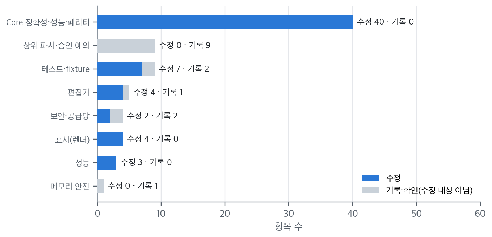

# 적용 사례 — RichMarkdown(iOS 0.10.0 · Android 0.4.0) 검증

> **요약.** 이 문서는 검증 가이드의 방법과 도구를 iOS·Android Markdown 렌더러 라이브러리 RichMarkdown에 적용한 조사 기록입니다. "AI 도구로 작성한 코드"라는 이유로 오류·성능·보안 우려가 제기되어, 누가 썼는지를 따지는 대신 결과를 네 질문(Q1 정확성·견고성, Q2 성능, Q3 보안, Q4 유지보수)으로 검증했습니다. 공용 입력 모음 829건의 플랫폼 간 비교에서 미해결 차이는 0건이었고, 퍼징 10만 회에서 크래시와 성질 위반이 없었으며, 검증 중 찾은 75개 항목을 결함 대장에 기록했습니다. 20 Hz 스트리밍 끊김은 개선 후 iPad Pro M5에서 기준 안이었지만 iPad 8세대에서는 기준을 넘었고, Android는 판정을 보류했습니다. 보고서를 낸 뒤 측정 방법 여섯 곳을 바로잡았고, 결론은 "남은 조건을 관리하는 전제로 도입 가능"입니다.

처음 보는 용어는 [용어 풀이](../glossary.md)에 모아 두었습니다.

이 가이드의 다른 문서가 인용하는 구체 수치는 모두 이 문서에 모아 두었습니다. 수치의 출처는 RichMarkdown 검증 보고서의 공개 사본[3]이고, 기준일은 2026-10-14(검증 보강 실행)이며, 20 Hz 스트리밍 재측정은 2026-10-16 결과를 반영합니다. 수치는 측정 시점의 코드 기준이므로, 이후 저장소의 현재 값처럼 인용하지 않습니다.

## 차례

- [1. 대상과 범위](#1-대상과-범위)
- [2. 실행 환경](#2-실행-환경)
- [3. 검증 방법](#3-검증-방법)
- [4. 결과](#4-결과)
- [5. 성능 판정과 재측정](#5-성능-판정과-재측정)
- [6. 결함 대장 소계](#6-결함-대장-소계)
- [7. 측정 방법을 나중에 고친 항목](#7-측정-방법을-나중에-고친-항목)
- [8. 남은 조건(타당성 위협)](#8-남은-조건타당성-위협)
- [9. 결론](#9-결론)
- [참고문헌](#참고문헌)

## 1. 대상과 범위

RichMarkdown은 LLM 답변을 화면에 그리는 Markdown 렌더러 라이브러리입니다(iOS는 Swift Package, Android는 Gradle)[1], [2]. "AI 도구로 작성한 코드"라는 이유로 오류·성능·보안 우려가 제기되어, 코드의 출처 대신 결과를 검증하기로 했습니다.

표 1은 두 저장소의 검증 대상입니다.

*표 1. 검증 대상*

| 항목 | iOS | Android |
|---|---|---|
| 저장소 | `RichMarkdown` (Swift Package) | `RichMarkdown-Android` (Gradle) |
| 보강 전 → 후 | 0.9.1 → 0.10.0 | 0.3.0 → 0.4.0 |
| 모듈 | Core · 표시 · 블록 편집기 · 하이라이트 · Mermaid | core · 표시 · editor · highlight · mermaid |
| Markdown 파서 | swift-markdown 0.4.0 (swift-cmark 0.8.0) | commonmark-java 0.30.0 |
| 수식 엔진 | RaTeX 0.1.14 (Rust, C ABI) | RaTeX 0.1.14 (JNI) |
| 최소 OS | iOS 16 | Android 11 (API 30) |

수식 엔진은 두 플랫폼이 같은 Rust 라이브러리를 씁니다. iOS는 C 언어의 함수 호출 규약(C ABI)으로, Android는 Kotlin·Java 코드가 네이티브 코드를 부르는 JNI(Java Native Interface)로 연결합니다.

범위 밖은 실제 LLM 서버 연동, 앱 서비스 코드, 서버 보안, 사용자 데이터 처리입니다. 데모의 스트리밍은 저장된 응답을 로컬에서 재생합니다.

## 2. 실행 환경

표 2는 측정에 쓴 호스트·기기·빌드 환경입니다.

*표 2. 실행 환경*

| 구분 | 환경 |
|---|---|
| 호스트 | MacBook Pro(M4 Pro, 24 GB), macOS 26.6.2, Xcode 26.6(iOS SDK 26.5), Swift 6.3.3 |
| iOS 실기기 | iPad Pro 11형(M5, 2025년 10월 출시, iPadOS 26.6.2), Release 빌드, 충전 중, 열 상태 정상 |
| iOS 저사양 실기기 | iPad 8세대(A12, 2020년 9월 출시, 60 Hz, iPadOS 26.0.1). 20 Hz 스트리밍 재측정에만 추가 |
| iOS 시뮬레이터 | iPhone 16 Pro(iOS 18.6), iPhone 14(iOS 16.4), iPhone 15(iOS 17.5·18.6), iPhone 17 Pro(iOS 26.5) |
| Android 실기기 | Galaxy S20 Ultra(2020년 3월 출시, Android 13, API 33, 120 Hz), release·benchmark 빌드 |
| Android 에뮬레이터 | Pixel 6(API 37.1, 16 KB 페이지), API 30 |
| JVM·빌드 | JetBrains Runtime 21, Kotlin 2.4, AGP(Android Gradle Plugin) 9.4, Gradle 9.6 |

Release 빌드는 배포용으로 최적화한 빌드이고, Debug 빌드는 디버깅 정보를 넣고 최적화를 줄인 개발용 빌드입니다. 시뮬레이터 Debug 빌드의 시간은 상대 비교에만 쓰고, 절대 성능은 실기기 Release 값만 인용합니다.

두 실기기는 출시 연도와 칩 세대가 달라, 플랫폼끼리 절댓값을 비교하지 않습니다.

## 3. 검증 방법

### 3.1 네 질문

검증은 표 3의 네 질문에 답하는 형태로 설계했습니다.

*표 3. 검증 질문과 답의 형태*

| ID | 질문 | 답의 형태 |
|---|---|---|
| Q1 | 다양한 입력·악의적 입력·스트리밍 중간 상태에서 크래시·멈춤·잘못된 표시가 없는가? 두 플랫폼이 같은 입력에 같은 구조를 내는가? | 테스트 매트릭스, 퍼징, 플랫폼 간 비교, 결함 대장 |
| Q2 | 긴 답변·20 Hz 스트리밍·스크롤에서 지연·끊김·메모리가 기준 안인가? | 도구별 측정표 |
| Q3 | LLM 답변이 앱 안에서 코드 실행·외부 통신·정보 유출로 이어질 수 있는가? 의존성은 고정·검증되는가? | 위협 모델, 정적 분석, 공격 입력 결과 |
| Q4 | 코드 품질이 관리 가능한 수준이고 검증이 자동으로 반복되는가? | 커버리지·복잡도·규모, CI 게이트 |

### 3.2 방법과 도구

질문마다 쓴 방법과 도구는 표 4와 같습니다.

*표 4. 질문별 방법과 도구*

| 질문 | 방법 | 도구 |
|---|---|---|
| Q1 | 단위·UI 테스트, 공용 입력 모음, 퍼징 10만 회, 플랫폼 간 비교, 극단 입력 25종 | [Swift Testing](../tools/ios-testing.md#2-swift-testing--swift-코드가-정해-둔-기댓값을-내는지-함수-단위로-검사하는-테스트-프레임워크)·[XCTest](../tools/ios-testing.md#3-xctest--xcode의-기본-테스트-프레임워크이자-ui-테스트성능-측정과-결과-번들xcresult의-기반)·[XCUITest](../tools/ios-testing.md#4-xcuitest와-접근성-감사--앱을-실제로-조작하는-ui-테스트와-화면의-접근성-문제를-자동으로-찾는-감사), [JUnit](../tools/android-testing.md#2-junit--기기-없이-jvm에서-kotlin-코드의-기댓값을-확인하는-테스트-프레임워크)·[AndroidX Test](../tools/android-testing.md#3-androidx-test와-espresso--에뮬레이터기기-안에서-화면-코드를-실행해-확인하는-계측-테스트-도구)·[Accessibility Test Framework](../tools/android-testing.md#4-accessibility-test-framework--android-화면의-접근성-문제를-규칙으로-자동-검사하는-라이브러리), 자체 정확성 검증 스크립트 |
| Q2 | 실기기 Release 반복 측정, 화면 끊김 추적, 도구 교차 확인 | [XCTest metrics](../tools/ios-performance.md#2-xctest-성능-지표--같은-블록을-반복-실행해-시간cpu메모리앱-실행-시간의-분포를-얻는-measure), [Instruments(xctrace)](../tools/ios-performance.md#3-instruments와-xctrace--앱이-도는-동안-cpu-표본프레임-hitch메모리구간을-한-타임라인trace에-기록하고-분석하는-도구)·[xcprof](../tools/ios-performance.md#4-xcprof--xctrace로-녹화한-cpu-profiler-트레이스를-함수별-비중과-메인-스레드-요약으로-풀어-주는-서드파티-도구), [Jetpack Micro](../tools/android-performance.md#2-jetpack-microbenchmark--android-함수-하나를-실기기에서-반복-실행해-시간과-할당-수를-재는-라이브러리)·[Macrobenchmark](../tools/android-performance.md#3-jetpack-macrobenchmark--앱을-밖에서-조작하며-실행-시간과-프레임-시간을-재는-라이브러리), [dumpsys gfxinfo](../tools/android-performance.md#4-dumpsys-gfxinfo--앱이-그린-프레임의-시간-분포를-기기에서-바로-읽는-android-명령), [Perfetto](../tools/android-performance.md#5-perfetto--android-기기에서-일어난-일을-시간축으로-보고-sql로-묻는-추적-도구) |
| Q3 | 위협 모델, 공격 입력 실행, 정적 분석, 의존성 감사, SBOM, 새니타이저 | [semgrep](../tools/common-security-quality.md#2-semgrep--코드를-실행하지-않고-규칙과-맞춰-위험한-모양을-찾는-도구), [osv-scanner](../tools/common-security-quality.md#3-osv-scanner--의존성-목록을-공개-취약점-데이터베이스와-대조하는-도구), [npm audit](../tools/common-security-quality.md#4-npm-audit--프로젝트의-npm-의존성에-알려진-취약점이-있는지-묻는-명령), [cdxgen·CycloneDX](../tools/common-security-quality.md#5-cdxgen과-cyclonedx--앱에-무엇이-들어-있는지-표준-형식의-목록으로-남기는-도구), [AddressSanitizer](../tools/ios-performance.md#5-addresssanitizer--범위-밖-접근해제-후-사용-같은-메모리-손상을-테스트가-도는-동안-잡아내는-컴파일러-기능)·[ThreadSanitizer](../tools/ios-performance.md#6-threadsanitizer--동기화-없이-두-스레드가-같은-메모리에-접근하는-데이터-경합을-테스트가-도는-동안-찾는-컴파일러-기능) |
| Q4 | 라인 커버리지, 복잡도·규모, 린트, CI 게이트 | [xccov](../tools/ios-testing.md#5-xccov--xcresult의-코드-커버리지를-타깃파일함수줄-단위로-읽는-xcode-명령행-도구), [Kover](../tools/android-testing.md#5-kover--jvm-단위-테스트가-kotlin-코드의-어느-줄을-실행했는지-재는-커버리지-플러그인), [JaCoCo](../tools/android-testing.md#6-jacoco--에뮬레이터-계측-테스트가-실행한-줄을-재는-커버리지-도구agp-내장), [lizard](../tools/common-security-quality.md#6-lizard--함수마다-갈림길이-몇-개인지-세어-복잡도를-재는-도구), [scc](../tools/common-security-quality.md#7-scc--언어별-코드주석빈-줄-수를-세어-코드-규모를-재는-도구), [SwiftLint](../tools/ios-testing.md#6-swiftlint--swift-소스의-스타일-문제와-위험한-관용구를-규칙으로-찾는-린터), [Android lint](../tools/android-testing.md#7-android-lint--앱을-실행하지-않고-소스리소스빌드-파일의-구조적-문제를-찾는-정적-검사-도구) |

Q1의 공용 입력 모음은 두 플랫폼이 함께 쓰는 테스트 입력(fixture) 묶음으로, 원 보고서는 "공용 fixture 코퍼스"라고 적었습니다. 플랫폼 간 비교(원 보고서 표기: 패리티)는 같은 입력을 넣은 iOS·Android의 정규화 결과를 맞춰 보는 차등 테스트이고, 퍼징은 입력을 무작위로 바꿔 대량으로 넣고 이상 동작을 찾는 테스트입니다.

극단 입력(원 보고서 표기: 병리 입력)은 수백 단계 중첩이나 수만 개 반복처럼 정상 사용에서는 드물지만 구조가 극단적인 입력입니다. Q3의 SBOM은 제품에 들어간 구성 요소 목록이고, 새니타이저는 실행 중 메모리 오류(ASan)·데이터 경합(TSan)을 잡도록 빌드에 검사 코드를 넣는 컴파일러 기능입니다.

도구별 읽는 법은 도구 문서 다섯 편, 곧 [iOS 테스트·품질 도구](../tools/ios-testing.md)·[iOS 성능·안전 도구](../tools/ios-performance.md)·[Android 테스트·품질 도구](../tools/android-testing.md)·[Android 성능 도구](../tools/android-performance.md)·[공통 보안·규모 도구](../tools/common-security-quality.md)에 일반화해 두었습니다. 표 4의 도구 이름을 누르면 해당 도구의 절로 이동합니다.

### 3.3 테스트 규모

표 5는 검증 보강 전후의 테스트 규모입니다.

*표 5. 보강 전후 테스트 규모*

| 항목 | 보강 전 | 보강 후 |
|---|---:|---:|
| iOS 패키지 테스트 함수 | 307 | 363 |
| iOS 매개변수 케이스(테스트 입력·극단 입력 등) | 86 | 381 |
| iOS 데모 UI 테스트 | 23 | 26(+ 수동 전용 측정·문서 캡처 10) |
| Android JVM 단위 테스트 케이스 | 187 | 1,017 |
| Android 계측 테스트 | 89 | 147(API 37 기준) |
| 공용 입력 모음의 테스트 입력(CommonMark 예제 포함) | 없음 | 847 |
| 퍼징 | 없음 | CI 1만 회, 수동 10만 회 |

CommonMark는 Markdown 문법을 엄밀하게 정한 공개 명세이고, 그 명세에 딸린 예제도 공용 입력 모음에 넣었습니다. 공용 입력 모음 847건 가운데 Mermaid 공격 입력 18건은 WebView 안 차단 여부를 보는 보안 입력이라 정규화 결과가 없습니다. 그래서 플랫폼 간 비교 대상은 나머지 829건입니다.

iOS 패키지 테스트는 5개 번들로 나뉩니다. 공용 입력 모음 829건은 매개변수화 테스트(입력만 바꿔 같은 테스트 함수를 여러 번 돌리는 방식) 152건과 25건, 그리고 반복문으로 도는 CommonMark 예제 652건으로 나눠 돌립니다. Android JVM 테스트는 Core 모듈이 JUnit Jupiter 6.1.3, Android 모듈이 JUnit 4.13.2를 쓰고, 합계는 1,017개입니다.

iOS와 Android는 테스트를 세는 방식이 달라(Swift Testing은 매개변수화한 테스트를 함수 하나로 셈) 서로 비교하지 않습니다. 매개변수 케이스는 처음에 370으로 적었다가 결과 번들 집계(381 test runs)로 바로잡았습니다. 로그의 케이스 시작 줄만 세면 인자에 줄바꿈이 든 11개가 빠지기 때문입니다.

데모 앱의 단위 테스트(Swift Testing)와 UI 테스트(XCTest)는 한 결과 번들에 함께 들어가며, 모두 61개입니다. UI 테스트는 클래스 8개·테스트 36개이고, 그중 10개(성능 측정 8개, 문서·GIF 캡처 2개)는 환경 변수가 없으면 건너뜁니다. 표 5의 "수동 전용 측정·문서 캡처 10"이 이 10개입니다.

CI 퍼징 1만 회는 iOS 시뮬레이터 Debug에서 11.3초 걸렸고, 시간 상한을 넘었다는 오탐은 3회 재측정으로 흡수했습니다. Android에서는 같은 퍼징이 테스트 1개로 잡히며, 로컬에서 약 1.7초, CI 러너에서 약 3.5초 걸렸습니다.

## 4. 결과

이 절의 수치는 2026-10-14 실행 결과입니다. 위치 보정 최적화(P-03)까지 반영한 같은 소스로 돌렸고, 원본은 릴리스 검수 기록[4]입니다. 성능 판정과 2026-10-16 재측정은 5절에 따로 정리했습니다.

### 4.1 Q1 정확성·견고성

표 6은 정확성·견고성 검사의 결과입니다. 공용 입력 모음과 퍼징의 플랫폼 간 비교에서 미해결 차이가 없었고, 극단 입력 25종은 모두 시간 예산 안에 들었습니다.

*표 6. Q1 정확성·견고성 검사 결과*

| 검사 | 결과 | 범위 |
|---|---|---|
| 패키지 테스트 | 363개 중 362개 통과, 실패 0, 1개 건너뜀 | iPhone 16 Pro 시뮬레이터(iOS 18.6). 건너뛴 1개는 iPhone 17 Pro 전용 렌더 스냅샷 |
| 렌더 스냅샷 | 40장 일치 | iPhone 17 Pro 시뮬레이터(iOS 26.5), 라이트·다크·글자 크기 |
| 최소 OS | iOS 16.4·17.5 각각 251개 통과 | Core·표시·Mermaid 테스트 |
| 예제 앱 | 51개 통과, 실패 0, 수동 전용 10개 건너뜀 | iPhone 16 Pro(iOS 18.6). iOS 26.5에서도 51개 통과 |
| Android 계측 테스트 | API 37에서 147개 통과. API 30에서 표시·Mermaid 모듈 88개 통과, 2개 건너뜀 | 로컬 에뮬레이터 결과. 수동 실행 CI 잡은 실행 이력 없음 |
| 접근성 자동 검사 | iOS 감사 3구성 통과. Android ERROR 0건 | iOS는 데모 앱 UI 테스트. Android는 데모 8개 화면을 라이트·다크로 검사(API 37 에뮬레이터) |
| **공용 입력 모음의 플랫폼 간 비교** | 829건 중 일치 825, 승인 예외 4, 미해결 0 | iOS와 Android의 정규화 결과 비교 |
| **퍼징** | 10만 회에서 크래시 0·성질 위반 0, 정규화 결과 99.6% 일치 | 잔여 409건은 스크립트가 상위 파서 차이로 전부 분류 |
| **극단 입력** | 25종 전부 시간 예산 안 | 보강 전 0.9.1은 중첩 목록 500단계에서 크래시 |

승인 예외는 차이를 알고도 이유를 기록하고 허용한 항목입니다. 그림 1은 공용 입력 모음과 두 규모의 퍼징에서 나온 플랫폼 간 비교 결과입니다. 세 묶음 모두 미해결 차이는 0건이고, 일치하지 않은 나머지는 승인 예외이거나 상위 파서 차이로 분류되었습니다.

*그림 1. iOS·Android 정규화 결과의 플랫폼 간 비교. 출처: RichMarkdown 검증 보고서(2026-10-14·16), 공개 저장소 사본*

다만 플랫폼 간 비교의 일치는 정답의 증명이 아닙니다. 비교기는 URL을 퍼센트 디코딩한 뒤 비교하므로 의미가 다를 수 있는 주소를 같게 보고, 양쪽이 함께 빠뜨린 입력은 찾지 못합니다. 비교기를 고친 뒤 일치율이 어떻게 달라지는지는 확인하지 않았습니다. 또 Android JUnit은 CommonMark 예제 652건을 명세의 기대 HTML과 자동 대조하지 않고, 크래시 여부와 처리 시간만 봤습니다.

그림 2는 극단 입력별 파싱 시간을 수정 전(0.9.1)과 수정 후로 비교한 것입니다. 중첩 목록 500단계는 수정 전에 크래시했고, 처리 시간이 폭증하던 입력(6.1절의 F-02·F-03)은 수정 후 크게 줄었습니다.

*그림 2. 극단 입력별 파싱 시간 — 수정 전(0.9.1) 대 수정 후(macOS 호스트 Release). 출처: RichMarkdown 검증 보고서(2026-10-14·16), 공개 저장소 사본*

### 4.2 Q2 성능 — 입력 크기별 파싱 지연

표 7은 입력 크기별 파싱 시간의 중앙값입니다. iOS는 Release 10회, Android는 release 50회 측정입니다.

*표 7. 입력 크기별 파싱 시간 중앙값*

| 입력 | iOS(iPad Pro M5) 중앙값 | Android(Galaxy S20 Ultra) 중앙값 |
|---|---:|---:|
| 1 KiB | 0.29 ms | 1.40 ms |
| 10 KiB | 2.59 ms | 12.42 ms |
| 50 KiB | 11.49 ms | 58.81 ms |
| 256 KiB(입력 상한) | 59.25 ms | 303.96 ms |

iOS 값은 iPad Pro 11형(M5, iPadOS 26.6.2) Release 빌드에서 XCTest metrics로 잰 10회 중앙값입니다(50 KiB 11.5 ms, 256 KiB 59.2 ms). 50 KiB의 P90은 11.59 ms였습니다. Android 값은 Galaxy S20 Ultra(Android 13) Release 빌드에서 Jetpack Microbenchmark로 벤치마크 14개를 약 13분 동안 돌린 결과이고, 50 KiB는 최솟값 54.54 ms, 할당 약 46만 개였습니다. 그림 3처럼 두 플랫폼 모두 파싱 시간이 입력 크기에 거의 비례해 늘어납니다.

*그림 3. 입력 크기별 파싱 시간(점: 반복별 값, 선: 중앙값). 출처: RichMarkdown 검증 보고서(2026-10-14·16), 공개 저장소 사본*

측정 도구가 맞게 재는지도 교차 확인했습니다. 같은 파싱 구간을 Time Profiler는 592 ms, 앱 코드가 남긴 구간 표시(os_signpost)는 591.3 ms, XCTClockMetric 50회 합은 587.7 ms로 재어, 세 도구가 1% 안에서 일치했습니다.

앱 실행 시간은 iOS 콜드 실행이 5회 중앙값 196 ms(193–202 ms), Android 웜 실행(부분 컴파일)이 Macrobenchmark 중앙값 76.2 ms였습니다. 실행 조건과 기기 세대가 달라 두 값은 비교하지 않습니다.

파싱은 메인 스레드 밖에서 최신 입력만 처리합니다. 그래서 파싱이 50 ms 갱신 간격보다 길어도 화면은 멈추지 않습니다. 스크롤·스트리밍의 끊김 판정은 5절에서 다룹니다.

### 4.3 Q3 보안

표 8은 보안 검사의 결과입니다. 라이브러리 코드에서는 두 검사 모두 지적이 0건이었지만, 0건은 검사한 범위 안의 결과입니다.

*표 8. Q3 보안 검사 결과*

| 검사 | 결과 | 범위 |
|---|---|---|
| **새니타이저** | AddressSanitizer·ThreadSanitizer 각 362개 통과, 오류·경합 0 | iPhone 16 Pro 시뮬레이터(iOS 18.6) Debug. 계측한 Swift·래퍼(wrapper) 호출 경로. Rust·시스템 JavaScriptCore·JNI 내부는 계측 밖 |
| **정적 분석·의존성** | semgrep 지적 0(iOS, 파일 138개), osv-scanner 0, npm audit 0 | Swift·JavaScript·Python·OWASP Top 10 규칙. Android semgrep 6건은 데모 앱 한정 |

새니타이저 0건(M-01)은 테스트가 실행한 경로 가운데 계측한 코드만의 결과입니다. 계측의 경계는 수식 엔진 RaTeX의 C 인터페이스와 JavaScriptCore입니다. Rust 엔진 쪽의 주된 방어는 입력 상한(수식 4 KiB, 이미지 한 변 8,192 px)입니다. Android JNI는 새니타이저로 실행하지 않았고, ThreadSanitizer 실행에는 실기기도 넣지 않았습니다.

새니타이저 실행에서 패키지 테스트 5개 번들의 통과 수는 95·93·16·29·129개였습니다. ThreadSanitizer 첫 실행의 `TEST FAILED` 세 건은 작성 중이던 테스트, RED 테스트(구현 전에 실패를 확인하려고 먼저 쓴 테스트), 시간 기준 테스트(P-01)였고, 경합 보고는 0줄이었습니다. 라이브러리 소스에는 컴파일러의 동시성 검사를 개발자 판단으로 면제하는 `@unchecked Sendable`·`nonisolated(unsafe)` 표시가 7곳(`ParseCache`, `MathRenderService`, `EquationTextAttachment` 등) 있습니다.

새니타이저는 실행을 크게 느리게 합니다. 50 KiB 파싱 P50은 유휴 상태 148.9 ms에서 AddressSanitizer 285 ms, ThreadSanitizer 581 ms로 늘었고, Core 번들은 AddressSanitizer 최종 재실행이 37.9초, ThreadSanitizer가 122.0초 걸렸습니다. 동시 빌드 부하 중 P50 384.9 ms가 300 ms 시간 기준에 걸린 사건(P-01) 뒤로는 새니타이저 실행에서 시간 판정을 건너뜁니다.

OWASP Top 10은 웹 애플리케이션에서 흔한 보안 취약점 열 가지 분류입니다. semgrep은 두 저장소를 같은 규칙 체계로 검사했습니다. Android 6건은 데모 앱 매니페스트의 `exported_activity` 지적으로, 스크린샷 자동화용 설정이라 결함이 아니라고 판정하고 기록만 했습니다. 라이브러리 모듈의 지적은 0건입니다.

새 CI 워크플로가 액션을 태그로 참조한다는 지적은 액션 6종을 커밋 SHA(바뀌지 않는 커밋 식별값)로 고정해 해결했습니다. 다만 semgrep에는 Swift·Kotlin 전용 규칙이 적어 보조 근거로만 두고, 보안 테스트 입력과 공격 입력을 실제로 실행한 동적 검증을 주된 근거로 삼았습니다.

의존성 조회는 플랫폼마다 대상과 실행 방식이 다릅니다. 표 9는 대상별로 정리한 것입니다.

*표 9. 의존성 조회 대상과 실행 방식*

| 대상 | 도구와 결과 | 실행 방식 |
|---|---|---|
| iOS `Package.resolved` | osv-scanner 0건 | iOS CI 게이트로 커밋마다 |
| Mermaid 웹 번들 `package-lock.json`(npm 패키지 140개) | osv-scanner 0건, npm audit 0건 | osv-scanner는 iOS CI 게이트로, `npm audit --audit-level=low`는 iOS CI에서 커밋마다 |
| Android 릴리스 런타임 의존성(CycloneDX 1.6 SBOM, 구성 요소 97개) | osv-scanner 0건 | 보고서를 쓸 때 수동으로 1회. CI 단계 없음 |
| 미리 빌드한 Rust 엔진 안의 라이브러리, 저장소에 복사해 둔 하이라이터 JavaScript | 조회하지 않음 | 조회 범위 밖 |

Android 저장소는 Gradle lockfile(설치할 의존성 버전을 고정해 적은 파일)을 쓰지 않습니다. 그래서 Gradle 의존성 출력을 변환 스크립트에 넣어 CycloneDX SBOM을 만든 뒤 osv-scanner로 조회했습니다. Mermaid 번들은 iOS 저장소에서 빌드한 것을 Android도 그대로 쓰므로, Android에서는 npm audit를 따로 돌리지 않습니다.

iOS는 cdxgen으로 SBOM 2종(Swift 패키지, Mermaid 웹 번들 140개)도 만들었습니다. 이 SBOM은 공급망 투명성의 근거로만 남기고 판정에는 쓰지 않았습니다. Android SBOM을 포함한 세 SBOM 모두 CI에서 다시 만들지 않습니다.

### 4.4 Q4 유지보수

라인 커버리지는 iOS 전체 92.1%(보강 전 84.0%), iOS Core 97.9%(2186/2233), Android 전체 91.3%로 기준(Core 90%·전체 80%)을 통과했습니다. 그림 4는 모듈별 라인 커버리지입니다.

*그림 4. 모듈별 라인 커버리지. 출처: RichMarkdown 검증 보고서(2026-10-14·16), 공개 저장소 사본*

iOS CI는 Core 90%·전체 80%를, Android CI는 Core 90%를 기준으로 둡니다. Android는 Kover 설정에서 Core에만 `minBound(90)` 규칙을 두었고, 검증 오류 출력(`verify.err`)은 0바이트였습니다. 로컬 래퍼 스크립트의 기준은 Core 80%라 CI보다 느슨했습니다.

Android 전체 91.3%(4,300/4,710줄)는 Kover의 JVM 단위 테스트 결과에 JaCoCo의 에뮬레이터 계측 결과를 줄 단위로 합친 값이고, CI는 계측 테스트를 돌리지 않습니다. Kover만 보면 라이브러리 5개 모듈의 JVM 단위 라인 커버리지는 41.1%(1831/4458), Core는 97.8%(908/928)입니다. JaCoCo는 라이브러리 4개 모듈의 debug 빌드에 `enableAndroidTestCoverage`를 켜고 API 37 에뮬레이터 실행에서 보고서를 만들었습니다. 표시 모듈은 계측 기준 줄 1,666개 중 188개가 실행되지 않았습니다.

iOS 결과의 벤치마크 타깃 행(83.37%)은 테스트를 건너뛴 타깃이라 인용하지 않았습니다. 그리고 커버리지가 높다고 결함이 없는 것은 아닙니다. 보강 전에도 iOS Core는 94.8%였지만, 그 뒤 iOS·Android 퍼징 기반 플랫폼 간 비교가 Core 결함 대부분을 찾았습니다.

복잡도는 lizard로 iOS Swift `Sources`와 Android Kotlin 라이브러리 5개 모듈 `src/main`을 같은 CSV 열 구조로 쟀습니다. 두 플랫폼 모두 중앙값 2·평균 3점대였고, 16 이상인 함수가 각각 7개(최대 28·34)였습니다. 플랫폼별 최대 함수 두 개는 퍼징 10만 회의 플랫폼 간 비교와 회귀 테스트 입력이 지나가는 함수라는 점을 근거로 판단했습니다.

코드 규모는 scc로 같은 범위(iOS `Sources`의 Swift, Android 라이브러리 5개 모듈 `src/main`의 Kotlin)를 같은 옵션으로 세어, 소스와 테스트 코드 줄을 나란히 놓았습니다. 번들 JavaScript(약 5천 줄대)와 테스트 입력 파일은 제외했고, 줄 수는 판정이 아닌 맥락 정보로만 실었습니다.

린트는 두 플랫폼 모두 설정 파일 없이 기본 규칙과 기본 심각도로 돌렸습니다. 표 10은 그 결과입니다.

*표 10. 린트 결과*

| 도구 | 대상 | 결과 |
|---|---|---|
| SwiftLint | iOS `Sources` | 위반 157건(경고 120·오류 37). 많은 순으로 `identifier_name` 30·`line_length` 28·`trailing_comma` 26. 코드 변경 뒤(커밋 `61b768b`)에는 155건(오류 37·경고 118) |
| Android lint | 라이브러리 4개 모듈 | 오류 0, 경고 15(표시 11·편집기 3·Mermaid 1·하이라이트 0) |
| Android lint | 데모 앱 | 오류 0, 경고 4, 힌트 3 |

SwiftLint 오류 37건 가운데 28건은 한 글자 변수 이름(`identifier_name`)이었습니다. `force_cast` 2건은 `layerClass`가 `CAShapeLayer`를 돌려주는 구조라 결함이 아니라고 판정했습니다. iOS CI에는 SwiftLint 단계가 없고, Android CI는 `lintDebug` 단계가 오류를 내면 실패합니다. SwiftLint 157건과 Android lint 결과는 서로 비교하지 않았습니다.

CI 게이트는 커밋마다 돌지만, 양쪽 `main` 브랜치가 `protected: false`이고 ruleset도 없어 CI 실패가 병합을 강제로 막지는 않습니다. 그래서 CI 실패와 병합 차단을 구분해서 다뤘습니다. 공유 CI에서 흔들리던 iOS UI 테스트는 수동 실행 잡으로 분리했습니다(T-09). 커버리지를 정확성의 근거로 쓰지 않은 이유와 CI 분할의 세부는 [유지보수 해설](../05-maintenance.md)의 적용 사례에 적었습니다.

## 5. 성능 판정과 재측정

표 11은 2026-10-16 재측정까지 반영한 성능 판정입니다. 판정에 쓴 용어는 다음과 같습니다.

- **끊김 시간 비율(ms/s)**: 1초 동안 늦게 표시된 시간의 합입니다. Instruments의 hitch time ratio이며, 화면 끊김(hitch)은 프레임이 제때 화면에 나가지 못해 툭 끊겨 보이는 현상입니다.
- **p50·P90·p99**: 값을 크기순으로 놓았을 때 각각 50%·90%·99%가 그 값 이하인 백분위입니다. p50은 중앙값입니다.
- **8.3 ms**: 120 Hz 화면의 프레임 예산(한 프레임에 쓸 수 있는 시간, 1,000 ÷ 120)입니다.
- **하네스**: 측정을 자동으로 돌리는 테스트 코드입니다. "첫 판 하네스"는 7절에서 고치기 전의 측정 방식입니다.
- **시작 위상**: 스트림 시작 시각이 화면 갱신 신호(vsync, 디스플레이가 다음 프레임을 받을 준비가 됐다고 알리는 주기 신호) 주기의 어느 지점에 걸리는지입니다.

*표 11. 성능 판정(2026-10-16 재측정 반영)*

| 기준 | 결과 | 판정 |
|---|---|---|
| 50 KiB 파싱 p50 < 300 ms(시뮬레이터 Debug 회귀 방지 기준) | 78.7 ms(최적화 전 146.1 ms) | 통과 |
| 스크롤 끊김 시간 비율 < 5 ms/s(iOS), 프레임 P90 < 8.3 ms(Android) | 0.64–1.9 ms/s(첫 판 하네스 3회, 잠정), 5–6 ms | 통과(잠정) |
| 20 Hz 스트리밍 끊김 시간 비율 < 5 ms/s(**iPad Pro M5**, 개선 후) | 0.6–3.4 ms/s(시나리오 4개, 6회 중앙값. 실제 시작 위상 미보정) | 관측 중앙값 기준 통과 |
| 20 Hz 스트리밍 끊김 시간 비율 < 5 ms/s(**iPad 8세대**, 개선 후) | UIKit 16.3–22.3, SwiftUI 71.6–73.8 ms/s | **미달 — 개선 대상** |
| 20 Hz 스트리밍 프레임 P90 < 8.3 ms(Android) | 합산 13.0 ms는 반복 1회의 버퍼 밀림 영향(반복별 7.0–13.6 ms) | **보류 — 반복별 재측정** |
| 스트리밍 뒤 메모리 증가 지속 없음 | 단일 실행에서 5–6 MiB 증가 후 유지. 반복 누적·Leaks 미확인 | 관찰 구간 내 통과 |

메모리 행의 Leaks는 Instruments의 메모리 누수 검사입니다. 시뮬레이터 Debug 기준은 프로젝트가 정한 회귀 방지 기준이고, 끊김 시간 비율의 5·10 ms/s는 Apple이 정한 외부 기준입니다.

그림 5는 첫 판 하네스로 잰 iPad Pro M5의 시나리오별 끊김 시간 비율입니다. 스크롤은 기준 안이었지만 3회 측정에 기댄 잠정 판정입니다. 20 Hz 스트리밍 값(SwiftUI 15.9·UIKit 5.5 ms/s)은 7절에서 고친 고정 측정 구간 방식의 첫 판 값이므로, 개선 전후 비교에는 5.1절의 재측정 값을 씁니다.

*그림 5. iOS 시나리오별 끊김 시간 비율(iPad Pro M5, 첫 판 하네스, 시나리오별 3회 중앙값, 가는 선은 최소–최대). 출처: RichMarkdown 검증 보고서(2026-10-14·16), 공개 저장소 사본*

표 11의 Android 행은 두 도구로 쟀습니다. 스트리밍은 Macrobenchmark의 `frameDurationCpuMs`(프레임 하나를 만드는 데 CPU가 쓴 시간)로 쟀고, 합산 P90이 12.97 ms(표 11의 13.0 ms)로 120 Hz 예산 8.33 ms를 넘었습니다. 스크롤은 Galaxy S20 Ultra가 Macrobenchmark 실행 중 커널 패닉(`kmem_cache_free`)으로 세 번 재부팅해, `am start`와 `input swipe` 제스처로 채팅 화면을 조작하고 dumpsys gfxinfo로 쟀습니다.

스크롤 5회 × 6페이지 왕복을 합산한 P90은 View 채팅 5 ms, Compose 채팅 6 ms(반복별 5–7 ms)로 120 Hz 예산 안이어서, 두 화면 모두 통과로 판정했습니다. gfxinfo의 프레임 시간은 `frameDurationCpuMs`와 정의가 달라 두 값을 같은 축에 놓지 않습니다.

### 5.1 20 Hz 스트리밍 재측정(2026-10-16)

두 빌드를 같은 날 두 기기에서 6회씩 쟀습니다. 개선 전 빌드는 0.10.0에 측정 하네스만 더한 빌드이고, 개선 후 빌드는 스트리밍 경로를 개선한 빌드입니다.

회차마다 실행 순서를 바꿨고(라틴 방진: 각 빌드가 각 실행 순서에 고르게 오도록 배치하는 실험 설계), 같은 회차에는 같은 시드(난수 생성의 시작값)로 예정 시작 오프셋을 배정했습니다. 시나리오는 SwiftUI·UIKit 각각 짧은 답변(1.1 KB)과 긴 답변(약 6 KB)입니다.

표 12의 지연 초과 시간(late excess ms/s)은 두 프레임 주기를 넘겨 늦은 프레임들이 넘긴 시간의 합입니다. 짝 차이는 같은 회차의 개선 후 값에서 개선 전 값을 뺀 차이이고, 음수면 줄어든 것입니다.

*표 12. 20 Hz 스트리밍 개선 전후 재측정*

| 기기 · 시나리오 | 끊김 시간 비율 전 → 후 (ms/s) | 지연 초과 시간 짝 차이 중앙값 | 줄어든 회차 | 판정 |
|---|---:|---:|---:|---|
| M5 · SwiftUI 짧은 답변 | 11.7 → 1.8 | −43.3 | 4/6 | 통과 |
| M5 · SwiftUI 긴 답변 | 33.2 → 3.4 | −73.3 | 6/6 | 통과 |
| M5 · UIKit 짧은 답변 | 10.9 → 0.6 | −13.2 | 6/6 | 통과 |
| M5 · UIKit 긴 답변 | 3.9 → 1.4 | −22.2 | 6/6 | 통과 |
| iPad 8 · SwiftUI 짧은 답변 | 134.8 → 71.6 | −14.0 | 3/6 | 미달, 개선 불확실 |
| iPad 8 · SwiftUI 긴 답변 | 36.0 → 73.8 | +60.9 | 0/6 | 미달, 악화 |
| iPad 8 · UIKit 짧은 답변 | 68.0 → 22.3 | −44.6 | 6/6 | 미달, 개선 |
| iPad 8 · UIKit 긴 답변 | 46.7 → 16.3 | −47.3 | 6/6 | 미달, 개선 |

그림 6은 같은 결과를 회차별 값과 함께 보여 줍니다. iPad Pro M5는 네 시나리오 모두 5 ms/s 아래로 내려왔고, iPad 8세대는 네 시나리오 모두 기준을 넘었으며 SwiftUI 긴 답변은 오히려 나빠졌습니다.

*그림 6. 20 Hz 스트리밍 개선 전후의 끊김 시간 비율(6회 교차 측정의 중앙값과 회차별 값, 점선은 Apple 기준 5·10 ms/s). 출처: RichMarkdown 검증 보고서(2026-10-14·16), 공개 저장소 사본*

판정에서는 끊김 시간 비율의 중앙값을 Apple 기준(5·10 ms/s)과 비교했습니다. "개선됐다"는 판단은 같은 회차 지연 초과 시간의 짝 차이와 줄어든 회차 수로 했습니다.

iPad 8세대 SwiftUI 긴 답변이 나빠진 것은, 메인 스레드 일이 줄자 iOS가 그 스레드를 효율 코어로 옮겨 갱신 한 번이 길어졌기 때문으로 추정합니다. 이 추정은 스트림 구간 메인 스레드 표본의 P 코어(고성능 코어) 비율이 개선 전 0.81–0.82에서 최종 0.23–0.29로 내려간 관찰과 맞습니다. 다만 코어 배치 규칙이 공개되어 있지 않아 신뢰도는 "가능성 높음"입니다.

이 사례의 교훈은 평균 작업량을 줄이는 최적화가 저사양 기기에서 거꾸로 작용할 수 있다는 점입니다. 그래서 빌드를 비교할 때는 저사양 기기를 넣고 프레임 단위 지표로 판단합니다.

Android는 개선 전후를 콘텐츠 프레임만 골라 비교했습니다. 스피너만 그린 프레임이 약 64%였기 때문입니다. 데모에 `sse-stream` 비동기 구간을 추가해 보니, 스트림 7.3초 동안 게시가 71번(약 10 Hz) 일어났습니다.

라이브러리 개선 뒤 Compose 재구성(상태가 바뀐 UI를 다시 계산하는 일) 구간이 게시당 4.80 → 2.59개로, 메인 스레드 작업이 381 → 285 ms로 줄었습니다. 그러나 콘텐츠 프레임 UI 시간(3.34 → 3.36 ms)과 마감 누락(14 → 12건)은 그대로였고, p99는 7.9 → 9.7 ms로 늘었습니다.

일은 줄었지만 끊김이 줄었다고 말할 수 없어 판정을 보류했습니다. 두 빌드를 번갈아 돌리지 않았으므로, 기기 상태 변화와 빌드 효과를 나눌 수도 없습니다.

## 6. 결함 대장 소계

검증 중 75개 항목을 결함 대장에 기록했습니다. 표 13은 영역별 처리 현황이고, 그림 7은 같은 건수를 그래프로 보인 것입니다.

*표 13. 결함 대장의 영역별 처리 현황*

| 영역 | 수정 | 기록·확인 | 합계 |
|---|---:|---:|---:|
| Core 정확성·성능·플랫폼 간 비교(F) | 40 | 0 | 40 |
| 상위 파서 차이·승인 예외(D) | 0 | 9 | 9 |
| 테스트·테스트 입력·측정 환경(T) | 7 | 2 | 9 |
| 편집기(E) | 4 | 1 | 5 |
| 표시·번들(R) | 4 | 0 | 4 |
| 보안·공급망(S) | 2 | 2 | 4 |
| 성능(P) | 3 | 0 | 3 |
| 메모리 안전(M) | 0 | 1 | 1 |
| **합계** | **60** | **15** | **75** |

*그림 7. 결함 분류별 처리 현황. 출처: RichMarkdown 검증 보고서(2026-10-14·16), 공개 저장소 사본*

보고서는 이 가운데 제품 결함 52건을 수정했다고 요약합니다. 표 13은 결함 분류 그림(그림 7)의 건수를 옮긴 것이어서, 보고서 요약과 분류 기준이 다릅니다.

Core 결함 대부분은 두 플랫폼의 퍼징 결과를 맞춰 보는 플랫폼 간 비교가 찾았습니다. 한 플랫폼만 테스트했다면 입력마다 기댓값을 사람이 정해야 해서 찾기 어려웠을 결함입니다. 이렇게 플랫폼 간 비교에서 찾아 고친 결함이 26건입니다.

### 6.1 영향이 큰 결함

표 14는 사용자 영향이 컸던 결함입니다.

*표 14. 영향이 큰 결함*

| ID | 내용 | 조치와 결과 |
|---|---|---|
| F-01 | **iOS 크래시.** 중첩 목록 65단계 이상에서 재귀 변환이 협력 스레드 스택(512 KB)을 넘어 SIGBUS(잘못된 메모리 접근으로 인한 강제 종료). 실측 56단계 통과·65단계 크래시 | 목록 들여쓰기 48열 상한(두 플랫폼) |
| F-02 | **처리 시간 O(n²)(입력 길이의 제곱에 비례).** 한 줄에 수식 구간 2만 개(95 KB)가 있으면 줄 끝 탐색과 구간 필터가 반복. Debug 테스트 빌드 12.9초, Release 약 300 ms | 줄 종료 위치 배열 + 이진 탐색. Release 18 ms |
| F-03 | **처리 시간 O(n²).** 닫히지 않은 `\(` 1만 개에서 여는 구분자(opener)마다 줄 끝까지 다시 탐색 | 같은 줄 미종료 판정 캐시 |
| R-01 | 다크 모드 블록 수식이 LaTeX 원문으로 표시. 시스템 색의 다크 값이 허용 범위를 넘어(1.0000001) 수식 엔진이 파싱 실패 | 색 값을 0–1로 고정해 전달 |
| P-03 | 수정이 만든 성능 회귀로, 실기기 재측정이 찾음. 위치 보정(F-15~F-39)을 넣은 뒤 iPad 50 KiB 파싱이 11.8 → 16.9 ms. 표본 추출에서 위치 보정이 45%, 파싱마다 트리를 네 번 순회 | 순회 한 번으로 통합해 11.5 ms. 퍼징 10만 회·공용 입력 모음 전체의 출력은 수정 전과 바이트 단위로 동일 |

그 밖에 iOS 화면 오표시 다수(F-15~F-39)가 있었습니다. 들여쓴 연속 줄·역슬래시 줄바꿈·표 안 이스케이프 등에서 수식 자리에 가림 문자(`xxxxx`)가 보이거나 글자가 사라졌고, 원인은 상위 파서(swift-cmark)의 위치 보고 오류였습니다.

표시 영역(R)의 나머지 세 건은 계측·UI 테스트와 접근성 검사가 찾았습니다. R-02는 XCUITest 접근성 감사가 찾은 단독 수식 뷰의 터치 영역 결함으로, `accessibilityTraits = .staticText`로 고쳤습니다. R-03은 API 30 에뮬레이터의 계측 테스트가 찾은 결함입니다. System WebView 91에 `Object.hasOwn`이 없어 모든 Mermaid 다이어그램이 원문으로 표시됐습니다. R-04는 Accessibility Test Framework가 View 채팅에서 찾은 `TextContrastCheck` WARNING 8건(대비 4.27:1·4.36:1)으로, 고친 뒤 경고가 사라졌습니다.

최종 코드로 새니타이저를 다시 돌려 Debug 빌드의 스택 여유 문제(F-40, 인용 64단계 입력)도 찾아 고쳤습니다. 이 크래시는 AddressSanitizer 보고가 아니라 `convert(block:)` 프레임이 8 KB를 넘어 생긴 스택 넘침이었고, 함수를 나누고 반복문으로 바꿔 고쳤습니다. Release 빌드는 스택을 112–116 KB만 써서 원래 영향이 없었습니다.

## 7. 측정 방법을 나중에 고친 항목

보고서를 낸 다음 날, 스트리밍 개선을 위해 트레이스를 다시 계산하다가 측정 방법과 해석을 여섯 곳 바로잡았습니다. 표 15는 항목마다 판정이 어느 쪽으로 움직였는지 숨기지 않고 적은 것입니다. 각 함정의 원리는 [3장 성능의 측정 함정](../03-performance.md#6-측정-함정과-대응)에 일반화해 두었습니다.

*표 15. 측정 방법을 나중에 고친 항목과 판정 방향*

| 항목 | 처음 한 방식 | 고친 내용 | 판정 방향 |
|---|---|---|---|
| 고정 측정 구간 희석 | "탭 + 10초" 고정 측정 구간으로 끊김 시간 비율을 계산. 스트림이 7.6~7.7초에 끝나 유휴 꼬리 2.4~2.6초가 분모에 들어가, 비율이 약 1.35배 낮게 나옴 | 앱이 기록하는 구간 표시(signpost, `sse-stream`)를 측정 구간으로 사용. SwiftUI 15.9 → 약 21.6, UIKit 5.5 → 약 7.7 ms/s | 라이브러리에 유리했던 오차를 바로잡음(느린 기기에서는 반대로 뒷부분이 잘림) |
| 상대 sleep | 청크를 처리한 뒤 50 ms를 쉼. 느린 빌드일수록 간격이 길어져 부하가 줄어듦 | 절대 시각 기준(시작 시각 + n × 50 ms) 일정 | 처리가 느린 빌드에 유리하던 편향 제거 |
| 접근성 모드 | "UI 자동화 접근성 호출 약 420 ms가 끊김의 일부"로 설명. 함수 이름에 `ccessibility`가 든 프레임을 넓게 센 과대 집계 | 직접 조회는 40–47 ms. 실제 비용은 UI 테스트가 켠 접근성 모드의 트리 유지(SwiftUI 164–194 ms로 스트림 중 메인 스레드의 약 11–12%, UIKit은 약 0.5%). 접근성을 끈 자동 재생 시나리오 추가 | 원인 설명 수정, 방향은 유지 |
| 데모 비용 | SwiftUI 끊김을 라이브러리 게시 단계 탓으로 배분 | 데모 화면의 상태 카운터가 화면 전체를 다시 그리는 비용(메인 스레드 20–30%)과 하단 스크롤 비용(약 14%)이 컸음. 데모 상태 표시를 본문과 분리 | 라이브러리에 불리하게 배분했음. 다만 1.1 KB는 짧아 약 6 KB 테스트 입력 추가 |
| 반복 합산 백분위 | Android 프레임 P90 13.0 ms의 원인을 재파싱·재배치로 설명 | Macrobenchmark는 5회 반복의 프레임을 합쳐 백분위를 냄. 반복 1회의 버퍼 대기(BufferQueue stuffing: 화면에 낼 버퍼가 밀려 쌓이는 현상)가 합산 P90을 끌어올림. 반복별 P90 7.63·13.59·7.54·7.04·7.52 ms | 원인 설명 철회, 판정 보류 |
| 끊김 변동 | 끊김 시간 비율 하나로 빌드를 비교 | 같은 빌드·같은 작업량에서도 끊김 수가 4건에서 83건까지 갈림(작업량 차이는 약 7% 안). vsync 기준 시작 위상 고정(청크 간격 50 ms = vsync 6번)과 "목격자 규칙"(늦은 프레임이 화면에 있는 동안 다른 프레임이 표시된 경우만 끊김으로 셈)의 겹침으로 설명(가능성 높음). 메인 스레드 점유 시간(busy ms/s)·지연 초과 시간을 병행 지표로 추가하고, 시작 일정을 vsync에 맞춘 뒤 시드로 정한 오프셋을 더함 | 스크롤·진입·실행의 통과 판정도 3회 측정에 기댄 잠정 판정으로 낮춤 |

반복 합산 백분위 항목은 Perfetto로 반복별 트레이스를 열어, 한 반복의 거의 모든 프레임이 `dequeueBuffer`(화면에 낼 버퍼를 받아 오는 호출)에서 막힌 것을 보고 원인 설명을 철회한 것입니다. 한편 유효한 반복 하나에서도 앱 프레임 대부분에 `Buffer Stuffing` 표시(529건 등)가 붙었지만, 이 표시는 끊김으로 세지 않았습니다.

그 밖에 xcprof의 `inclusive_ms`가 시간이 아니라 표본 비율에 측정 구간 길이를 곱한 추정치임을 확인했습니다. SwiftUI 스트리밍 트레이스에서 `inclusive_ms`는 8,512 ms였지만, 같은 시나리오의 Time Profiler 메인 스레드 작업량은 1,650 ms였습니다. 그래서 시간은 Time Profiler(1 kHz 표본) 값으로 읽고, xcprof는 비율만 읽기로 정했습니다.

xcprof는 측정 스크립트의 CPU Profiler 녹화 요약에만 썼고, 보고서 본문 수치에는 쓰지 않았습니다(`record`·`compare`도 쓰지 않음). 당시 요약 스크립트가 비율(%)만 읽었으므로 보고서 수치는 이 보정의 영향을 받지 않았습니다. 후속 측정 하네스는 dSYM(심벌 정보 파일)도 결과 폴더에 보존하도록 바꿨습니다.

### 7.1 도구별 관찰

이 밖에도 도구를 돌리고 결과를 읽는 과정에서 집계 방식을 바로잡거나 기록의 빈틈이 드러난 일이 있었습니다. 표 16은 이를 도구별로 모은 것입니다. 같은 도구를 다시 쓸 때 먼저 확인할 점이기도 합니다.

*표 16. 도구별 관찰과 처리*

| 도구 | 관찰과 처리 |
|---|---|
| Swift Testing | 수동 실행 입력으로 준 퍼징 횟수가 시뮬레이터까지 전달되는지는 확인하지 못함 |
| XCTest | CI의 앱 단위 테스트 잡은 `Executed N tests` 줄을 출력하지만, 테스트가 Swift Testing이라 실제 결과는 `Test run with` 줄에서 읽음 |
| Instruments·xctrace | iPad 8세대에서 측정이 겹쳐 돈 데이터를 무효 처리함. xctrace가 69분 동안 멈춘 일이 있어 측정 하네스에 종료 로직을 넣음 |
| Jetpack Microbenchmark | 콘솔의 54,535,885 ns는 최솟값이라 보고서의 중앙값과 다름. `cpuLocked: true`는 `lockClocks` 흔적 없이 기록돼 클럭 고정을 단정하지 않음 |
| Jetpack Microbenchmark | `parse_50k_dollar`는 샘플에 `$`가 없어, 옵션을 켰을 때의 빈 탐색 비용만 잼 |
| dumpsys gfxinfo | 데모 앱이 화면에 없을 때 `Failure while dumping the app`이 나옴 |
| AndroidX Test·Espresso | 계측 코드에는 `androidx.test.espresso` import가 없음. `espresso-core`는 Compose 테스트의 전이 의존성(다른 의존성이 끌고 들어온 의존성) 때문에 3.7.0으로 올림 |
| Accessibility Test Framework | API 30 실행은 `assumeTrue`(조건이 거짓이면 테스트를 건너뛰는 함수)로 건너뛰었는데, AGP 보고서에는 `2 failures`로 표시됨(T-05) |
| JaCoCo | API 30 실행이 같은 빌드 폴더의 결과를 덮어씀. 보고서가 API 37 실행 결과로 남았음을 `Sessions` 시각으로 확인함 |
| Kover | 계획 단계에 적은 "JaCoCo보다 정확하다"는 선택 이유를 공식 문서로 확인하지 못해 근거에서 뺌 |
| Android lint | Mermaid의 `MissingOnRenderProcessGone` 경고는 콜백이 실제로 구현돼 있어 lint의 인식 한계로 봄(원인은 미확인) |
| npm audit | 보고서를 쓸 때 `node_modules`를 만들었는지 기록에 없음. 실행 위치를 남기는 습관이 필요함 |
| cdxgen·CycloneDX | Android SBOM에 변환 스크립트를 쓴 이유와 SBOM 생성 명령 원문이 기록에 없어, 결과 파일의 메타데이터에서 일반 형태를 거꾸로 추정함 |
| lizard | 보고서 집계 뒤 iOS 코드가 바뀌어 재실행 값이 달라짐. 측정 시점을 붙여 인용하는 방식으로 정정함. Android는 재실행 값이 일치함 |
| scc | 집계 다음 날 재확인에서 iOS는 코드 변경으로 줄 수가 조금 늘었고 Android 소스는 같았음. Android 테스트 줄은 원래 센 범위가 기록에 없어 재현하지 못함 |

## 8. 남은 조건(타당성 위협)

이 절은 논문의 타당성 위협(threats to validity), 즉 앞 절의 결과를 어디까지 일반화할 수 있는지 제한하는 조건에 해당합니다. 표 17의 항목은 결과를 인용할 때 함께 밝혀야 합니다.

*표 17. 남은 조건과 다음 조치*

| 항목 | 상태 | 다음 조치 |
|---|---|---|
| 20 Hz 스트리밍 끊김 | M5는 기준 안(관측 중앙값, 실제 시작 위상 미보정). iPad 8세대는 미달. Android는 판정 보류 | 갱신 한 번의 최대 비용을 줄이는 방향으로 개선, 실제 시작 위상 기준 재분석, Android는 두 빌드를 번갈아 반복별로 재측정 |
| 스트리밍 개선 코드 배포 | 두 플랫폼 모두 릴리스 태그 이후 변경 | 다음 릴리스에 포함하고 같은 스크립트로 확인 |
| iOS 스크롤·진입·실행 끊김 | 첫 판 하네스 3회 측정이라 잠정 판정 | 고친 하네스로 재측정 |
| iPhone·저사양 iPad 실기기 성능 | iPad 8세대는 20 Hz 스트리밍만 측정. iPhone 16 Pro는 연결하지 못해 미측정 | 마이크로·트레이스 시나리오 스크립트 재실행 |
| Android 14 이상 실기기 Macrobenchmark | Galaxy S20 Ultra(Android 13)가 하네스 실행 중 커널 패닉으로 3회 재시작. Compose 스크롤 매크로 미측정 | Android 14 이상 기기에서 재실행 |
| iOS 16·17 실기기 | 시뮬레이터만 확인 | 해당 OS 기기 확보 시 |
| VoiceOver·TalkBack 실사용 | 자동 감사만 | 출시 전 사람 확인 |
| Android 접근성 경고 | 블록 수식 복사 버튼 라벨이 구분되지 않음, 아이콘 대비 추정치 1.12(라이트)·1.23(다크). Compose 글자 대비는 도구가 읽지 못해 미검사 | 라벨에 수식 요약 추가 검토, 대비 수동 확인 |
| Mermaid 첫 WebView 초기화 지연 | 느린 CI 러너에서 로드 상한 15초를 넘어 다이어그램이 원문과 안내 문구로 대체된 사례 1건(설계대로 동작) | 시간 초과 뒤 한 번 자동 재시도 검토 |
| 상위 파서 차이 D-03~D-09 | 기록 | 상위 저장소 수정 시 갱신 |

이 가운데 D-03은 "사용자에게 보이면 고친다"는 판단 기준의 예외입니다. iOS 파서가 8자리 숫자 문자 참조를 U+FFFD(대체 문자)로 바꿔 사용자에게도 글자가 달라 보입니다. 하지만 아주 드문 입력이고 원인이 상위 파서라 고치지 않고 기록만 했습니다. 그래서 이 프로젝트는 "같은 글자를 보존한다"고 말하지 않습니다.

## 9. 결론

정확성·견고성(Q1)에서는 공용 입력 모음과 퍼징의 플랫폼 간 비교에서 미해결 차이가 0건이었고, 극단 입력 25종이 모두 시간 예산 안에 들었습니다. 보안(Q3)의 0건은 계측·검사한 범위 안의 결과이고, 유지보수(Q4)의 커버리지는 기준을 넘었지만 정확성의 근거로 쓰지 않았습니다.

성능(Q2)은 조건부입니다. iPad Pro M5의 20 Hz 스트리밍은 개선 후 기준 안이었지만 저사양 iPad 8세대에서는 기준을 넘었고, Android 스트리밍은 판정을 보류했습니다. 이 항목들은 8절의 남은 조건으로 넘겼습니다.

권고 요지는 "남은 조건을 관리하는 전제로 도입 가능"이었습니다. 도입 뒤에도 커밋마다 CI가 같은 검증을 반복하고, 릴리스 전에는 실기기 측정과 퍼징 10만 회를 수동으로 다시 실행합니다.

방법 쪽에서 얻은 교훈은 두 가지입니다. 평균 작업량을 줄이는 최적화가 저사양 기기에서 거꾸로 작용할 수 있으므로, 빌드 비교에는 저사양 기기와 프레임 단위 지표를 넣습니다. 그리고 측정 방법을 나중에 고치면 첫 판 수치와 재측정 수치를 구분하고, 판정이 어느 쪽으로 움직였는지 적습니다(7절).

## 참고문헌

[1] Jimmy-Jung, "RichMarkdown", iOS 저장소, GitHub, <https://github.com/Jimmy-Jung/RichMarkdown>.

[2] Jimmy-Jung, "RichMarkdown-Android", Android 저장소, GitHub, <https://github.com/Jimmy-Jung/RichMarkdown-Android>.

[3] "RichMarkdown 검증 보고서" 공개 사본, [1], [2] 저장소의 `Docs/report/verification/`. 측정 방법·결함 대장 전체(부록 A)·재현 명령(부록 B)·그래프는 이 사본을 참고합니다. 이 문서의 수치는 이 보고서의 2026-10-14 본문과 2026-10-15·16 정정·재측정 기록에서 가져왔습니다.

[4] "릴리스 검수 기록", [1] 저장소의 `Docs/report/validation.md`. 4절 2026-10-14 결과 표의 원본입니다.
