# Android 성능 도구 — Jetpack Microbenchmark · Jetpack Macrobenchmark · dumpsys gfxinfo · Perfetto

> **요약.** 이 문서의 네 도구는 Android 앱이 실제 기기에서 얼마나 빠르고 부드럽게 동작하는가(Q2 성능)에 답합니다. Jetpack Microbenchmark는 함수 하나의 시간과 할당 수를, Jetpack Macrobenchmark는 앱 실행 시간과 연속 동작의 프레임 분포를 실기기에서 반복 측정하고, dumpsys gfxinfo는 Macrobenchmark를 쓸 수 없는 기기에서 프레임 분포를 대신 읽습니다. Perfetto는 이 숫자가 이상할 때 반복별 트레이스를 열어 어느 스레드가 무엇을 했는지 확인하는 원인 분석 도구입니다. 결과를 읽을 때 가장 중요한 점은 숫자의 정의와 집계 방식을 확인하는 것으로, Microbenchmark 콘솔의 시간은 최솟값이고, 프레임 백분위는 모든 반복을 합쳐 계산되며, gfxinfo와 Macrobenchmark의 프레임 시간은 정의가 달라 같은 축에 놓을 수 없습니다.

처음 보는 용어는 [용어 풀이](../glossary.md)에 모아 두었습니다.

에이전트용 압축판: `skills/verify/references/platform-android.md`(명령·함정), `skills/verify/references/tools.md`(도구 지도)

## 차례

- [1. 들어가며](#1-들어가며)
- [2. Jetpack Microbenchmark — Android 함수 하나를 실기기에서 반복 실행해 시간과 할당 수를 재는 라이브러리](#2-jetpack-microbenchmark--android-함수-하나를-실기기에서-반복-실행해-시간과-할당-수를-재는-라이브러리)
- [3. Jetpack Macrobenchmark — 앱을 밖에서 조작하며 실행 시간과 프레임 시간을 재는 라이브러리](#3-jetpack-macrobenchmark--앱을-밖에서-조작하며-실행-시간과-프레임-시간을-재는-라이브러리)
- [4. dumpsys gfxinfo — 앱이 그린 프레임의 시간 분포를 기기에서 바로 읽는 Android 명령](#4-dumpsys-gfxinfo--앱이-그린-프레임의-시간-분포를-기기에서-바로-읽는-android-명령)
- [5. Perfetto — Android 기기에서 일어난 일을 시간축으로 보고 SQL로 묻는 추적 도구](#5-perfetto--android-기기에서-일어난-일을-시간축으로-보고-sql로-묻는-추적-도구)
- [참고문헌](#참고문헌)

## 1. 들어가며

스트리밍 화면을 Macrobenchmark로 재 보니 프레임 P90이 프레임 예산을 넘었다고 해 봅시다. "갱신마다 다시 파싱하고 배치하느라 느리다"고 결론을 적으려는데, 반복 다섯 번 가운데 한 번만 유난히 느렸다면 이야기가 달라집니다.

그래서 숫자 하나로 결론을 내리기 전에 그 숫자가 어떻게 계산됐는지, 원인을 트레이스로 확인할 수 있는지를 따져야 합니다. 이 문서는 Android에서 성능(Q2)을 재는 도구 네 개를 다음 순서로 씁니다.

1. **함수 하나를 잽니다.** [Jetpack Microbenchmark](#2-jetpack-microbenchmark--android-함수-하나를-실기기에서-반복-실행해-시간과-할당-수를-재는-라이브러리)로 파싱 같은 함수를 실기기에서 예열한 뒤 반복 실행해 시간과 할당 수를 얻습니다. 보고서에는 결과 JSON의 중앙값을 대푯값으로 씁니다.
2. **앱 전체를 잽니다.** [Jetpack Macrobenchmark](#3-jetpack-macrobenchmark--앱을-밖에서-조작하며-실행-시간과-프레임-시간을-재는-라이브러리)의 별도 테스트 앱이 대상 앱을 실행·조작하면서 실행 시간과 프레임 시간을 반복 측정하고, 반복마다 트레이스를 남깁니다.
3. **Macrobenchmark를 못 쓰면 대신 잽니다.** 측정에 함께 도는 프로세스 조합이 기기를 재부팅시키는 경우처럼 Macrobenchmark를 돌릴 수 없는 기기에서는, [dumpsys gfxinfo](#4-dumpsys-gfxinfo--앱이-그린-프레임의-시간-분포를-기기에서-바로-읽는-android-명령)로 같은 동작의 프레임 분포를 읽습니다.
4. **원인을 확인합니다.** 백분위가 이상하면 [Perfetto](#5-perfetto--android-기기에서-일어난-일을-시간축으로-보고-sql로-묻는-추적-도구)로 그 반복의 트레이스를 열어 보고, 같은 분류 규칙을 SQL로 적어 모든 반복에 적용합니다. Macrobenchmark 절의 '콘텐츠 프레임' 지표(3.7.3절)가 이렇게 만들어집니다.

앞의 세 측정 도구는 준비도 같습니다. 실기기를 USB로 연결하고, 기기가 식기를 기다렸다가 기기 상태를 기록한 뒤 측정 스크립트로 실행합니다. 실기기가 필요하므로 CI에서는 돌리지 않습니다.

처음 읽는다면 Microbenchmark(2절)에서 측정 단계와 결과 JSON 읽는 법을 익히고, Macrobenchmark(3절)는 주의할 점(3.7절)까지 읽기를 권합니다. 이어서 Perfetto(5절)로 트레이스를 읽는 법을 봅니다.

dumpsys gfxinfo(4절)는 Macrobenchmark를 쓸 수 없는 기기를 만났을 때 펼쳐 봅니다. JVM 테스트와 계측 테스트는 [Android 테스트·품질 도구](android-testing.md)에서 다룹니다.


## 2. Jetpack Microbenchmark — Android 함수 하나를 실기기에서 반복 실행해 시간과 할당 수를 재는 라이브러리

> **요약.** Jetpack Microbenchmark는 "Android 함수 하나(예: 파싱)가 실제 기기에서 얼마나 걸리고 객체를 몇 개 만드는가"에 답하는 측정 라이브러리입니다. 결과를 읽을 때 가장 중요한 점은 콘솔 요약의 시간이 중앙값이 아니라 최솟값이라는 것입니다. 또 결과 JSON의 `cpuLocked: true`를 "클럭을 고정했다"로 단정하지 않습니다.


### 2.1 한눈에 보기

*표 1. Jetpack Microbenchmark 개요*

| 항목 | 내용 |
|---|---|
| 무엇을 하나 | 함수 하나를 예열한 뒤 반복 실행해 실행 시간(중앙값·최소·최대)과 메모리 할당 수를 JSON으로 남깁니다 |
| 만든 곳·라이선스 | Google AndroidX(Jetpack)의 `androidx.benchmark` 라이브러리이고, 라이선스는 Apache 2.0입니다 |
| 쓰는 곳(예) | Q2 성능의 함수 단위 지연 측정(파싱·변환 같은 순수 로직), 입력 크기별 비례성 확인에 씁니다 |
| 버전 | 확인 시점 버전은 `androidx.benchmark` 1.5.0(2026-10)이고, 러너는 `AndroidBenchmarkRunner`입니다 |
| 공식 문서 | [Microbenchmark overview](https://developer.android.com/topic/performance/benchmarking/microbenchmark-overview), [Write a Microbenchmark](https://developer.android.com/topic/performance/benchmarking/microbenchmark-write) |

### 2.2 무엇을 하는 도구인가

함수 하나의 실행 시간을 반복문과 시계로 직접 재면 값이 크게 흔들립니다. 앱 코드는 처음 몇 번 실행될 때 JIT(실행 중에 코드를 기계어로 컴파일하는 과정)가 끝나지 않아 느리고, 휴대폰 CPU는 온도와 전력 상태에 따라 클럭을 수시로 바꾸기 때문입니다.

Microbenchmark는 이 흔들림을 줄이는 측정 틀입니다. 개발자는 잴 코드를 `BenchmarkRule.measureRepeated { }` 블록 안에 넣기만 하고, 예열 횟수와 반복 횟수는 라이브러리가 정합니다. 공식 문서는 이 라이브러리가 "예열을 처리하고, 성능과 할당 수를 측정해 Android Studio 콘솔과 더 자세한 JSON 파일로 결과를 낸다"고 설명합니다 [1].

결과 JSON을 보면 측정은 다음 단계로 이루어집니다.

1. **예열(warmup)**: 값이 안정될 때까지 블록을 먼저 실행합니다(`warmupIterations`). 입력이 클수록 적게 돕니다.
2. **시간 측정**: 측정 한 번(run)마다 블록을 `repeatIterations`번 실행해 한 번당 평균 시간을 기록하고, 이것을 여러 번(예: 50) 모읍니다. 오래 걸리는 입력은 1번, 짧은 입력은 수십 번씩 묶어 잽니다.
3. **할당 수 측정**: 블록을 한 번 실행할 때 만드는 객체 수를 따로 몇 번 셉니다(`allocationCount`). 객체를 많이 만들면 가비지 컬렉션이 자주 돌아 다른 작업을 멈추게 할 수 있으므로 시간과 별개로 봅니다.
4. **트레이스 남기기**: 벤치마크마다 Perfetto 시스템 트레이스와 메서드 트레이스를 하나씩 남깁니다.

라이브러리는 잘못된 측정 환경도 거릅니다. 공식 문서에 따르면 디버그 가능한 빌드, 에뮬레이터, 클럭을 고정하지 않은 루팅 기기, 배터리 25% 미만 같은 조건에서는 오류를 내 부정확한 측정을 막습니다 [2].

클럭을 고정(`gradlew lockClocks`)하는 것이 가장 좋지만, 공식 문서는 이 방법에 루팅이 필요해 대부분의 기기에서는 쓸 수 없다고 설명합니다 [1]. 클럭 고정이나 지속 성능 모드(sustained performance mode, 최고 성능 대신 오래 유지할 수 있는 성능을 일정하게 지키는 모드)를 쓰지 않으면 라이브러리가 발열 상태를 감지합니다. CPU 성능이 떨어질 만큼 뜨거워지면 측정을 멈추고, 기기를 식힌 뒤 다시 잽니다.

### 2.3 왜 이 도구를 썼나

이 도구가 답하는 질문은 "Android에서 함수 하나(예: 파싱)가 실제 기기에서 얼마나 걸리는가"입니다. iOS에서는 같은 질문에 XCTest metrics를 쓰고, Android에서 같은 역할을 하는 공식 도구가 Microbenchmark입니다. 다른 방법을 고르지 않은 이유는 표 2와 같습니다.

*표 2. 다른 측정 방법을 고르지 않은 이유*

| 방법 | 고르지 않은 이유 |
|---|---|
| 테스트 안에서 `System.nanoTime()` 반복문 | 예열·발열 감지가 없어 JIT와 클럭 변화가 값에 섞입니다 |
| 개발 PC의 JVM 벤치마크 | 휴대폰의 ART(Android 런타임)와 CPU를 재지 않으므로 사용자 기기 체감과 연결되지 않습니다 |
| Macrobenchmark | 앱 실행·화면 프레임처럼 앱 단위를 재는 도구라 함수 하나의 시간을 따로 떼어 보기 어렵습니다 |
| Android Studio 프로파일러 | 원인을 찾는 데는 좋지만 사람이 조작하고 읽어야 해 반복 측정과 스크립트 집계에 맞지 않습니다 |

Microbenchmark는 결과를 JSON으로 남기므로, 사람이 숫자를 옮겨 적지 않고 스크립트로 보고서 표를 만들 수 있습니다.

### 2.4 준비

배포하지 않는 측정 전용 모듈(예: `:benchmark-micro`)을 하나 두고, 잴 라이브러리 모듈의 함수를 이 모듈의 계측 테스트(기기에 설치해 실행하는 테스트)로 잽니다. 설정의 요점은 세 가지입니다.

- `androidx.benchmark` Gradle 플러그인과 `androidx.benchmark:benchmark-junit4`를 쓰고, 테스트 러너를 `androidx.benchmark.junit4.AndroidBenchmarkRunner`로 지정합니다.
- Debug 빌드(디버거를 붙일 수 있게 만든 개발용 빌드)는 JIT와 검증 동작이 달라 수치가 왜곡됩니다. 그래서 `testBuildType = "release"`로 두고, 테스트 매니페스트에 `android:debuggable="false"`를 넣습니다.
- 입력으로는 단위 테스트가 쓰는 공용 입력 모음(여러 플랫폼·저장소가 함께 쓰는 테스트 입력 묶음)을 복사하지 않고 테스트 APK의 assets로 묶습니다. 측정할 때는 이 입력을 이어 붙여 1·10·50·256 KiB처럼 크기별로 자릅니다.

```sh
grep -n '^benchmark' gradle/libs.versions.toml     # benchmark = "<버전>"
```

실기기(에뮬레이터가 아닌 실제 기기)가 USB로 연결되어 있어야 하고, 화면 잠금이 풀려 있어야 합니다. 기기 시리얼은 gitignore된 로컬 env 파일에서 읽습니다. 실기기 벤치마크는 CI에서 돌리지 않고 측정 스크립트(예: `scripts/run-benchmarks.sh`)로 따로 실행합니다.

### 2.5 사용 방법

**1. 벤치마크 작성.** 블록 안에는 잴 코드만 두고, 입력 준비는 블록 밖에서 끝냅니다 [2].

```kotlin
@RunWith(AndroidJUnit4::class)
class CoreBenchmark {
    @get:Rule
    val benchmarkRule = BenchmarkRule()

    @Test
    fun parse_50k() = parse(BenchmarkInputs.parse50k)

    private fun parse(input: String) {
        benchmarkRule.measureRepeated { Parser.parse(input) }
    }
}
```

**2. 실행.** 측정 스크립트가 아래 순서로 일하도록 만들어 둡니다.

```sh
scripts/run-benchmarks.sh micro
# 한 클래스만:
scripts/run-benchmarks.sh micro -Pandroid.testInstrumentationRunnerArguments.class=<패키지>.CoreBenchmark
```

1. 기기 연결을 확인합니다(`ANDROID_SERIAL`).
2. 기기가 식을 때까지 기다립니다. 열 상태(thermal status)가 0이고 표면(SKIN) 온도가 임계값(예: 35 °C) 미만이어야 시작합니다.
3. 기기 모델·OS·배터리·열 상태·화면 주사율을 `device-<시각>-micro.txt`에 남깁니다.
4. 화면을 깨운 뒤 Gradle 계측 테스트를 실행합니다.
5. 기기에서 호스트 PC로 복사된 결과를 실행 시각별 폴더에 보존합니다.

위 목록 4번의 Gradle 명령은 다음과 같습니다. 빌드 산출물이 저장소 안에 생기지 않도록 빌드 폴더를 인자로 넘깁니다.

```sh
./gradlew :benchmark-micro:connectedReleaseAndroidTest \
  --project-cache-dir <빌드 폴더>/gradle-project-cache \
  -P<프로젝트>.buildRoot=<빌드 폴더>/build --console=plain
```

**3. 집계.** 결과 폴더의 JSON을 읽어 표를 만듭니다.

```sh
scripts/summarize-benchmarks.py [결과 폴더]   # → android-results.md (median · min · allocations · 측정 × 반복)
```

결과 폴더에는 벤치마크별로 표 3의 파일이 생깁니다.

*표 3. Microbenchmark 결과 폴더의 파일*

| 파일 | 내용 |
|---|---|
| `*-benchmarkData.json` | 기기 정보(`context`)와 벤치마크별 시간·할당 수 통계, 반복별 값 |
| `additionaltestoutput.benchmark.message_*.txt` | Android Studio 콘솔에 보이는 요약 한 줄 |
| `*.perfetto-trace`, `*-methodTracing-*.trace` | 시스템 트레이스와 메서드 트레이스 |
| `report/` | Gradle 계측 테스트 HTML 보고서(통과·실패) |

### 2.6 결과 읽는 법

콘솔 요약은 벤치마크마다 한 줄입니다(그림 1). 입력 크기별 벤치마크를 한 클래스에 두면 시간과 할당 수가 입력 크기를 따라 커지는지 한눈에 보입니다. 다음은 출력 형식을 보여 주는 예이며, 숫자는 프로젝트마다 다릅니다.

```text
    54,535,885   ns      461798 allocs    CoreBenchmark.parse_50k
     1,340,112   ns       9012  allocs    CoreBenchmark.parse_1k
```

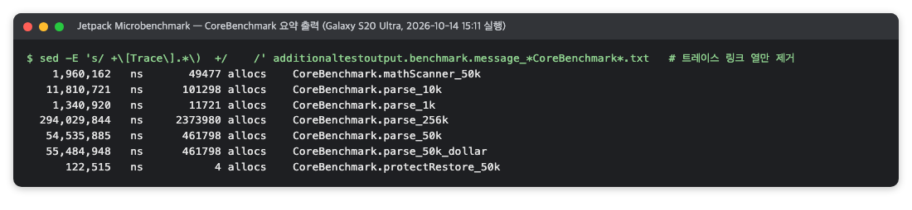

*그림 1. Microbenchmark 콘솔 요약 출력(RichMarkdown 검증 화면, 2026-10)*

각 줄은 **① 시간(ns) ② 할당 수 ③ 벤치마크 이름**입니다. 여기서 시간은 중앙값이 아니라 **최솟값**입니다. 그래서 콘솔 숫자를 보고서 표의 중앙값과 바로 맞춰 보면 안 됩니다.

결과 JSON에서 기기 정보와 벤치마크 항목을 `jq`로 뽑으면 아래와 같습니다. 그림 2의 실제 출력에는 기기 모델·API 수준·컴파일 모드까지 `context`에 함께 들어 있습니다. 다음은 출력 형식을 보여 주는 예이며, 숫자는 프로젝트마다 다릅니다.

```text
context: { "build": {"model": "<기기 모델>"}, "cpuLocked": true, "sustainedPerformanceModeEnabled": false }
benchmark parse_50k: warmupIterations 58, repeatIterations 1
  timeNs: minimum 5.45E7  median 5.88E7  maximum 6.51E7  (runs 50)
  allocationCount: median 461801.0
```

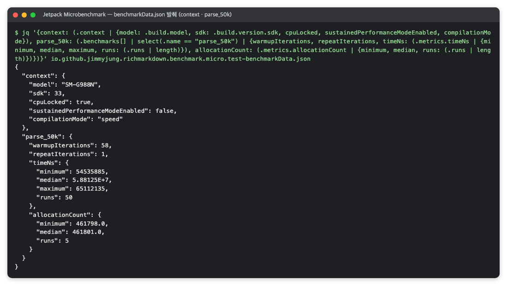

*그림 2. 결과 JSON에서 뽑은 기기 정보와 50 KiB 파싱 항목(RichMarkdown 검증 화면, 2026-10)*

1. **`context`**: 측정 기기와 환경입니다. `cpuLocked`의 뜻은 2.7절에서 다룹니다.
2. **`warmupIterations`, `repeatIterations`**: 예열 횟수와 측정 한 번당 실행 횟수입니다.
3. **`timeNs`**: 여러 번 측정한 값의 최소·중앙값·최대입니다. 보고서에는 보통 중앙값을 대푯값으로, 최소를 참고값으로 씁니다.
4. **`allocationCount`**: 블록을 한 번 실행할 때 만드는 객체 수입니다. 측정 횟수가 적어도 값이 거의 흔들리지 않습니다.

최솟값은 방해가 가장 적었던 실행, 중앙값은 보통의 실행을 나타냅니다. 둘의 차이가 이 환경의 측정 잡음 크기입니다.

입력 크기별로 같은 방식으로 재면 표 4와 같은 표가 나옵니다.

*표 4. 입력 크기별 파싱 시간 표의 양식(a는 1 KiB의 중앙값)*

| 입력 | 중앙값 | 최소 |
|---|---:|---:|
| 1 KiB | a ms | a' ms |
| 10 KiB | ≈10a ms | |
| 50 KiB | ≈50a ms | |
| 256 KiB | ≈250a ms | |

이 표에서는 시간이 입력 크기에 거의 비례하는지 봅니다. 실기기 시간에는 외부 기준(플랫폼 제작사·공식 문서가 정한 판정 기준)이 없는 경우가 많으므로, 비례성과 "처리가 메인 스레드 밖에서 최신 입력만 다룬다"는 구조로 결과를 설명합니다.

### 2.7 주의할 점·한계

**`cpuLocked: true`를 "클럭을 고정했다"로 단정하지 않습니다.** 이 값은 라이브러리가 실행 시점에 `/sys/devices/system/cpu`의 코어별 주파수 설정 파일을 읽어, 클럭이 고정된 것처럼 보이는지 판정한 결과입니다(AndroidX 소스 `CpuInfo.kt`의 `isCpuLocked`) [3]. 공식 문서는 클럭 고정에 루팅이 필요하다고 설명합니다. 실행 기록에 `lockClocks`를 실행한 흔적이 없다면 왜 `true`로 판정됐는지 알 수 없으므로, "JSON에 클럭 고정으로 기록되었다"까지만 말합니다.

**클럭 기록은 Microbenchmark에만 해당합니다.** 같은 기기의 Macrobenchmark 실행은 `cpuLocked: false`일 수 있습니다. 보고서에 "CPU 클럭 고정"이라고 쓸 때는 이 도구의 실행으로 한정합니다.

**예열된 반복 측정입니다.** 앱을 처음 실행할 때의 비용(클래스 로딩, 아직 컴파일되지 않은 코드)은 들어가지 않습니다. 첫 실행 비용은 [Macrobenchmark](#3-jetpack-macrobenchmark--앱을-밖에서-조작하며-실행-시간과-프레임-시간을-재는-라이브러리)의 콜드 실행 측정으로 따로 봅니다.

**다른 플랫폼 값과 나란히 놓고 우열을 말하지 않습니다.** 기기 세대와 칩이 다르면 같은 입력의 시간 차이를 플랫폼 우열로 읽을 수 없습니다.

**큰 입력은 화면을 멈추게 하지 않지만 중간 상태를 건너뜁니다.** 입력 처리 시간이 갱신 간격(예: 20 Hz면 50 ms)의 몇 배라도, 처리가 메인 스레드 밖에서 최신 입력만 다룬다면 화면은 멈추지 않습니다. 대신 중간 상태 몇 개를 건너뛰며 따라갑니다.

**입력의 특성을 확인합니다.** 옵션을 켠 측정인데 입력에 그 옵션이 처리할 내용(예: 수식 구분자 `$`)이 하나도 없으면, 옵션을 켠 빈 탐색 비용만 잽니다. 할당 수가 옵션을 끈 측정과 같게 나오면 이 경우를 의심합니다.

**요약 파일의 시점을 확인합니다.** 결과 폴더의 요약 파일(`android-results.md`)이 더 앞선 실행의 값일 수 있습니다. 보고서에는 최종 코드로 다시 잰 실행의 값을 씁니다.

**다른 도구와 교차 확인했는지 적습니다.** Microbenchmark와 Perfetto의 교차 확인은 선택 사항이며, 하지 않았다면 그렇게 적습니다. 벤치마크별 트레이스가 결과 폴더에 남아 있으므로 나중에 확인할 수 있습니다.


## 3. Jetpack Macrobenchmark — 앱을 밖에서 조작하며 실행 시간과 프레임 시간을 재는 라이브러리

> **요약.** Jetpack Macrobenchmark는 "앱이 열리기까지 얼마나 걸리는가, 연속 갱신 동안 프레임이 프레임 예산 안에 만들어지는가"에 답하는 측정 라이브러리로, 별도 테스트 앱이 대상 앱을 사용자처럼 조작합니다. 결과를 읽을 때 가장 중요한 점은 프레임 백분위가 모든 반복의 프레임을 합쳐 계산된다는 것입니다. 반복 하나만 느려도 합산 P90이 끌려 올라가므로 반복별 값을 함께 확인합니다.


### 3.1 한눈에 보기

*표 5. Jetpack Macrobenchmark 개요*

| 항목 | 내용 |
|---|---|
| 무엇을 하나 | 별도 테스트 앱이 대상 앱을 실행·조작하면서 앱 실행 시간(`StartupTimingMetric`)과 프레임 시간(`FrameTimingMetric`)을 반복 측정하고, 반복마다 시스템 트레이스를 남깁니다 |
| 만든 곳·라이선스 | Google AndroidX(Jetpack)의 `androidx.benchmark:benchmark-macro-junit4`이고, 라이선스는 Apache 2.0입니다 |
| 쓰는 곳(예) | Q2 성능 중 앱 실행 시간, 스트리밍·스크롤 같은 연속 동작의 프레임 분포, 반복별 트레이스를 이용한 원인 분석에 씁니다 |
| 버전 | 확인 시점 버전은 `androidx.benchmark` 1.5.0, UiAutomator 2.4.0(2026-10)입니다 |
| 공식 문서 | [Write a Macrobenchmark](https://developer.android.com/topic/performance/benchmarking/macrobenchmark-overview), [Capture Macrobenchmark metrics](https://developer.android.com/topic/performance/benchmarking/macrobenchmark-metrics) |

### 3.2 무엇을 하는 도구인가

Macrobenchmark는 앱 하나를 사용자처럼 다룹니다. 측정 코드는 대상 앱 안이 아니라 별도 테스트 모듈(`com.android.test`)에 있습니다. 이 테스트가 대상 앱을 실행하고 화면을 조작하는 동안 시스템 트레이스를 기록하고, 그 트레이스에서 지표를 뽑습니다 [5]. 그래서 측정 대상 코드에 측정용 코드를 넣지 않아도 됩니다.

측정 한 건은 `MacrobenchmarkRule.measureRepeated`로 정하며, 연속 동작(예: 스트리밍) 측정은 다음과 같은 모양입니다.

```kotlin
@Test
fun streaming() = rule.measureRepeated(
    packageName = TargetApp.PACKAGE,
    metrics = listOf(FrameTimingMetric()),
    compilationMode = TargetApp.partial,
    startupMode = StartupMode.WARM,
    iterations = 5,
    setupBlock = { pressHome() },
) {
    startActivityAndWait(TargetApp.intent("<화면 Activity>", "autoplay" to true))
    SystemClock.sleep(STREAM_MILLIS)        // 일정 시간 프레임 기록
}
```

인자 가운데 `compilationMode`는 Android 앱의 컴파일 방식을 알아야 이해됩니다. Android는 설치 직후 앱 코드를 모두 미리 기계어로 바꿔 두지는 않고, 실행 중에 자주 쓰이는 코드를 기록해 두었다가 점차 컴파일합니다. 그래서 같은 앱도 컴파일 상태에 따라 속도가 다르고, 이 인자로 측정 전 컴파일 상태를 고정합니다(표 6).

*표 6. `measureRepeated`의 주요 인자*

| 인자 | 뜻 |
|---|---|
| `metrics` | 무엇을 잴지. 실행 시간은 `StartupTimingMetric` [8], 화면 프레임은 `FrameTimingMetric` [7] |
| `compilationMode` | 측정 전에 앱 코드를 얼마나 미리 컴파일해 둘지. `None`(설치 직후 상태), `Partial`(프로파일 기반 부분 컴파일) |
| `startupMode` | 앱 프로세스를 어떤 상태에서 시작할지. `COLD`(프로세스 종료 후 새로 시작), `WARM`(프로세스는 살려 두고 화면만 새로 시작) |
| `iterations` | 반복 횟수 |
| `setupBlock` | 반복마다 측정 전에 할 준비(예: 홈 화면으로 이동) |

**지표.** 공식 문서의 정의는 다음과 같습니다 [6].

- `timeToInitialDisplayMs`: 시스템이 실행 인텐트를 받은 시점부터 첫 화면의 첫 프레임을 그릴 때까지의 시간입니다. 결과는 반복의 최소·중앙값·최대로 나오고, 공식 문서는 중앙값을 보라고 권합니다.
- `frameDurationCpuMs`: 한 프레임을 만드는 데 UI 스레드와 RenderThread(화면 그리기 명령을 GPU로 보내는 스레드)에서 쓴 시간입니다. 이름에 CPU가 붙어 있지만, RenderThread가 그래픽 버퍼를 기다리며 막힌 시간도 들어갈 수 있습니다.
- `frameOverrunMs`: 프레임이 마감 시각을 넘긴 시간입니다. 공식 문서는 양수를 끊김이 보이는 프레임으로, 음수를 마감보다 일찍 끝난 여유로 설명합니다. Android 12(API 31) 이상에서만 나옵니다.

프레임 지표는 백분위(P50·P90·P95·P99)로 나옵니다. P90은 값을 크기순으로 놓았을 때 90%가 그 값 이하인 지점입니다. 예를 들어 P90이 12.97 ms라면 "프레임 10%가 12.97 ms 이상 걸렸다"는 뜻입니다.

**반복별 트레이스.** 측정 반복마다 시스템 트레이스(`.perfetto-trace`)를 따로 남깁니다 [5]. 숫자가 이상하면 그 반복의 트레이스를 [Perfetto](#5-perfetto--android-기기에서-일어난-일을-시간축으로-보고-sql로-묻는-추적-도구)나 Android Studio에서 열어 원인을 찾습니다.

### 3.3 왜 이 도구를 썼나

이 도구가 답하는 질문은 두 가지입니다. 앱이 열리기까지 얼마나 걸리는가, 그리고 연속 갱신(스트리밍·스크롤) 동안 프레임이 프레임 예산(한 프레임에 쓸 수 있는 시간, 120 Hz면 8.33 ms) 안에 만들어지는가입니다. 함수 하나가 아니라 앱 전체의 동작이라 [Microbenchmark](#2-jetpack-microbenchmark--android-함수-하나를-실기기에서-반복-실행해-시간과-할당-수를-재는-라이브러리)로는 잴 수 없습니다 [4]. 다른 방법과의 차이는 표 7과 같습니다.

*표 7. 앱 단위 측정 방법의 비교*

| 방법 | 비교 |
|---|---|
| `adb shell am start -W` 시간 | 실행 시간 한 값은 얻지만 컴파일 상태를 통제하지 못하고 트레이스가 남지 않습니다 |
| [`dumpsys gfxinfo`](#4-dumpsys-gfxinfo--앱이-그린-프레임의-시간-분포를-기기에서-바로-읽는-android-명령) | 프레임 분포는 얻지만 컴파일 상태 통제와 반복별 트레이스가 없습니다. Macrobenchmark를 못 돌리는 기기에서 대안으로 씁니다 |
| Android Studio 프로파일러 | 원인 분석에는 좋지만 사람이 조작해야 해 같은 조건의 반복 측정에 맞지 않습니다 |

정리하면 다음 세 가지를 함께 주는 방법은 Macrobenchmark뿐입니다. `CompilationMode`로 설치 직후(None)와 부분 컴파일 뒤(Partial)를 나눠 잴 수 있고, 반복 실행과 결과 JSON 저장이 자동이며, 반복마다 트레이스가 남아 숫자를 나중에 다시 검증할 수 있습니다.

### 3.4 준비

측정 모듈(예: `:benchmark-macro`)은 공식 템플릿을 따라 다음 세 가지를 맞춥니다 [5].

- 측정 모듈은 `com.android.test` 플러그인을 쓰고 `targetProjectPath = ":<앱모듈>"`로 대상 앱을 지정합니다.
- 대상 앱에 `benchmark` 빌드 타입(release와 같되 디버그 키로 서명)을 두고, 매니페스트에 `<profileable android:shell="true" />`를 넣습니다. profileable은 디버거는 붙일 수 없지만 셸에서 성능 추적은 허용하는 설정입니다. 공식 문서는 대상 앱이 디버그 가능하거나 profileable이 아니면 잘못된 측정 대신 오류를 낸다고 설명합니다.
- baseline profile(미리 컴파일할 코드 목록)이 없으면 `Partial`의 기본값(`BaselineProfileMode.Require`)이 실패합니다. 이때는 `CompilationMode.Partial(BaselineProfileMode.UseIfAvailable, warmupIterations = 3)`로 예열 3회의 실행 기록을 바탕으로 부분 컴파일합니다.

실기기가 필요하며, 주사율 모드(고정·적응형)와 OS 버전을 기록해 둡니다. `frameOverrunMs`가 필요하면 API 31 이상이어야 합니다. CI에서 돌리지 않고 측정 스크립트로 따로 실행하는 점과 기기 시리얼을 읽는 방식은 Microbenchmark와 같습니다(2.4절).

### 3.5 사용 방법

**1. 실행.** 저장소 루트에서 측정 스크립트로 실행합니다.

```sh
scripts/run-benchmarks.sh macro
# 한 클래스만:
scripts/run-benchmarks.sh macro -Pandroid.testInstrumentationRunnerArguments.class=<패키지>.StartupBenchmark
# 특정 클래스 제외:
scripts/run-benchmarks.sh macro -Pandroid.testInstrumentationRunnerArguments.notClass=<패키지>.ScrollBenchmark
```

콤마로 여러 클래스를 준 `class=A,B`는 첫 클래스만 실행될 수 있으므로, 뺄 클래스를 `notClass`로 지정합니다. 스크립트는 [Microbenchmark](#2-jetpack-microbenchmark--android-함수-하나를-실기기에서-반복-실행해-시간과-할당-수를-재는-라이브러리)와 같은 순서로 일합니다. 기기 연결 확인, 냉각 대기(열 상태 0, 표면 온도 35 °C 미만), 기기 상태 기록, 화면 깨우기, Gradle 실행, 결과 보존 순서입니다.

```sh
./gradlew :benchmark-macro:connectedBenchmarkAndroidTest \
  --project-cache-dir <빌드 폴더>/gradle-project-cache \
  -P<프로젝트>.buildRoot=<빌드 폴더>/build --console=plain
```

냉각 대기는 실제 측정에서도 꼭 필요합니다. 연속 실행 뒤 열 상태 2, 표면 온도 40 °C대에서 실행 시간을 재면 값이 부풀 수 있으므로 식힌 뒤 다시 잽니다.

**2. 결과 확인.** 결과 폴더(`<빌드 폴더>/<단계>/macro/<실행 시각>/`)에는 표 8의 파일이 남습니다.

*표 8. Macrobenchmark 결과 폴더의 파일*

| 파일 | 내용 |
|---|---|
| `*-benchmarkData.json` | 지표별 요약과 반복별 원시 값(프레임 지표는 반복별 프레임 목록) |
| `additionaltestoutput.benchmark.message_*.txt` | 콘솔 요약(지표·최소·중앙값·최대, 반복별 트레이스 링크) |
| `<클래스>_<테스트>_iter00N_*.perfetto-trace` | 반복별 시스템 트레이스 |
| `report/` | Gradle 계측 테스트 HTML 보고서 |

**3. 집계.** 집계 스크립트가 JSON을 읽어 실행 시간 표와 프레임 표를 만듭니다. 반복별 P50·P90 열도 함께 만들어 두기를 권합니다(3.7.1절).

### 3.6 결과 읽는 법

콘솔 요약은 지표별 최소·중앙값·최대와 백분위로 나옵니다. 그림 3은 열 상태가 0인 실행과 2인 실행의 요약을 나란히 옮긴 것으로, 열 상태 2에서 잰 실행 시간은 참고값으로만 씁니다. 다음은 출력 형식을 보여 주는 예이며, 숫자는 프로젝트마다 다릅니다.

```text
StreamingBenchmark_streaming
  frameDurationCpuMs   P50   5.4   P90  13.0   P95  13.3   P99  13.9
  frameOverrunMs       P50  -0.7   P90   7.6   P95   9.1   P99  11.2
  frameCount           min 865   median 868   max 876
StartupBenchmark_startup_warm_partial
  timeToInitialDisplayMs   min 71.0   median 76.2   max 84.5
```

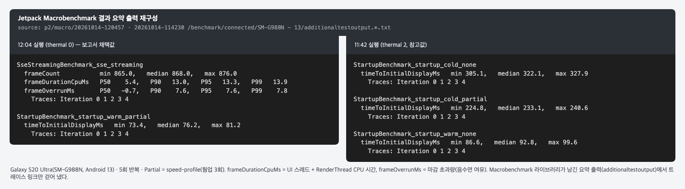

*그림 3. 열 상태가 다른 두 실행의 Macrobenchmark 요약 출력(RichMarkdown 검증 때의 명령 출력을 옮긴 화면, 2026-10)*

1. **`frameDurationCpuMs` 백분위**: 프레임을 만드는 데 걸린 시간의 분포입니다. 프레임 예산(8.33 ms 등)과 비교할 때 P90이 예산을 넘는다고 곧바로 "미달"이라 하지 말고, 3.7절의 함정을 먼저 확인합니다.
2. **`frameOverrunMs`**: 마감을 넘긴 시간입니다. P90이 양수면 프레임 10% 이상이 마감을 넘겼다는 뜻이며, 공식 문서가 끊김과 직접 연결해 설명하는 지표입니다.
3. **`frameCount`**: 반복당 프레임 수의 최소·중앙값·최대입니다. 측정 시간 동안 기대한 만큼 프레임이 잡혔는지 봅니다.
4. **`timeToInitialDisplayMs`**: 실행 시간입니다. 콜드·웜과 컴파일 모드별로 나눠 적고, 열 상태가 높았던 실행은 참고값으로 표시합니다.

Gradle 보고서는 측정이 끝까지 돌았는지만 보여 줍니다(그림 4). 다음은 출력 형식을 보여 주는 예이며, 숫자는 프로젝트마다 다릅니다.

```text
SseStreamingBenchmark   1 tests | 0 failures | 5m38.92s | 100% successful
  streaming  passed
```

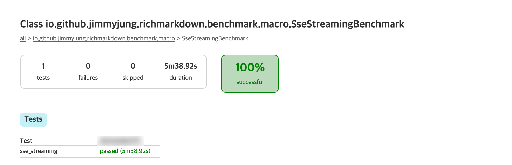

*그림 4. 스트리밍 측정 클래스의 Gradle 보고서(RichMarkdown 검증 화면, 2026-10)*

"passed"는 프레임이 예산 안이라는 뜻이 아니라, 반복이 오류 없이 끝나 지표가 기록됐다는 뜻입니다. 수치는 요약 출력이나 JSON에서 읽습니다.

### 3.7 주의할 점·한계

#### 3.7.1 반복 합산 백분위

라이브러리는 모든 반복의 프레임(예: 5회 × 약 870개)을 합쳐 백분위를 냅니다. 그래서 반복 한 번의 프레임이 거의 다 느리면 합산 P90이 그 반복에 끌려 올라갑니다. 표 9는 2번째 반복에서 BufferQueue stuffing이 일어난 가상 예시입니다.

*표 9. 반복별 P90과 합산 P90(가상 예시)*

| 반복 | 1 | 2 | 3 | 4 | 5 | 합산 |
|---|---:|---:|---:|---:|---:|---:|
| `frameDurationCpuMs` P90 (ms) | 7.6 | 13.6 | 7.5 | 7.0 | 7.5 | 13.0 |

BufferQueue는 앱이 그린 화면 버퍼를 화면 합성기로 넘기는 대기열입니다. stuffing은 이 대기열에 버퍼가 밀려, 그 반복의 거의 모든 프레임이 빈 버퍼를 받아 오는 `dequeueBuffer`에서 몇 ms씩 막힌 현상입니다. 반복 하나는 전체 프레임의 약 20%이므로 합산 상위 10%가 모두 그 반복에서 나오고, 합산 P90이 그 반복의 중앙값과 거의 같아집니다. 이때 "재파싱·재배치가 느리다" 같은 코드 원인 설명은 이 지표로 뒷받침되지 않습니다.

JSON의 `sampledMetrics.<지표>.runs`에 반복별 프레임 값이 들어 있으므로 반복별 백분위는 직접 계산할 수 있습니다. 합산 값만 보지 말고 반복별 값을 함께 확인합니다. stuffing 반복이 재측정에서도 무작위로 나타나면 "통과"로 바꿀 근거도 없으므로 판정을 단정하지 않습니다.

#### 3.7.2 스피너 프레임 비중

스트리밍 중 진행 표시(스피너)가 계속 돌면, 글자가 바뀌지 않아도 화면 갱신 신호(vsync)마다 프레임을 만듭니다. 스피너 프레임은 글자를 다시 배치하지 않아 가벼우므로 백분위를 끌어내립니다. 그래서 전체 프레임의 P90이 예산 안이어도, 갱신 프레임만 따로 보면 값이 더 높을 수 있습니다.

#### 3.7.3 보완 지표: 콘텐츠 프레임

위 두 문제를 피하려면 반복별 트레이스를 Perfetto `trace_processor`로 직접 분석합니다(질의는 [Perfetto](#5-perfetto--android-기기에서-일어난-일을-시간축으로-보고-sql로-묻는-추적-도구)).

1. 앱이 기록하는 사용자 정의 트레이스 구간(예: `stream`) 안의 메인 스레드 프레임만 봅니다.
2. 프레임마다 그 안에서 실행된 작업 이름으로 분류합니다. 분류는 게시(publish), 파싱 결과 반영(parse), 기타 재구성·배치(other), 스피너뿐인 프레임(spinner) 네 가지이고, 앞의 세 가지를 **콘텐츠 프레임**이라 부릅니다.
3. 렌더 스레드의 `dequeueBuffer` 대기가 2 ms를 넘는 프레임이 20%를 넘는 반복(stuffing)과 구간이 닫히지 않은 반복은 빼고, 남은 반복의 중앙값을 비교합니다.

두 빌드를 비교할 때는 번갈아 돌려야 시간에 따른 기기 상태 변화와 빌드 효과를 분리할 수 있습니다. 순서대로 돌렸다면 그 한계를 적고, 작업량 감소(재구성 횟수·시간 합)와 끊김 개선(P99, 마감 누락)을 따로 판정합니다. 작업량이 줄어도 꼬리 지연(가장 느린 몇 % 프레임의 지연)이 늘 수 있기 때문입니다.

#### 3.7.4 기기 커널 문제로 측정이 중단되는 경우

특정 구형 기기에서는 측정 하네스(측정을 위해 함께 돌리는 프로세스 종료·컴파일 초기화·Perfetto 추적) 조합이 커널 결함을 건드려 기기가 재부팅될 수 있습니다. 이때 Gradle 보고서에는 그 시점의 테스트가 코드 실패처럼 표시됩니다. 그림 5의 실패 1건도 콜드 실행을 재던 중 기기가 커널 패닉으로 재부팅해 생긴 것으로, 코드 실패가 아닙니다.

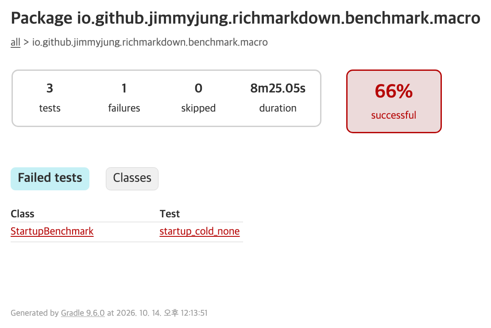

*그림 5. 실패 1건이 표시된 Macrobenchmark 패키지 보고서(RichMarkdown 검증 화면, 2026-10)*

기기 커널 로그(`KERNEL PANIC`)와 재부팅 시각을 대조해 코드 실패와 구분하고, 같은 화면을 `am start`와 `input swipe`로 직접 조작해 재현되는지 확인합니다. 재현되지 않으면 그 기기에서는 Macrobenchmark를 멈추고 하네스 없이 [`dumpsys gfxinfo`](#4-dumpsys-gfxinfo--앱이-그린-프레임의-시간-분포를-기기에서-바로-읽는-android-명령)로 대신 잽니다. Macrobenchmark는 더 새로운 OS의 실기기에서 다시 실행하도록 권합니다.

#### 3.7.5 그 밖의 주의점

- **판정 지표는 프로젝트가 고른 것입니다.** `frameDurationCpuMs` P90과 프레임 예산의 비교는 공식 기준이 아니라 검증 설계에서 고른 방식입니다.
- **CPU 클럭은 고정되지 않습니다.** 위 Microbenchmark 절 2.7에서 본 대로, 결과 JSON의 기기 정보가 `cpuLocked: false`일 수 있습니다.
- **프레임 예산은 근삿값입니다.** 적응형 주사율 모드에서는 주사율이 바뀌므로 고정 120 Hz 예산(8.33 ms)은 근삿값일 뿐입니다.
- **측정 빌드를 확인합니다.** 값을 잰 빌드가 수정 전 빌드인지 수정 후 빌드인지 보고서에 적습니다.
- **경고 줄은 환경에 따라 무시해도 됩니다.** 예를 들어 "Unable to clear Runtime Image"는 Android 14 이상의 런타임 이미지 대상 경고라 API 33에서는 의미가 없습니다.


## 4. dumpsys gfxinfo — 앱이 그린 프레임의 시간 분포를 기기에서 바로 읽는 Android 명령

> **요약.** `dumpsys gfxinfo`는 "사용자 동작 동안 앱이 그린 프레임이 프레임 예산 안에 들어오는가"에 답하는 Android 기본 명령으로, 앱에 아무것도 붙이지 않고 기기가 이미 모으는 통계를 읽기만 합니다. 결과를 읽을 때 가장 중요한 점은 히스토그램의 바닥 칸(가장 낮은 칸)이 5 ms라서 "5 ms"를 "5 ms 이하"로 읽어야 한다는 것입니다. 또 프레임 시간의 정의가 Macrobenchmark의 `frameDurationCpuMs`와 달라 두 값을 같은 축에 놓지 않습니다.


### 4.1 한눈에 보기

*표 10. dumpsys gfxinfo 개요*

| 항목 | 내용 |
|---|---|
| 무엇을 하나 | 지정한 앱이 지금까지 그린 프레임 수, 느린 프레임 수, 프레임 시간 백분위와 히스토그램을 텍스트로 출력합니다 |
| 만든 곳·라이선스 | Android 플랫폼(AOSP, Android 오픈소스 프로젝트)의 기본 시스템 서비스입니다. `adb shell`로 호출하며 따로 설치할 것이 없습니다 |
| 쓰는 곳(예) | Q2 성능 중 스크롤 같은 사용자 동작의 프레임 분포, Macrobenchmark를 쓸 수 없는 기기의 대체 측정에 씁니다 |
| 버전 | 출력은 기기 OS가 만듭니다. 확인 시점 버전은 adb 1.0.41(platform-tools 36.0.0, 2026-10)입니다 |
| 공식 문서 | [dumpsys](https://developer.android.com/tools/dumpsys)의 'Test UI performance' 절 |

### 4.2 무엇을 하는 도구인가

Android는 앱이 화면을 그리는 동안 프레임마다 걸린 시간을 이미 기록하고 있습니다. `dumpsys`는 Android 시스템 서비스의 상태를 텍스트로 출력하는 명령입니다. 그중 `gfxinfo` 서비스는 앱의 화면 그리기 계층(HWUI, 하드웨어 가속 렌더링을 맡는 Android 내부 라이브러리)이 모은 통계를 보여 줍니다. 공식 문서는 이 출력이 "기록 구간에 일어난 애니메이션 프레임의 성능 정보"를 담는다고 설명합니다 [9].

패키지 이름을 주면 그 앱의 요약 통계가 나옵니다. 주요 항목은 다음과 같습니다.

- `Stats since`: 통계를 모으기 시작한 시각으로, 앱이 시작된 때나 마지막으로 `reset`한 때입니다.
- `Total frames rendered`: 그 사이에 그린 프레임 수입니다.
- `Janky frames`: 마감을 놓친 프레임 수와 비율입니다.
- `50th`·`90th`·`95th`·`99th percentile`: 프레임 시간 백분위입니다. 90th가 P90(3.2절)입니다.
- `HISTOGRAM`: 프레임 시간 구간(칸)별 프레임 수입니다. 백분위는 이 히스토그램에서 계산됩니다.

여기서 프레임 시간은 AOSP 소스(`JankTracker.cpp`, main 브랜치) 기준으로, 그 프레임이 시작되어야 했던 화면 갱신 신호(vsync) 시각부터 렌더 스레드가 프레임을 끝낸 시각까지입니다 [12]. UI 스레드와 렌더 스레드의 작업, 그 사이의 대기가 모두 들어간 "총 프레임 시간"입니다.

히스토그램의 칸 너비는 고르지 않습니다. 첫 칸은 "5 ms 이하"를 모두 담고(`ProfileData.cpp`의 `kBucketMinThreshold = 5`), 32 ms까지는 1 ms 단위, 그 위로는 2·4·50 ms 단위로 넓어집니다 [11]. 그래서 5 ms보다 빠른 프레임끼리는 구분되지 않습니다.

옵션은 표 11의 두 가지이며, AOSP 소스(`ThreadedRenderer.java`의 인자 처리)에 정의되어 있습니다 [13].

*표 11. dumpsys gfxinfo의 옵션*

| 옵션 | 동작 |
|---|---|
| `framestats` | 최근 프레임마다 단계별 시각을 표로 더 출력합니다. 열 이름은 `IntendedVsync`, `HandleInputStart`, `DrawStart`, `IssueDrawCommandsStart`, `FrameCompleted` 등입니다(AOSP `FrameInfo.cpp`). 공식 문서는 "최근 프레임의 더 자세한 시간 정보"로 설명합니다 [9] |
| `reset` | 출력한 뒤 그 앱의 프레임 통계를 비웁니다. 다음 덤프는 이 시점부터 다시 셉니다 |

### 4.3 왜 이 도구를 썼나

이 도구가 답하는 질문은 "스크롤 같은 사용자 동작 동안 프레임이 프레임 예산(120 Hz면 8.33 ms) 안에 만들어지는가"입니다. 이 질문에는 보통 [Macrobenchmark](#3-jetpack-macrobenchmark--앱을-밖에서-조작하며-실행-시간과-프레임-시간을-재는-라이브러리)의 `FrameTimingMetric`을 먼저 씁니다.

그런데 Macrobenchmark의 측정 하네스(측정을 위해 함께 돌리는 Gradle·Perfetto 추적·컴파일 명령)가 기기에서 문제를 일으킬 수 있습니다. 3.7.4절에서 본 것처럼 실행 중에 기기가 커널 패닉으로 재부팅하기도 합니다. 이때는 하네스 없이 같은 제스처로 스크롤하고, gfxinfo로 프레임을 기록하는 쪽이 안전합니다. 다른 방법과의 차이는 표 12와 같습니다.

*표 12. 프레임 측정 방법의 비교*

| 방법 | 비교 |
|---|---|
| Macrobenchmark `FrameTimingMetric` | 먼저 고려하는 방법. 하네스 조합이 기기에서 문제를 일으키면 쓰지 못합니다 |
| Perfetto 시스템 트레이스 | 원인 분석에 강하지만 추적 자체가 부하를 줍니다 |
| 화면의 GPU 렌더링 프로필 막대 | 개발자 옵션의 막대그래프는 눈으로 보는 용도라 반복 집계에 맞지 않습니다 [10] |
| `dumpsys gfxinfo` | 앱에 아무것도 붙이지 않고 기기가 이미 모으는 통계를 읽기만 합니다. 텍스트라 스크립트로 집계하기 쉽습니다 |

### 4.4 준비

호스트 PC에 Android SDK platform-tools의 adb가 있어야 합니다. 설치와 기기 연결은 다음 명령으로 확인합니다.

```sh
adb version          # Android Debug Bridge version 1.0.41 / Version 36.0.0-…
adb devices -l       # 대상 기기가 device 상태인지
```

대상 앱이 설치되어 있어야 합니다. 측정 스크립트는 대상 앱의 benchmark 빌드(3.4절)가 설치되어 있지 않으면, 설치 작업(`:<앱모듈>:installBenchmark`)부터 하라고 안내하고 멈추게 만들어 둡니다. 실기기 측정이라 CI 밖에서 측정 스크립트로 실행하는 점과 기기 시리얼을 읽는 방식은 앞의 두 도구와 같습니다.

### 4.5 사용 방법

**기본 명령.** 패키지 이름을 주어 실행합니다 [9].

```sh
adb shell dumpsys gfxinfo <패키지>              # 요약 통계
adb shell dumpsys gfxinfo <패키지> framestats   # 최근 프레임별 시각 추가
adb shell dumpsys gfxinfo <패키지> reset        # 출력 후 통계 비우기
```

측정할 때는 `reset`으로 통계를 비우고, 측정할 동작을 한 뒤, 덤프를 파일로 남기는 순서를 따릅니다. 그래야 앱 시작이나 이전 동작의 프레임이 섞이지 않습니다.

**측정 스크립트 예.** 스크립트의 `gfxinfo` 모드가 이 순서를 자동으로 반복하게 만들 수 있습니다.

```sh
scripts/run-benchmarks.sh gfxinfo
```

화면마다 다음을 합니다.

1. 앱을 종료하고(`am force-stop`) 대상 화면을 엽니다(`am start -W`). 그 뒤 1.5초 기다립니다.
2. 다음 동작을 5회 반복합니다.
   - `dumpsys gfxinfo <패키지> reset`으로 통계를 비웁니다.
   - 화면 높이의 3/4 지점에서 1/4 지점까지 300 ms 동안 끄는 `input swipe`를 6번(0.7초 간격) 해서 아래로 6페이지 내려갑니다.
   - 같은 방식으로 6페이지 올라옵니다.
   - `dumpsys gfxinfo <패키지>` 출력을 `<화면>-<반복>.txt`로 저장합니다.
3. 측정 뒤 앱의 컴파일 상태(`dumpsys package dexopt`)를 남깁니다.

실행 전의 냉각 대기와 기기 상태 기록은 Macrobenchmark와 똑같이 합니다.

**집계.** 집계 스크립트가 덤프마다 `HISTOGRAM` 줄을 읽어 5회 반복의 칸별 프레임 수를 더한 뒤, 누적 비율이 50·90·95·99%에 처음 닿는 칸을 백분위로 씁니다.

### 4.6 결과 읽는 법

덤프 한 건은 아래와 같은 모양입니다. 그림 6의 실제 덤프에는 예시에서 뺀 `(legacy)` 카운터와 `Number …` 카운터, 칸이 끝까지 이어지는 긴 `HISTOGRAM` 줄도 들어 있습니다. 다음은 출력 형식을 보여 주는 예이며, 숫자는 프로젝트마다 다릅니다.

```text
** Graphics info for pid <pid> [<패키지>] **
Stats since: 1234567890123ns
Total frames rendered: 1296
Janky frames: 40 (3.09%)
50th percentile: 5ms
90th percentile: 7ms
95th percentile: 9ms
99th percentile: 15ms
Number Frame deadline missed: 40
HISTOGRAM: 5ms=957 6ms=188 7ms=43 8ms=20 ...
```

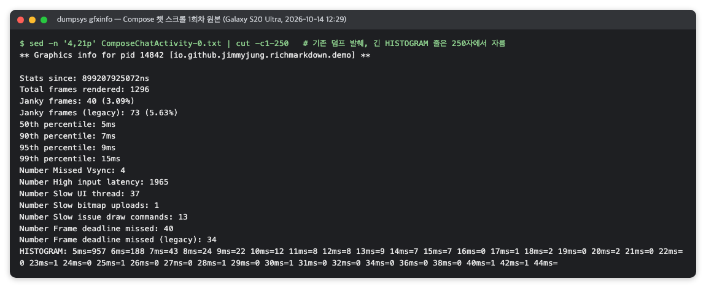

*그림 6. Compose 채팅 화면 스크롤 1회차의 gfxinfo 덤프(RichMarkdown 검증 화면, 2026-10)*

숫자는 이렇게 읽습니다.

1. **`Total frames rendered: 1296`**: 이번 왕복에서 그린 프레임 수입니다. 직전 `reset` 이후만 셉니다.
2. **`Janky frames: 40 (3.09%)`**: 마감을 놓친 프레임입니다. `Number Frame deadline missed`와 같은 값입니다.
3. **`50th`~`99th percentile`**: 이 반복의 프레임 시간 백분위입니다. P90 7 ms는 "프레임 90%가 7 ms 칸 이하"라는 뜻입니다.
4. **`HISTOGRAM: 5ms=957 6ms=188 …`**: 칸별 프레임 수입니다. 1,296개 중 957개(약 74%)가 5 ms 이하 칸에 있습니다.

`Number High input latency`처럼 이름이 붙은 다른 카운터들은 정의가 문서화되어 있지 않으므로, 판정에 쓰기 전에 의미를 따로 검증합니다.

5회 반복을 합산한 집계 표는 아래와 같은 모양입니다. 그림 7은 두 화면의 반복별 프레임 수, 합산 백분위, 느린 프레임 수를 한 표에 모은 실제 집계입니다. 다음은 출력 형식을 보여 주는 예이며, 숫자는 프로젝트마다 다릅니다.

```text
화면          반복별 프레임 수   P50   P90   P95   P99
ListScreenA     1,362-1,393     5 ms  5 ms  6 ms  10 ms
ListScreenB     1,296-1,318     5 ms  6 ms  7 ms  13 ms
```

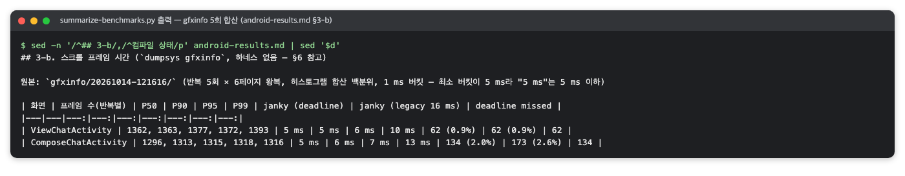

*그림 7. 5회 반복을 합산한 스크롤 프레임 시간 표(RichMarkdown 검증 화면, 2026-10)*

히스토그램 바닥이 5 ms이므로 "5 ms"는 "5 ms 이하"로 읽습니다. 통과 여부는 P90을 프레임 예산(120 Hz면 8.33 ms)과 비교해 판정합니다. 합산값이 한 반복에 끌려가지 않았는지는 덤프마다 기기가 출력한 백분위(반복별 P90)로 확인합니다.

### 4.7 주의할 점·한계

**Macrobenchmark 값과 같은 축에 놓지 않습니다.** gfxinfo의 값은 총 프레임 시간(vsync 예정 시각부터 프레임 완료까지)이고, Macrobenchmark의 `frameDurationCpuMs`는 UI 스레드와 RenderThread가 그 프레임을 만드는 데 CPU에서 쓴 시간입니다. 정의가 다른 두 값을 놓고 "한쪽이 두 배 느리다"고 읽으면 안 됩니다. 의미가 있는 것은 각각을 예산과 비교한 결과뿐입니다.

**작은 변화는 보이지 않습니다.** 칸이 1 ms 단위이고 바닥이 5 ms라서, 5 ms 이하에서 일어나는 개선이나 회귀는 숫자에 나타나지 않습니다 [11]. 미세한 차이를 비교하려면 [Perfetto](#5-perfetto--android-기기에서-일어난-일을-시간축으로-보고-sql로-묻는-추적-도구) 트레이스가 필요합니다.

**합산 백분위의 함정은 여기에도 있습니다.** 5회 반복의 히스토그램을 더해 백분위를 내면, 반복 하나가 크게 튈 때 Macrobenchmark처럼 합산값이 끌려갈 수 있습니다. 반복별 덤프를 함께 봅니다([Macrobenchmark](#3-jetpack-macrobenchmark--앱을-밖에서-조작하며-실행-시간과-프레임-시간을-재는-라이브러리)의 3.7.1절 '반복 합산 백분위').

**측정 조건이 Macrobenchmark와 다릅니다.** 덤프 당시 앱의 컴파일 상태가 `status=verify`(설치 직후, 미리 컴파일하지 않음)일 수 있어 Macrobenchmark의 Partial 컴파일과 다릅니다. CPU 클럭 상태도 기록되지 않으므로 열 상태를 대신 기록합니다.

**앱이 화면 앞에 있어야 합니다.** 앱이 화면에 떠 있지 않으면 덤프가 실패할 수 있습니다. 다음은 출력 형식을 보여 주는 예입니다. 숫자는 프로젝트마다 다릅니다.

```text
** Graphics info for pid <pid> [<패키지>] **
Failure while dumping the app: ProcessRecord{<해시> <pid>:<패키지>/u0a<번호>}
```

측정 스크립트는 화면을 연 직후 같은 화면에서 `reset`과 덤프를 하므로 이 상황을 피합니다.

**출력 항목의 정의는 공식 문서에 없습니다.** 공식 dumpsys 문서는 명령만 설명하고 `Janky frames`, 백분위, `HISTOGRAM`의 정의를 싣지 않습니다. 정의는 AOSP 소스에서 확인해야 하며, 참고한 소스는 main 브랜치라 오래된 기기 OS의 세부 동작과 다를 수 있습니다.

**프레임 예산은 근삿값입니다.** 적응형 주사율 모드의 기기에서는 Macrobenchmark(3.7.5절)와 마찬가지로 고정 120 Hz 예산(8.33 ms)이 근삿값일 뿐입니다.


## 5. Perfetto — Android 기기에서 일어난 일을 시간축으로 보고 SQL로 묻는 추적 도구

> **요약.** Perfetto는 "벤치마크 숫자가 이상할 때, 그 프레임 안에서 어느 스레드가 무엇을 했는가"에 답하는 시스템 추적 도구입니다. 브라우저 UI로 원인을 눈으로 확인하고, trace_processor의 SQL로 같은 판단 규칙을 모든 반복에 적용합니다. 결과를 읽을 때 가장 중요한 점은 트레이스가 판정을 내려 주지 않는다는 것입니다. 특히 FrameTimeline의 `Buffer Stuffing` 표시는 끊김이 아니라 상태이므로 끊김으로 세지 않습니다.


### 5.1 한눈에 보기

*표 13. Perfetto 개요*

| 항목 | 내용 |
|---|---|
| 무엇을 하나 | 스레드 상태, CPU 스케줄, 그래픽 버퍼, 앱이 남긴 구간 같은 시스템 사건을 시간 순서로 기록한 트레이스를 브라우저에서 보고(Perfetto UI), SQL로 질의합니다(trace_processor) |
| 만든 곳·라이선스 | Google의 Perfetto 프로젝트(`google/perfetto`)가 만들었고, 라이선스는 Apache 2.0입니다 |
| 쓰는 곳(예) | Q2 성능의 원인 분석 단계에 씁니다. Macrobenchmark 백분위가 이상할 때 반복별 트레이스를 열어 어느 스레드가 무엇을 했는지 확인하고, 개선 전후의 작업량을 비교합니다 |
| 버전 | 확인 시점 버전은 Perfetto UI v58.3, `trace_processor_shell` v58.2, Python `perfetto` 패키지 0.58.2(2026-10)입니다 |
| 공식 문서 | [What is Perfetto?](https://perfetto.dev/docs/), [Android Jank detection with FrameTimeline](https://perfetto.dev/docs/data-sources/frametimeline) |

### 5.2 무엇을 하는 도구인가

트레이스는 기기 안에서 일어난 일을 시간 순서대로 적은 기록입니다. "메인 스레드가 12.3초부터 3.4 ms 동안 프레임을 만들었다", "렌더 스레드가 그래픽 버퍼를 2 ms 기다렸다" 같은 사건이 수만 개 들어 있습니다. Perfetto는 Android의 기본 시스템 추적 도구이며, 이런 트레이스를 기록하고 보고 분석하는 기능을 한데 묶어 제공합니다 [14]. 트레이스를 읽을 때 쓰는 기본 용어는 표 14와 같습니다.

*표 14. 트레이스를 읽는 기본 용어*

| 용어 | 뜻 | 예 |
|---|---|---|
| 트랙(track) | 한 스레드나 프로세스의 사건이 놓이는 가로줄 | 앱의 메인 스레드, RenderThread |
| 슬라이스(slice) | 시작 시각과 길이가 있는 구간 하나(안에 하위 구간이 겹쳐 쌓임) | `Choreographer#doFrame <vsync>`(프레임 하나), 그 안의 `Compose:recompose` |
| 스레드 상태 | 그 순간 스레드가 실행 중(Running)인지, 잠들었는지, 기다리는지를 나타내는 값 | 메인 스레드 상태 트랙의 초록 막대 |
| 비동기 구간 | 스레드에 묶이지 않고 앱이 직접 시작과 끝을 표시한 구간 | 앱이 `Trace.beginAsyncSection`으로 표시한 스트림 하나 |

**FrameTimeline.** Android 12 이상에서는 화면 합성기(SurfaceFlinger)가 앱마다 트랙 두 개를 더 기록합니다. 공식 문서에 따르면 Expected Timeline은 앱이 프레임을 끝내도록 주어진 시간이고, Actual Timeline은 앱이 실제로 프레임을 끝내 합성기에 넘기기까지 걸린 시간입니다 [17]. 두 막대를 위아래로 비교하면 어느 프레임이 늦었는지 보입니다.

공식 문서의 색 규칙에서 초록은 정상, 빨강은 그 프로세스 때문에 늦은 프레임, 연두는 "프레임은 부드럽지만 늦게 표시되어 입력 지연이 커진 상태"를 뜻합니다 [17]. 공식 문서의 예인 그림 8에서도 빨간 프레임은 Actual 막대가 Expected 막대보다 길게 늘어나 있습니다.

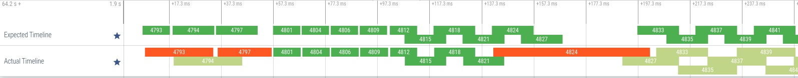

*그림 8. Expected Timeline과 Actual Timeline의 비교(출처: Perfetto 문서 'Android Jank detection with FrameTimeline', Apache License 2.0)*

각 프레임에는 늦은 이유를 분류한 `jank_type`이 붙습니다. 예를 들어 `App Deadline Missed`는 앱 작업이 마감을 넘긴 경우입니다.

`Buffer Stuffing`은 `jank_type`의 하나이지만 끊김이 아니며, 공식 문서도 이를 "jank라기보다 상태"로 설명합니다 [17]. 이전 프레임이 표시되기도 전에 앱이 새 프레임을 계속 보내 버퍼 큐(BufferQueue, 3.7.1절)가 차 있는 상태입니다. 프레임은 부드럽지만 표시가 화면 갱신 신호(vsync) 한 주기 이상 늦어 입력 지연이 커지고, 큐가 꽉 차면 앱이 빈 버퍼를 기다리며 막힐 수도 있습니다.

**트레이스 출처.** 따로 기록하지 않아도 [Macrobenchmark](#3-jetpack-macrobenchmark--앱을-밖에서-조작하며-실행-시간과-프레임-시간을-재는-라이브러리)가 측정 반복마다 남기는 `.perfetto-trace` 파일을 그대로 열 수 있습니다.

### 5.3 왜 이 도구를 썼나

Macrobenchmark의 백분위는 "얼마나 느린가"만 알려 줍니다. 연속 갱신의 프레임 P90이 예산을 넘었을 때 원인을 "갱신마다 일어나는 재파싱·재배치"로 추정했다고 합시다. 이 추정을 확인하려면 느린 프레임 안에서 어느 스레드가 무엇을 했는지 봐야 합니다.

그런데 반복별 트레이스를 열어 보았을 때 한 반복에서 거의 모든 프레임의 렌더 스레드가 `dequeueBuffer`(빈 그래픽 버퍼 받기)에서 막혀 있다면, 원인 설명을 철회하고 반복 합산 백분위의 함정을 의심할 근거가 생깁니다. 이 판단에 필요한 정보를 주는 도구를 비교하면 표 15와 같습니다.

*표 15. 원인 분석 도구의 비교*

| 방법 | 비교 |
|---|---|
| Android Studio 프로파일러 | 같은 트레이스 파일을 열 수 있고 사람이 보기에 좋지만, 트레이스 수십 개에 같은 계산을 반복하기 어렵습니다 |
| [`dumpsys gfxinfo`](#4-dumpsys-gfxinfo--앱이-그린-프레임의-시간-분포를-기기에서-바로-읽는-android-명령) | 프레임 분포만 주고 "왜"는 말하지 않습니다 |
| Perfetto UI + trace_processor | UI로 원인을 눈으로 확인하고, 같은 판단 규칙을 SQL로 적어 모든 반복에 똑같이 적용할 수 있습니다 |

### 5.4 준비

**Perfetto UI.** 따로 설치할 것은 없습니다. 브라우저에서 ui.perfetto.dev를 엽니다. 공식 문서는 Perfetto UI를 "완전히 로컬에서 도는 브라우저 기반 UI(Fully local, browser-based UI)"로 소개하고 [14], 트레이스 처리는 기본적으로 브라우저 안의 WebAssembly 런타임이 맡는다고 설명합니다 [16]. 그래서 트레이스 파일을 서버에 올리지 않고 열 수 있습니다.

**trace_processor.** SQL로 트레이스를 질의하는 C++ 도구입니다 [18]. 공식 문서의 설치 방법은 다음과 같으며, 이 래퍼 스크립트를 실행하면 실제 실행 파일(`trace_processor_shell`)을 내려받습니다. 래퍼 실행에는 Python 3이 필요합니다.

```sh
curl -LO https://get.perfetto.dev/trace_processor
chmod +x ./trace_processor
trace_processor_shell --version
# Perfetto v58.2-<해시> (<커밋>)
# Trace Processor RPC API version: 14
```

여러 트레이스를 스크립트로 분석할 때는 Python API를 씁니다 [19]. `pip install perfetto`로 설치하고, `TraceProcessor(trace=…)`로 트레이스를 연 뒤 `query()`로 SQL을 실행합니다. 설치한 실행 파일을 쓰려면 `TraceProcessorConfig(bin_path=…)`로 지정합니다.

**앱의 사용자 정의 구간.** 분석할 구간만 골라 보려면 앱에 비동기 구간을 추가합니다. 분석할 동작(예: 스트림)이 시작될 때 `Trace.beginAsyncSection("<구간이름>", run)`을 부르고, 동작이 끝난 뒤 마지막 프레임까지 그려지도록 짧게(예: 300 ms) 기다렸다가 `endAsyncSection`을 부릅니다. 이 구간이 없는 이전 빌드의 트레이스로는 같은 방식의 구간 분석을 할 수 없습니다.

### 5.5 사용 방법

#### 5.5.1 Perfetto UI에서 트레이스 보기

1. ui.perfetto.dev를 열고 왼쪽 메뉴의 **Open trace file**을 누르거나, 트레이스 파일을 창에 끌어다 놓습니다 [15].
2. 프로세스 목록에서 대상 앱(`<패키지>`)을 펼칩니다. 메인 스레드, RenderThread, Expected/Actual Timeline, 사용자 정의 구간 트랙을 찾습니다.
3. 키보드 W·S로 확대·축소하고 A·D로 좌우로 이동합니다(공식 문서의 WASD 조작).
4. 슬라이스를 누르면 아래 창에 이름·시작 시각·길이가 나오고, 범위를 끌어 선택하면 그 안의 슬라이스가 집계됩니다.
5. 왼쪽 메뉴 **Query (SQL)** 화면에서 SQL을 실행하면 결과가 표로 나옵니다.

#### 5.5.2 trace_processor로 질의하기

질의 하나는 명령줄 인자로 줍니다.

```sh
trace_processor_shell query <반복>.perfetto-trace \
  "select name, round(dur/1e6,1) as dur_ms from slice where name = '<구간이름>'"
# "name","dur_ms"
# "<구간이름>",7303.200000
```

긴 질의는 파일로 둡니다. 기존 옵션 `-q <파일>`과 새 형식 `query -f <파일>`이 같은 일을 하며, 결과는 CSV로 나옵니다.

```sh
trace_processor_shell -q frames_window.sql <반복>.perfetto-trace
trace_processor_shell query -f frames_window.sql <반복>.perfetto-trace
```

`frames_window.sql`은 사용자 정의 구간의 일정 지점부터 300 ms 동안 메인 스레드 프레임을 하나씩 뽑아 분류하는 질의입니다.

```sql
with w as (select ts from slice where name = '<구간이름>')
select
  substr(f.name, 23) as vsync,
  round((f.ts - w.ts) / 1e6, 1) as t_ms,
  case
    when exists (select 1 from descendant_slice(f.id) d where d.name = '<게시 측정 구간>') then 'publish'
    when exists (select 1 from descendant_slice(f.id) d where d.name = '<파싱 결과 측정 구간>') then 'parse'
    when exists (select 1 from descendant_slice(f.id) d where d.name in ('Compose:recompose', 'AndroidOwner:measureAndLayout')) then 'other'
    else 'spinner'
  end as class,
  round(f.dur / 1e6, 2) as ui_ms,
  (select round(sum(d.dur) / 1e6, 2) from descendant_slice(f.id) d where d.name = 'Compose:recompose') as recompose_ms,
  (select round(sum(d.dur) / 1e6, 2) from descendant_slice(f.id) d where d.name = 'AndroidOwner:measureAndLayout') as layout_ms,
  (select round(r.dur / 1e6, 2) from slice r where r.name = 'DrawFrames ' || substr(f.name, 23) limit 1) as rt_ms,
  (select a.jank_type from actual_frame_timeline_slice a where a.name = substr(f.name, 23) limit 1) as jank
from slice f
join thread_track tt on f.track_id = tt.id
join thread using (utid)
cross join w
where thread.tid = <메인 스레드 tid>
  and f.depth = 0
  and f.name like 'Choreographer#doFrame %'
  and f.ts between w.ts + <시작 오프셋 ns> and w.ts + <끝 오프셋 ns>
order by f.ts
```

질의의 뼈대는 세 가지입니다 [20]. 첫째, `slice`·`thread_track`·`thread` 테이블을 이어 메인 스레드의 최상위 프레임 슬라이스를 고릅니다. 둘째, `descendant_slice(f.id)`로 그 프레임 안에서 실행된 하위 구간을 찾습니다. 셋째, `actual_frame_timeline_slice`에서 같은 vsync 번호의 `jank_type`을 가져옵니다. 메인 스레드 tid와 시간 범위는 트레이스마다 다르므로 `thread` 테이블에서 먼저 확인합니다.

여러 반복에 같은 분류를 적용하려면 위 질의를 Python API(`TraceProcessor`)로 반복 트레이스마다 실행해 반복별·빌드별 중앙값을 냅니다. 이 스크립트는 저장소가 아니라 검증 작업 폴더에 두어도 됩니다.

### 5.6 결과 읽는 법

스트림 하나 전체를 UI에서 열면 위에서부터 사용자 정의 구간(길이 확인), Expected/Actual Timeline(vsync마다 프레임 하나, Actual 대부분이 연두면 `Buffer Stuffing`), 메인 스레드 `Choreographer#doFrame`, 메인 스레드 상태(초록 = Running), RenderThread `DrawFrames` 트랙이 보입니다(그림 9).

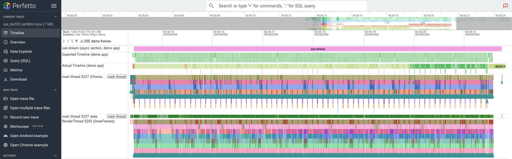

*그림 9. 스트림 하나 전체의 트레이스(RichMarkdown 검증 화면, 2026-10)*

300 ms를 확대하면 대부분의 프레임은 스피너만 도는 짧은 프레임이고, 일정 간격마다 키가 큰 프레임이 두 개씩(게시 publish, 파싱 반영 parse) 나타납니다. 그림 10은 이 구간을 확대한 화면이며, 아래 창에는 같은 구간에 분류 질의를 실행한 결과가 함께 보입니다.

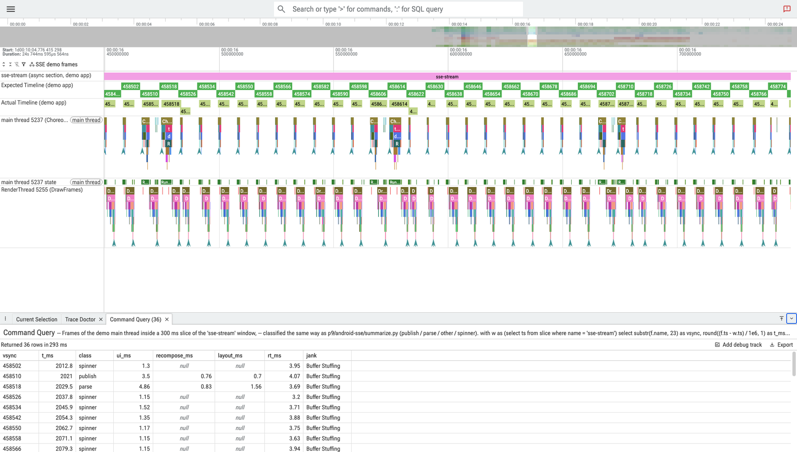

*그림 10. 300 ms 구간 확대 화면과 UI에서 실행한 프레임 분류 질의(RichMarkdown 검증 화면, 2026-10)*

분류 질의를 trace_processor로 실행한 결과는 아래와 같은 표로 나오며, 그림 11처럼 재구성·배치 시간은 게시·파싱 행에만 있고 스피너 행에서는 비어 있습니다. 다음은 출력 형식을 보여 주는 예이며, 숫자는 프로젝트마다 다릅니다.

```text
vsync   t_ms    class    ui_ms  recompose_ms  layout_ms  rt_ms  jank
458606  2010.2  publish   3.41          0.85       0.68   2.10  Buffer Stuffing
458607  2018.5  spinner   1.02                            0.90  Buffer Stuffing
458614  2076.9  parse     5.20          1.10       2.40   2.30  Buffer Stuffing
```

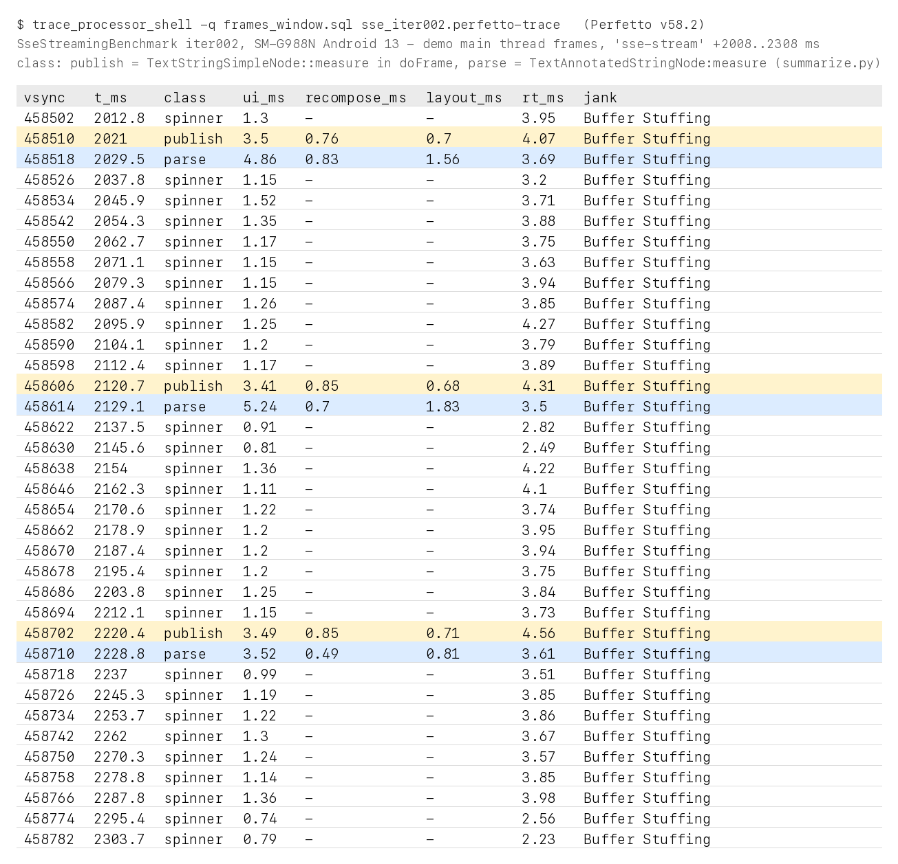

*그림 11. trace_processor로 실행한 프레임 분류 질의 결과(RichMarkdown 검증 때의 명령 출력을 옮긴 화면, 2026-10)*

`ui_ms`는 메인 스레드 프레임 길이, `recompose_ms`와 `layout_ms`는 그 안의 Compose 재구성과 배치 시간, `rt_ms`는 RenderThread 시간, `jank`는 FrameTimeline의 `jank_type`입니다.

게시 프레임 하나를 16 ms 폭으로 확대하면 `Choreographer#doFrame`(메인 스레드 총 시간) 아래에 `Compose:recompose`(재구성), `AndroidOwner:measureAndLayout`(배치), 텍스트 측정 구간이 쌓여 보입니다(그림 12). 같은 vsync의 `DrawFrames <vsync>`(RenderThread)는 따로 보입니다.

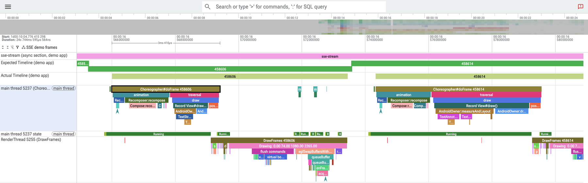

*그림 12. 게시 프레임 하나의 내부(RichMarkdown 검증 화면, 2026-10)*

읽을 점은 두 가지입니다. 게시·파싱 프레임의 메인 스레드 시간도 프레임 예산(120 Hz면 8.33 ms) 안에 드는지, 스피너 프레임이 1 ms 안팎인지입니다. 프레임을 종류별로 나누는 이 규칙을 모든 반복에 적용한 것이 [Macrobenchmark](#3-jetpack-macrobenchmark--앱을-밖에서-조작하며-실행-시간과-프레임-시간을-재는-라이브러리) 3.7.3절의 '콘텐츠 프레임' 지표입니다.

### 5.7 주의할 점·한계

**트레이스는 판정을 내리지 않습니다.** 어느 구간의 어느 프레임을 볼지, 무엇을 느린 프레임으로 셀지는 분석하는 사람이 정합니다. 같은 트레이스라도 기준에 따라 다른 숫자가 나오므로, 질의와 분류 규칙을 결과와 함께 남깁니다.

**`Buffer Stuffing` 표시를 끊김으로 세지 않습니다.** 유효한 반복에서도 앱 프레임 대부분에 `Buffer Stuffing`이 붙을 수 있습니다. 트레이스 전체의 분포는 아래처럼 질의합니다. 다음은 출력 형식을 보여 주는 예입니다. 숫자는 프로젝트마다 다릅니다.

```sh
trace_processor_shell query <반복>.perfetto-trace "select jank_type, count(*) n
  from actual_frame_timeline_slice a join process p using(upid)
  where p.name='<패키지>' group by jank_type order by n desc"
# "Buffer Stuffing",529
# "Buffer Stuffing, SurfaceFlinger Stuffing",190
# "SurfaceFlinger Stuffing",134
# "App Deadline Missed, SurfaceFlinger Stuffing",2
# "App Deadline Missed",1
```

공식 문서대로 `Buffer Stuffing`은 끊김이 아니라 상태이므로, stuffing이 아닌 `jank_type`(`App Deadline Missed` 등)만 앱 원인의 끊김으로 셉니다 [17]. 반복 전체를 무효로 뺄 기준은 이 표시와 별도로 정합니다. 예를 들어 RenderThread의 `dequeueBuffer` 대기가 2 ms를 넘는 프레임이 20%를 넘는지를 봅니다.

**분류 규칙은 앱과 Compose 내부 구간 이름에 기댑니다.** 게시 프레임은 앱 화면의 글자 측정 구간으로, 파싱 프레임은 Markdown 글자의 측정 구간(`TextAnnotatedStringNode:measure` 등)으로 알아봅니다. Compose 버전이 바뀌어 내부 구간 이름이 달라지거나 화면 구성이 바뀌면 규칙을 다시 확인합니다.

**구간에는 종료 대기가 들어 있습니다.** 마지막 게시와 그 파싱 결과가 그려지는 프레임까지 넣으려고 스트림이 끝난 뒤에도 구간을 잠시 열어 두면, 그 시간의 프레임도 구간 집계에 들어갑니다.

**추적 자체가 기기에 부하를 줍니다.** 구형 기기에서는 추적을 포함한 하네스 조합이 커널 결함을 건드려 재부팅을 일으킨 사례가 있습니다([Jetpack Macrobenchmark](#3-jetpack-macrobenchmark--앱을-밖에서-조작하며-실행-시간과-프레임-시간을-재는-라이브러리)).

**보고서에 싣는 Perfetto 수치는 비교 목적이 분명할 때만 둡니다.** 개선 전후의 재구성 구간 수나 메인 스레드 작업량처럼 트레이스를 나눠 얻은 값은 분류 규칙과 함께 적습니다.


## 참고문헌

[1] Google, "Microbenchmark overview", Android Developers, <https://developer.android.com/topic/performance/benchmarking/microbenchmark-overview>. 예열·할당 수 측정, 클럭 고정과 발열 감지 방식.

[2] Google, "Write a Microbenchmark", Android Developers, <https://developer.android.com/topic/performance/benchmarking/microbenchmark-write>. `BenchmarkRule.measureRepeated` 작성법, 환경 오류 검사, JSON 결과 위치.

[3] AndroidX 프로젝트, "CpuInfo.kt", GitHub, <https://github.com/androidx/androidx/blob/androidx-main/benchmark/benchmark-common/src/main/java/androidx/benchmark/CpuInfo.kt>. `cpuLocked`를 판정하는 소스 코드(공식 문서가 아니라 공식 소스).

[4] Google, "Benchmark your app", Android Developers, <https://developer.android.com/topic/performance/benchmarking/benchmarking-overview>. Microbenchmark와 Macrobenchmark를 포함한 앱 벤치마킹 개요.

[5] Google, "Write a Macrobenchmark", Android Developers, <https://developer.android.com/topic/performance/benchmarking/macrobenchmark-overview>. `com.android.test` 모듈 구성, `CompilationMode`·`StartupMode`, profileable 요건, 반복별 트레이스.

[6] Google, "Capture Macrobenchmark metrics", Android Developers, <https://developer.android.com/topic/performance/benchmarking/macrobenchmark-metrics>. `timeToInitialDisplayMs`, `frameDurationCpuMs`, `frameOverrunMs`의 정의와 백분위 출력.

[7] Google, "FrameTimingMetric API reference", Android Developers, <https://developer.android.com/reference/kotlin/androidx/benchmark/macro/FrameTimingMetric>. 프레임 지표 클래스 레퍼런스.

[8] Google, "StartupTimingMetric API reference", Android Developers, <https://developer.android.com/reference/kotlin/androidx/benchmark/macro/StartupTimingMetric>. 실행 시간 지표 클래스 레퍼런스.

[9] Google, "dumpsys", Android Developers, <https://developer.android.com/tools/dumpsys>. `adb shell dumpsys gfxinfo <패키지>`와 `framestats` 사용법('Test UI performance' 절).

[10] Google, "Inspect rendering speed", Android Developers, <https://developer.android.com/topic/performance/rendering/inspect-gpu-rendering>. 개발자 옵션의 GPU 렌더링 프로필 막대와 오버드로 확인.

[11] Android 오픈소스 프로젝트(AOSP), "ProfileData.cpp", <https://android.googlesource.com/platform/frameworks/base/+/refs/heads/main/libs/hwui/ProfileData.cpp>. 백분위·`HISTOGRAM` 출력과 5 ms 바닥 칸(`kBucketMinThreshold`)을 정하는 소스(공식 문서가 아니라 공식 소스).

[12] Android 오픈소스 프로젝트(AOSP), "JankTracker.cpp", <https://android.googlesource.com/platform/frameworks/base/+/refs/heads/main/libs/hwui/JankTracker.cpp>. 히스토그램에 넣는 프레임 시간(vsync 예정 시각부터 완료까지)의 계산.

[13] Android 오픈소스 프로젝트(AOSP), "ThreadedRenderer.java", <https://android.googlesource.com/platform/frameworks/base/+/refs/heads/main/core/java/android/view/ThreadedRenderer.java>. `framestats`·`reset` 인자 처리.

[14] Perfetto 프로젝트, "What is Perfetto?", Perfetto 문서, <https://perfetto.dev/docs/>. Perfetto 구성(기록·UI·SQL 분석)과 "Fully local, browser-based UI" 설명.

[15] Perfetto 프로젝트, "Perfetto UI", Perfetto 문서, <https://perfetto.dev/docs/visualization/perfetto-ui>. 트레이스 열기(Open trace file, 끌어다 놓기), WASD 조작.

[16] Perfetto 프로젝트, "Opening Large Traces", Perfetto 문서, <https://perfetto.dev/docs/visualization/large-traces>. 브라우저 안 WebAssembly 처리와 메모리 한계, 로컬 trace_processor 서버로 넘기는 방법.

[17] Perfetto 프로젝트, "Android Jank detection with FrameTimeline", Perfetto 문서, <https://perfetto.dev/docs/data-sources/frametimeline>. Expected/Actual Timeline, 색 규칙, `jank_type`(`Buffer Stuffing` 포함) 정의. Android 12 이상.

[18] Perfetto 프로젝트, "Trace Processor", Perfetto 문서, <https://perfetto.dev/docs/analysis/trace-processor>. trace_processor 설치와 SQL 셸.

[19] Perfetto 프로젝트, "Trace Processor (Python)", Perfetto 문서, <https://perfetto.dev/docs/analysis/trace-processor-python>. `pip install perfetto`, `TraceProcessor`와 `bin_path`.

[20] Perfetto 프로젝트, "PerfettoSQL: Getting Started", Perfetto 문서, <https://perfetto.dev/docs/analysis/perfetto-sql-getting-started>. `slice`·`thread_track`·`thread` 테이블과 `descendant_slice`.
