# Android 테스트·품질 도구 — JUnit · AndroidX Test와 Espresso · Accessibility Test Framework · Kover · JaCoCo · Android lint

> **요약.** 이 문서의 여섯 도구는 Android 코드가 정해 둔 기댓값대로 동작하는가(Q1 오류), 그리고 테스트가 닿는 범위와 구조적 품질이 유지되는가(Q4 유지보수)에 함께 답합니다. JUnit은 기기 없이 JVM에서 핵심 로직을 커밋마다 검사하고, AndroidX Test와 Espresso는 에뮬레이터·기기에서 화면 코드를 실행하며, Accessibility Test Framework는 그 계측 테스트 안에서 접근성 문제를 찾습니다. Kover와 JaCoCo는 JVM 테스트와 계측 테스트의 커버리지를 나눠 재서 줄 단위로 합칠 수 있게 하고, Android lint는 앱을 실행하지 않고 Android 고유의 구조적 문제를 찾습니다. 결과를 읽을 때 가장 중요한 점은 어느 테스트 종류(JVM·계측)와 어느 기기·API 레벨에서 나온 숫자인지 확인하는 것으로, AGP(Android Gradle 플러그인) 보고서의 빨간 "실패"가 실제로는 건너뜀일 수 있고 Kover 하나로 잰 커버리지는 프로젝트 전체 값이 아닙니다.

처음 보는 용어는 [용어 풀이](../glossary.md)에 모아 두었습니다.

에이전트용 압축판: `skills/verify/references/platform-android.md`(명령·함정), `skills/verify/references/tools.md`(도구 지도)

## 차례

- [1. 들어가며](#1-들어가며)
- [2. JUnit — 기기 없이 JVM에서 Kotlin 코드의 기댓값을 확인하는 테스트 프레임워크](#2-junit--기기-없이-jvm에서-kotlin-코드의-기댓값을-확인하는-테스트-프레임워크)
- [3. AndroidX Test와 Espresso — 에뮬레이터·기기 안에서 화면 코드를 실행해 확인하는 계측 테스트 도구](#3-androidx-test와-espresso--에뮬레이터기기-안에서-화면-코드를-실행해-확인하는-계측-테스트-도구)
- [4. Accessibility Test Framework — Android 화면의 접근성 문제를 규칙으로 자동 검사하는 라이브러리](#4-accessibility-test-framework--android-화면의-접근성-문제를-규칙으로-자동-검사하는-라이브러리)
- [5. Kover — JVM 단위 테스트가 Kotlin 코드의 어느 줄을 실행했는지 재는 커버리지 플러그인](#5-kover--jvm-단위-테스트가-kotlin-코드의-어느-줄을-실행했는지-재는-커버리지-플러그인)
- [6. JaCoCo — 에뮬레이터 계측 테스트가 실행한 줄을 재는 커버리지 도구(AGP 내장)](#6-jacoco--에뮬레이터-계측-테스트가-실행한-줄을-재는-커버리지-도구agp-내장)
- [7. Android lint — 앱을 실행하지 않고 소스·리소스·빌드 파일의 구조적 문제를 찾는 정적 검사 도구](#7-android-lint--앱을-실행하지-않고-소스리소스빌드-파일의-구조적-문제를-찾는-정적-검사-도구)
- [참고문헌](#참고문헌)

## 1. 들어가며

PR을 올렸더니 CI의 JVM 테스트와 lint는 모두 통과했습니다. 그런데 로컬 에뮬레이터에서 돌린 계측 테스트 보고서에는 빨간 실패가 두 건 보이고, 커버리지 화면은 절반에도 못 미치는 값을 보여 줍니다.

이 빨간 표시는 정말 실패일까요? 이 커버리지는 정말 프로젝트 전체의 값일까요? 답은 숫자를 만든 도구가 무엇을 실행하고 무엇을 세는지에 달려 있습니다. 이 문서는 Android에서 오류(Q1)와 유지보수(Q4)를 확인하는 도구 여섯 개를 다음 순서로 씁니다.

1. **JVM에서 핵심 로직을 검사합니다.** [JUnit](#2-junit--기기-없이-jvm에서-kotlin-코드의-기댓값을-확인하는-테스트-프레임워크)으로 기기 없이 PC에서 파서·변환 로직이 기대한 값을 내는지 확인합니다. 빠르고 결과가 매번 같으므로 커밋마다 도는 CI에 둡니다.
2. **기기에서 화면 코드를 검사합니다.** [AndroidX Test와 Espresso](#3-androidx-test와-espresso--에뮬레이터기기-안에서-화면-코드를-실행해-확인하는-계측-테스트-도구)로 Compose·View·WebView 경로를 에뮬레이터·기기에서 실행합니다. 최소 지원 API와 최신 API에서 각각 돌려 지원 범위의 양 끝을 봅니다.
3. **같은 계측 테스트 안에서 접근성을 검사합니다.** [Accessibility Test Framework](#4-accessibility-test-framework--android-화면의-접근성-문제를-규칙으로-자동-검사하는-라이브러리)가 화면마다 대비·터치 영역·라벨 규칙을 적용합니다. API 33 이상에서만 검사하고, WARNING은 logcat에서 따로 읽습니다.
4. **두 종류의 커버리지를 합칩니다.** JVM 테스트의 커버리지는 [Kover](#5-kover--jvm-단위-테스트가-kotlin-코드의-어느-줄을-실행했는지-재는-커버리지-플러그인)가, 계측 테스트의 커버리지는 AGP에 들어 있는 [JaCoCo](#6-jacoco--에뮬레이터-계측-테스트가-실행한-줄을-재는-커버리지-도구agp-내장)가 잽니다. 두 XML 보고서의 형식이 같으므로 스크립트가 줄 단위로 합쳐 모듈별 값을 냅니다(6.5절).
5. **앱을 실행하지 않고 훑습니다.** [Android lint](#7-android-lint--앱을-실행하지-않고-소스리소스빌드-파일의-구조적-문제를-찾는-정적-검사-도구)가 Android API 사용 실수, 호환성, 리소스·Manifest 문제를 찾습니다. CI는 오류에서만 실패하므로 경고는 보고서를 열어 따로 읽습니다.

커밋마다 도는 CI에는 보통 1단계와 Kover 기준 검사, lint가 들어갑니다. 2~3단계와 JaCoCo 커버리지는 에뮬레이터가 필요해 수동으로 돌리므로, 그 결과에는 어느 기기·API 레벨에서 언제 돌렸는지를 함께 적습니다.

처음 읽는다면 JUnit(2절)과 AndroidX Test와 Espresso(3절)로 JVM 테스트와 계측 테스트의 차이를 먼저 익히기를 권합니다. 그다음 Kover(5절)와 JaCoCo(6절)를 이어서 읽으면 두 커버리지가 왜 따로 나오고 어떻게 합치는지 보입니다.

접근성 검사가 필요하면 4절을, 정적 검사가 필요하면 7절을 펼칩니다. 실기기 성능 측정은 [Android 성능 도구](android-performance.md)에서 다룹니다.


## 2. JUnit — 기기 없이 JVM에서 Kotlin 코드의 기댓값을 확인하는 테스트 프레임워크

> **요약.** JUnit은 "핵심 로직이 기대한 값을 내는가, 고친 결함이 다시 생기지 않는가"를 기기 없이 PC의 JVM에서 커밋마다 확인하는 테스트 프레임워크입니다. 결과를 읽을 때 가장 중요한 점은 통과가 "테스트에 적어 둔 조건을 지켰다"는 뜻일 뿐이라는 것입니다. 테스트 개수도 세는 방식에 따라 달라지므로 다른 플랫폼의 개수와 직접 비교하지 않습니다.


### 2.1 한눈에 보기

*표 1. JUnit 개요*

| 항목 | 내용 |
|---|---|
| 무엇을 하나 | 테스트 함수를 실행해 결과가 기댓값과 다르면 실패로 표시합니다. 에뮬레이터나 기기 없이 PC의 JVM(Java 가상 머신)에서 도는 테스트를 맡습니다 |
| 만든 곳·라이선스 | JUnit 팀이 만들었고, 라이선스는 JUnit 6(Jupiter)이 EPL 2.0, JUnit 4가 EPL 1.0입니다 |
| 쓰는 곳(예) | Q1 오류 중 파서·변환 로직의 기댓값 확인, 커밋마다 도는 CI의 JVM 테스트 단계, 퍼징(입력을 무작위로 바꿔 대량으로 넣고 이상 동작을 찾는 테스트) 반복에 씁니다 |
| 버전 | 확인 시점 버전은 JUnit 6.1.3(2026-10, Gradle 9.6.0 기준)입니다. 순수 Kotlin 모듈은 Jupiter를, Android 모듈의 JVM 테스트는 JUnit 4.13.2를 쓰는 경우가 흔합니다 |
| 공식 문서 | [JUnit User Guide](https://docs.junit.org/current/user-guide/) · [Gradle 테스트 문서](https://docs.gradle.org/current/userguide/java_testing.html#test_reporting) |

### 2.2 무엇을 하는 도구인가

파서를 고칠 때마다 "예전 입력에서도 여전히 같은 결과가 나오는가"를 손으로 확인하기는 어렵습니다. JUnit은 이 확인을 코드로 적어 두고 자동으로 돌리게 해 주는 테스트 프레임워크로, Java·Kotlin에서 가장 널리 쓰입니다. `@Test`를 붙인 함수를 실행하고, 함수 안의 단언(assert, "이 값이어야 한다"는 확인)이 하나라도 어긋나면 그 테스트를 실패로 기록합니다.

현재 세대인 JUnit 6은 세 부분으로 나뉩니다. 공식 문서는 이를 "JUnit Platform + JUnit Jupiter + JUnit Vintage"로 적습니다 [1]. Jupiter는 테스트를 작성하는 문법, Platform은 테스트를 찾아 실행하는 기반, Vintage는 JUnit 4 테스트를 Platform에서 돌리는 호환 엔진입니다.

Android 프로젝트에는 표 2처럼 두 세대가 함께 있는 경우가 많습니다. 순수 Kotlin 모듈은 Jupiter를 쓰고, Android 모듈의 JVM 테스트와 계측 테스트는 흔히 JUnit 4를 씁니다 [3]. 계측 테스트는 테스트 코드를 앱과 함께 기기에 올려 실제 Android 런타임에서 실행하는 테스트이고, JVM 테스트(JVM 단위 테스트)는 Android 프레임워크 없이 PC에서 순수 로직만 실행하는 테스트입니다.

*표 2. 테스트 위치별 JUnit 세대와 설정*

| 테스트 위치 | JUnit 세대 | 설정 |
|---|---|---|
| 순수 Kotlin 모듈 | JUnit Jupiter 6.x | `tasks.test { useJUnitPlatform() }` |
| Android 모듈의 JVM 테스트 | JUnit 4.13.x | `testImplementation("junit:junit:4.13.2")` |
| 에뮬레이터·기기의 계측 테스트 | JUnit 4(AndroidJUnit4 러너) | [AndroidX Test와 Espresso](#3-androidx-test와-espresso--에뮬레이터기기-안에서-화면-코드를-실행해-확인하는-계측-테스트-도구) |

테스트 입력(테스트에 넣는 고정 입력 파일, 영어로 fixture)이 수백 개라면 입력마다 테스트 함수를 따로 쓰기 어렵습니다. 공용 입력 모음(여러 플랫폼·저장소가 함께 쓰는 테스트 입력 묶음, 코퍼스(corpus)라고도 부름)을 통째로 돌릴 때는 Jupiter의 동적 테스트(dynamic test)가 편합니다. `@TestFactory` 함수가 실행 중에 입력마다 테스트를 하나씩 만들어 반환합니다 [2].

```kotlin
@TestFactory
fun corpus(): List<DynamicTest> = fixtureIds().map { id ->
    DynamicTest.dynamicTest(id) {
        verify(id, readInput(id), readExpected(id))
    }
}
```

이렇게 하면 입력 파일 하나가 테스트 1개로 집계됩니다. 외부 명세(예: 표준 문서의 예제 모음)를 `expected = null`로 돌려 크래시 여부와 시간만 검사한다면, 명세의 기대 출력과 자동 대조하지 않는다는 점을 문서에 분명히 적어 둡니다.

### 2.3 왜 이 도구를 썼나

JVM 테스트가 답하는 질문은 "핵심 로직이 기준 구현(예: 다른 플랫폼 구현)과 같은 기댓값을 내는가, 고친 결함이 다시 생기지 않는가"입니다. 이 질문은 코드가 바뀔 때마다, 즉 커밋마다 물어야 의미가 있습니다. Android 의존성이 없는 모듈은 JVM에서 바로 돌고 퍼징 1만 회 같은 반복도 수 초에 끝나므로 이 빈도를 감당할 수 있습니다.

같은 검사를 에뮬레이터 계측 테스트로 돌릴 수도 있지만, 에뮬레이터를 띄워야 하고 오래 걸려 CI 게이트(커밋·PR마다 자동으로 돌고 실패하면 병합을 막을 수 있는 검사)에 두기 어렵습니다. CI 게이트에 넣을 검사를 고르는 기준은 "빠르고, 돌릴 때마다 같은 결과가 나오는가"입니다.

반대로 JVM 테스트로 대신할 수 없는 영역도 있습니다. 하이라이터·WebView·수식 엔진처럼 기기의 Android 런타임이 필요한 경로는 "JVM 테스트 통과"를 검증 근거로 쓰지 않고 계측 테스트에 맡깁니다.

### 2.4 준비

따로 설치할 것은 없습니다. Gradle 래퍼(`./gradlew`)가 버전 카탈로그(`gradle/libs.versions.toml`)에 적힌 버전의 JUnit을 내려받습니다. 필요한 것은 JDK뿐이며, JUnit 6은 실행할 때 Java 17 이상을 요구합니다 [1].

```sh
grep -E '^junitJupiter ' gradle/libs.versions.toml          # junitJupiter = "<버전>"
grep -rn 'junit:junit' --include=build.gradle.kts .         # JUnit 4를 쓰는 모듈
grep distributionUrl gradle/wrapper/gradle-wrapper.properties
```

CI에는 push·pull request마다 테스트 입력 해시 검사, JVM 테스트, 커버리지 기준 검사, lint 순서로 도는 잡을 두는 구성이 흔합니다. JVM 테스트 단계의 명령은 아래 1단계와 같습니다.

### 2.5 사용 방법

**1. 모듈별 JVM 테스트.**

```sh
./gradlew :<순수모듈>:test
./gradlew :<안드로이드모듈>:testDebugUnitTest :<다른모듈>:testDebugUnitTest
```

순수 Kotlin 모듈의 작업 이름은 `test`이고, Android 모듈은 빌드 변형(variant) 이름이 붙은 `testDebugUnitTest`입니다 [6].

**2. 빌드 산출물을 저장소 밖으로 보내는 래퍼.** 빌드 폴더를 환경마다 바꾸고 싶으면 래퍼 셸 함수를 둡니다. 예를 들어 `scripts/gradle-env.sh`에 `gradle_run` 함수를 정의하고, 이 함수가 Gradle 실행을 감싸 다음 일을 하게 합니다.

1. gitignore된 컴퓨터별 설정 파일(예: `scripts/gradle-env.local.sh`)이 있으면 먼저 읽어 빌드 폴더를 정합니다. 없으면 `~/.cache/<프로젝트>`를 씁니다.
2. 빌드 폴더에 `gradle.lock` 디렉터리를 만들어, 같은 폴더를 쓰는 Gradle 실행이 동시에 돌지 않게 합니다.
3. 원래 명령에 `--project-cache-dir <빌드 폴더>/gradle-project-cache -P<프로젝트>.buildRoot=<빌드 폴더>/build --console=plain`을 붙입니다.

```sh
bash -c 'source scripts/gradle-env.sh && gradle_run :<순수모듈>:test'
```

**3. 환경 변수로 동작 바꾸기.** 퍼징 횟수·시드·결과 출력 폴더 같은 값은 환경 변수로 받게 합니다. 이미 떠 있는 Gradle 데몬(빌드를 빠르게 하려고 뒤에서 계속 도는 Gradle 프로세스)은 시작할 때 받은 환경 변수를 계속 쓸 수 있으므로, 이 변수를 바꾼 실행은 `--no-daemon`으로 돌립니다.

```sh
FUZZ_ITERATIONS=100000 FIXTURE_OUT=<출력폴더> ./gradlew --no-daemon :<순수모듈>:test
```

시드(난수 생성의 시작값, seed)를 고정하면 다른 플랫폼 구현과 바이트 단위로 같은 입력열을 만들 수 있습니다. 그래서 두 구현의 결과를 그대로 비교할 수 있습니다.

**4. 다시 돌리기와 골라 돌리기.** 입력이 바뀌지 않은 테스트 작업은 Gradle이 건너뜁니다. 강제로 다시 돌리려면 `--rerun`을, 특정 클래스만 돌리려면 `--tests`를 씁니다 [4].

```sh
./gradlew :<순수모듈>:test --rerun
./gradlew :<순수모듈>:test --tests '*FuzzTest'
```

### 2.6 결과 읽는 법

Gradle은 테스트 작업마다 HTML 보고서와 XML 결과를 남깁니다 [4], [6]. 기본 위치는 `<모듈>/build/reports/tests/<작업 이름>/index.html`과 `<모듈>/build/test-results/<작업 이름>/TEST-<클래스>.xml`입니다. 빌드 루트를 바꾸는 속성을 쓰면 이 파일들은 각 환경의 출력 경로 아래에 생깁니다.

HTML 보고서 첫 화면은 요약 칸, 성공률 상자, 클래스 표로 이루어지며, 실패가 하나도 없으면 그림 1처럼 성공률 상자가 녹색 100%로 표시됩니다. 다음은 출력 형식을 보여 주는 예입니다. 숫자는 프로젝트마다 다릅니다.

```text
<모듈>:testDebugUnitTest
 62 tests | 0 failures | 0 skipped | 1.471s | 100% successful

Class                      tests  failures  ignored  duration  success
com.example.FooModelTest      31         0        0    0.812s     100%
com.example.FooCodecTest      16         0        0    0.301s     100%
...
```

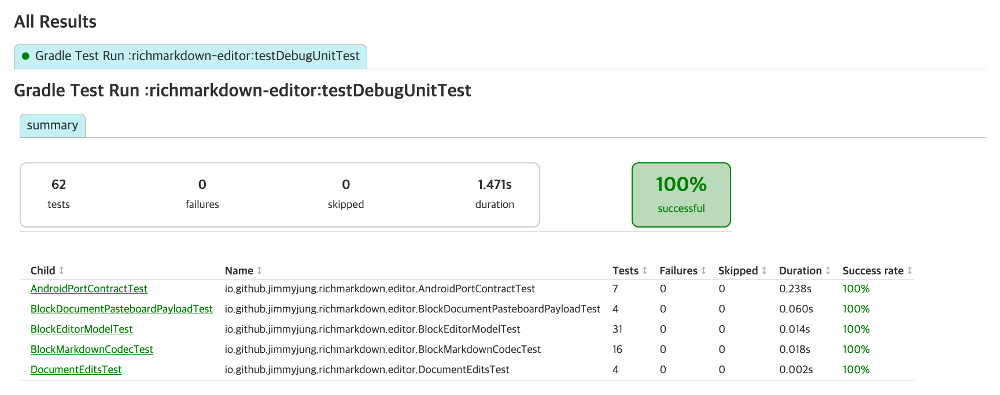

*그림 1. 편집기 모듈 JVM 테스트의 Gradle HTML 보고서 (RichMarkdown 검증 화면, 2026-10)*

1. **요약 칸**: `tests`, `failures`, `skipped`, 소요 시간입니다. 검수 기록에 적는 개수는 여기서 가져옵니다.
2. **성공률 상자**: 실패가 하나라도 있으면 빨간색으로 바뀌고 비율이 내려갑니다.
3. **클래스 표**: 테스트가 어느 클래스에 몇 개 있는지 보여 줍니다. 클래스 이름을 누르면 테스트 함수별 결과와 출력이 나옵니다.

퍼징처럼 함수 하나 안에서 반복문을 도는 테스트는 입력이 1만 개여도 테스트 **1개**로 셉니다. 그림 2의 퍼징 테스트 클래스 페이지에도 `fuzz()` 함수 하나가 테스트 1개로만 나옵니다.

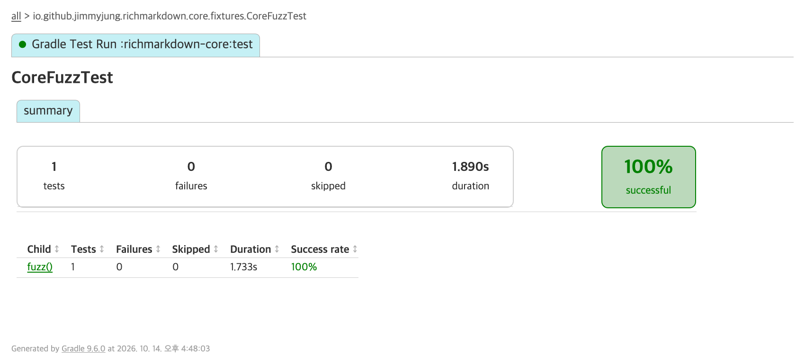

*그림 2. 핵심 모듈 퍼징 테스트의 클래스 페이지 (RichMarkdown 검증 화면, 2026-10)*

반복 횟수와 시간은 보고서 화면에 나오지 않으므로, XML의 표준 출력에 남도록 다음과 같은 줄을 직접 찍어 둡니다.

```text
fuzz: seed=<시드> iterations=10000 elapsed=<ms> ms (<값> ms/iteration)
```

전체 개수는 모듈별 보고서(또는 XML)를 더해야 나옵니다. CI 결과물(예: `jvm-reports` 아티팩트)을 내려받아 XML의 `tests` 속성을 더하면 로컬 값과 대조할 수 있습니다.

테스트 개수를 세는 방식은 플랫폼마다 다릅니다(표 3). 그래서 두 플랫폼의 테스트 개수를 놓고 "한쪽이 몇 배 많다"고 읽으면 안 됩니다.

*표 3. 플랫폼별 테스트 개수를 세는 방식*

| 항목 | JUnit(Android) | 다른 프레임워크(예: Swift Testing) |
|---|---|---|
| 테스트 입력 하나 | 동적 테스트 1개로 셈 | 매개변수 테스트는 함수 하나로 세고 케이스는 따로 적는 경우가 있음 |
| 명세 예제 수백 건 | 예제마다 테스트 1개 | 한 테스트 안에서 반복하면 어느 숫자에도 나타나지 않음 |
| 퍼징 1만 회 | 테스트 1개 | 테스트 1개 |

CI 로그에서는 작업 이름 뒤의 표시를 봅니다. 그림 3은 두 CI 실행의 로그로, 앞 실행에서는 한 모듈의 테스트만 실제로 돌고 뒤 실행에서는 모든 테스트 작업이 캐시 결과(`FROM-CACHE`)로 끝났습니다. 다음은 출력 형식을 보여 주는 예입니다.

```text
> Task :<순수모듈>:test
> Task :<안드로이드모듈>:testDebugUnitTest FROM-CACHE
> Task :<다른모듈>:testDebugUnitTest UP-TO-DATE
```

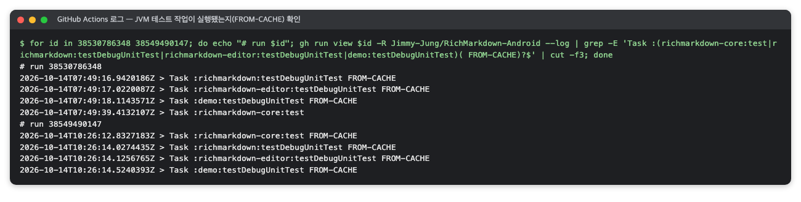

*그림 3. CI 로그에서 확인한 테스트 작업의 실행 여부 (RichMarkdown 검증 때의 명령 출력을 옮긴 화면, 2026-10)*

표시가 없으면 이번 실행에서 테스트를 실제로 돌렸다는 뜻입니다. `UP-TO-DATE`는 4단계에서 본 것처럼 입력이 바뀌지 않아 작업을 건너뛰었다는 뜻입니다. `FROM-CACHE`는 Gradle 빌드 캐시에서 작업의 출력을 불러왔다는 뜻으로, 입력(소스·의존성·설정)이 같은 이전 실행의 통과 결과를 재사용한 것입니다 [5]. 문서만 고친 커밋에서는 테스트 작업이 모두 캐시 결과일 수 있습니다.

### 2.7 주의할 점·한계

- **통과는 그 테스트가 명시한 조건을 지켰다는 뜻입니다.** 기대 출력과 자동 대조하지 않는 입력(크래시 여부만 보는 명세 예제)은 "크래시하지 않음"만 증명합니다. 플랫폼 간 비교(iOS·Android 결과가 같은지 맞춰 보는 일, 패리티(parity)라고도 부름)는 차이를 찾는 검사이며, 찾은 차이는 명세 대조와 검토로 판정합니다.
- **JVM 테스트는 화면 코드를 실행하지 않습니다.** Compose·View·WebView·네이티브 엔진 경로는 계측 테스트에서만 돕니다. JVM 테스트만으로 잰 커버리지가 낮게 나오는 이유도 이것입니다([Kover](#5-kover--jvm-단위-테스트가-kotlin-코드의-어느-줄을-실행했는지-재는-커버리지-플러그인)).
- **보고서는 마지막으로 실행한 범위만 보여 줍니다.** `--tests`로 골라 돌리면 같은 위치의 HTML 보고서가 그 범위로 덮어써집니다. 작업이 `UP-TO-DATE`나 `FROM-CACHE`로 끝나면 보고서도 이전 실행의 것입니다.
- **퍼징 시간은 기계마다 다릅니다.** 같은 1만 회가 로컬 JVM과 CI 러너에서 두 배 가까이 차이 날 수 있습니다. 퍼징 시간은 "이 규모를 커밋마다 감당할 수 있는가"만 보여 줄 뿐, 제품의 파싱 속도를 뜻하지 않습니다. 실기기 시간은 [Jetpack Microbenchmark](android-performance.md#2-jetpack-microbenchmark--android-함수-하나를-실기기에서-반복-실행해-시간과-할당-수를-재는-라이브러리) 값을 봅니다.
- **환경 변수를 바꿀 때는 데몬에 주의합니다.** 퍼징 횟수 같은 변수를 바꾼 실행은 `--no-daemon`으로 돌립니다.


## 3. AndroidX Test와 Espresso — 에뮬레이터·기기 안에서 화면 코드를 실행해 확인하는 계측 테스트 도구

> **요약.** AndroidX Test와 Espresso는 "Compose·View·WebView·네이티브 라이브러리 경로가 실제 Android에서, 그리고 지원하는 최소 OS에서도 맞게 동작하는가"에 답하는 계측 테스트 도구입니다. 결과를 읽을 때 가장 중요한 점은 AGP(Android Gradle 플러그인)의 HTML 보고서가 건너뛴 테스트를 실패로 그린다는 것입니다. 판정은 Gradle 로그와 결과 XML을 함께 보고 내리며, 어느 기기에서 돌린 결과인지는 XML 파일 이름으로 확인합니다.


### 3.1 한눈에 보기

*표 4. AndroidX Test와 Espresso 개요*

| 항목 | 내용 |
|---|---|
| 무엇을 하나 | 테스트 코드를 별도 APK로 만들어 에뮬레이터·기기에 설치하고, 실제 Android 런타임에서 Compose·View·WebView·네이티브 라이브러리 경로를 실행해 결과를 확인합니다 |
| 만든 곳·라이선스 | Google이 만들었고(AndroidX Test·Espresso, `android/android-test` 저장소), 라이선스는 Apache 2.0입니다 |
| 쓰는 곳(예) | Q1 오류 중 화면 경로 확인, 최소 지원 OS에서의 동작 확인, 렌더 동등성 비교, 수동 실행 CI 잡에 씁니다 |
| 버전 | 확인 시점 버전은 `androidx.test:runner` 1.7.0, `androidx.test.ext:junit` 1.3.0, `androidx.test:core` 1.7.0, `espresso-core` 3.7.0, AGP 9.4.0(2026-10)입니다 |
| 공식 문서 | [AndroidJUnitRunner](https://developer.android.com/training/testing/instrumented-tests/androidx-test-libraries/runner) · [Espresso](https://developer.android.com/training/testing/espresso) |

### 3.2 무엇을 하는 도구인가

JVM 단위 테스트는 PC에서 돌기 때문에 화면을 실제로 그리거나 WebView를 띄우지 못합니다. 계측 테스트(instrumented test)는 이 빈자리를 메웁니다. 테스트 코드를 별도 APK로 만들어 앱과 함께 기기에 설치하고, 앱 프로세스 안에서 실행하는 테스트입니다. 그래서 실제 화면 그리기, WebView, 네이티브 라이브러리(.so 파일) 로드를 그대로 거칩니다.

AndroidX Test는 이런 테스트를 쓰고 돌리기 위한 라이브러리 묶음입니다(표 5) [7].

*표 5. AndroidX Test의 구성 요소*

| 구성 요소 | 하는 일 |
|---|---|
| `AndroidJUnitRunner` | 기기에서 JUnit 4 테스트를 찾아 실행하고 결과를 보고하는 러너(모듈의 `testInstrumentationRunner`로 지정) |
| `AndroidJUnit4` | JUnit 4 테스트 클래스를 계측 환경에서 돌리는 실행기(`@RunWith(AndroidJUnit4::class)`) |
| `ActivityScenario`·`InstrumentationRegistry` | Activity를 띄워 수명 주기를 다루고, 테스트 인자·셸 명령에 접근하는 API |
| Compose 테스트 규칙 | Compose 화면을 띄우고 semantics 트리(접근성 서비스가 읽는 화면 구조)로 요소를 찾는 규칙(`createComposeRule()`, `onNodeWithText(...)`) |
| Espresso | View 화면에서 `onView(...)`로 요소를 찾아 조작·검사하는 UI 테스트 프레임워크 [9] |

공식 문서는 AndroidJUnitRunner를 "Espresso, UI Automator, Compose 테스트 프레임워크를 쓰는 테스트를 포함해 계측 JUnit 4 테스트를 Android 기기에서 실행하게 하는 러너"로 설명합니다 [8]. 테스트 자체는 JUnit 4 문법으로 씁니다 [3].

Espresso는 직접 호출하지 않아도 의존성에 들어올 수 있습니다. Compose 테스트 라이브러리(`ui-test-android`)가 `espresso-core`에 의존하기 때문인데, 이처럼 다른 라이브러리를 따라 들어오는 의존성을 전이 의존성이라고 합니다. 이렇게 딸려 오는 구버전이 최신 API 레벨에서 실패하는 경우가 있으므로(예: `InputManager.getInstance` 리플렉션 실패), 이때는 `espresso-core`를 명시적으로 올려 둡니다. 의존성 조사는 `./gradlew :<모듈>:dependencies --configuration debugAndroidTestRuntimeClasspath`로 합니다.

대표적인 사용 예는 렌더 동등성 테스트입니다. 스트리밍 입력을 조각 크기별로 흘려 그린 최종 화면이 전체 원문을 한 번에 그린 화면과 같은지 비교합니다. Compose는 semantics 트리를, View는 뷰 계층을 텍스트로 적은 서술을 비교하며, JUnit 4 `Parameterized`로 경우마다 테스트를 하나씩 만듭니다.

### 3.3 왜 이 도구를 썼나

이 도구가 답하는 질문은 "Compose·View·WebView·스크립트 엔진·수식 엔진 경로가 실제 Android에서 맞게 동작하는가, 지원하는 최소 OS에서도 그런가"입니다. 이 경로들은 JVM에서 돌지 않으므로 기기 위에서 실행하는 것 말고는 확인할 방법이 없습니다.

최소 OS 확인은 실제로 결함을 잡습니다. 예를 들어 오래된 API 레벨 에뮬레이터의 System WebView에는 최신 JavaScript 내장 함수(`Object.hasOwn` 등)가 없어, WebView 기반 다이어그램이 모두 원문으로 표시될 수 있습니다. 최신 OS에서만 돌리면 드러나지 않는 결함입니다.

Robolectric처럼 JVM에서 Android 프레임워크를 흉내 내는 방식도 있습니다. 하지만 실제 기기의 WebView 버전이나 네이티브 라이브러리 로드 같은 런타임 차이는 재현하지 못합니다. 위와 같은 결함을 찾는 것이 목적이라면 실제 에뮬레이터·기기가 필요합니다.

### 3.4 준비

계측 테스트에는 연결된 기기나 실행 중인 에뮬레이터가 필요합니다. 최소 지원 API 레벨과 최신 API 레벨을 각각 준비하면 지원 범위의 양 끝을 볼 수 있습니다.

```sh
adb devices                                  # 연결된 기기·에뮬레이터 목록
export ANDROID_SERIAL=<기기 시리얼>           # 여러 대가 연결되어 있으면 한 대만 지정
```

공개 저장소에 시리얼을 넣지 않도록, 기기 지정은 gitignore된 로컬 env 파일에서 읽는 방식을 씁니다. 라이브러리는 Gradle이 버전 카탈로그의 버전으로 내려받으므로 따로 설치하지 않습니다.

CI에는 수동 실행 잡을 둘 수 있습니다. `workflow_dispatch`(사람이 직접 시작하는 GitHub Actions 실행)에서 입력을 `true`로 줄 때만 에뮬레이터를 띄워(예: API 34 x86_64) 모듈의 계측 테스트를 실행하는 방식입니다. 수동 잡의 실행 이력이 실제로 있는지는 Actions 실행 목록으로 확인하고, 보고서에 쓰는 결과가 로컬 에뮬레이터에서 나온 것이라면 그렇게 적습니다.

### 3.5 사용 방법

**1. 모듈별 실행.** 작업 이름은 `connected<빌드 변형>AndroidTest`입니다 [6].

```sh
./gradlew :<모듈>:connectedDebugAndroidTest
./gradlew :<모듈A>:connectedDebugAndroidTest :<모듈B>:connectedDebugAndroidTest
```

빌드 산출물을 저장소 밖으로 보내는 래퍼 함수가 있다면 [JUnit](#2-junit--기기-없이-jvm에서-kotlin-코드의-기댓값을-확인하는-테스트-프레임워크)의 2단계와 같은 방식으로 감쌉니다.

```sh
bash -c 'source scripts/gradle-env.sh && gradle_run :<모듈>:connectedDebugAndroidTest'
```

**2. 한 클래스만 실행.** 러너 인자를 Gradle 속성으로 넘깁니다. 공식 문서는 같은 목적으로 `adb shell am instrument -e class ...`를 안내합니다 [6].

```sh
./gradlew :<모듈>:connectedDebugAndroidTest \
  -Pandroid.testInstrumentationRunnerArguments.class=<패키지>.<테스트클래스>
```

**3. 커버리지 함께 받기.** 모듈의 debug 빌드에 `enableAndroidTestCoverage = true`를 설정해 두면 `createDebugAndroidTestCoverageReport` 작업으로 보고서를 만들 수 있습니다. 자세한 내용은 [JaCoCo](#6-jacoco--에뮬레이터-계측-테스트가-실행한-줄을-재는-커버리지-도구agp-내장)에 있습니다.

**4. CI 수동 잡.** GitHub Actions에서 "Run workflow"를 누르고 입력을 켜거나, CLI로 같은 일을 합니다.

```sh
gh workflow run ci.yml -R <소유자>/<저장소> -f instrumented=true
```

### 3.6 결과 읽는 법

AGP는 모듈마다 HTML 보고서를 `<모듈>/build/reports/androidTests/connected/debug/index.html`에, XML 결과를 `<모듈>/build/outputs/androidTest-results/connected/debug/TEST-<기기 이름>.xml`에 남깁니다 [6]. XML 파일 이름에 AVD(에뮬레이터 기기 설정) 이름과 Android 버전이 들어가므로, 어느 기기에서 돈 결과인지는 파일 이름으로 확인합니다.

HTML 보고서 첫 화면은 그림 4처럼 요약 칸과 패키지 표로 이루어지며, 실패가 없으면 성공률 상자가 녹색 100%로 표시됩니다. 다음은 출력 형식을 보여 주는 예입니다. 숫자는 프로젝트마다 다릅니다.

```text
46 tests | 0 failures | 0 skipped | 2m39.50s | 100% successful

Packages
  com.example.display      41 tests  0 failures
  com.example.spike         5 tests  0 failures
```

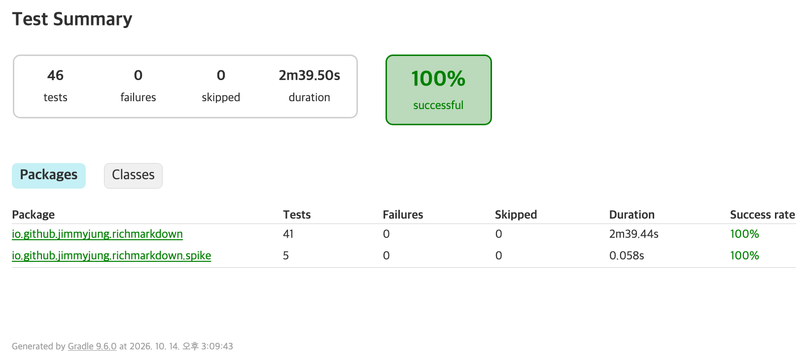

*그림 4. API 30 에뮬레이터에서 돌린 표시 모듈(`:richmarkdown`) 계측 테스트 보고서 (RichMarkdown 검증 화면, 2026-10)*

1. **요약 칸**: `tests`, `failures`, 소요 시간입니다. 어느 API 레벨 에뮬레이터에서 돌린 결과인지 함께 기록합니다.
2. **패키지 표**: 테스트가 어느 패키지에 몇 개 있는지 보여 줍니다.
3. **소요 시간**: 대부분은 동등성 테스트처럼 반복과 대기가 많은 테스트가 차지합니다. 조각 크기 1로 흘리는 경우는 한 번 실행에 수 초에서 수십 초가 걸릴 수 있습니다.

Gradle 로그에서는 작업 줄과 기기 줄을 확인합니다. 그림 5처럼 모듈마다 작업 줄 아래에 테스트를 돌린 기기가 한 줄씩 찍히므로, 여러 모듈을 한 번에 돌려도 모두 같은 에뮬레이터에서 돌았는지 확인할 수 있습니다. 다음은 출력 형식을 보여 주는 예이며, 숫자는 프로젝트마다 다릅니다.

```text
> Task :<모듈>:connectedDebugAndroidTest
Running tests on devices: <AVD 이름>(AVD) - <Android 버전>
> Task :<모듈>:createDebugAndroidTestCoverageReport
BUILD SUCCESSFUL in 6m 50s
```

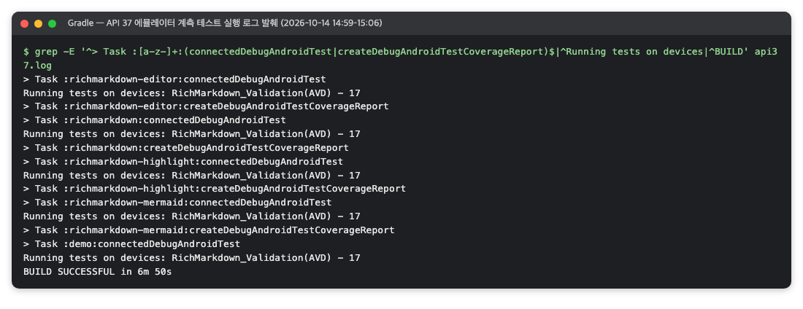

*그림 5. API 37 에뮬레이터 계측 테스트 실행 로그 (RichMarkdown 검증 때의 명령 출력을 옮긴 화면, 2026-10)*

`<AVD 이름> - 17`에서 끝의 숫자는 API 레벨이 아니라 Android 출시 버전입니다(예: API 37 이미지는 17). `BUILD SUCCESSFUL` 뒤의 시간에는 테스트 APK를 빌드한 시간까지 들어갑니다.

보고서에 싣는 표는 표 6처럼 모듈과 API 레벨 두 축으로 만듭니다. 실행하지 않은 칸은 "—"로 두어 "통과 0건"과 구분합니다.

*표 6. 모듈과 API 레벨별 계측 테스트 결과 표의 양식*

| 모듈 | 최신 API | 최소 API | 주로 확인하는 것 |
|---|---:|---:|---|
| 표시 | N | N 통과 | Compose·View 렌더, 스트리밍 동등성 |
| 웹뷰 | N | N 통과 | WebView 렌더, 공격 입력 차단 |
| 편집기 | N | — | 편집 뷰·스타일러 |
| 데모 | N | 건너뜀 | ATF 접근성 검사 |

### 3.7 주의할 점·한계

- **AGP 보고서는 "건너뜀"을 "실패"로 그립니다.** AGP HTML 보고서는 `assumeTrue`로 건너뛴 테스트(예: 특정 API 레벨 미만에서 접근성 검사를 건너뜀)를 빨간 `failures`로 표시합니다. 같은 실행의 Gradle 로그는 `BUILD SUCCESSFUL`이고, 결과 XML에만 failure로 기록됩니다. 그래서 판정은 Gradle 로그와 XML을 함께 보고 내립니다. 화면 예시는 [Accessibility Test Framework](#4-accessibility-test-framework--android-화면의-접근성-문제를-규칙으로-자동-검사하는-라이브러리)에 있습니다.
- **같은 빌드 폴더의 보고서는 마지막 실행으로 덮어써집니다.** 모듈마다 다른 API 레벨에서 돌린 결과가 섞여 남을 수 있으므로, 보고서를 근거로 쓸 때는 XML 파일 이름의 기기 이름을 함께 확인합니다.
- **커밋마다 돌지 않습니다.** 계측 테스트는 에뮬레이터가 필요하고 오래 걸려 수동 실행으로 분리하는 경우가 많습니다. 그 대가로 회귀는 수동 실행에서만 다시 확인됩니다.
- **CI 수동 잡만으로는 최소 OS 조건이 재현되지 않습니다.** 수동 잡이 중간 API 레벨에서 돈다면, 구버전 WebView 같은 조건은 최소 API 에뮬레이터에서 따로 돌려야 합니다.
- **에뮬레이터 Debug 실행은 성능 근거가 아닙니다.** 보고서의 시간은 테스트의 대기·비교 시간입니다. 체감 성능은 실기기(에뮬레이터가 아닌 실제 기기)에서 Release 빌드(최적화를 켠 배포용 빌드)로 잰 값([Jetpack Microbenchmark](android-performance.md#2-jetpack-microbenchmark--android-함수-하나를-실기기에서-반복-실행해-시간과-할당-수를-재는-라이브러리), [Jetpack Macrobenchmark](android-performance.md#3-jetpack-macrobenchmark--앱을-밖에서-조작하며-실행-시간과-프레임-시간을-재는-라이브러리))으로 봅니다.
- **사람의 확인을 대신하지 않습니다.** TalkBack(Android 화면 낭독기)으로 실제로 듣고 조작해 보는 확인은 자동 테스트 범위 밖이므로, 출시 전에 사람이 직접 확인합니다.


## 4. Accessibility Test Framework — Android 화면의 접근성 문제를 규칙으로 자동 검사하는 라이브러리

> **요약.** Accessibility Test Framework(ATF)는 "화면에 자동 검사로 찾을 수 있는 접근성 문제(대비 부족, 작은 터치 영역, 구분되지 않는 라벨)가 있는가"에 답하는 Google의 검사 라이브러리입니다. 결과를 읽을 때 가장 중요한 점은 "오류 0건"이 ATF가 읽을 수 있는 범위의 결과일 뿐이라는 것입니다. Compose 화면의 글자 대비처럼 ATF가 보지 못한 요소는 통과가 아니라 미검사입니다.


### 4.1 한눈에 보기

*표 7. Accessibility Test Framework 개요*

| 항목 | 내용 |
|---|---|
| 무엇을 하나 | 화면의 요소 트리에 검사 규칙을 돌려 글자·이미지 대비, 터치 영역 크기, 읽어 주는 라벨의 누락·중복 같은 접근성 문제를 ERROR·WARNING·INFO로 보고합니다 |
| 만든 곳·라이선스 | Google이 만들었고, 라이선스는 Apache 2.0입니다 |
| 쓰는 곳(예) | Q1 오류 중 자동 접근성 감사 단계, 릴리스 전 수동 계측 실행, 대비·라벨 회귀 확인에 씁니다 |
| 버전 | 확인 시점 버전은 ATF 4.1.1(2026-10)입니다. API 33 이상 에뮬레이터에서 돌립니다 |
| 공식 문서 | [ATF 저장소](https://github.com/google/Accessibility-Test-Framework-for-Android) · [Accessibility checking](https://developer.android.com/training/testing/espresso/accessibility-checking) |

### 4.2 무엇을 하는 도구인가

TalkBack 사용자는 화면을 눈으로 보는 대신, 접근성 서비스가 요소 트리에서 읽어 주는 이름과 설명으로 이해합니다. 버튼 두 개가 똑같은 이름으로 읽히면 TalkBack 사용자는 둘을 구분하지 못하고, 글자가 배경과 잘 구분되지 않으면 시력이 약한 사용자가 읽기 어렵습니다. ATF는 이런 문제를 화면마다 사람이 일일이 찾지 않도록 규칙으로 자동 검사하는 라이브러리입니다.

원리는 단순합니다. ATF는 접근성 서비스가 보는 요소 트리를 읽고, 정해 둔 검사 규칙을 하나씩 적용합니다 [10]. Android 공식 문서는 ATF를 "Accessibility Scanner와 Espresso 접근성 검사가 함께 쓰는 기반 프레임워크"로 설명합니다 [13]. Accessibility Scanner는 Google이 만든 접근성 검사 앱입니다.

검사마다 요소별 결과가 나오며, 결과 종류는 표 8과 같습니다.

*표 8. ATF 결과 종류와 권장 처리*

| 결과 | 뜻 | 권장 처리 |
|---|---|---|
| ERROR | 접근성 문제로 판정 | 테스트 실패 |
| WARNING | 문제일 가능성이 있어 사람이 판단해야 함 | 로그에 기록하고 릴리스 전에 읽음 |
| INFO | 참고 정보 | 무시 |
| NOT_RUN | 그 요소에는 해당 검사를 적용하지 않음 | 무시 |

검사를 거는 방법은 두 가지입니다. Espresso의 `AccessibilityChecks.enable()`은 Espresso 동작(`ViewActions`)을 수행할 때마다 검사를 겁니다 [12]. Espresso 동작이 없는 테스트(Compose 화면 위주이거나, 화면이 뜨는지만 빠르게 보는 스모크 테스트 등)라면 ATF의 `AccessibilityValidator`를 직접 돌리는 편이 맞습니다. 이때는 화면마다 다음 순서를 밟습니다.

1. `ActivityScenario`로 화면을 띄우고, `cmd uimode night yes|no`로 라이트·다크 모드를 바꿉니다.
2. ATF가 읽는 요소 트리에 그 화면의 표식 글자(화면마다 정해 둔 확인용 글자)가 나타나고, 0.5초 간격 스냅샷이 3번 연속 같아질 때까지 기다립니다. 스트리밍 화면은 스트림이 끝난 최종 화면까지 기다립니다.
3. 화면 루트(decor view) 전체에 `AccessibilityValidator`를 돌립니다(`setRunChecksFromRootView(true)`).
4. ERROR는 실패 목록에 모으고 WARNING은 logcat에 남긴 뒤, 모든 화면을 돈 다음 한 번에 판정합니다.

ATF 검사기는 기본적으로 ERROR가 있으면 예외를 던집니다 [11]. 한 화면의 실패가 나머지 화면 검사를 막지 않게 하려면 예외를 끄고(`setThrowExceptionFor(null)`) 같은 기준을 직접 적용합니다. 라이트·다크 두 모드를 테스트 2개로 나누면 테스트마다 모든 화면을 한 번씩 돕니다.

### 4.3 왜 이 도구를 썼나

이 도구가 답하는 질문은 "화면에 자동 검사로 찾을 수 있는 접근성 문제(대비 부족, 작은 터치 영역, 구분되지 않는 라벨)가 있는가"입니다. iOS에서는 XCUITest의 `performAccessibilityAudit`이 같은 질문에 답하므로, 두 플랫폼의 검사를 화면별로 짝지어 볼 수 있습니다.

Espresso 접근성 모듈을 거치지 않고 ATF를 직접 쓴 이유는, 그 모듈이 끌어오는 ATF가 오래된 버전일 수 있기 때문입니다. 버전 카탈로그에 이유를 주석으로 남겨 두면 나중에 버전을 바꿀 때 판단 근거가 됩니다.

```toml
# 접근성 검사. espresso-accessibility가 끌어오는 구버전 ATF는 Compose 가상 노드를 hierarchy에 넣지 않아
# (에뮬레이터 실측: Compose 화면 글자 0개) ATF를 직접 쓴다. 4.1.1 = Google Maven 최신 stable
```

Compose 1.8.0부터는 Compose 테스트 규칙의 `enableAccessibilityChecks()`로도 ATF 검사를 걸 수 있습니다 [13]. 그래도 Activity 전체를 View와 Compose 구분 없이 같은 방식으로 훑고 싶다면 `AccessibilityValidator`를 직접 쓰는 쪽이 단순합니다.

### 4.4 준비

API 33 이상의 에뮬레이터나 기기가 필요합니다. 그보다 낮은 API에서는 ATF가 Compose 글자를 읽지 못하므로, 테스트에서 `assumeTrue(Build.VERSION.SDK_INT >= 33)`로 33 미만은 건너뛰게 둡니다.

```sh
# build.gradle.kts: androidTestImplementation(libs.accessibility.test.framework)
grep -E '^accessibilityTestFramework ' gradle/libs.versions.toml   # accessibilityTestFramework = "<버전>"
```

접근성 계측 테스트는 에뮬레이터가 필요하므로 커밋마다 도는 CI에는 보통 넣지 않습니다. 대신 수동 계측 잡의 모듈 목록에 들어 있는지 확인합니다.

### 4.5 사용 방법

**1. 전체 화면 검사.** 해당 모듈의 계측 테스트를 돌립니다.

```sh
./gradlew :<앱모듈>:connectedDebugAndroidTest
```

**2. 한 화면만 다시 검사.** 테스트가 러너 인자 `screen`을 받아 화면 이름 일부와 맞는 화면만 돌게 만들어 두면, Gradle에서 이 값을 러너 인자 형식으로 넘겨 한 화면만 돌릴 수 있습니다.

```sh
./gradlew :<앱모듈>:connectedDebugAndroidTest -Pandroid.testInstrumentationRunnerArguments.screen=<화면이름일부>
```

**3. 경고 읽기.** 판정 결과는 AGP 보고서에 나오지만, 화면별 집계와 WARNING 내용은 logcat에만 남습니다. 로그 태그를 하나 정해 두면(예: `A11yAudit`) 그 줄만 골라 볼 수 있습니다.

```sh
adb logcat -s A11yAudit
```

### 4.6 결과 읽는 법

logcat 요약은 화면마다 한 줄이 나오도록 테스트에서 직접 출력합니다. 그림 6은 데모 앱 8개 화면을 라이트·다크 모드로 검사한 실제 요약으로, ERROR는 한 줄도 없고 WARNING만 일부 화면에 남았습니다. 다음은 출력 형식을 보여 주는 예이며, 숫자는 프로젝트마다 다릅니다.

```text
[light] 홈                ATF hierarchy 글자 24개  결과 {NOT_RUN=61, WARNING=0}  TextContrastCheck {NOT_RUN=24}
[light] 쇼케이스(Compose) ATF hierarchy 글자 37개  결과 {NOT_RUN=88, WARNING=1}  TextContrastCheck {NOT_RUN=37}
[dark]  채팅(View)        ATF hierarchy 글자 30개  결과 {NOT_RUN=70, WARNING=1}  TextContrastCheck {NOT_RUN=70}
W DuplicateSpeakableTextCheck: 복사 버튼 2개가 모두 "수식 원문 복사"로 읽힘
W ImageContrastCheck: estimated foreground color ... estimated background color ... ratio 1.12
```

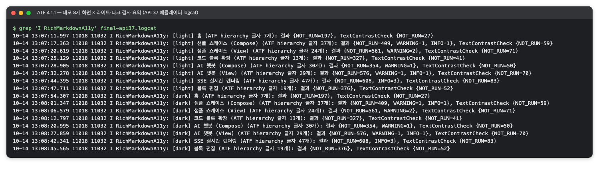

*그림 6. 데모 앱 8개 화면의 라이트·다크 모드 ATF 검사 요약 (RichMarkdown 검증 때의 명령 출력을 옮긴 화면, 2026-10)*

한 줄은 "모드, 화면, ATF가 읽은 글자 수, 결과 집계"로 이루어집니다.

1. **`[light]`·`[dark]`**: 검사한 모드입니다. 같은 화면이 두 번 나옵니다.
2. **`ATF hierarchy 글자 N개`**: ATF가 실제로 읽은 글자·설명의 개수입니다. 검사의 전제가 성립하는지 확인하는 값으로, Compose 화면에서 이 값이 0개라면 ATF가 Compose 요소를 보지 못하는 상태입니다.
3. **`결과 {...}`**: 결과 종류별 개수입니다. **ERROR 항목이 어느 줄에도 없으면** 오류 0건입니다.
4. **`TextContrastCheck {...}`**: 글자 대비 검사만 따로 뺀 집계입니다. 모든 화면이 NOT_RUN뿐이면 경고·오류가 없다는 뜻입니다. 다만 대비를 통과한 요소는 결과를 남기지 않으므로 "모든 글자를 검사했다"는 뜻은 아닙니다. 대비를 고친 뒤 `NOT_RUN=70, WARNING=8`이 `NOT_RUN=70`으로 바뀌는 식으로 회귀를 확인합니다.

AGP 보고서에서는 건너뛴 접근성 테스트가 실패처럼 보일 수 있습니다. 그림 7은 API 30 에뮬레이터에서 의도대로 건너뛴 테스트 2개가 빨간 0% 화면으로 그려진 실제 보고서입니다. 다음은 출력 형식을 보여 주는 예이며, 숫자는 프로젝트마다 다릅니다.

```text
DemoAccessibilityTest   2 tests | 2 failures | 0% successful
org.junit.AssumptionViolatedException: ATF가 API 33 미만에서 Compose 글자를 읽지 못한다
```

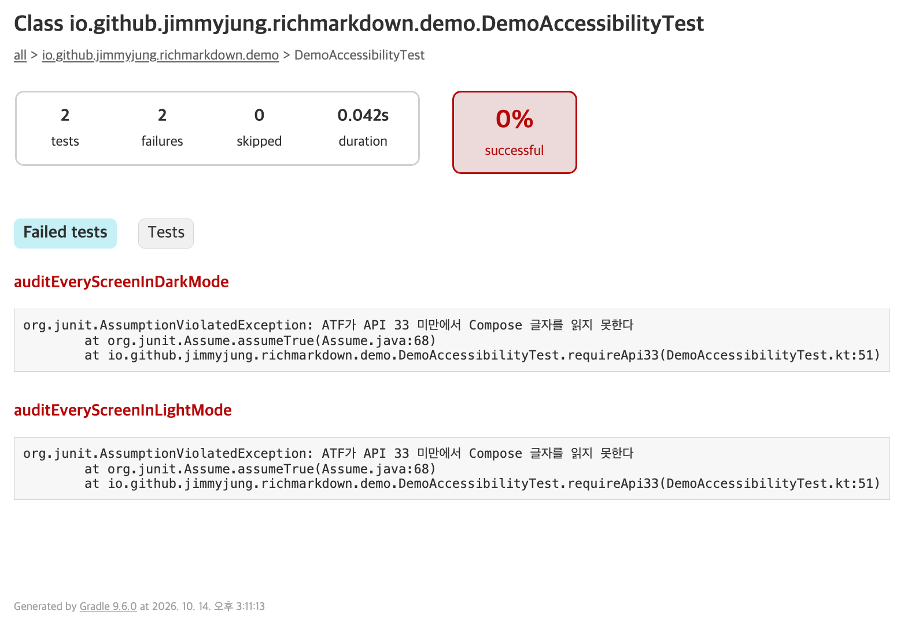

*그림 7. API 30에서 건너뛴 데모 접근성 테스트가 실패처럼 보이는 AGP 보고서 (RichMarkdown 검증 화면, 2026-10)*

이것은 **ATF 결과가 아닙니다.** 낮은 API에서 `assumeTrue`가 거짓이 되어 의도대로 건너뛴 기록이며, AGP HTML 보고서가 `AssumptionViolatedException`을 빨간 실패로 그렸을 뿐입니다. 같은 실행의 Gradle 작업은 `BUILD SUCCESSFUL`입니다. 실패 개수만 보고 "접근성 오류"로 읽지 말고, 예외 이름과 메시지를 함께 봅니다.

### 4.7 주의할 점·한계

- **"오류 0건"은 ATF가 읽을 수 있는 범위의 결과입니다.** 검사 규칙에 없는 문제나 ATF가 보지 못한 요소는 결과에 나타나지 않습니다.
- **ATF는 Compose 화면의 글자 대비를 읽지 못합니다.** Compose 화면에 경고가 없는 것은 통과가 아니라 미검사이므로, Compose 대비는 수동 확인으로 남깁니다. 대비 검사는 화면 캡처에서 색을 추정하므로(경고 문구의 "estimated foreground color … estimated background color") 결과가 추정치라는 점도 염두에 둡니다.
- **API 33 미만에서는 검사하지 않습니다.** 낮은 API에서는 ATF가 Compose 글자를 요소 트리에 담지 못해 화면 표식 대기가 모두 시간 초과될 수 있습니다. View 화면의 선택 가능한 문단을 터치 대상으로 보고 48dp 미만이라고 잘못 지적하기도 합니다.
- **WARNING은 테스트를 실패시키지 않습니다.** ATF 검사기의 기본값과 같은 동작입니다 [11]. logcat을 읽지 않으면 대비 경고도 통과로 지나가므로, 릴리스 전 실행에서는 경고 줄을 함께 확인합니다.
- **커밋마다 돌지 않습니다.** 접근성 회귀는 릴리스 전 수동 실행에서만 잡힙니다.
- **TalkBack 사용감을 대신하지 않습니다.** 실제로 듣고 조작해 보는 확인은 출시 전에 사람이 직접 합니다.


## 5. Kover — JVM 단위 테스트가 Kotlin 코드의 어느 줄을 실행했는지 재는 커버리지 플러그인

> **요약.** Kover는 "JVM 단위 테스트가 Kotlin 코드의 어디까지 닿는가, 닿지 않는 곳은 어디인가"에 답하는 JetBrains의 커버리지 Gradle 플러그인입니다. 결과를 읽을 때 가장 중요한 점은 Kover가 기기에서 도는 계측 테스트를 세지 않는다는 것입니다. 그래서 합산 화면의 Line 값을 프로젝트 전체 커버리지로 읽으면 안 됩니다.


### 5.1 한눈에 보기

*표 9. Kover 개요*

| 항목 | 내용 |
|---|---|
| 무엇을 하나 | JVM 단위 테스트를 돌리는 동안 Kotlin 코드의 어느 줄·분기가 실행됐는지 기록해 보고서를 만들고, 정해 둔 기준에 못 미치면 빌드를 실패시킵니다 |
| 만든 곳·라이선스 | JetBrains(Kotlin 팀)가 만들었고, 라이선스는 Apache 2.0입니다 |
| 쓰는 곳(예) | Q4 유지보수의 테스트 범위 측정, CI의 커버리지 기준 단계, 보고서의 커버리지 표에 씁니다 |
| 버전 | 확인 시점 버전은 Kover Gradle 플러그인 0.9.11(2026-10)입니다 [15] |
| 공식 문서 | [Kover Gradle Plugin](https://kotlin.github.io/kotlinx-kover/gradle-plugin/) |

### 5.2 무엇을 하는 도구인가

테스트가 1,000개 통과해도 어떤 함수는 한 번도 실행되지 않았을 수 있습니다. 라인 커버리지는 이런 빈 곳을 찾는 지표로, 실행할 수 있는 코드 줄 가운데 테스트가 한 번이라도 실행한 줄의 비율입니다.

Kover는 Gradle의 JVM 테스트 작업에 붙어 이 비율을 잽니다. 테스트가 도는 동안 클래스에 실행 기록 장치를 넣고, 줄마다 실행됐는지를 모읍니다. Kover가 추가하는 Gradle 작업은 표 10과 같습니다 [14].

*표 10. Kover가 추가하는 Gradle 작업*

| 작업 | 하는 일 |
|---|---|
| `koverHtmlReport` | 사람이 읽는 HTML 보고서 생성 |
| `koverXmlReport` | JaCoCo 호환 XML 보고서 생성 |
| `koverVerify` | 프로젝트에 정한 검증 규칙(최소 커버리지 등) 확인 |
| `koverBinaryReport`·`koverLog` | 바이너리 보고서 생성, 커버리지를 로그로 출력 |

여러 모듈을 합산하려면 루트 프로젝트를 "합치는 모듈"로 씁니다. 루트 `build.gradle.kts`가 모듈마다 `kover(project(":<모듈>"))`를 의존성으로 걸면, 루트 보고서에 그 모듈들을 합친 값이 나옵니다. 합산에서 뺄 모듈(데모 앱 등)은 걸지 않습니다.

커밋마다 검사하는 기준은 보통 핵심 로직 모듈에 둡니다.

```kotlin
// <핵심모듈>/build.gradle.kts
kover {
    reports {
        verify {
            rule {
                minBound(90)
            }
        }
    }
}
```

Kover 문서에 따르면 규칙의 기본 측정 단위는 `LINE`(줄), 기본 집계는 `COVERED_PERCENTAGE`(커버된 단위 ÷ 전체 단위 × 100)입니다 [14]. 따라서 위 규칙은 "라인 커버리지가 90% 미만이면 `koverVerify` 실패"라는 뜻입니다.

### 5.3 왜 이 도구를 썼나

이 도구가 답하는 질문은 "테스트가 코드의 어디까지 닿는가, 닿지 않는 곳은 어디인가"입니다. 커버리지 측정 도구가 아직 없는 저장소라면 가장 먼저 붙일 만한 도구입니다.

Kover는 JetBrains가 만든 Kotlin용 Gradle 플러그인이라 순수 Kotlin 모듈과 Android 모듈에 같은 방식으로 붙습니다. 또 XML 보고서가 JaCoCo 형식이라, 계측 테스트의 AGP JaCoCo 결과와 줄 단위로 합칠 때 스크립트 하나가 같은 파서로 두 파일을 읽을 수 있습니다([JaCoCo](#6-jacoco--에뮬레이터-계측-테스트가-실행한-줄을-재는-커버리지-도구agp-내장)).

"JaCoCo보다 인라인 함수·코루틴 집계가 정확하다"는 주장은 공식 문서로 확인하지 못했으므로 선택 근거로 쓰지 않았습니다.

Android 모듈의 단위 테스트에는 AGP 자체 커버리지(`enableUnitTestCoverage`)를 켜지 않는 편이 좋습니다. 두 도구의 기록 장치(에이전트)가 같은 테스트에 겹쳐 붙으면 이중으로 계측되기 때문입니다.

### 5.4 준비

따로 설치할 것은 없습니다. 플러그인 버전은 `gradle/libs.versions.toml`에 두고, 루트와 각 모듈이 플러그인을 적용합니다.

```sh
grep -E '^kover ' gradle/libs.versions.toml     # kover = "<버전>"
```

CI의 JVM 잡은 JVM 테스트 다음 단계에서 아래 명령을 실행하는 구성이 흔합니다. 기준에 못 미치면 이 단계와 CI가 실패합니다. 다만 브랜치 보호 규칙이 없으면 GitHub가 병합을 강제로 막지는 않으므로 설정을 따로 확인합니다.

```sh
./gradlew --console=plain koverVerify koverXmlReport
```

### 5.5 사용 방법

**1. 기준 확인.** 보고서 작업은 필요한 테스트 작업을 자동으로 먼저 돌립니다.

```sh
./gradlew koverVerify koverXmlReport
```

공식 문서는 `koverXmlReport`처럼 프로젝트 경로 없이 쓴 짧은 이름이 "모든 프로젝트의 모든 테스트를 실행한다"고 경고합니다 [14]. 모듈 하나만 보려면 경로를 붙입니다.

```sh
./gradlew :<핵심모듈>:koverHtmlReport
```

**2. 사람이 읽는 보고서.** 합산 보고서와 모듈별 보고서가 함께 만들어집니다.

```sh
./gradlew koverHtmlReport
```

**3. 저장소 래퍼로 실행.** 빌드 산출물을 저장소 밖에 두려면 래퍼 함수를 씁니다([JUnit](#2-junit--기기-없이-jvm에서-kotlin-코드의-기댓값을-확인하는-테스트-프레임워크)의 2단계).

```sh
bash -c 'source scripts/gradle-env.sh && gradle_run koverVerify koverXmlReport koverHtmlReport'
```

합산 보고서는 `build/reports/kover/html/index.html`에, 모듈별 보고서는 `<모듈>/build/reports/kover/html/index.html`에 생기고, XML은 HTML 폴더 옆의 `build/reports/kover/report.xml`(모듈별은 `<모듈>/build/reports/kover/report.xml`)입니다. 빌드 루트를 바꾸는 속성을 쓰면 이 파일들은 각 환경의 출력 경로 아래에 생깁니다. 검증 결과 파일 `verify.err`가 0바이트면 위반이 없다는 뜻입니다.

### 5.6 결과 읽는 법

합산 HTML 보고서는 패키지 표로 나옵니다. 그림 8은 실제 합산 보고서로, 핵심 로직 패키지는 거의 다 실행됐지만 화면 코드 패키지가 0%여서 맨 위 전체 Line 값이 절반에 못 미칩니다. 다음은 출력 형식을 보여 주는 예이며, 숫자는 프로젝트마다 다릅니다.

```text
all classes       Line 41.1% (1831/4458)   Branch 41.8%
  <핵심 패키지>      97.8%
  <편집기 패키지>    53.6%
  <표시 패키지>      17.2%
  <compose 패키지>   0%
  <view 패키지>      0%
```

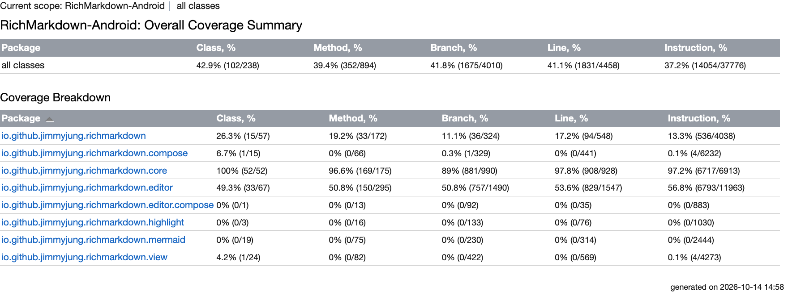

*그림 8. 라이브러리 5개 모듈 합산 Kover 보고서 (RichMarkdown 검증 화면, 2026-10)*

1. **맨 위 `all classes` 행의 Line 41.1%** 는 JVM 단위 테스트만으로 잰 값입니다. 프로젝트의 커버리지가 아니며, 계측 테스트 결과까지 합친 값이 프로젝트 커버리지입니다.
2. **0%인 패키지**는 Compose·View·WebView·스크립트 엔진 코드입니다. 이 코드는 에뮬레이터 계측 테스트에서만 실행되므로 Kover에는 0%로 나옵니다. 같은 패키지가 계측 테스트의 JaCoCo 결과에서는 90% 안팎으로 나올 수 있습니다.
3. **핵심 로직 패키지**가 커밋 기준의 대상입니다. 편집기 같은 모듈이 절반 정도로 나오는 것은 모델·코덱만 JVM에서 돌고 편집 뷰는 계측 테스트에서 돌기 때문입니다.

모듈 하나의 보고서는 단위별 숫자를 함께 보여 줍니다. 그림 9의 핵심 모듈 보고서처럼 Class·Method·Branch·Line·Instruction 다섯 단위의 비율이 분자·분모와 함께 한 행에 나란히 나옵니다. 다음은 출력 형식을 보여 주는 예이며, 숫자는 프로젝트마다 다릅니다.

```text
Class 100% (52/52)  Method 96.6% (169/175)  Branch 89% (881/990)
Line 97.8% (908/928)  Instruction 97.2% (6717/6913)
```

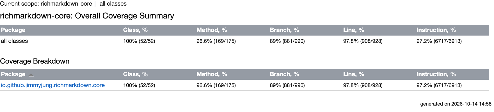

*그림 9. 핵심 모듈(`:richmarkdown-core`) Kover 보고서 (RichMarkdown 검증 화면, 2026-10)*

커밋 기준과 연결되는 값은 **Line** 하나입니다. 규칙의 기본 단위가 줄이므로 기준 90%를 이 값과 비교합니다. Class·Method는 한 번이라도 실행된 클래스·메서드의 비율, Instruction은 바이트코드 명령(Kotlin 코드를 컴파일해 만든 JVM 명령) 단위, Branch는 `if`·`when`의 갈래 단위입니다. Branch 값은 판정에 쓰지 않는 편이 단순합니다.

### 5.7 주의할 점·한계

- **합산의 Line 값을 프로젝트 커버리지로 읽으면 안 됩니다.** Kover는 계측 테스트를 다루지 않습니다. 공식 문서도 "기기에서 실행되는 계측 테스트는 아직 지원하지 않는다"고 적었습니다 [14]. 화면 코드의 커버리지는 [JaCoCo](#6-jacoco--에뮬레이터-계측-테스트가-실행한-줄을-재는-커버리지-도구agp-내장)로 따로 잽니다.
- **커버리지는 "실행했다"이지 "맞다"가 아닙니다.** 결과를 검사하지 않고 지나가기만 하는 테스트도 커버리지를 올립니다. 기준 구현과의 비교는 차이를 찾을 뿐, 두 구현이 함께 틀린 경우까지 확인하지는 못합니다. 커버리지가 높아도 퍼징이나 플랫폼 간 비교가 결함을 찾을 수 있습니다.
- **기준은 규칙을 둔 모듈에만 있습니다.** 다른 모듈에는 규칙이 없어 `koverVerify`가 커버리지와 상관없이 통과합니다. 커밋 CI에 계측 테스트가 없으면 화면 코드에는 커밋 기준이 없습니다.
- **90%는 회귀 방지 기준입니다.** "이 정도면 충분하다"는 외부 기준(플랫폼 제작사·공식 문서가 정한 판정 기준)이 아니라, 커버리지가 떨어지면 CI를 실패시키려고 프로젝트가 정한 값입니다. 병합 차단 정책과도 별개입니다.
- **숫자의 분모는 집계 방식에 따라 조금 다릅니다.** 같은 파일의 같은 줄을 한 번만 세는 합산 스크립트는 Kover 화면과 분모가 몇 줄 다를 수 있습니다. 백분율은 같습니다.


## 6. JaCoCo — 에뮬레이터 계측 테스트가 실행한 줄을 재는 커버리지 도구(AGP 내장)

> **요약.** JaCoCo는 "JVM 단위 테스트가 닿지 못하는 Compose·View·WebView 경로를 에뮬레이터 계측 테스트가 얼마나 실행했는가"에 답하는 커버리지 도구로, Android에서는 AGP(Android Gradle 플러그인)가 자동으로 적용합니다. 결과를 읽을 때 가장 중요한 점은 HTML 보고서의 두 `Cov.` 열이 라인 커버리지가 아니라 명령·분기 커버리지라는 것입니다. 라인 커버리지는 `Missed`·`Lines` 열로 따로 계산합니다.


### 6.1 한눈에 보기

*표 11. JaCoCo 개요*

| 항목 | 내용 |
|---|---|
| 무엇을 하나 | AGP가 계측 테스트를 돌리는 동안 JaCoCo로 줄·분기·바이트코드 명령의 실행 여부를 기록하고 HTML·XML 보고서를 만듭니다 |
| 만든 곳·라이선스 | JaCoCo는 EclEmma 팀이 만들었고 라이선스는 EPL 2.0입니다 [20]. AGP 통합은 Google이 맡습니다 |
| 쓰는 곳(예) | Q4 유지보수의 화면 코드 커버리지 측정, JVM 결과(Kover)와 합친 전체 커버리지 표에 씁니다 |
| 버전 | 확인 시점 버전은 AGP 9.4.0이 적용한 JaCoCo 0.8.14(보고서 화면 하단 표기, 2026-10)입니다 |
| 공식 문서 | [View code coverage reports](https://developer.android.com/studio/test/coverage-report) · [JaCoCo](https://www.jacoco.org/jacoco/) |

### 6.2 무엇을 하는 도구인가

[Kover](#5-kover--jvm-단위-테스트가-kotlin-코드의-어느-줄을-실행했는지-재는-커버리지-플러그인)로 JVM 단위 테스트의 커버리지를 재면 Compose·View 패키지가 0%로 나옵니다. 이 코드는 에뮬레이터·기기에서 도는 계측 테스트만 실행하기 때문입니다. JaCoCo는 Java 바이트코드의 실행 여부를 재는 커버리지 라이브러리이며, Android에서는 이 계측 테스트의 커버리지를 재는 데 씁니다 [18].

원리는 위 Kover 절(5.2)과 같습니다. 바이트코드에 실행 기록 장치를 넣고, 무엇이 실행됐는지 셉니다. JaCoCo가 세는 단위 가운데 이 문서에서 쓰는 것은 표 12의 세 가지입니다 [19].

*표 12. JaCoCo가 세는 단위*

| 단위 | JaCoCo 문서의 정의 |
|---|---|
| 명령(Instructions) | 가장 작은 단위인 바이트코드 명령 하나 |
| 분기(Branches) | `if`·`switch`의 갈래 |
| 줄(Lines) | 그 줄에 속한 명령이 하나라도 실행되면 실행된 줄로 봄 |

Android에서는 JaCoCo를 직접 설정하지 않습니다. 공식 문서는 "모듈에 커버리지를 켜면 AGP가 JaCoCo를 자동으로 적용한다"고 적었습니다 [16]. 계측 테스트가 있는 모듈의 debug 빌드에만 설정을 켭니다 [17].

```kotlin
// <모듈>/build.gradle.kts
buildTypes {
    debug {
        // 계측 테스트 커버리지(JaCoCo, createDebugAndroidTestCoverageReport).
        // JVM 단위 테스트는 Kover가 집계하므로 enableUnitTestCoverage는 켜지 않는다(이중 계측 방지).
        enableAndroidTestCoverage = true
    }
}
```

동작 순서는 이렇습니다. 계측 테스트가 기기에서 돌면서 실행 기록을 `coverage.ec` 파일로 남기고, AGP가 이 파일을 내려받아 보고서 작업에서 HTML·XML로 바꿉니다.

### 6.3 왜 이 도구를 썼나

이 도구가 답하는 질문은 "JVM 단위 테스트가 닿지 못하는 Compose·View·WebView 경로를 계측 테스트가 얼마나 실행했는가"입니다. Kover는 기기에서 도는 계측 테스트를 다루지 않으므로([Kover](#5-kover--jvm-단위-테스트가-kotlin-코드의-어느-줄을-실행했는지-재는-커버리지-플러그인)), 이 경로는 AGP의 JaCoCo로 따로 잴 수밖에 없습니다.

AGP에 들어 있어 플러그인을 따로 추가하지 않아도 되고, XML 보고서가 Kover와 같은 JaCoCo 형식이라 두 결과를 같은 파서로 합칠 수 있다는 점(5.3절)도 이유입니다.

공식 문서에는 단위 테스트와 계측 테스트 커버리지를 하나의 보고서로 합치는 실험 기능(`testAllSuites`)도 있습니다 [16]. 다만 이 기능을 쓰려면 AGP 알파 버전(확인 시점 9.5.0-alpha05) 이상과 `android.experimental.reportAggregationSupport=true` 설정이 필요합니다. 쓰는 AGP가 그보다 낮으면 보고서 생성 스크립트로 두 결과를 줄 단위로 합칩니다.

### 6.4 준비

계측 테스트와 같은 준비가 필요합니다. 실행 중인 에뮬레이터나 연결된 기기가 있어야 합니다([AndroidX Test와 Espresso](#3-androidx-test와-espresso--에뮬레이터기기-안에서-화면-코드를-실행해-확인하는-계측-테스트-도구)의 "준비").

설정이 어느 모듈에 켜져 있는지는 아래 명령으로 확인합니다.

```sh
grep -rn 'enableAndroidTestCoverage = true' --include=build.gradle.kts .
```

CI 게이트에 계측 테스트가 없으면 이 보고서는 CI에서 만들어지지 않습니다. 수동 계측 잡도 `connectedDebugAndroidTest`만 실행하고 보고서 작업을 부르지 않을 수 있으므로 확인합니다.

### 6.5 사용 방법

**1. 계측 테스트와 보고서 생성.** 보고서 작업은 필요한 계측 테스트를 자동으로 먼저 돌립니다.

```sh
./gradlew :<모듈>:createDebugAndroidTestCoverageReport
./gradlew :<모듈A>:createDebugAndroidTestCoverageReport :<모듈B>:createDebugAndroidTestCoverageReport
```

보고서는 `<모듈>/build/reports/coverage/androidTest/debug/connected/index.html`과 같은 폴더의 `report.xml`에 생깁니다 [16]. 빌드 루트를 바꾸는 속성을 쓰면 보고서는 각 환경의 출력 경로 아래 `<모듈>/reports/coverage/...`에 생깁니다.

**2. Kover 결과와 줄 단위로 합치기.** 모듈별 Kover XML을 만든 뒤, 합산 스크립트에 빌드 루트를 넘깁니다.

```sh
./gradlew koverXmlReport -P<프로젝트>.buildRoot=<빌드 루트>     # 모듈별 reports/kover/report.xml
python3 scripts/report/collect.py --android-build <빌드 루트> --out data
```

1단계의 계측 커버리지와 Kover XML이 같은 빌드 루트에 있어야 하므로, 1단계도 같은 속성으로 실행합니다(래퍼 함수가 이 값을 자동으로 붙이게 만들어 두면 편합니다). 스크립트는 모듈마다 `<빌드 루트>/<모듈>/reports/kover/report.xml`(JVM 단위)과 `<빌드 루트>/<모듈>/reports/coverage/androidTest/debug/connected/report.xml`(계측)을 읽습니다.

합치는 규칙은 아래 코드가 전부입니다.

```python
def jacoco_lines(path):
    """JaCoCo 형식 XML(Kover XML도 같은 형식)의 줄별 실행 여부."""
    lines = {}
    if not path.exists():
        return lines
    for package in ET.parse(path).getroot().iter("package"):
        for source in package.findall("sourcefile"):
            for line in source.findall("line"):
                key = (package.get("name"), source.get("name"), int(line.get("nr")))
                lines[key] = lines.get(key, False) or int(line.get("ci")) > 0
    return lines

# 모듈마다: 두 보고서의 줄을 합집합으로 모으고, 어느 한쪽에서라도 실행된 줄을 커버로 센다
keys = set(unit) | set(instrumented)
covered = sum(1 for key in keys if unit.get(key) or instrumented.get(key))
```

줄은 "패키지, 파일, 줄 번호"로 식별합니다. XML의 `ci`(covered instructions, 실행된 명령 수)가 0보다 크면 실행된 줄로 봅니다. JaCoCo의 줄 정의와 같은 기준입니다.

### 6.6 결과 읽는 법

AGP JaCoCo HTML 보고서는 패키지 표로 나옵니다. 그림 10의 실제 보고서를 보면 Kover에서 0%였던 view·compose 패키지가 계측 테스트에서는 높은 커버리지로 나옵니다. 다음은 출력 형식을 보여 주는 예이며, 숫자는 프로젝트마다 다릅니다.

```text
Element       Missed Instr.  Cov.   Missed Branches  Cov.   ... Missed Lines
<pkg>                  ...    82%                      62%
<pkg>.view             ...    89%                      72%         57 / 611
<pkg>.compose          ...    93%                      77%         29 / 463
Total        1,512 of 13,376  88%   300 of 1,002       70%         188 / 1,666
Android Gradle plugin 9.4.0 · JaCoCo 0.8.14        Sessions: 15:00:09 - 15:02:49
```

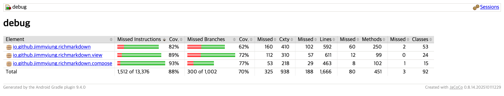

*그림 10. 표시 모듈(`:richmarkdown`) 계측 테스트 JaCoCo 보고서 (RichMarkdown 검증 화면, 2026-10)*

열마다 단위가 다르므로 순서대로 읽습니다.

1. **`Cov.` 열 두 개는 명령과 분기 커버리지입니다.** Total의 88%는 명령, 70%는 분기이며, 라인 커버리지가 아닙니다.
2. **라인 커버리지는 `Missed`·`Lines` 열로 계산합니다.** 위 예시에서는 1,666줄 중 188줄이 실행되지 않았으므로 1,478줄(88.7%)이 실행됐습니다.
3. **같은 패키지가 Kover에서는 0%일 수 있습니다.** JVM 단위 테스트가 이 코드를 실행하지 않기 때문이며, 두 결과를 합쳐야 하는 이유가 여기에 있습니다.
4. **`Sessions`**(HTML 보고서에서는 오른쪽 위, 위 예시에서는 맨 아래 줄)는 실행 기록이 만들어진 시각입니다. 어느 에뮬레이터 실행에서 나온 결과인지 이 시각으로 확인합니다.

합산 스크립트는 모듈마다 Kover와 JaCoCo가 실행한 줄 수와 둘을 합친 결과를 한 줄씩 출력하고, 맨 아래에 전체 합계를 적습니다(그림 11). 다음은 출력 형식을 보여 주는 예입니다. 숫자는 프로젝트마다 다릅니다.

```text
<핵심모듈>   kover 903            merged  903/923   97.8%
<표시모듈>   kover 94 jacoco 1478 merged 1480/1671  88.6%
<웹뷰모듈>   jacoco 299           merged  299/354   84.5%
total 4300/4710 91.3%
```

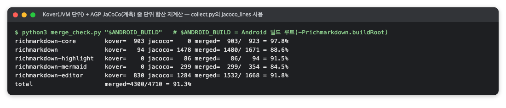

*그림 11. Kover와 JaCoCo 결과의 줄 단위 합산 재계산 (RichMarkdown 검증 때의 명령 출력을 옮긴 화면, 2026-10)*

모듈마다 두 도구가 맡는 부분은 표 13처럼 다릅니다.

*표 13. 모듈 유형별 Kover와 JaCoCo의 분담*

| 모듈 유형 | JVM 단위(Kover) | 계측(JaCoCo) | 읽는 법 |
|---|---|---|---|
| 순수 Kotlin 핵심 | 대부분 | 0 | 계측 테스트 대상이 아님 |
| 화면 표시 | 소수 | 대부분 | 거의 전부 계측 테스트가 실행 |
| 하이라이트·WebView | 0 | 전부 | JVM 테스트 없음 |
| 편집기 | 모델·코덱 | 편집 뷰 | 둘이 나눠 실행 |

### 6.7 주의할 점·한계

- **커버리지는 "실행했다"이지 "맞다"가 아닙니다.** 이 한계는 위 Kover 절(5.7)과 같습니다. 여기에 더해 줄 정의상 그 줄의 명령 하나만 실행돼도 실행된 줄로 보므로, 일부만 실행된 줄도 다 실행된 것으로 셉니다.
- **합산 값은 두 시점의 결과를 합친 것입니다.** Kover와 JaCoCo의 결과가 다른 시각에 만들어졌을 수 있고, 같은 빌드 폴더에서 다른 API 레벨 실행이 테스트 결과와 `coverage.ec`를 덮어쓸 수 있습니다. 보고서를 근거로 쓸 때는 `Sessions` 시각을 확인합니다.
- **분모가 도구마다 조금 다릅니다.** Kover 절(5.7)에서 본 것처럼 합산은 같은 파일의 같은 줄을 한 번만 세므로, JaCoCo 화면의 줄 수와도 분모가 다를 수 있습니다. 백분율 차이는 작지만 숫자를 대조할 때 혼동하기 쉽습니다.
- **테스트가 실패하면 보고서가 만들어지지 않습니다.** 공식 문서가 밝힌 동작입니다 [16]. 계측 테스트가 하나라도 실패하면 그 실패부터 해결합니다.
- **커밋마다 갱신되지 않습니다.** 커밋 CI에 계측 테스트가 없으면 화면 코드 커버리지는 릴리스 전 수동 실행 시점의 값입니다.
- **분기 커버리지는 판정에 쓰지 않는 편이 단순합니다.** 화면에는 나오지만 판정에는 라인 커버리지만 씁니다.


## 7. Android lint — 앱을 실행하지 않고 소스·리소스·빌드 파일의 구조적 문제를 찾는 정적 검사 도구

> **요약.** Android lint는 "앱을 실행하기 전에 Android API 사용 실수, 호환성, 리소스·Manifest 문제를 잡을 수 있는가"에 답하는 정적 검사 도구로, AGP(Android Gradle 플러그인)에 들어 있습니다. 결과를 읽을 때 가장 중요한 점은 빌드를 멈추는 것은 오류뿐이고 경고는 보고서에만 쌓인다는 것입니다. 경고는 개수보다 내용을 코드와 대조해 읽습니다.


### 7.1 한눈에 보기

*표 14. Android lint 개요*

| 항목 | 내용 |
|---|---|
| 무엇을 하나 | Kotlin·Java 소스, XML 리소스, Manifest, Gradle 빌드 파일을 실행 없이 읽고 정확성·보안·성능·사용성·접근성·국제화 문제를 오류·경고로 보고합니다 |
| 만든 곳·라이선스 | Google이 Android 오픈 소스 프로젝트(AOSP)에서 만들고 Apache 2.0으로 배포합니다. AGP에 들어 있어 따로 설치하지 않습니다 |
| 쓰는 곳(예) | Q4 유지보수의 정적 검사 단계(보안 규칙은 Q3 보안을 보완), CI의 lint 단계(오류면 실패), 릴리스 전 품질 확인에 씁니다 |
| 버전 | 확인 시점 버전은 AGP 9.4.0에 포함된 lint(보고서 머리글 "by AGP (9.4.0)", 2026-10)입니다 |
| 공식 문서 | [Improve your code with lint checks](https://developer.android.com/studio/write/lint) |

### 7.2 무엇을 하는 도구인가

`minSdk`(앱이 지원하는 가장 낮은 API 레벨)보다 새로운 API를 버전 확인 없이 부르거나 Manifest에 필요한 선언을 빠뜨리면, 앱은 빌드되지만 특정 기기에서 문제가 생깁니다. 이런 실수는 코드를 실행하지 않고 읽기만 해도 찾을 수 있는데, 이렇게 찾는 방법을 정적 검사라고 합니다. 공식 문서는 lint가 "정확성, 보안, 성능, 사용성, 접근성, 국제화"에 관한 잠재 버그와 개선점을 검사한다고 설명합니다 [21].

검사 항목(issue)마다 심각도가 있습니다. 공식 문서가 드는 단계는 `informational`, `warning`, `error`, `fatal`입니다. 검사 항목은 설정으로 끄거나(`disable`·`ignore`) 켤(`enable`) 수 있습니다 [21].

lint가 빌드를 멈추는 조건은 공식 문서의 `abortOnError` 설명에 있습니다 [21]. 기본값이 `true`라서 lint 작업이 돌 때 오류가 있으면 빌드를 멈추고, 경고는 보고서에만 남깁니다. 공식 문서는 또 lint가 일반 빌드에 자동으로 포함되지 않으므로 CI에서 명시적으로 돌리라고 권합니다.

검사 규칙은 AGP에만 있지 않습니다. Compose나 WebKit 같은 라이브러리도 자기 규칙을 함께 배포하므로, 결과에 `ModifierParameter`(Jetpack Compose 제공), `MissingOnRenderProcessGone`(androidx.webkit 제공) 같은 항목이 나옵니다.

### 7.3 왜 이 도구를 썼나

이 도구가 답하는 질문은 "Android API 사용 실수, 호환성, 리소스·Manifest 문제를 실행 전에 잡을 수 있는가"입니다. 보안 패턴은 semgrep 같은 도구가, 코드 복잡도는 lizard 같은 도구가 따로 봅니다. lint는 그중 Android 플랫폼 지식이 필요한 문제를 맡습니다.

lint는 AGP에 들어 있어 의존성을 따로 추가하지 않아도 됩니다. Android에서 가장 널리 쓰는 기본 검사이므로 다른 팀원도 같은 도구로 결과를 다시 확인할 수 있습니다.

iOS의 SwiftLint와 이름은 비슷하지만 하는 일이 다릅니다(표 15).

*표 15. Android lint와 SwiftLint의 차이*

| 항목 | Android lint | SwiftLint |
|---|---|---|
| 만든 곳·설치 | Google, AGP에 포함 | 오픈소스 커뮤니티 도구, 별도 설치 [22] |
| 검사 대상 | Kotlin·Java 소스, XML 리소스, Manifest, Gradle 빌드 파일 | Swift 소스 |
| 주로 보는 것 | 정확성·보안·성능 같은 구조적 문제 | 스타일과 관례 |
| 설정 | 없으면 기본값 | 없으면 기본 규칙 |
| CI 게이트 | 보통 CI에서 실행, 오류면 실패 | 프로젝트마다 다름 |

그래서 "Android lint 오류 0건"과 "SwiftLint 위반 N건"을 나란히 놓고 두 플랫폼의 코드 품질을 비교하면 안 됩니다. 검사 대상과 규칙이 다른 도구입니다.

### 7.4 준비

따로 설치할 것은 없습니다. AGP를 쓰는 Android 모듈에는 `lint` 작업이 이미 있습니다. 순수 Kotlin(JVM) 모듈에는 Android lint 작업이 없습니다.

먼저 lint 설정이 있는지 확인합니다. 설정이 없으면 모든 검사가 기본 심각도와 `abortOnError = true`로 돕니다.

```sh
grep -rn -E '^\s*lint\s*\{|abortOnError|warningsAsErrors|baseline' --include='*.kts' .
find . -name 'lint.xml' -o -name 'lint-baseline.xml'
```

CI의 JVM 잡은 커버리지 단계 다음에 Android 모듈들의 `lintDebug`를 실행하는 구성이 흔합니다. 오류가 하나라도 나오면 이 단계와 CI가 실패합니다. 다만 브랜치 보호 규칙이 없으면 GitHub가 병합을 강제로 막지는 않습니다.

### 7.5 사용 방법

**1. 전체 실행.** 빌드 변형이 있는 모듈에서 `lint`는 기본 변형만 검사합니다.

```sh
./gradlew lint
```

**2. CI와 같은 범위로 실행.**

```sh
./gradlew :<모듈A>:lintDebug :<모듈B>:lintDebug :<앱모듈>:lintDebug
```

빌드 산출물을 저장소 밖으로 보내는 래퍼가 있으면 `bash -c 'source scripts/gradle-env.sh && gradle_run lint'`처럼 실행합니다([JUnit](#2-junit--기기-없이-jvm에서-kotlin-코드의-기댓값을-확인하는-테스트-프레임워크)의 2단계).

**3. 보고서 열기.** 모듈마다 `<모듈>/build/reports/lint-results-debug.html`이 생기고, 같은 이름의 `.xml`·`.txt`·`.sarif`도 함께 생깁니다. 빌드 루트를 바꾸는 속성을 쓰면 보고서는 각 환경의 출력 경로 아래 `<모듈>/reports/`에 생깁니다.

### 7.6 결과 읽는 법

HTML 보고서 개요 카드는 머리글, 분류별 검사 목록, 추가·비활성 검사 목록으로 이루어집니다. 그림 12는 오류 없이 경고만 나온 표시 모듈의 개요 카드입니다. 다음은 출력 형식을 보여 주는 예이며, 숫자는 프로젝트마다 다릅니다.

```text
Lint Report: 11 warnings
Check performed at <날짜> by AGP (9.4.0)

Correctness   ModifierParameter       1
Performance   ObsoleteSdkInt          3
Productivity  UseKtx                  4
              UseTomlInstead          3
Included Additional Checks (60)   Disabled Checks (41)
```

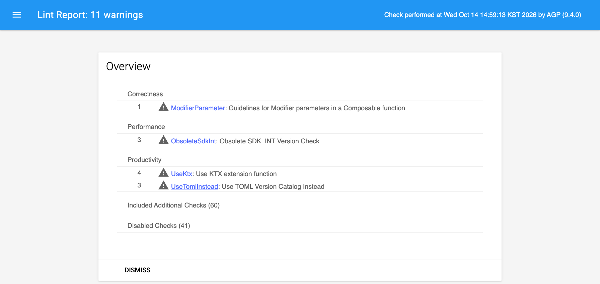

*그림 12. 표시 모듈(`:richmarkdown`) lint 보고서 개요 카드 (RichMarkdown 검증 화면, 2026-10)*

1. **머리글 `Lint Report: N warnings`**: 이 모듈의 결과입니다. 오류 개수는 같은 실행의 텍스트 보고서(`lint-results-debug.txt`) 마지막 줄 `0 errors, 11 warnings`에서 확인합니다.
2. **분류별 목록**: 각 줄의 숫자는 그 검사에 걸린 위치의 수입니다.
3. **`Included Additional Checks`·`Disabled Checks`**: 라이브러리 등에서 추가된 검사 목록과 기본으로 꺼진 검사 목록입니다. 이 숫자가 바뀌면 같은 코드라도 결과가 달라질 수 있습니다.

흔히 나오는 개선 제안은 표 16과 같습니다.

*표 16. 흔히 나오는 lint 개선 제안*

| 검사 | 내용 |
|---|---|
| `ModifierParameter` | Composable 함수의 `modifier` 매개변수를 첫 번째 선택 매개변수로 두라는 Compose API 지침 |
| `ObsoleteSdkInt` | `minSdk`가 이미 그 버전 이상이라 항상 참인 `SDK_INT >=` 분기를 지우라는 제안 |
| `UseKtx` | `Uri.parse` 대신 `toUri()`처럼 Android KTX 확장 함수를 쓰라는 제안 |
| `UseTomlInstead` | 빌드 파일에 문자열로 적은 의존성을 버전 카탈로그로 옮기라는 제안 |

모듈별 텍스트 보고서를 모아 집계하면 모듈마다 오류·경고 개수와 검사 이름을 한눈에 볼 수 있습니다. 그림 13은 라이브러리 4개 모듈과 데모 앱의 실제 집계로, 모든 모듈이 오류 0건이고 경고는 모듈마다 다른 검사에서 나왔습니다. 다음은 출력 형식을 보여 주는 예이며, 숫자는 프로젝트마다 다릅니다.

```text
<모듈A>  0 errors 11 warnings
<모듈B>  0 errors  3 warnings (UseTomlInstead)
<모듈C>  0 errors  1 warning  (MissingOnRenderProcessGone)
<모듈D>  No issues found
<앱모듈> 0 errors  4 warnings 3 hints
```

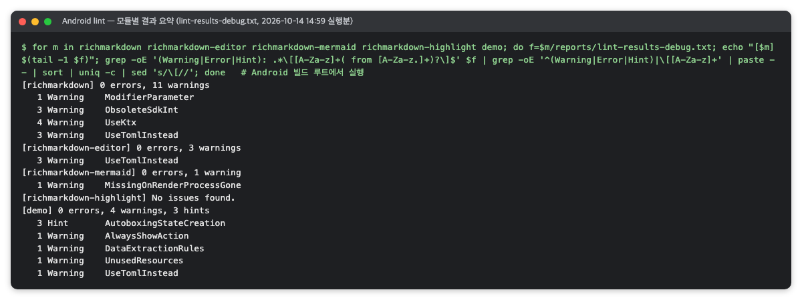

*그림 13. 라이브러리 4개 모듈과 데모 앱의 lint 결과 요약 (RichMarkdown 검증 때의 명령 출력을 옮긴 화면, 2026-10)*

CI 통과 조건은 오류 0건이고, 경고는 합계를 따로 적어 둡니다.

경고는 하나씩 내용을 코드와 대조해 읽어 둘 만합니다. 예를 들어 lint가 `WebViewClient`에 렌더 프로세스 종료 콜백(`onRenderProcessGone`)이 없다고 경고할 수 있습니다. 그런데 실제 클래스는 이 콜백을 구현해 `true`를 돌려주고, 계측 테스트가 복구까지 확인하는 경우가 있습니다. 이런 경고는 lint가 구현을 인식하지 못한 것으로 보입니다. 경고 숫자만 세면 이런 차이를 놓칩니다.

### 7.7 주의할 점·한계

- **오류 0건은 "lint 규칙에 걸린 오류가 없다"는 뜻입니다.** 규칙이 모르는 논리 오류나 동작 결함은 알려 주지 않습니다.
- **경고는 CI를 통과합니다.** 그래서 경고가 그대로 쌓이고, 보고서를 열어 보지 않으면 드러나지 않습니다. 새 경고만 보고 싶다면 공식 문서의 baseline 기능(현재 경고를 기준으로 저장하고 새 항목만 보고)을 쓸 수 있습니다 [21].
- **숫자는 도구 버전과 규칙 구성에 따라 바뀝니다.** AGP를 올리거나 라이브러리를 바꾸면 추가·비활성 검사 목록이 달라집니다. 경고 건수가 늘거나 줄었을 때는 코드 변화와 도구 변화를 구분해서 읽습니다.
- **기본 변형(debug)만 검사합니다.** release 빌드에만 있는 문제는 `lintRelease`로 따로 돌려야 찾습니다.
- **순수 Kotlin 모듈은 대상이 아닙니다.** Android lint가 돌지 않으므로 그 모듈의 정적 검사는 다른 도구가 맡습니다.
- **상세 보고서에는 소스의 절대 경로가 들어갑니다.** HTML 상세 카드와 텍스트 보고서에 빌드한 컴퓨터의 경로가 찍히므로, 외부에 공유할 때는 개요만 잘라 쓰거나 경로를 가립니다.


## 참고문헌

[1] JUnit 팀, "JUnit User Guide — Overview", JUnit 문서, <https://docs.junit.org/current/user-guide/>. JUnit 6의 구성(Platform·Jupiter·Vintage)과 Java 17 이상 요구 사항.

[2] JUnit 팀, "JUnit User Guide — Dynamic Tests", JUnit 문서, <https://docs.junit.org/6.1.3/writing-tests/dynamic-tests.html>. `@TestFactory`로 실행 중에 테스트를 만드는 방법.

[3] JUnit 팀, "JUnit 4", <https://junit.org/junit4/>. Android 모듈 JVM 테스트와 계측 테스트가 쓰는 JUnit 4 문서.

[4] Gradle, "Testing in Java & JVM projects", Gradle User Manual, <https://docs.gradle.org/current/userguide/java_testing.html#test_reporting>. `useJUnitPlatform()`, 테스트 보고서, `--tests` 필터, `--rerun`.

[5] Gradle, "Build Cache", Gradle User Manual, <https://docs.gradle.org/current/userguide/build_cache.html>. `FROM-CACHE`의 뜻과 캐시 키 계산.

[6] Google, "Test from the command line", Android Developers, <https://developer.android.com/studio/test/command-line>. `testVariantNameUnitTest`·`connectedAndroidTest` 작업, HTML·XML 결과 위치, adb로 특정 클래스 실행.

[7] Google, "Set up project for AndroidX Test", Android Developers, <https://developer.android.com/training/testing/instrumented-tests/androidx-test-libraries/test-setup>. AndroidX Test 라이브러리 의존성과 설정.

[8] Google, "AndroidJUnitRunner", Android Developers, <https://developer.android.com/training/testing/instrumented-tests/androidx-test-libraries/runner>. 기기에서 JUnit 4 테스트를 실행하는 러너, `testInstrumentationRunner` 설정.

[9] Google, "Espresso", Android Developers, <https://developer.android.com/training/testing/espresso>. View 화면 UI 테스트 프레임워크.

[10] Google, "Accessibility Test Framework for Android", GitHub, <https://github.com/google/Accessibility-Test-Framework-for-Android>. ATF 저장소와 검사 목록.

[11] Google, "AccessibilityValidator.java", ATF 저장소 소스, <https://github.com/google/Accessibility-Test-Framework-for-Android/blob/master/src/main/java/com/google/android/apps/common/testing/accessibility/framework/integrations/espresso/AccessibilityValidator.java>. `setRunChecksFromRootView`, `setThrowExceptionFor`의 뜻과 기본값(ERROR).

[12] Google, "Accessibility checking", Android Developers, <https://developer.android.com/training/testing/espresso/accessibility-checking>. Espresso `AccessibilityChecks`로 ATF 검사를 켜고 결과를 억제하는 방법.

[13] Google, "Testing | Jetpack Compose", Android Developers, <https://developer.android.com/develop/ui/compose/accessibility/testing>. ATF가 Accessibility Scanner·Espresso 검사와 같은 기반이라는 설명, Compose의 `enableAccessibilityChecks()`.

[14] JetBrains, "Kover Gradle Plugin", Kover 문서, <https://kotlin.github.io/kotlinx-kover/gradle-plugin/>. 작업 목록(`koverHtmlReport`·`koverXmlReport`·`koverVerify`), 검증 규칙의 기본 단위·집계, 합치는 모듈 구성, Android 계측 테스트 미지원.

[15] JetBrains, "kotlinx-kover", GitHub, <https://github.com/Kotlin/kotlinx-kover>. 소스와 릴리스 기록.

[16] Google, "View code coverage reports", Android Developers, <https://developer.android.com/studio/test/coverage-report>. `enableAndroidTestCoverage` 설정, `create<변형>AndroidTestCoverageReport` 작업과 보고서 위치, 실험 기능 `testAllSuites`, 실패 시 보고서 미생성.

[17] Google, "BuildType (AGP DSL)", Android Developers, <https://developer.android.com/reference/tools/gradle-api/com/android/build/api/dsl/BuildType>. `enableAndroidTestCoverage` 속성 설명.

[18] JaCoCo 프로젝트, "JaCoCo", <https://www.jacoco.org/jacoco/>. JaCoCo 프로젝트 홈.

[19] JaCoCo 프로젝트, "Coverage Counter", JaCoCo 문서, <https://www.jacoco.org/jacoco/trunk/doc/counters.html>. 명령·분기·줄 단위의 정의.

[20] JaCoCo 프로젝트, "License", JaCoCo 문서, <https://www.jacoco.org/jacoco/trunk/doc/license.html>. EPL 2.0.

[21] Google, "Improve your code with lint checks", Android Developers, <https://developer.android.com/studio/write/lint>. `./gradlew lint` 실행, 보고서 위치, 심각도, `lint {}` 설정(`abortOnError` 기본값), baseline.

[22] SwiftLint 프로젝트, "SwiftLint", GitHub, <https://github.com/realm/SwiftLint>. 비교 대상인 Swift 스타일 검사 도구.
