# 공통 보안·규모 도구 — semgrep · osv-scanner · npm audit · cdxgen과 CycloneDX · lizard · scc

> **요약.** 이 문서의 여섯 도구는 플랫폼을 가리지 않고, 코드와 의존성에 알려진 위험이 있는가(Q3 보안)와 코드가 고치기 어려울 만큼 얽혀 있거나 커졌는가(Q4 유지보수)에 답합니다. semgrep은 소스에서 알려진 위험한 코드 모양을 찾고, osv-scanner와 npm audit은 의존성 목록을 서로 다른 공개 취약점 데이터와 대조하며, cdxgen은 그 대조의 입력이자 기록이 되는 구성 요소 목록(SBOM)을 만듭니다. lizard와 scc는 함수별 복잡도와 언어별 코드 규모를 재서 유지보수 판단의 맥락을 줍니다. 결과를 읽을 때 가장 중요한 점은 0건이나 숫자 하나를 범위와 함께 읽는 것으로, 어떤 규칙·목록·폴더를 언제 검사했는지가 빠진 0건은 "안전하다"는 뜻이 되지 못합니다.

처음 보는 용어는 [용어 풀이](../glossary.md)에 모아 두었습니다.

에이전트용 압축판: `skills/verify/references/tools.md`(도구 지도)

## 차례

- [1. 들어가며](#1-들어가며)
- [2. semgrep — 코드를 실행하지 않고 규칙과 맞춰 위험한 모양을 찾는 도구](#2-semgrep--코드를-실행하지-않고-규칙과-맞춰-위험한-모양을-찾는-도구)
- [3. osv-scanner — 의존성 목록을 공개 취약점 데이터베이스와 대조하는 도구](#3-osv-scanner--의존성-목록을-공개-취약점-데이터베이스와-대조하는-도구)
- [4. npm audit — 프로젝트의 npm 의존성에 알려진 취약점이 있는지 묻는 명령](#4-npm-audit--프로젝트의-npm-의존성에-알려진-취약점이-있는지-묻는-명령)
- [5. cdxgen과 CycloneDX — 앱에 무엇이 들어 있는지 표준 형식의 목록으로 남기는 도구](#5-cdxgen과-cyclonedx--앱에-무엇이-들어-있는지-표준-형식의-목록으로-남기는-도구)
- [6. lizard — 함수마다 갈림길이 몇 개인지 세어 복잡도를 재는 도구](#6-lizard--함수마다-갈림길이-몇-개인지-세어-복잡도를-재는-도구)
- [7. scc — 언어별 코드·주석·빈 줄 수를 세어 코드 규모를 재는 도구](#7-scc--언어별-코드주석빈-줄-수를-세어-코드-규모를-재는-도구)
- [참고문헌](#참고문헌)

## 1. 들어가며

출시 전 점검표에 "보안 정적 분석 0건, 의존성 취약점 0건"이라고 적으려는 참이라고 해 봅시다. 그런데 누군가 "그 0건은 어떤 규칙으로, 어느 폴더와 어떤 의존성 목록을, 언제 검사한 결과인가요?"라고 묻는다면 바로 답할 수 있을까요?

이 문서의 도구들은 이 질문에 답할 수 있게 쓰는 것이 핵심입니다. 플랫폼을 가리지 않고 보안(Q3)과 유지보수(Q4)를 보는 도구 여섯 개를 다음 순서로 씁니다.

1. **소스를 훑습니다.** [semgrep](#2-semgrep--코드를-실행하지-않고-규칙과-맞춰-위험한-모양을-찾는-도구)이 공개 규칙 모음과 소스 코드를 맞춰 위험한 코드 모양을 찾습니다. CI에서 `--error`를 붙여 돌리면 지적이 하나라도 있을 때 그 단계가 실패합니다.
2. **의존성을 공개 취약점과 대조합니다.** [osv-scanner](#3-osv-scanner--의존성-목록을-공개-취약점-데이터베이스와-대조하는-도구)가 Swift·npm lockfile을 OSV.dev 데이터베이스와 대조합니다. npm 의존성은 [npm audit](#4-npm-audit--프로젝트의-npm-의존성에-알려진-취약점이-있는지-묻는-명령)으로 npm 레지스트리에도 한 번 더 물어, 한쪽 데이터 출처에만 올라온 공지를 놓치지 않게 합니다.
3. **구성 요소 목록을 남깁니다.** [cdxgen과 CycloneDX](#5-cdxgen과-cyclonedx--앱에-무엇이-들어-있는지-표준-형식의-목록으로-남기는-도구)로 앱에 든 외부 구성 요소를 표준 형식의 목록(SBOM)으로 남깁니다. lockfile이 없는 Gradle 프로젝트는 의존성 출력을 CycloneDX로 바꾼 SBOM을 osv-scanner에 넣어 2단계를 마칩니다.
4. **복잡도와 규모를 잽니다.** [lizard](#6-lizard--함수마다-갈림길이-몇-개인지-세어-복잡도를-재는-도구)로 함수별 순환 복잡도의 분포를, [scc](#7-scc--언어별-코드주석빈-줄-수를-세어-코드-규모를-재는-도구)로 언어별 소스·테스트 코드 줄 수를 셉니다. 두 값은 판정 기준이 아니라 유지보수 판단의 맥락입니다.

1~2단계는 CI 게이트(커밋·PR마다 자동으로 돌고 실패하면 병합을 막을 수 있는 검사)에 넣을 수 있고, 3~4단계는 보통 측정 시점의 기록으로 남깁니다. 어느 쪽이든 실행한 명령, 대상 경로, 날짜와 도구 버전을 결과 옆에 적어야 나중에 같은 범위를 다시 잴 수 있습니다.

처음 읽는다면 보안 쪽은 semgrep(2절), osv-scanner(3절), cdxgen과 CycloneDX(5절) 순서로 읽고, npm으로 만든 번들이 있다면 npm audit(4절)을 더하기를 권합니다. 유지보수 쪽은 lizard(6절)를 읽은 뒤 scc(7절)를 읽습니다.

플랫폼마다 따로 쓰는 정적 검사 도구인 SwiftLint와 Android lint는 [iOS 테스트·품질 도구](ios-testing.md)와 [Android 테스트·품질 도구](android-testing.md)에서 다룹니다.


## 2. semgrep — 코드를 실행하지 않고 규칙과 맞춰 위험한 모양을 찾는 도구

> **요약.** semgrep은 "이미 알려진 위험한 코드 모양이 소스에 들어 있는가"에 답하는 정적 분석 도구입니다. 결과를 읽을 때 가장 중요한 점은 지적 0건이 "안전하다"가 아니라 "사용한 규칙이 아는 모양이 코드에 없다"는 뜻이라는 것입니다. 그래서 0건에는 대상 경로·규칙 모음·언어별 규칙 수를 함께 적습니다.


### 2.1 한눈에 보기

*표 1. semgrep 개요*

| 항목 | 내용 |
|---|---|
| 무엇을 하나 | 규칙 기반 정적 분석 도구로, 공개 규칙 모음과 소스 코드를 맞춰 보고 위험한 코드 모양을 찾습니다 |
| 만든 곳·라이선스 | Semgrep 오픈소스 엔진(GitHub `semgrep/semgrep`)이고, 라이선스는 LGPL-2.1입니다 [5] |
| 쓰는 곳(예) | Q3 보안의 정적 분석 단계와 CI 게이트 단계에 씁니다 |
| 버전 | 확인 시점 버전은 1.157.0(2026-10)입니다 |
| 공식 문서 | <https://semgrep.dev/docs/> |

### 2.2 무엇을 하는 도구인가

코드 리뷰에서 사람이 "여기 사용자 입력이 그대로 들어가네요"라고 짚듯, 정적 분석(static analysis)은 코드를 실행하지 않고 읽기만 해서 문제가 될 만한 모양을 찾는 방법입니다. 프로그램을 돌리지 않으므로 빠르고, 아직 테스트가 닿지 않은 코드까지 한 번에 훑을 수 있습니다.

semgrep은 소스 파일을 언어별 문법으로 해석한 뒤, 규칙에 적힌 코드 모양과 맞는 곳을 지적(finding)으로 보고합니다 [1]. 글자를 그대로 찾는 `grep`과 달리 문법 구조를 기준으로 맞춰 보므로, 줄바꿈이나 띄어쓰기가 달라도 같은 모양이면 찾습니다.

규칙은 직접 쓸 수도 있고, Semgrep 레지스트리(공개 규칙 저장소)에 있는 규칙 모음을 `--config p/<이름>`으로 불러올 수도 있습니다 [2]. 공개 규칙 모음은 실행할 때 레지스트리에서 내려받습니다.

규칙에는 특정 언어 전용 규칙(Swift·Kotlin·JavaScript 등)과 언어를 가리지 않는 공통 규칙(`<multilang>`)이 있습니다. 실행 로그의 언어별 규칙 수를 보면 어느 언어를 얼마나 촘촘히 봤는지 알 수 있습니다.

### 2.3 왜 이 도구를 썼나

보안 질문(Q3) 가운데 하나는 "AI가 작성한 코드에 이미 알려진 위험 패턴이 들어 있는가"입니다. 사람이 코드를 한 줄씩 읽어 확인하기에는 양이 많고, 읽는 사람마다 기준도 달라집니다. semgrep은 여러 언어를 한 도구, 한 규칙 체계로 검사하므로 언어가 다른 저장소와 빌드 스크립트를 같은 기준으로 볼 수 있습니다.

언어별 린터(스타일과 흔한 실수를 잡는 정적 검사 도구)는 보통 스타일이나 플랫폼 고유 문제에 집중합니다. 언어 공통 보안 패턴을 보는 도구를 따로 두면 그 사이의 빈틈이 줄어듭니다. 다만 다른 보안 정적 분석 도구(CodeQL 등)와 직접 비교한 기록은 없으므로, 대안과의 우열은 말하지 않습니다.

### 2.4 준비

```sh
semgrep --version        # 확인 시점 1.157.0
brew install semgrep     # macOS(Homebrew). 다른 환경은 pipx install semgrep
```

공개 규칙 모음을 내려받으므로 네트워크가 필요합니다. `--metrics=off`는 Semgrep 서버로 보내는 사용 통계를 끄는 옵션이며 [3], CI에서도 붙이는 편이 좋습니다.

CI에서는 Linux 러너에 `pipx install semgrep`으로 설치한 뒤 실행합니다. `--error`를 붙이면 지적이 하나라도 있을 때 종료 코드 1로 끝나므로 [3], 그 단계가 실패하면서 병합을 막을 수 있습니다. 다음은 CI 단계의 예입니다.

```yaml
# .github/workflows/ci.yml (자리표시자 경로)
- name: semgrep
  run: |
    pipx install semgrep
    semgrep scan --metrics=off --error \
      --config p/<언어> --config p/owasp-top-ten --config p/secrets \
      --exclude <외부 코드 폴더> --exclude node_modules --exclude '*.min.js' \
      <소스 폴더> <스크립트 폴더>
```

`p/owasp-top-ten`은 웹 애플리케이션의 주요 보안 위험 10가지(OWASP Top 10)에 해당하는 규칙 모음입니다 [4]. 저장소에 복사해 둔 외부 JavaScript(하이라이터·번들)와 데모 앱은 흔히 검사 대상에서 뺍니다. 비밀값(API 키·토큰 등) 노출을 찾는 규칙 모음 `p/secrets`는 CI에만 두는 구성도 흔합니다.

### 2.5 사용 방법

**1. 작은 범위로 먼저 돌려 봅니다.** 규칙 모음 하나와 폴더 하나로 시작하면 출력 형식을 빨리 익힐 수 있습니다.

```sh
semgrep scan --config p/<언어> --metrics=off <소스 폴더>
```

**2. 최종 보고와 같은 범위로 돌립니다.** 실제로 쓴 규칙 모음을 모두 나열하고, 그 명령을 기록에 그대로 남깁니다.

```sh
semgrep scan --no-git-ignore --config p/<언어> --config p/javascript --config p/owasp-top-ten <대상 경로>
```

`--no-git-ignore`는 `.gitignore`와 git 추적 여부를 보지 않고 파일을 고르게 합니다 [3]. 아직 커밋하지 않은 새 파일(새로 만든 CI 워크플로 등)까지 보려면 최종 재검사에서 이 옵션을 쓸 만합니다.

로그에 나온 언어별 규칙 수가 명령에 적은 규칙 모음과 맞는지 대조합니다. 예상하지 못한 언어(예: Python) 규칙이 로그에 있으면 그 모음이 실제로 적용된 것이므로, 보고할 구성에 포함해 적습니다.

**3. 결과를 파일로 남깁니다.** 기록용으로는 `--json --output <파일>`을 붙입니다. JSON에는 `version`·`results`·`errors`·`paths`가 들어 있습니다.

**4. 오탐은 근거와 함께 표시합니다.** 오탐(false positive)은 실제 문제가 아닌데 지적된 경우입니다. 이때는 해당 줄에 `nosemgrep` 주석과 규칙 이름을 함께 남겨 예외로 표시합니다. 규칙 이름을 빼면 그 줄의 모든 규칙이 꺼지므로 반드시 적습니다. 다음은 Python 스크립트의 한 줄에서 XML 파서 규칙 하나만 끈 예입니다.

```python
for package in ET.parse(path).getroot().iter("package"):  # nosemgrep: python.lang.security.use-defused-xml-parse.use-defused-xml-parse
```

### 2.6 결과 읽는 법

다음은 출력 형식을 보여 주는 예입니다. 숫자는 프로젝트마다 다릅니다.

```text
Scanning 138 files with 568 Code rules:

  Language      Rules   Files          Origin      Rules
 <multilang>        5     138          Community     568
  swift             2      92
  python          151       4
  js               68      12
  yaml             24      18
  bash              4      12

Ran 254 rules on 138 files: 0 findings.
```

1. **`Scanning N files with M Code rules`** — 불러온 규칙 수 M입니다. 실제로 도는 규칙 수와는 다릅니다.
2. **언어 표의 `swift 2 / 92`** — Swift 파일 92개에 Swift 전용 규칙 2개가 적용됐다는 뜻입니다. 나머지는 다른 언어 규칙과 언어 공통 규칙입니다.
3. **`Ran R rules`** — 실제로 돈 규칙 수입니다. 언어 표의 규칙 수를 더한 값과 같고, 검사 대상에 없는 언어의 규칙은 돌지 않습니다.
4. **`findings`** — 지적 건수입니다. 보고서의 "정적 분석 N건"은 이 값입니다.
5. **지적이 있으면** 규칙 ID(`java.android.security.exported_activity` 같은 형식), 파일, 줄 번호가 표로 나옵니다.

`Parsed lines: ~99.9%`는 대부분의 줄을 해석했다는 뜻입니다. JSON의 `errors`에 셸 스크립트 일부 구문을 해석하지 못했다는 경고가 있어도 검사 실패는 아닙니다.

그림 1은 2.5절 1단계처럼 `p/swift` 규칙 모음 하나로 소스 폴더 하나만 검사한 화면입니다. Swift 파일 11개에 Swift 전용 규칙 2개만 돌아 0건이 나왔고, `--no-git-ignore`를 붙이지 않았으므로 git이 추적하는 파일로 범위가 제한됐다는 줄도 함께 나옵니다.

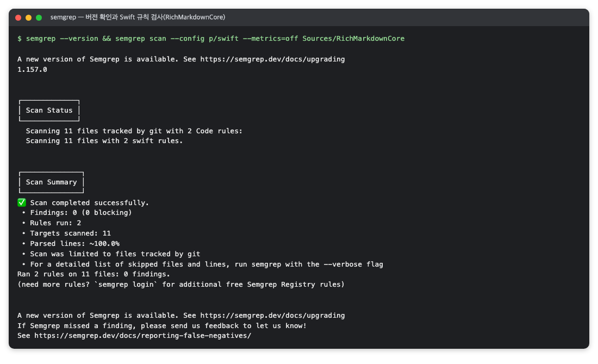

*그림 1. `p/swift` 규칙 모음으로 RichMarkdownCore 폴더만 검사한 결과 (RichMarkdown 검증 때의 명령 출력을 옮긴 화면, 2026-10)*

**해석 예.** 모바일 데모 앱 매니페스트에서 화면(Activity)을 외부 앱에 열어 둔 설정(`exported`)이 지적으로 나올 수 있습니다. 스크린샷 자동화를 위해 일부러 연 것이고 라이브러리 모듈이 아니라면, 결함이 아니라고 판정하되 그 근거를 기록으로 남깁니다. 그림 2의 최종 검사에서는 iOS가 0건이었고, Android의 6건은 모두 데모 앱 매니페스트의 `exported_activity` 규칙이었습니다.

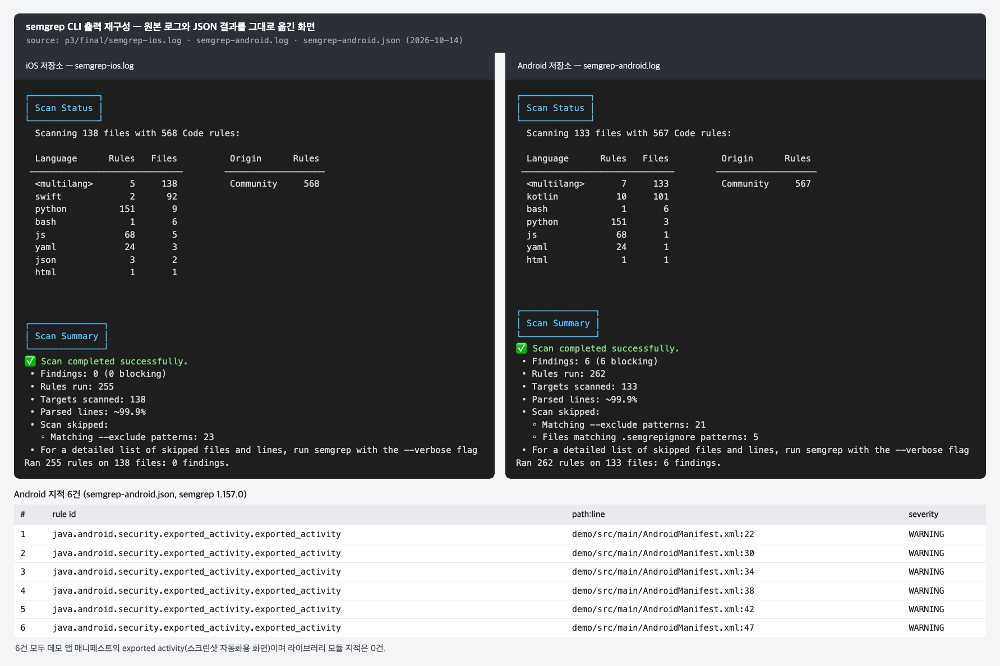

*그림 2. 최종 검사의 semgrep 로그와 Android 지적 6건 (RichMarkdown 검증 때의 명령 출력을 옮긴 화면, 2026-10)*

**코드를 고쳐야 하는 사례.** 새 CI 워크플로가 GitHub Actions를 버전 태그(`@v4`)로 참조하면 `github-actions-mutable-action-tag` 지적이 나옵니다. 태그는 나중에 다른 커밋을 가리키도록 옮겨질 수 있어, 같은 워크플로가 어느 날 다른 코드를 실행할 수 있기 때문입니다. 액션을 커밋 SHA로 고정하고(`uses: <소유자>/<액션>@<커밋 SHA> # v4`) 다시 검사해 0건을 확인합니다.

### 2.7 주의할 점·한계

- **0건의 뜻.** "사용한 규칙이 아는 위험한 모양이 코드에 없다"는 뜻입니다. 허용 주소 정책 같은 논리 오류나 규칙에 없는 새 패턴은 찾지 못합니다. 0건에는 반드시 범위(대상 경로·규칙 모음·파일 수)를 함께 적습니다.
- **언어별 규칙 수를 확인합니다.** Swift·Kotlin 같은 언어는 전용 규칙이 몇 개에서 십수 개뿐일 수 있습니다. 그런 언어에서 semgrep은 보조 근거이고, 주된 근거는 위험한 입력을 실제로 넣어 실행해 보는 동적 검증이어야 합니다.
- **규칙은 고정되어 있지 않습니다.** 규칙 모음은 실행할 때마다 레지스트리에서 내려받으므로, 시점이 다르면 같은 명령이라도 규칙 수와 결과가 달라질 수 있습니다. 실행 날짜와 버전을 함께 기록합니다.
- **CI와 최종 검사의 범위가 다를 수 있습니다.** 테스트 폴더나 규칙 모음의 포함 여부가 다르면, CI 통과가 최종 검사를 재현한다고 말할 수 없습니다.
- **제외한 폴더는 CI가 보지 않습니다.** 데모 앱이나 외부 코드를 뺐다면, 배포 대상이 바뀔 때 그 지적을 다시 판단해야 합니다.


## 3. osv-scanner — 의존성 목록을 공개 취약점 데이터베이스와 대조하는 도구

> **요약.** osv-scanner는 "우리가 쓰는 외부 라이브러리 버전 가운데 이미 취약점이 공개된 것이 있는가"에 답하는 도구입니다. 결과를 읽을 때 가장 중요한 점은 0건이 "조회한 날, 입력 목록에 있던 패키지에 한해" 공개 취약점이 없다는 뜻이라는 것입니다. 목록에 없는 구성 요소와 아직 공개되지 않은 취약점은 범위 밖입니다.


### 3.1 한눈에 보기

*표 2. osv-scanner 개요*

| 항목 | 내용 |
|---|---|
| 무엇을 하나 | lockfile이나 SBOM에서 패키지 이름·버전을 읽어 OSV 데이터베이스에 공개된 취약점과 대조합니다 |
| 만든 곳·라이선스 | Google이 만들었고(GitHub `google/osv-scanner`), 라이선스는 Apache 2.0입니다 |
| 쓰는 곳(예) | Q3 보안의 의존성 감사 단계와 CI 게이트 단계에 씁니다 |
| 버전 | 확인 시점 버전은 2.7.0(2026-10)입니다 |
| 공식 문서 | <https://google.github.io/osv-scanner/> |

### 3.2 무엇을 하는 도구인가

앱은 직접 짠 코드 외에 외부 라이브러리를 씁니다. 어떤 라이브러리의 특정 버전에서 보안 결함이 발견되어 공개되면, 그 버전을 쓰는 앱도 영향을 받을 수 있습니다. osv-scanner는 "우리가 쓰는 버전 가운데 취약점이 공개된 것이 있는가"를 확인합니다 [6].

원리는 목록끼리 대조하는 것입니다. 취약점이 공개되면 공개 취약점 데이터베이스에 "어느 패키지의 어느 버전이 영향을 받는가"가 항목으로 올라갑니다. osv-scanner는 우리 의존성 목록의 이름·버전을 OSV.dev 데이터베이스의 항목과 맞춰 보고, 영향을 받는 버전이 있으면 보고합니다. OSV는 Open Source Vulnerabilities의 약자이고, OSV.dev는 오픈소스 패키지의 취약점 정보를 모은 공개 데이터베이스입니다.

입력은 lockfile입니다. lockfile은 프로젝트가 실제로 받은 의존성의 이름과 버전을 고정해 둔 파일로, Swift Package Manager의 `Package.resolved`, npm의 `package-lock.json`이 여기에 해당합니다. CycloneDX·SPDX 형식의 SBOM(제품에 들어간 구성 요소 목록, Software Bill of Materials)도 입력으로 받습니다 [8].

조회 방식은 두 가지입니다. 기본 모드는 의존성 정보로 OSV.dev API를 조회하고, `--offline` 모드는 미리 받아 둔 로컬 데이터베이스만 써서 프로젝트·의존성 정보를 어디에도 보내지 않습니다 [10].

### 3.3 왜 이 도구를 썼나

이 도구가 답하는 질문은 "AI가 고른 외부 라이브러리 버전에 이미 공개된 취약점이 있는가"입니다. osv-scanner는 Swift lockfile, npm lockfile, CycloneDX SBOM을 한 도구로 읽으므로, 생태계(언어별 패키지 관리 체계)가 다른 저장소를 같은 데이터베이스로 검사할 수 있습니다.

Gradle 프로젝트처럼 lockfile을 쓰지 않는 경우(dependency locking을 켜지 않은 경우)에는 릴리스 런타임 의존성을 CycloneDX SBOM으로 만든 뒤 그 파일을 넣습니다. SBOM을 만드는 방법은 [cdxgen과 CycloneDX](#5-cdxgen과-cyclonedx--앱에-무엇이-들어-있는지-표준-형식의-목록으로-남기는-도구) 절에 있습니다.

npm 의존성은 [npm audit](#4-npm-audit--프로젝트의-npm-의존성에-알려진-취약점이-있는지-묻는-명령)으로도 함께 검사할 수 있습니다. 같은 `package-lock.json`을 서로 다른 데이터 출처로 한 번 더 보는 셈입니다.

### 3.4 준비

```sh
osv-scanner --version        # osv-scanner version: 2.7.0
brew install osv-scanner     # macOS(Homebrew)
```

CI에서는 GitHub 릴리스의 Linux 바이너리를 내려받아 실행할 수 있습니다. 로컬과 CI의 버전이 다를 수 있으므로 어느 버전으로 얻은 결과인지 기록합니다. 다음은 CI 단계의 예입니다.

```yaml
# .github/workflows/ci.yml (자리표시자 경로)
- name: osv-scanner
  run: |
    curl -fsSL -o osv-scanner https://github.com/google/osv-scanner/releases/download/v<버전>/osv-scanner_linux_amd64
    chmod +x osv-scanner
    ./osv-scanner scan --lockfile Package.resolved --lockfile <웹 폴더>/package-lock.json
```

### 3.5 사용 방법

**1. lockfile을 조회합니다.** 저장소 루트에서 실행합니다. `-L`은 `--lockfile`의 짧은 형태이고, 여러 번 붙이면 파일 여러 개를 한 번에 검사할 수 있습니다 [8]. `scan` 하위 명령의 전체 사용법은 [7]에 있습니다.

```sh
osv-scanner scan -L Package.resolved -L <웹 폴더>/package-lock.json
```

기록용으로는 파일마다 따로 `--format json`으로 실행해 결과 파일에 남깁니다.

**2. SBOM 파일을 넣습니다.** SBOM은 파일 이름이 형식 규칙을 따라야 SBOM으로 인식됩니다. CycloneDX는 `bom.json`이나 `*.cdx.json` 같은 이름이어야 합니다 [8].

```sh
osv-scanner scan -L <SBOM 폴더>/sbom-<대상>.cdx.json
```

**3. 사람에게 보여 줄 보고서는 HTML로 만듭니다.** `--format html --output-file <파일>`로 저장하거나 `--serve`로 로컬에서 띄울 수 있습니다 [9].

**4. 종료 코드로 CI를 멈춥니다.** 공식 문서 기준으로 취약점이 없으면 0, 있으면 1, 패키지를 하나도 찾지 못하면 128로 끝납니다 [9]. 별도 옵션 없이 이 종료 코드로 실패를 판정할 수 있습니다.

### 3.6 결과 읽는 법

다음은 출력 형식을 보여 주는 예입니다. 숫자는 프로젝트마다 다릅니다.

```text
Scanned <경로>/Package.resolved file and found 3 packages
Scanned <경로>/package-lock.json file and found 140 packages
No issues found
```

1. **`Package.resolved file and found 3 packages`** — Swift 의존성 3개를 읽었습니다.
2. **`package-lock.json file and found 140 packages`** — npm 패키지 140개를 읽었습니다.
3. **`No issues found`** — 조회 시점에 두 목록의 어느 버전도 OSV 데이터베이스의 취약점 항목과 맞지 않았다는 뜻입니다.

그림 3은 3.5절 1단계의 명령을 iOS 저장소에서 실행한 화면입니다. Swift 패키지 3개와 npm 패키지 140개를 읽은 뒤 `No issues found`로 끝났습니다.

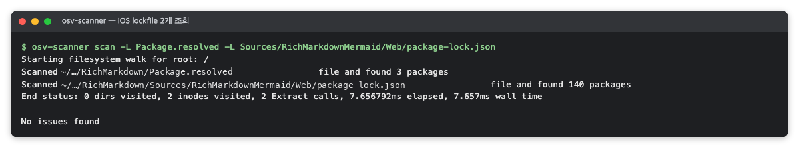

*그림 3. iOS lockfile 두 개를 조회한 결과 (RichMarkdown 검증 때의 명령 출력을 옮긴 화면, 2026-10)*

`--format json` 결과에서는 `{ "results": [] }`가 취약점 0건입니다. 취약점이 있으면 이 배열에 패키지와 OSV 항목 ID가 들어갑니다. 보고서에 쓰는 "N개 구성 요소, 0건"의 N은 `found N packages` 줄에서 가져옵니다.

HTML 보고서의 요약 패널은 Critical·High·Medium·Low·Unknown 개수를 보여 줍니다(그림 4). 결과가 비어 있으면 다섯 값이 모두 0으로 나올 뿐 HTML에 패키지 수가 나오지 않으므로, 텍스트 출력의 패키지 수와 함께 기록합니다.

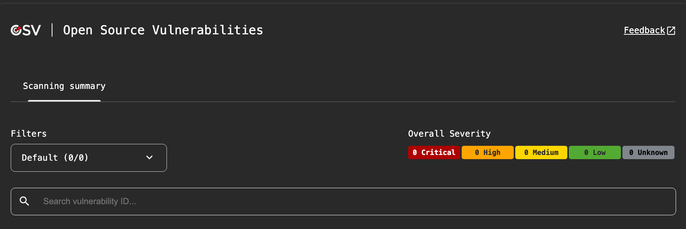

*그림 4. osv-scanner HTML 보고서의 요약 패널 (RichMarkdown 검증 화면, 2026-10)*

### 3.7 주의할 점·한계

- **오늘 0건이 내일 0건은 아닙니다.** 아직 공개되지 않은 취약점은 찾지 못합니다. CI에 감사 단계가 없는 대상은 감사를 다시 돌려야만 나중에 공개된 취약점을 알 수 있습니다.
- **입력 목록에 없는 구성 요소는 범위 밖입니다.** 미리 빌드한 바이너리(XCFramework 등)를 담은 패키지 안의 라이브러리는 lockfile에 나타나지 않습니다. XCFramework는 Apple 플랫폼용으로 미리 빌드해 묶은 라이브러리 형식입니다.
- **저장소에 직접 넣어 둔 JavaScript도 범위 밖입니다.** 복사해 둔 외부 파일(하이라이터 등)은 lockfile·SBOM 어디에도 없으면 조회되지 않습니다.
- **SBOM 입력의 0건은 SBOM에 빠진 것이 없다는 전제 위에 있습니다.** 의존성 출력을 변환해 만든 목록이라면, 변환에서 빠진 구성 요소는 조회되지 않습니다.
- **버전 일치만 봅니다.** 이 도구가 답하는 것은 "취약한 버전이 목록에 있는가"까지입니다. 취약점이 나오면 그 코드가 앱에서 실제로 쓰이는지는 따로 판단해야 합니다.


## 4. npm audit — 프로젝트의 npm 의존성에 알려진 취약점이 있는지 묻는 명령

> **요약.** `npm audit`은 "npm 의존성 가운데 이미 알려진 취약점이 있는 패키지가 있는가"를 npm 레지스트리에 묻는 명령입니다. 결과를 읽을 때는 무엇을 감사했는지부터 확인해야 합니다. 감사 대상은 앱에 들어가는 번들 파일이 아니라, 그 번들을 만드는 재료로 lockfile에 적힌 패키지입니다.


### 4.1 한눈에 보기

*표 3. npm audit 개요*

| 항목 | 내용 |
|---|---|
| 무엇을 하나 | 프로젝트의 의존성 목록을 npm 레지스트리에 보내 알려진 취약점 보고서를 받습니다 |
| 만든 곳·라이선스 | npm CLI에 들어 있는 명령(GitHub `npm/cli`)이고, 라이선스는 Artistic License 2.0입니다 |
| 쓰는 곳(예) | Q3 보안의 의존성 감사 단계와 CI 게이트 단계에 씁니다 |
| 버전 | 확인 시점 버전은 npm 10.9.3, Node.js 22.18.0(2026-10)입니다 |
| 공식 문서 | <https://docs.npmjs.com/cli/v10/commands/npm-audit> |

### 4.2 무엇을 하는 도구인가

`npm audit`은 Node.js 패키지 관리자 npm에 들어 있는 명령입니다. 공식 문서에 따르면 이 명령은 "프로젝트에 설정된 의존성의 설명을 기본 레지스트리에 보내 알려진 취약점 보고서를 요청"합니다 [11]. 여기서 레지스트리는 npm 패키지를 내려받는 공용 서버를 말합니다.

감사에는 lockfile(`package-lock.json` 또는 `npm-shrinkwrap.json`)이 필요합니다 [11]. lockfile에는 설치할 패키지의 이름과 버전이 고정되어 있으므로(3.2절), 패키지를 내려받아 설치하지 않아도 무엇을 쓰는지 알 수 있습니다.

#### 4.2.1 감사 대상 정하기

네이티브 앱이 웹 기술로 만든 번들(다이어그램 렌더러 등)을 앱에 넣는 경우가 있습니다. 그 번들을 만드는 원본 폴더에는 보통 표 4의 두 파일이 있습니다.

*표 4. 번들 원본 폴더의 두 파일*

| 파일 | 내용 |
|---|---|
| `package.json` | 런타임 의존성, 빌드 도구, 하위 의존성 고정 |
| `package-lock.json` | 실제로 해석된 패키지의 이름·버전 |

앱에 들어가는 것은 이 폴더에서 빌드한 번들 파일이고, `node_modules` 폴더는 앱에 들어가지 않습니다. 그래서 `npm audit`은 "번들을 만드는 재료에 알려진 취약점이 있는가"를 묻는 검사입니다.

### 4.3 왜 이 도구를 썼나

`npm audit`은 npm 생태계의 기본 감사 도구라서, 다른 개발자도 별도 설치 없이 같은 검사를 다시 할 수 있습니다. 대상은 npm 의존성뿐이므로, 다른 생태계는 [osv-scanner](#3-osv-scanner--의존성-목록을-공개-취약점-데이터베이스와-대조하는-도구) 같은 도구가 맡아야 합니다.

같은 `package-lock.json`은 osv-scanner도 읽습니다. npm audit은 npm 레지스트리에, osv-scanner는 OSV.dev에 묻습니다. 그래서 한쪽 데이터 출처에만 올라온 공지도 놓치지 않도록 두 검사를 겹쳐 둘 수 있습니다.

### 4.4 준비

Node.js를 설치하면 npm과 `npm audit`이 함께 들어옵니다.

```sh
node --version   # v22.18.0
npm --version    # 10.9.3
```

CI에서는 Node.js를 준비한 뒤 번들 원본 폴더에서 감사만 실행합니다. 감사에는 lockfile만 쓰이므로 `npm ci`(의존성 설치)는 하지 않아도 됩니다. 다음은 CI 단계의 예입니다.

```yaml
# .github/workflows/ci.yml (자리표시자 경로)
- name: npm audit
  working-directory: <번들 원본 폴더>
  run: npm audit --audit-level=low
```

`--audit-level=low`는 심각도가 low 이상인 취약점이 하나라도 있으면 0이 아닌 종료 코드로 끝내라는 뜻입니다 [11]. 심각도는 낮은 쪽부터 info·low·moderate·high·critical 순서이므로, low로 두면 info를 뺀 모든 취약점에서 실패합니다. 이 옵션은 실패 기준만 정하고 보고서 내용을 거르지는 않습니다.

### 4.5 사용 방법

**1. 저장소 안에서 바로 실행합니다.** CI와 같은 방식입니다.

```sh
cd <번들 원본 폴더>
npm audit                     # 사람이 읽는 요약
npm audit --json              # 기록용 JSON
npm audit --audit-level=low   # CI와 같은 실패 기준
```

**2. 저장소를 건드리지 않고 실행합니다.** `package.json`과 `package-lock.json`만 작업 폴더에 복사해 실행하면 `node_modules` 없이 같은 결과가 나오고, 저장소에는 아무것도 생기지 않습니다.

```sh
mkdir -p <작업 폴더>/npm-audit
cp <번들 원본 폴더>/package.json <번들 원본 폴더>/package-lock.json <작업 폴더>/npm-audit/
cd <작업 폴더>/npm-audit && npm audit --json
```

`npm ci && npm test && npm audit`처럼 이어서 실행하면 `npm ci`가 그 폴더에 `node_modules`를 만듭니다. 감사 결과를 기록할 때는 어느 위치에서 어떤 명령으로 실행했는지도 함께 남깁니다.

**3. 고치기는 별도로 판단합니다.** `npm audit fix`는 해결 방법을 의존성 트리에 바로 적용합니다 [11]. 그러면 lockfile과 번들이 바뀌므로, 취약점이 나오더라도 감사 단계에서 자동으로 돌리지 않고 번들 회귀 테스트와 함께 따로 진행하는 편이 안전합니다.

### 4.6 결과 읽는 법

다음은 `npm audit --json`의 출력 형식을 보여 주는 예입니다. 숫자는 프로젝트마다 다릅니다.

```json
{
  "vulnerabilities": {},
  "metadata": {
    "vulnerabilities": { "info": 0, "low": 0, "moderate": 0, "high": 0, "critical": 0, "total": 0 },
    "dependencies": { "prod": 113, "dev": 27, "optional": 27, "total": 140 }
  }
}
```

1. **`"vulnerabilities": {}`** — 취약점이 있는 패키지 목록입니다. 비어 있으면 0건입니다. 취약점이 있으면 패키지 이름별로 심각도와 영향 범위가 들어갑니다.
2. **`metadata.vulnerabilities`** — 심각도별 개수입니다. `total: 0`이 보고서의 "npm audit 0건"입니다.
3. **`metadata.dependencies`** — 감사한 패키지 수입니다. `total`은 `prod`와 `dev`를 더한 값이고, `optional`은 이 둘과 겹쳐 세는 분류입니다. osv-scanner가 같은 파일에서 읽은 패키지 수와도 맞아야 합니다.

그림 5는 4.5절 2단계처럼 `package.json`과 `package-lock.json`만 작업 폴더에 복사해 `npm audit --json`을 실행한 화면입니다. 심각도별 취약점은 모두 0건이고 감사한 패키지는 140개이며, 실제 출력에는 위 예시에 없는 `auditReportVersion`·`peer`·`peerOptional` 필드도 있습니다.

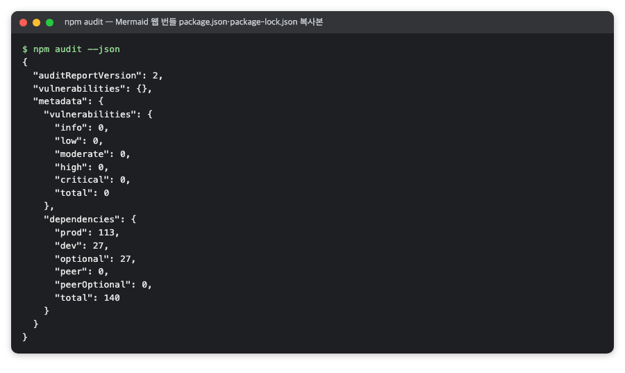

*그림 5. Mermaid 웹 번들 lockfile 복사본으로 실행한 `npm audit --json` (RichMarkdown 검증 때의 명령 출력을 옮긴 화면, 2026-10)*

그림 6은 보고서 실행 때의 원본 결과로, 왼쪽에 osv-scanner, 오른쪽에 npm audit을 놓았습니다. 같은 `package-lock.json`에서 osv-scanner는 패키지 140개를 읽었고 npm audit의 `dependencies.total`도 140이므로, 두 도구가 같은 목록을 서로 다른 데이터 출처로 검사해 둘 다 0건을 냈다는 것을 확인할 수 있습니다.

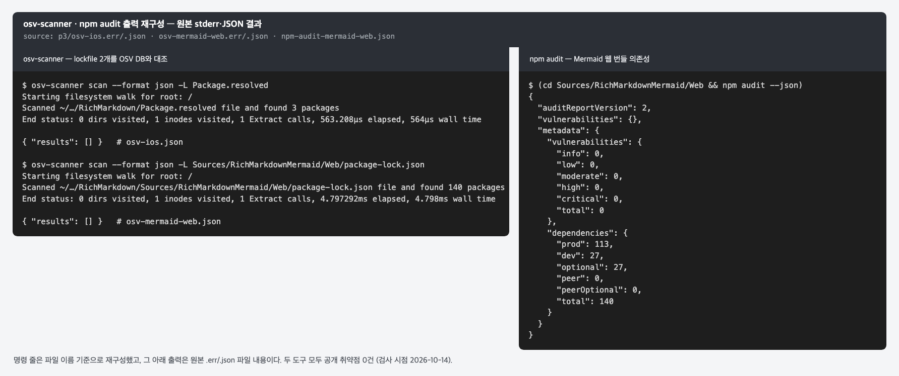

*그림 6. 보고서 실행 때 osv-scanner와 npm audit의 원본 결과 (RichMarkdown 검증 때의 명령 출력을 옮긴 화면, 2026-10)*

사람이 읽는 요약(`npm audit`)은 같은 상황에서 `found 0 vulnerabilities` 한 줄만 출력합니다.

### 4.7 주의할 점·한계

- **알려진 취약점만 봅니다.** osv-scanner(3.7절)와 마찬가지로 아직 공개되지 않은 취약점은 찾지 못하므로, 0건은 검사한 날의 결과입니다. 날짜와 npm 버전을 함께 기록합니다.
- **빌드 도구도 함께 셉니다.** `dev` 의존성(번들러 등)은 번들을 만들 때만 쓰입니다. 여기서 취약점이 나오면 그 코드가 번들에 들어가는지부터 따로 판단해야 합니다.
- **번들 파일 자체를 읽지는 않습니다.** 감사는 lockfile의 이름·버전을 봅니다. 저장소에 복사해 둔 다른 JavaScript는 이 lockfile에 없으면 대상이 아닙니다.
- **같은 번들을 쓰는 다른 저장소는 원본 한 곳의 감사로 대신합니다.** 다만 두 저장소의 번들 버전이 같은지 먼저 확인해야 합니다.


## 5. cdxgen과 CycloneDX — 앱에 무엇이 들어 있는지 표준 형식의 목록으로 남기는 도구

> **요약.** cdxgen은 "앱에 어떤 외부 구성 요소가 어떤 버전으로 들어 있는가"를 CycloneDX라는 표준 형식의 목록(SBOM)으로 남기는 도구입니다. 결과를 읽을 때 가장 중요한 점은 SBOM이 안전 판정이 아니라 목록이라는 것입니다. 나중에 취약점이 공지됐을 때 빨리 확인하게 해 주지만, 목록에서 빠진 구성 요소는 알려 주지 못합니다.


### 5.1 한눈에 보기

*표 5. cdxgen과 CycloneDX 개요*

| 항목 | 내용 |
|---|---|
| 무엇을 하나 | cdxgen은 소스와 lockfile에서 의존성 목록을 읽어 CycloneDX 형식의 SBOM을 만듭니다. CycloneDX는 그 목록의 표준 형식입니다 |
| 만든 곳·라이선스 | cdxgen은 GitHub `cdxgen/cdxgen` 프로젝트이고(SBOM 메타데이터상 게시자는 OWASP Foundation), 라이선스는 Apache 2.0입니다. CycloneDX는 OWASP Foundation과 Ecma International이 개발한 표준(ECMA-424)입니다 |
| 쓰는 곳(예) | Q3 보안의 SBOM 단계에 쓰고, 의존성 감사의 입력으로도 씁니다 |
| 버전 | 확인 시점 버전은 cdxgen 12.8.5(CycloneDX 1.7, 2026-10)입니다 |
| 공식 문서 | <https://cyclonedx.org/specification/overview/> · <https://github.com/cdxgen/cdxgen> |

### 5.2 무엇을 하는 도구인가

osv-scanner의 입력으로 앞에서 잠깐 나온 SBOM은 제품에 들어간 구성 요소 목록입니다. 우리말로 "소프트웨어 자재 명세서"라고도 부르며, 앱에 들어간 외부 구성 요소와 그 버전을 적습니다. 식품 포장의 원재료 표시처럼, 제품을 뜯어보지 않아도 무엇으로 만들었는지 알 수 있게 해 줍니다.

CycloneDX는 이 목록을 기계가 읽을 수 있게 적는 표준 형식입니다 [12]. 형식이 정해져 있으므로 다른 도구가 그대로 읽을 수 있고, [osv-scanner](#3-osv-scanner--의존성-목록을-공개-취약점-데이터베이스와-대조하는-도구)도 CycloneDX SBOM을 입력으로 받습니다.

cdxgen은 프로젝트 폴더의 lockfile과 매니페스트(의존성을 선언한 파일, 예: `Package.swift`·`package.json`)를 읽어 CycloneDX SBOM을 만드는 명령줄 도구입니다 [14]. 공식 문서의 프로젝트 종류 표에는 Swift(`Package.resolved`·`Package.swift`)와 Node.js(`package-lock.json` 등)가 모두 있습니다 [15].

### 5.3 왜 이 도구를 썼나

SBOM은 안전 판정이 아니라 목록이며, 문제가 생겼을 때 대응하는 근거로 씁니다. 나중에 어떤 라이브러리의 취약점이 공지되면 "우리 앱에 그 버전이 들어 있는가"를 이 목록으로 바로 답할 수 있습니다.

쓰임은 크게 두 가지입니다. 하나는 공급망 투명성(무엇을 가져다 썼는지 밖에서도 확인할 수 있게 하는 일)의 근거로 목록을 남기는 일이며, 이 목록을 판정에 쓰지는 않습니다. 다른 하나는 lockfile을 쓰지 않는 Gradle 프로젝트를 osv-scanner로 검사할 때 입력으로 넣는 일입니다.

SPDX 같은 다른 SBOM 형식과 직접 비교한 기록은 없습니다. 어느 형식이든 함께 쓰는 도구들이 읽을 수 있으면 되므로, 이미 쓰는 도구가 받는 형식을 우선합니다.

### 5.4 준비

cdxgen은 npm 패키지로 배포되는 도구입니다. 같은 버전을 다시 쓰려면 `npx`로 버전을 고정해 실행합니다. 확인 시점(2026-10)에 저장소 README는 새 패키지 이름 `@cdxgen/cdxgen`(13.x)을 안내하므로, 새로 시작한다면 현재 안내를 먼저 확인합니다 [14].

```sh
npx @cyclonedx/cdxgen@12.8.5 --version
```

cdxgen 실행 로그에는 "자격 증명처럼 보이는 환경 변수가 설정되어 있고, SBOM 생성 중 호출되는 빌드 도구나 설치 스크립트가 이를 읽을 수 있다"는 LOW 경고가 찍힐 수 있습니다. 다른 사람의 저장소를 스캔할 때는 필요 없는 비밀값을 환경에서 빼고 돌리는 편이 안전합니다.

### 5.5 사용 방법

생태계에 lockfile이 있으면 cdxgen으로 바로 만들고, 없으면 의존성 출력을 변환해 만듭니다.

#### 5.5.1 lockfile이 있는 생태계 — cdxgen으로 생성

`-t`는 프로젝트 종류 [15], `-o`는 출력 파일입니다. 출력 파일은 저장소 밖 작업 경로에 두는 편이 좋습니다. 아래 명령의 `cdxgen`은 설치해 둔 명령이나 앞의 `npx` 형태로 실행합니다.

```sh
cdxgen -t swift -o <출력 폴더>/sbom-swift.json .                 # Swift 패키지 의존성
cdxgen -t js -o <출력 폴더>/sbom-web-bundle.json <웹 번들 폴더>   # 웹 번들 빌드 의존성
```

#### 5.5.2 lockfile이 없는 프로젝트 — 의존성 출력을 변환

Gradle은 dependency locking(의존성 버전을 lockfile에 고정하는 선택 기능)을 켜지 않으면 lockfile이 없으므로, 두 단계로 만듭니다. 먼저 각 모듈의 `dependencies` 작업 출력을 한 파일에 모읍니다. 이때 앱에 실제로 들어가는 런타임 구성(`runtimeClasspath`, Android는 `releaseRuntimeClasspath`)을 고릅니다.

```sh
./gradlew :<모듈>:dependencies --configuration runtimeClasspath
./gradlew :<안드로이드 모듈>:dependencies --configuration releaseRuntimeClasspath
```

다음으로 그 출력을 CycloneDX JSON으로 바꾸는 변환 스크립트를 둡니다. 스크립트가 지켜야 할 규칙은 세 가지입니다. 첫째, 해석된 Maven 좌표(`그룹:이름:버전`)만 모읍니다. 둘째, 제약 줄 `(c)`와 해석되지 않은 줄 `(n)`은 뺍니다. 셋째, `a:b:1 -> 2`처럼 버전이 바뀐 줄은 실제로 쓰인 `2`를 씁니다. 자체 검사 옵션(`--self-test`)을 넣어 두면 변환 규칙이 깨졌을 때 바로 알 수 있습니다.

```sh
python3 gradle-deps-to-cdx.py --self-test
python3 gradle-deps-to-cdx.py dependencies.txt sbom-release.cdx.json
```

### 5.6 결과 읽는 법

CycloneDX 파일에서 먼저 볼 곳은 네 가지입니다. 다음은 출력 형식을 보여 주는 예입니다. 숫자는 프로젝트마다 다릅니다.

```json
{
  "bomFormat": "CycloneDX",
  "specVersion": "1.7",
  "metadata": { "timestamp": "2026-10-14T00:00:00Z", "lifecycles": [{ "phase": "pre-build" }] },
  "components": [
    { "name": "swift-cmark", "version": "0.8.0", "scope": "required",
      "purl": "pkg:swift/github.com/apple/swift-cmark@0.8.0" }
  ]
}
```

1. **`bomFormat`·`specVersion`** — 형식과 명세 버전입니다.
2. **`metadata`** — 만든 도구(`tools`), 만든 시각(`timestamp`), 생성 단계(`lifecycles`)가 들어 있습니다. `pre-build`는 빌드 전에 얻은 정보, `build`는 빌드 과정에서 얻은 구성 요소 목록입니다 [13].
3. **`components`** — 목록의 본체입니다. 각 항목에는 `name`·`version`과 함께 `purl`이 있습니다. purl(package URL)은 생태계·이름·버전을 한 줄로 적은 식별자로, 다른 도구가 같은 구성 요소를 찾을 때 이 값을 씁니다.
4. **`scope`** — CycloneDX 명세상 `required`는 실행에 필요, `optional`은 실행 시 선택, `excluded`는 테스트 등 실행과 무관한 용도입니다 [13]. cdxgen이 이 값을 붙이는 기준을 확인하지 않았다면 "앱에 실제로 들어가는가"의 판정으로 쓰지 않습니다.

그림 7은 cdxgen으로 만든 iOS SBOM 두 개의 구성 요소를 표로 옮긴 화면입니다. Swift 패키지 SBOM에는 외부 의존성 3개와 프로젝트 자신(버전 `unspecified`)이 들어 있고, Mermaid 웹 번들 SBOM에는 구성 요소 140개가 들어 있습니다. 웹 번들 쪽 앞부분에서 `scope`가 `required`인 것은 `mermaid` 하나뿐이고 나머지는 `optional`·`excluded`라서, 위 목록의 4번처럼 이 값만으로 앱 포함 여부를 판정하기 어렵습니다.

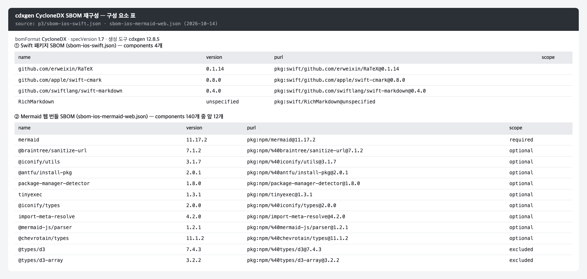

*그림 7. cdxgen이 만든 iOS SBOM 두 개의 구성 요소 표 (RichMarkdown 검증 때의 명령 출력을 옮긴 화면, 2026-10)*

SBOM의 외부 의존성 개수는 osv-scanner가 같은 lockfile에서 읽은 패키지 수와 맞아야 합니다. 그림 7의 3개와 140개는 그림 3의 패키지 수와 같고, 맞지 않으면 두 도구가 읽은 입력이 서로 다르다는 뜻입니다. 스크립트로 변환한 SBOM에는 만든 도구 정보, 구성 요소 사이의 `dependencies`, 해시·라이선스가 없을 수 있습니다.

그림 8은 5.5.2절의 변환 스크립트로 만든 Android 릴리스 런타임 SBOM을 `jq`로 요약한 화면입니다. 명세 버전은 1.6, 구성 요소는 97개이고, 앞 세 항목에는 `type`·`group`·`name`·`version`·`purl`·`bom-ref`만 있을 뿐 `scope`·해시·라이선스는 없습니다.

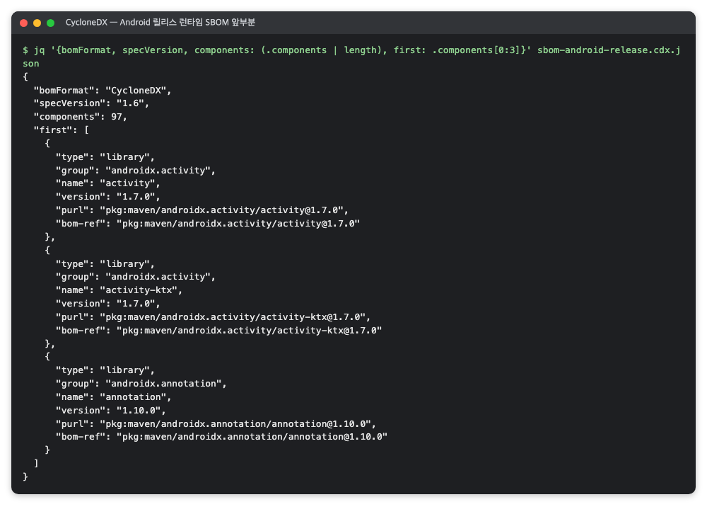

*그림 8. 변환 스크립트로 만든 Android 릴리스 런타임 SBOM의 앞부분 (RichMarkdown 검증 때의 명령 출력을 옮긴 화면, 2026-10)*

**취약점 공지가 났을 때 쓰는 법.** 어떤 패키지의 공지가 나오면 우리 번들에 든 버전을 바로 확인하고, osv-scanner에 SBOM을 그대로 넣어 다시 조회할 수 있습니다.

```sh
jq -r '.components[] | select(.name == "<패키지>") | "\(.name) \(.version) \(.scope)"' sbom-web-bundle.json
osv-scanner scan -L sbom-release.cdx.json
```

### 5.7 주의할 점·한계

- **목록이지 안전 판정이 아닙니다.** "SBOM이 있으니 안전하다"가 아니라 "문제가 생겼을 때 빨리 확인할 수 있다"로 읽어야 합니다.
- **빠진 것은 확인되지 않습니다.** osv-scanner 절(3.7)에서 본 대로, SBOM 기반 "취약점 0건"은 그 SBOM이 의존성을 빠짐없이 담았다는 전제 위에 있습니다.
- **lockfile 밖의 구성 요소는 목록에 없습니다.** 미리 빌드된 엔진 안의 라이브러리, 저장소에 복사해 둔 JavaScript는 어느 SBOM에도 없습니다. Gradle 의존성만 담은 SBOM에는 `assets`에 넣은 번들도 들어 있지 않으므로, 그 원본의 SBOM을 따로 연결해야 합니다.
- **만든 시점의 목록입니다.** CI에서 다시 만들지 않으면 의존성이 바뀐 뒤에는 실제와 어긋납니다. 의존성을 바꾸면 SBOM도 다시 만듭니다.


## 6. lizard — 함수마다 갈림길이 몇 개인지 세어 복잡도를 재는 도구

> **요약.** lizard는 "어느 함수가 갈림길이 많아 읽고 테스트하기 어려운가"에 답하는 도구입니다. 결과를 읽을 때 가장 중요한 점은 순환 복잡도가 "복잡해 보이는 정도"일 뿐 결함의 증거가 아니라는 것입니다. 그래서 값이 큰 함수는 왜 복잡한지, 어떤 테스트가 그 경로를 지나가는지를 함께 확인합니다.


### 6.1 한눈에 보기

*표 6. lizard 개요*

| 항목 | 내용 |
|---|---|
| 무엇을 하나 | 함수별 순환 복잡도(CCN)·코드 줄 수·매개변수 수를 셉니다 |
| 만든 곳·라이선스 | Terry Yin과 기여자들이 만들었고(GitHub `terryyin/lizard`), 라이선스는 MIT입니다 |
| 쓰는 곳(예) | Q4 유지보수의 복잡도와 규모 단계에 씁니다 |
| 버전 | 확인 시점 버전은 1.24.1(2026-10)입니다 |
| 공식 문서 | <https://github.com/terryyin/lizard> |

### 6.2 무엇을 하는 도구인가

코드 리뷰에서 "이 함수는 `if`가 너무 많아 따라가기 어렵다"는 말을 들을 때가 있습니다. 순환 복잡도(cyclomatic complexity, CCN)는 이 느낌을 숫자로 바꾼 값으로, 함수 안에서 실행이 갈라지는 독립 경로의 수입니다.

계산은 간단합니다. 대략 `if`·`guard`·반복문·`case`·`&&` 같은 갈림길 수에 1을 더한 값이라, 갈림길이 없는 함수는 1입니다. 예를 들어 `if` 하나와 `for` 하나가 있는 함수는 갈림길이 두 개라 3입니다. 값이 클수록 읽기 어렵고, 모든 경로를 테스트하려면 더 많은 경우를 만들어야 합니다.

lizard는 소스 파일을 컴파일하지 않고 읽어 함수 단위로 이 값을 셉니다 [16]. Swift와 Kotlin을 비롯해 여러 언어를 같은 정의로 세므로, 플랫폼이 다른 저장소를 나란히 놓고 볼 수 있습니다. 출력 열의 뜻은 표 7과 같습니다.

*표 7. lizard 출력 열의 뜻*

| 열 | 뜻 |
|---|---|
| `NLOC` | 주석·빈 줄을 뺀 함수의 코드 줄 수 |
| `CCN` | 순환 복잡도 |
| `token` | 함수의 토큰 수 |
| `PARAM` | 매개변수 수 |
| `length` | 함수의 전체 줄 수(주석·빈 줄 포함) |
| `location` | `함수이름@시작줄-끝줄@파일` |

### 6.3 왜 이 도구를 썼나

유지보수 질문(Q4) 가운데 하나는 "AI가 쓴 코드가 사람이 고치기 어려울 만큼 얽혀 있지 않은가"입니다. 평균 하나로는 소수의 복잡한 함수가 가려지므로, 함수마다 값을 받아 분포를 봅니다.

언어별 린터에도 복잡도 규칙이 있지만 그 언어만 봅니다. lizard는 여러 언어를 같은 정의로 재므로 두 플랫폼을 비교하기에 알맞습니다.

### 6.4 준비

lizard는 PyPI로 배포되는 Python 도구입니다. 전역 환경을 건드리지 않도록 가상 환경에 설치하는 편이 좋습니다.

```sh
python3 -m venv <작업 폴더>/venv
<작업 폴더>/venv/bin/pip install lizard==1.24.1
<작업 폴더>/venv/bin/lizard --version   # 1.24.1
```

복잡도는 CI에서 매번 재지 않아도 됩니다. 다만 한 번 잰 값은 측정 시점의 코드 기준이라는 점을 함께 적습니다.

### 6.5 사용 방법

**1. 파일 하나를 봅니다.** 기본 출력은 함수별 표, 파일 요약, 경고 목록 순서입니다.

```sh
lizard <소스 폴더>/<파일>
```

**2. 저장소 전체를 CSV로 남깁니다.** 언어(`-l`)와 대상 폴더를 명시하고, 실행한 명령을 기록에 그대로 남깁니다 [16]. 테스트 코드를 집계에서 뺄지 먼저 정합니다.

```sh
lizard -l swift --csv <소스 폴더> > <출력 폴더>/lizard-<플랫폼>.csv

lizard -l kotlin --csv <모듈 A>/src/main <모듈 B>/src/main > <출력 폴더>/lizard-<플랫폼>.csv
```

**3. 보고할 수치로 모읍니다.** `/Tests/`·`/src/test/` 같은 테스트 폴더 경로에 있는 함수를 빼고, 함수 수·중앙값·평균·기준 초과 개수·최댓값을 집계합니다. 집계를 스크립트로 만들어 두면 다시 잴 때 같은 규칙을 적용할 수 있습니다.

**4. 경고 기준을 알고 씁니다.** lizard는 기본으로 CCN이 15를 넘는 함수를 경고합니다(`-C`로 바꿀 수 있음) [16]. 보고서의 "복잡도 16 이상"은 이 기본 경고선을 넘은 함수입니다. 기준을 바꿨다면 보고서에 적습니다.

### 6.6 결과 읽는 법

다음은 출력 형식을 보여 주는 예입니다. 숫자는 프로젝트마다 다릅니다.

```text
================================================
  NLOC    CCN   token  PARAM  length  location
------------------------------------------------
    10      8      70      2      16  init@13-28@./LineMap.swift
    60     19     380      2      70  visit@40-109@./LineMap.swift
   105     28     750      4     114  init@79-192@./LineMap.swift
...
!!!! Warnings (cyclomatic_complexity > 15) !!!!
  NLOC    CCN   token  PARAM  length  location
    60     19     380      2      70  visit@40-109@./LineMap.swift
   105     28     750      4     114  init@79-192@./LineMap.swift
```

1. **위쪽 표** — 함수마다 한 줄입니다. 가장 큰 `CCN`이 그 파일의 최댓값입니다.
2. **같은 이름이 두 번 나옵니다** — 예시의 `init`처럼 이름이 같은 함수는 줄 범위(`@13-28`, `@79-192`)로 구분합니다. lizard는 함수 이름만 보여 주므로, 어느 타입의 함수인지는 줄 범위를 보고 파일을 열어 확인합니다.
3. **`Warnings` 목록** — CCN이 경고선을 넘는 함수만 다시 모은 목록입니다.
4. **맨 아래 요약** — 파일 전체의 평균 CCN과 경고 함수 수입니다. 저장소 단위 보고에는 파일 평균이 아니라 모든 함수의 중앙값·평균을 씁니다.

그림 9는 실제 파일 하나에 lizard를 실행한 출력입니다. `init`이 줄 범위 `@13-28`과 `@79-192`로 두 번 나오고, CCN이 15를 넘는 `visit`(19)와 `init@79-192`(28)는 경고 목록에 다시 모여 맨 아래 요약에 경고 함수 2개로 집계됩니다.

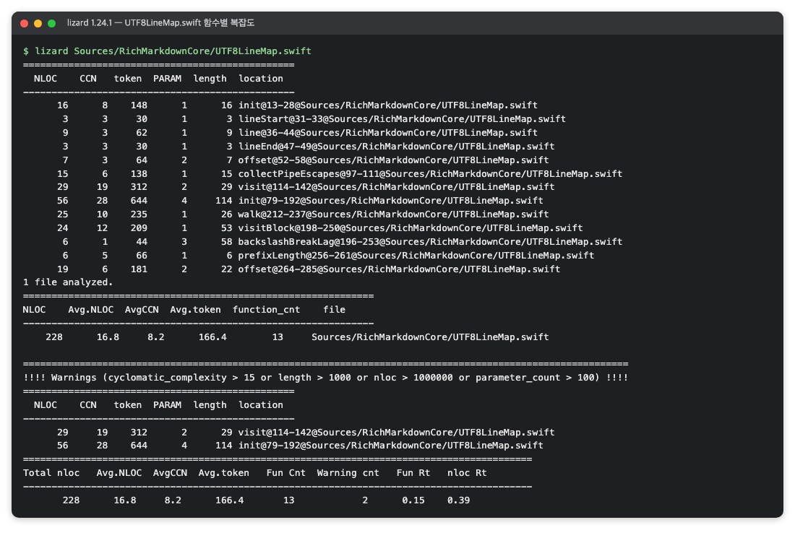

*그림 9. `UTF8LineMap.swift` 한 파일의 함수별 복잡도 (RichMarkdown 검증 때의 명령 출력을 옮긴 화면, 2026-10)*

**CSV 읽는 법.** `-V`를 붙이면 머리글 줄이 나옵니다. 열 순서는 `NLOC, CCN, token, PARAM, length, location, file, function, long_name, start, end`입니다. 머리글 없이 저장한 CSV는 이 순서를 집계 스크립트의 설명에 적어 둡니다.

`long_name` 열에는 매개변수까지 들어갑니다. 같은 이름의 함수를 구분하거나, 호출하는 쪽의 인자 모양과 맞춰 어느 함수인지 찾을 때 씁니다. 다음은 그 값의 예입니다.

```text
init document : Markup , lineMap : LineMap , bytes : [ UInt8 ] , parsedBytes : [ UInt8 ] ? = nil
```

그림 10은 `-V`를 붙인 CSV 출력에서 머리글 줄과 `init` 두 줄만 골라 본 화면입니다. `function` 열은 둘 다 `init`이지만 `long_name`의 매개변수와 `start`·`end` 줄 번호가 달라 두 함수를 구분할 수 있습니다.

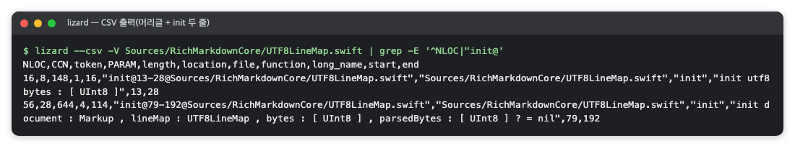

*그림 10. CSV 출력의 머리글과 `init` 두 줄 (RichMarkdown 검증 때의 명령 출력을 옮긴 화면, 2026-10)*

#### 6.6.1 복잡도가 높은 함수 판단하기

그림 11은 보고서 집계 시점에 플랫폼별로 CCN이 가장 큰 함수를 모은 표입니다. iOS 552개, Android 541개 함수의 CCN 중앙값은 모두 2이고 16 이상인 함수는 각각 7개이지만, 최댓값은 iOS 28, Android 34로 소수의 함수에 복잡도가 몰려 있습니다.

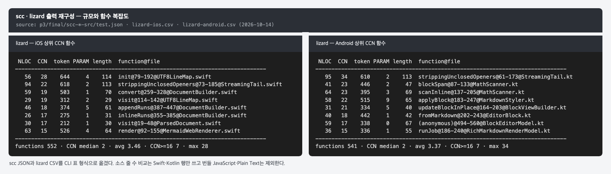

*그림 11. 보고서 집계 시점의 플랫폼별 상위 복잡도 함수 (RichMarkdown 검증 때의 명령 출력을 옮긴 화면, 2026-10)*

높은 값을 바로 결함으로 보지 않고, 플랫폼별로 값이 가장 큰 함수 몇 개를 골라 표 8의 두 가지를 확인합니다.

*표 8. 복잡도가 높은 함수에서 확인할 것*

| 확인할 것 | 방법 |
|---|---|
| 왜 복잡한가 | 코드를 열어 분기의 원인을 적는다(예: 외부 라이브러리의 오류 유형별 보정, 스트리밍 입력의 구분자 종류별 처리) |
| 어떤 검증이 그 함수를 지나가는가 | 플랫폼 간 비교 퍼징, 회귀 테스트 입력 같은 테스트가 그 경로를 지나가는지 확인한다 |

표 8의 플랫폼 간 비교 퍼징은 무작위로 바꾼 입력을 대량으로 iOS·Android 두 구현에 똑같이 넣고 결과가 같은지 맞춰 보는 테스트입니다. 회귀 테스트 입력은 고친 결함이 다시 생기면 걸리도록 남겨 두는 최소 재현 입력입니다. 이런 테스트가 그 경로를 지나간다면, 값이 크다는 사실만으로 결함을 의심할 근거는 약해집니다.

기준을 넘은 나머지 함수는 따로 설명하지 않을 수도 있습니다. 그 경우 "설명하지 않았다"고 적습니다. 같은 일을 하는 두 플랫폼 구현의 값이 서로 다른 이유는 분석하지 않았다면 추측하지 않습니다.

### 6.7 주의할 점·한계

- **"복잡해 보이는 정도"입니다.** lizard README가 밝히듯 이 값은 코드가 얼마나 복잡해 보이는가를 잽니다 [16]. 복잡도가 높다고 결함이 있는 것은 아니며, 그래서 그 함수를 어떤 테스트가 지나가는지를 함께 봅니다.
- **코드 시점에 따라 바뀝니다.** 집계 뒤 코드가 바뀌면 함수 수와 기준 초과 개수가 달라집니다. 현재 main 브랜치의 값으로 인용하지 않고 측정 시점을 함께 적습니다.
- **이름만으로는 함수를 특정할 수 없습니다.** `init`·`visit`처럼 흔한 이름이나 Kotlin 람다의 `(anonymous)`는 줄 범위와 `long_name`으로 확인해야 합니다.
- **분기 커버리지와는 다릅니다.** CCN은 경로의 수를 셀 뿐, 테스트가 그 경로를 모두 지났는지는 말해 주지 않습니다.
- **범위 정의를 함께 말합니다.** 테스트 코드·생성 코드·외부 코드를 넣느냐에 따라 분포가 달라집니다.


## 7. scc — 언어별 코드·주석·빈 줄 수를 세어 코드 규모를 재는 도구

> **요약.** scc는 "검증한 코드가 어느 정도 규모이고, 테스트 코드는 소스와 비교해 얼마나 되는가"에 답하는 도구입니다. 줄 수는 판정 기준이 아니라 맥락 정보입니다. 결과를 인용할 때 가장 중요한 점은 어떤 범위(언어·폴더·제외 항목)를 언제 셌는지 함께 적는 것입니다.


### 7.1 한눈에 보기

*표 9. scc 개요*

| 항목 | 내용 |
|---|---|
| 무엇을 하나 | 폴더 안 파일을 언어별로 나눠 파일 수·전체 줄·빈 줄·주석 줄·코드 줄을 셉니다 |
| 만든 곳·라이선스 | Ben Boyter가 만들었고(GitHub `boyter/scc`), 라이선스는 MIT입니다 |
| 쓰는 곳(예) | Q4 유지보수의 복잡도와 규모 단계에서 소스·테스트 코드 줄을 셀 때 씁니다 |
| 버전 | 확인 시점 버전은 4.1.0(2026-10)입니다 |
| 공식 문서 | <https://github.com/boyter/scc> |

### 7.2 무엇을 하는 도구인가

"이 라이브러리는 얼마나 큰가"라는 질문에 가장 먼저 떠오르는 답은 줄 수입니다. 하지만 파일의 줄을 그대로 세면 빈 줄과 주석까지 섞이므로, 실제 코드가 얼마인지 알려면 줄마다 종류를 나눠야 합니다.

scc는 주로 파일 확장자로 언어를 판별하고, 각 줄을 빈 줄·주석·코드로 나눠 셉니다 [17]. 주석 안의 빈 줄은 주석으로 세고, 문자열 안에 있는 주석 모양의 글자는 주석으로 보지 않습니다.

출력 표의 `Complexity` 열은 scc가 파일마다 분기·반복 키워드를 세어 낸 근삿값입니다. README는 이 값을 같은 언어의 파일끼리만 비교할 수 있다고 설명합니다 [17]. 함수별 순환 복잡도는 [lizard](#6-lizard--함수마다-갈림길이-몇-개인지-세어-복잡도를-재는-도구)로 따로 잽니다.

기본 출력 끝에는 COCOMO 모델(코드 줄 수로 개발 노력과 비용을 추정하는 모델)로 계산한 개발 비용 추정치가 붙습니다. 규모 측정에는 필요 없으므로 `--no-cocomo`로 끕니다.

### 7.3 왜 이 도구를 썼나

규모는 판정 기준이 아니라 맥락 정보입니다. 여러 저장소를 같은 도구, 같은 규칙으로 세어 "어느 정도 크기의 코드를 검증했는가"와 "테스트 코드가 소스와 비교해 얼마나 되는가"를 나란히 놓으려고 씁니다.

cloc·tokei 같은 다른 줄 수 측정 도구와 직접 비교한 기록은 없습니다. 같은 범위를 같은 도구로 다시 셀 수 있으면 어느 도구든 됩니다.

### 7.4 준비

```sh
scc --version      # scc version 4.1.0
brew install scc   # macOS(Homebrew)
```

CI에서 매번 세지 않아도 되고 센 값에는 측정 시점을 함께 적는다는 점은 lizard(6.4절)와 같습니다.

### 7.5 사용 방법

**1. 폴더 하나를 그대로 셉니다.** 저장소 루트에서 실행합니다.

```sh
scc --no-cocomo <소스 폴더>
```

소스 폴더를 그대로 세면 직접 쓴 언어 외에 JavaScript, Plain Text, HTML, JSON이 함께 나올 수 있습니다. 대개 저장소에 넣어 둔 외부 코드(하이라이터·번들)와 번들 빌드 스크립트, 그 라이선스 고지입니다.

**2. 보고할 소스 범위에 맞춰 셉니다.** 직접 쓴 언어의 `Code` 열만 쓰고 번들 JavaScript는 뺍니다. 확장자를 지정하면 그 언어만 셉니다 [17].

```sh
scc --no-cocomo --include-ext swift <소스 폴더>

scc --no-cocomo --include-ext kt \
  <모듈 A>/src/main <모듈 B>/src/main <모듈 C>/src/main
```

**3. 테스트 코드도 같은 방식으로 셉니다.** 예를 들어 `scc --no-cocomo --include-ext swift <테스트 폴더>`로 셉니다. 테스트 폴더를 그대로 세면 테스트 입력 파일(테스트에 넣는 고정 입력 파일, 예: JSON·Markdown)이 함께 나오므로 언어를 골라야 합니다.

**4. 기록용으로는 JSON을 남깁니다.** `scc --format json -o <파일> <폴더>`로 저장합니다.

실행한 명령 원문과 대상 경로를 기록에 남깁니다. 나중에 같은 범위를 재현하지 못하는 가장 흔한 원인이 범위 기록 누락입니다.

### 7.6 결과 읽는 법

다음은 출력 형식을 보여 주는 예입니다. 숫자는 프로젝트마다 다릅니다.

```text
───────────────────────────────────────────────────────
Language     Files   Lines   Blanks  Comments    Code  Complexity
───────────────────────────────────────────────────────
Swift           36  10,800    1,040     1,100   8,660         620
───────────────────────────────────────────────────────
Total           36  10,800    1,040     1,100   8,660         620
───────────────────────────────────────────────────────
```

1. **열의 관계** — `Lines` = `Blanks` + `Comments` + `Code`입니다. 예시는 10,800 = 1,040 + 1,100 + 8,660입니다.
2. **소스 `Code`** — 보고서의 "소스 코드 줄"입니다. 직접 쓴 언어만 센 값을 씁니다.
3. **테스트 `Code`** — 보고서의 "테스트 코드 줄"입니다. 공용 입력 모음(여러 플랫폼·저장소가 함께 쓰는 테스트 입력 묶음)의 줄은 넣지 않습니다.
4. **번들 JavaScript 줄** — 직접 작성하지 않은 코드가 포함되어 있어 보고서 수치에서 뺍니다.

그림 12는 보고서 집계 시점(2026-10-14)에 두 저장소의 소스·테스트 폴더를 그대로 센 결과입니다. 소스 폴더에는 직접 쓴 Swift(8,638줄)·Kotlin(7,229줄) 외에 번들 JavaScript와 Plain Text가 함께 잡히고, Android 테스트 폴더에는 Kotlin 외에 JSON·Markdown 파일이 섞여 있어 7.5절처럼 언어를 골라 세야 합니다.

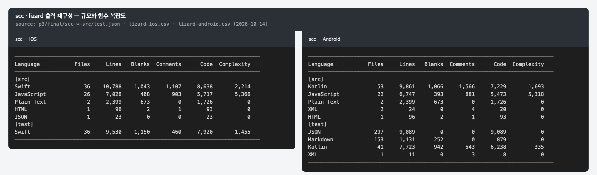

*그림 12. 보고서 집계 시점의 iOS·Android scc 결과 (RichMarkdown 검증 때의 명령 출력을 옮긴 화면, 2026-10)*

**보고서 값과 재확인 값을 나란히 적는 법.** 집계 뒤 코드가 바뀌면 줄 수가 달라지므로, 다시 셌다면 표 10처럼 측정 시점을 붙인 표로 남깁니다.

*표 10. 보고서 시점과 재확인 시점의 줄 수 비교(가상 예시)*

| 항목 | 보고서 시점 | 재확인 시점 |
|---|---:|---:|
| 소스 코드 줄 | 8,600 | 8,660 |
| 테스트 코드 줄 | 7,900 | 7,930 |
| 다른 저장소 테스트 코드 줄 | 6,200 | 재현하지 못함 |

재현하지 못한 값은 숨기지 않고 "재현하지 못함"과 그 이유(센 범위가 기록에 없음)를 적습니다. 코드 변화와의 인과는 커밋별로 대조하지 않았다면 "때문으로 보이지만 대조하지 않았다"고 적습니다.

그림 13은 보고서 집계 다음 날 iOS 소스 폴더를 Swift만 지정해 다시 센 결과입니다. 코드 줄은 8,664줄로, 그림 12의 보고서 시점 값 8,638줄보다 26줄 많습니다.

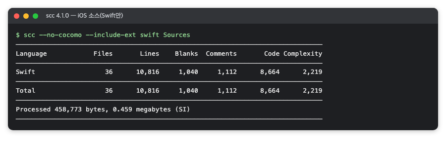

*그림 13. 재확인 시점에 iOS 소스를 Swift만 다시 센 결과 (RichMarkdown 검증 때의 명령 출력을 옮긴 화면, 2026-10)*

그림 14는 같은 날 Android 라이브러리 5개 모듈의 `src/main`을 Kotlin만 지정해 다시 센 결과입니다. 파일 53개, 코드 7,229줄로 보고서 시점과 같습니다.

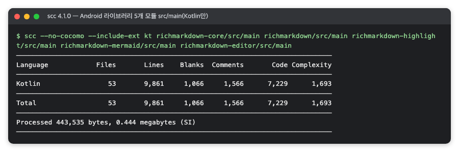

*그림 14. 재확인 시점에 Android 라이브러리 소스를 Kotlin만 다시 센 결과 (RichMarkdown 검증 때의 명령 출력을 옮긴 화면, 2026-10)*

### 7.7 주의할 점·한계

- **줄 수는 품질 지표가 아닙니다.** 같은 기능을 짧게 쓸 수도 길게 쓸 수도 있으므로, 많고 적음으로 좋고 나쁨을 말하지 않습니다.
- **범위 정의를 함께 말해야 합니다.** 번들 JavaScript·라이선스 고지·테스트 입력 파일을 넣느냐에 따라 숫자가 크게 바뀝니다. 인용할 때는 "직접 쓴 언어, 번들 JavaScript 제외"처럼 범위를 붙입니다.
- **`Complexity` 열은 lizard의 CCN과 다릅니다.** scc의 값은 파일 단위 키워드 수 근삿값이라, 함수 복잡도(lizard)와 섞어 쓰지 않습니다.
- **코드 시점에 따라 바뀝니다.** lizard(6.7절)와 마찬가지로 나중에 저장소의 현재 줄 수로 인용하지 않고, 측정 날짜와 커밋을 함께 적습니다.


## 참고문헌

[1] Semgrep, "Semgrep Docs", 공식 문서 홈, <https://semgrep.dev/docs/>. 확인 시점에 docs.semgrep.dev로 리다이렉트됩니다.

[2] Semgrep, "Run rules", 공식 문서, <https://semgrep.dev/docs/running-rules>. 레지스트리 규칙 모음(`--config p/<이름>`)과 로컬 규칙을 실행하는 방법.

[3] Semgrep, "CLI reference", 공식 문서, <https://docs.semgrep.dev/cli-reference>. `--config`·`--error`·`--metrics`·`--exclude`·`--no-git-ignore`·`--json` 옵션과 종료 코드(지적이 있고 `--error`를 쓰면 1).

[4] Semgrep, "Semgrep Registry: p/owasp-top-ten", 규칙 레지스트리, <https://semgrep.dev/p/owasp-top-ten>. OWASP Top 10 태그가 붙은 규칙 모음 페이지.

[5] Semgrep, "semgrep/semgrep", GitHub, <https://github.com/semgrep/semgrep>. 소스 저장소와 라이선스(LGPL-2.1).

[6] Google, "OSV-Scanner", 공식 문서 홈, <https://google.github.io/osv-scanner/>. OSV.dev 데이터로 의존성 취약점을 찾는 스캐너의 문서.

[7] Google, "Usage", 공식 문서, <https://google.github.io/osv-scanner/usage/>. `scan source`·`scan image` 같은 V2 하위 명령 사용법.

[8] Google, "Project Source Scanning", 공식 문서, <https://google.github.io/osv-scanner/usage/scan-source>. `--lockfile` 지정, SBOM 파일 이름 규칙(`bom.json`·`*.cdx.json` 등).

[9] Google, "Output", 공식 문서, <https://google.github.io/osv-scanner/output/>. `--format`(table·html·json 등) 출력 형식과 종료 코드(0·1·128).

[10] Google, "Offline Mode", 공식 문서, <https://google.github.io/osv-scanner/usage/offline-mode>. 네트워크 없이 로컬 데이터베이스로 검사하는 `--offline` 옵션.

[11] npm, "npm-audit", npm Docs, <https://docs.npmjs.com/cli/v10/commands/npm-audit>. 감사 동작, lockfile 필요 조건, `--audit-level`·`--json`, `npm audit fix`, 종료 코드. npm 10.9.3에 맞춘 v10 문서이고, 최신 문서는 `/cli/v11/` 아래에 있습니다.

[12] OWASP Foundation, "CycloneDX Specification Overview", CycloneDX, <https://cyclonedx.org/specification/overview/>. CycloneDX BOM 표준(ECMA-424) 명세 개요.

[13] OWASP Foundation, "CycloneDX v1.7 JSON Reference", CycloneDX, <https://cyclonedx.org/docs/1.7/json/>. `components`·`scope`·`purl`·`bom-ref`·`metadata.lifecycles` 필드 정의.

[14] cdxgen, "cdxgen", GitHub, <https://github.com/cdxgen/cdxgen>. cdxgen 저장소와 README(기본 명세 버전 1.7, 라이선스 Apache 2.0).

[15] cdxgen, "cdxgen Project Types", GitHub, <https://github.com/cdxgen/cdxgen/blob/master/docs/PROJECT_TYPES.md>. 프로젝트 종류별 `-t` 값과 읽는 파일(Swift `Package.resolved`, Node.js `package-lock.json` 등).

[16] Terry Yin, "terryyin/lizard", GitHub, <https://github.com/terryyin/lizard>. 지원 언어, CCN·NLOC 정의, `-C`·`--csv`·`-l` 등 명령 옵션을 설명하는 README.

[17] Ben Boyter, "boyter/scc", GitHub, <https://github.com/boyter/scc>. 설치, `--include-ext`·`--no-cocomo`·`--format` 옵션, 빈 줄·주석·코드 판별 방식, `Complexity` 열의 계산과 해석(같은 언어 파일끼리만 비교), 라이선스(MIT)를 설명하는 README.
