# iOS 성능·안전 도구 — XCTest 성능 지표 · Instruments와 xctrace · xcprof · AddressSanitizer · ThreadSanitizer

> **요약.** 이 문서의 다섯 도구는 iOS 앱이 얼마나 빠르게 동작하는가(Q2 성능), 그리고 오류(Q1) 가운데 메모리 손상과 데이터 경합이 없는가에 답합니다. XCTest 성능 지표는 함수 하나의 시간을 반복 측정해 분포로 주고, Instruments와 xctrace는 실기기에서 화면 끊김·메인 스레드·메모리를 한 타임라인에 기록하며, xcprof는 그중 CPU Profiler 녹화를 스크립트 안에서 요약합니다. AddressSanitizer와 ThreadSanitizer는 같은 테스트를 검사 코드가 들어간 빌드로 한 번씩 따로 돌려 메모리 손상과 데이터 경합을 찾습니다. 결과를 읽을 때 가장 중요한 점은 숫자마다 범위를 밝히는 것으로, 시계 시간인지 CPU 시간·사이클 비중인지, 트레이스 전체인지 측정 구간인지, 보고 0건이 어느 실행 경로에서 나왔는지를 함께 적습니다.

처음 보는 용어는 [용어 풀이](../glossary.md)에 모아 두었습니다.

에이전트용 압축판: `skills/verify/references/platform-ios.md`(명령·함정), `skills/verify/references/tools.md`(도구 지도)

## 차례

- [1. 들어가며](#1-들어가며)
- [2. XCTest 성능 지표 — 같은 블록을 반복 실행해 시간·CPU·메모리·앱 실행 시간의 분포를 얻는 `measure`](#2-xctest-성능-지표--같은-블록을-반복-실행해-시간cpu메모리앱-실행-시간의-분포를-얻는-measure)
- [3. Instruments와 xctrace — 앱이 도는 동안 CPU 표본·프레임 hitch·메모리·구간을 한 타임라인(.trace)에 기록하고 분석하는 도구](#3-instruments와-xctrace--앱이-도는-동안-cpu-표본프레임-hitch메모리구간을-한-타임라인trace에-기록하고-분석하는-도구)
- [4. xcprof — xctrace로 녹화한 CPU Profiler 트레이스를 함수별 비중과 메인 스레드 요약으로 풀어 주는 서드파티 도구](#4-xcprof--xctrace로-녹화한-cpu-profiler-트레이스를-함수별-비중과-메인-스레드-요약으로-풀어-주는-서드파티-도구)
- [5. AddressSanitizer — 범위 밖 접근·해제 후 사용 같은 메모리 손상을 테스트가 도는 동안 잡아내는 컴파일러 기능](#5-addresssanitizer--범위-밖-접근해제-후-사용-같은-메모리-손상을-테스트가-도는-동안-잡아내는-컴파일러-기능)
- [6. ThreadSanitizer — 동기화 없이 두 스레드가 같은 메모리에 접근하는 데이터 경합을 테스트가 도는 동안 찾는 컴파일러 기능](#6-threadsanitizer--동기화-없이-두-스레드가-같은-메모리에-접근하는-데이터-경합을-테스트가-도는-동안-찾는-컴파일러-기능)
- [참고문헌](#참고문헌)

## 1. 들어가며

긴 답변이 흘러나올 때 화면이 툭툭 끊긴다는 제보를 받았다고 해 봅시다. 파싱 함수의 시간을 재 보면 짧게 끝나는데, 실기기에서 스크롤해 보면 끊김이 눈에 띕니다. 함수 하나의 시간과 화면 끊김은 서로 다른 질문이고, 그래서 재는 도구도 다릅니다.

이 문서는 iOS에서 성능(Q2)과 메모리·스레드 안전(Q1)을 확인하는 도구 다섯 개를 다음 순서로 씁니다.

1. **함수 하나의 시간을 잽니다.** [XCTest 성능 지표](#2-xctest-성능-지표--같은-블록을-반복-실행해-시간cpu메모리앱-실행-시간의-분포를-얻는-measure)로 실기기 Release 빌드에서 같은 블록을 반복 실행해 시계 시간의 분포를 얻습니다. 인용할 값은 시계 시간 중앙값입니다.
2. **화면을 조작하며 녹화합니다.** [Instruments와 xctrace](#3-instruments와-xctrace--앱이-도는-동안-cpu-표본프레임-hitch메모리구간을-한-타임라인trace에-기록하고-분석하는-도구)로, UI 테스트나 자동 재생이 화면을 조작하는 동안 Hitches·Time Profiler·os_signpost를 녹화합니다. 그런 다음 앱이 남긴 구간 안의 끊김 시간 비율을 Apple이 정한 기준과 비교합니다.
3. **CPU 사이클의 쓰임을 요약합니다.** 같은 시나리오를 CPU Profiler로 따로 녹화했다면 [xcprof](#4-xcprof--xctrace로-녹화한-cpu-profiler-트레이스를-함수별-비중과-메인-스레드-요약으로-풀어-주는-서드파티-도구)로 함수별 사이클 비중을 요약합니다. 시간은 Time Profiler에서 읽고, xcprof에서는 비율만 읽습니다.
4. **도구끼리 맞춰 봅니다.** Time Profiler·os_signpost·XCTClockMetric으로 같은 구간을 재서 세 값이 1% 안에서 맞는지 확인합니다(2.5.3절).
5. **메모리와 스레드 안전을 확인합니다.** 릴리스 전에 같은 테스트를 [AddressSanitizer](#5-addresssanitizer--범위-밖-접근해제-후-사용-같은-메모리-손상을-테스트가-도는-동안-잡아내는-컴파일러-기능) 빌드와 [ThreadSanitizer](#6-threadsanitizer--동기화-없이-두-스레드가-같은-메모리에-접근하는-데이터-경합을-테스트가-도는-동안-찾는-컴파일러-기능) 빌드로 한 번씩 따로 돌립니다. 두 기능은 한 빌드에 함께 켤 수 없고, 이 실행에서는 시간 판정을 건너뜁니다.

1~4단계는 성능 숫자를 만드는 흐름이고, 5단계는 같은 테스트를 다른 빌드로 다시 돌리는 별도 흐름입니다. 성능 숫자에는 어느 빌드·기기·구간에서 쟀는지를, 새니타이저 결과에는 테스트가 어느 경로를 지났는지를 함께 남깁니다.

처음 읽는다면 XCTest 성능 지표(2절)로 반복 측정의 기본을 익히고, Instruments와 xctrace(3절)에서 끊김 시간 비율의 정의(3.2.2절)와 hitch 수가 회차마다 갈리는 이유(3.6.2절)를 읽기를 권합니다. xcprof(4절)는 CPU Profiler 녹화를 요약할 때 펼쳐 봅니다.

새니타이저는 AddressSanitizer(5절)를 먼저 읽고, ThreadSanitizer(6절)는 다른 점을 중심으로 읽으면 됩니다. 실기기에서 쓸 수 없다는 점, 더 큰 감속 폭, Swift 6 엄격 동시성 검사와의 관계가 그것입니다. 테스트를 실행하고 결과 번들을 읽는 기본은 [iOS 테스트·품질 도구](ios-testing.md)에 있습니다.


## 2. XCTest 성능 지표 — 같은 블록을 반복 실행해 시간·CPU·메모리·앱 실행 시간의 분포를 얻는 `measure`

> **요약.** XCTest 성능 지표는 "함수 하나가 실기기에서 Release 빌드로 얼마나 걸리는가"에 답하고, 같은 측정을 반복해 한 번의 값이 아닌 분포를 줍니다. 결과를 읽을 때 가장 중요한 점은 지표가 무엇을 재는지 확인하는 것입니다. 시계 시간(실제로 흐른 시간) 중앙값이 인용할 지연 값이고, CPU·메모리 값은 프로세스 전체의 값이라 함수 하나의 비용으로 읽지 않습니다.


### 2.1 한눈에 보기

표 1은 이 도구의 기본 정보를 한데 모은 것입니다.

*표 1. XCTest 성능 지표 개요*

| 항목 | 내용 |
|---|---|
| 무엇을 하나 | `measure(metrics:options:block:)` 블록을 정해진 횟수만큼 실행하며 `XCTClockMetric`(경과 시간)·`XCTCPUMetric`(CPU)·`XCTMemoryMetric`(메모리)·`XCTApplicationLaunchMetric`(앱 실행 시간)을 기록합니다. |
| 만든 곳·라이선스 | Apple이 만들었고, XCTest의 일부로 Xcode에 들어 있습니다. |
| 쓰는 곳(예) | Q2 성능의 함수 단위 지연(실기기 Release 반복 측정), 앱 실행 시간, 도구 교차 확인, 시뮬레이터 회귀 방지 CI 게이트(나빠지면 CI를 실패시켜 병합을 막는 자동 검사)에 씁니다. |
| 버전 | 확인 시점 버전은 Xcode 26.6 내장(2026-10)입니다. 실기기 Release 빌드(최적화를 켠 배포용 빌드)로 측정합니다. |
| 공식 문서 | [Performance Tests](https://developer.apple.com/documentation/xctest/performance-tests), [measure(metrics:block:)](https://developer.apple.com/documentation/xctest/xctestcase/measure(metrics:block:)), [XCTClockMetric](https://developer.apple.com/documentation/xctest/xctclockmetric) |

### 2.2 무엇을 하는 도구인가

함수 하나의 실행 시간은 한 번만 재면 흔들립니다. 캐시가 아직 비어 있거나 다른 작업이 끼어들기 때문입니다. XCTest의 성능 측정은 같은 블록을 여러 번 실행해 지표별 값을 모으고, 평균과 상대 표준편차(평균 대비 흔들림의 크기)를 함께 보여 줍니다.

반복 횟수는 `XCTMeasureOptions.iterationCount`로 정합니다. Apple 문서에 따르면 블록은 `iterationCount + 1`번 실행되고, 캐시 예열 같은 첫 실행의 흔들림을 줄이려고 첫 번째 실행은 버립니다[4].

자주 쓰는 지표는 표 2의 네 가지입니다. 설명은 Apple 문서의 정의를 옮긴 것입니다[5]~[8].

*표 2. 자주 쓰는 성능 지표*

| 지표 | 재는 것 | 읽을 때 주의 |
|---|---|---|
| `XCTClockMetric` | 블록 실행 동안 흐른 시간(시스템 시계 변경과 무관한 단조 시계 기준) | CPU가 쉬거나 다른 코드를 실행한 시간도 들어갑니다. |
| `XCTCPUMetric` | CPU 시간, CPU 사이클, 완료된 명령 수 | 기본 생성자는 현재 프로세스 전체를 기록하므로 다른 스레드의 CPU 시간도 들어갑니다. |
| `XCTMemoryMetric` | 블록 전후의 물리 메모리 차이(로그에는 최대 물리 메모리도 함께 나옴) | 최댓값은 프로세스 전체의 값이라 블록 하나가 쓴 양이 아닙니다. |
| `XCTApplicationLaunchMetric` | 앱 실행에 걸린 시간 | UI 테스트 안에서 `XCUIApplication().launch()`를 재는 데 씁니다. |

XCTest에는 기준값(baseline)을 저장해 두고, 결과가 그보다 일정 비율 이상 나빠지면 테스트를 실패시키는 기능도 있습니다[1]. 기준값 없이 측정값만 기록해도 되며, 로그의 `baselineName: ""`가 그 표시입니다. 이 경우 판정은 원시 값에서 따로 내립니다.

#### 2.2.1 측정값을 스크립트로 꺼내는 틀

문제는 `measure`가 측정값을 돌려주는 API를 제공하지 않는다는 점입니다. 그래서 공통 틀을 하나 만들어 쓸 수 있습니다. 내장 지표를 감싼 기록용 지표가 반복별 값을 가로채 두었다가, 테스트가 끝나면 JSON 한 줄(예: `BENCH {…}`)로 출력하는 방식입니다.

```swift
let builtIn: [any XCTMetric] = [XCTClockMetric(), XCTMemoryMetric(), XCTCPUMetric()]
let metrics = builtIn.map { RecordingMetric($0, recorder: recorder) }
let options = XCTMeasureOptions()
options.iterationCount = iterations   // 예: 기본 10, 교차 확인은 환경 변수로 50
measure(metrics: metrics, options: options, block: block)
recorder.emit(name: name, iterations: iterations)
```

예열로 버려진 첫 값은 통계에서 빼되 `warmup` 필드로 남깁니다. 수집 스크립트가 이 줄을 모아 지표별 중앙값·P90(값을 크기순으로 놓았을 때 90%가 이 값 이하인 지점)·최솟값·최댓값·표준편차를 계산해 `results.json`으로 씁니다. 단위는 ns를 ms로, byte를 kB(1,000 byte)로 바꿉니다.

### 2.3 왜 이 도구를 썼나

답하려는 질문은 "함수 하나가 실기기에서 Release 빌드로 얼마나 걸리는가"입니다. 이 질문에 답하려면 같은 측정을 반복해 분포를 얻어야 하고, 그 결과를 스크립트가 읽을 수 있어야 합니다.

직접 시간을 재는 반복문이나 프로파일러로도 숫자는 얻을 수 있지만, 예열 제외·여러 지표·결과 번들 기록을 따로 갖춰야 합니다. 표 3은 검토했지만 고르지 않은 대안입니다.

*표 3. 고르지 않은 대안과 이유*

| 대안 | 고르지 않은 이유 |
|---|---|
| 테스트 안에서 `ContinuousClock` 반복문 | 예열 제외, CPU·메모리 지표, 결과 번들 기록을 직접 만들어야 합니다. 시뮬레이터 회귀 방지 CI 게이트에는 이 방식을 씁니다(2.5.4절). |
| Instruments(Time Profiler) | "어디서 시간이 쓰였나"를 찾는 데 강하지만, 같은 측정을 반복해 분포를 얻기에는 무겁습니다. 대신 교차 확인에 씁니다. |
| 서드파티 벤치마크 패키지 | 의존성이 늘고, 실기기 테스트 실행과 결과 번들에 바로 이어지지 않습니다. |

### 2.4 준비

XCTest는 Xcode에 들어 있습니다. 실기기 측정에는 다음이 더 필요합니다.

- 개발자 모드를 켠 기기와 서명 팀(`DEVELOPMENT_TEAM`)
- 호스트 앱 프로젝트: SwiftPM 테스트 타깃은 실기기에서 직접 돌 수 없습니다("Tool-hosted testing is unavailable on device destinations"). 빈 호스트 앱과, 같은 소스로 만든 테스트 번들을 묶은 프로젝트를 `xcodegen` 같은 도구로 빌드 슬롯(작업마다 고정해 둔 빌드 출력 폴더)에 생성하는 방법이 있습니다.

```sh
xcodebuild -version
xcodegen --version     # 호스트 프로젝트를 생성하는 경우
xcrun devicectl list devices
```

표준 CI에서는 이 타깃을 `-skip-testing:<벤치마크 타깃>`으로 건너뜁니다. CI 러너에는 실기기가 없으므로 실기기 성능은 릴리스 전에 수동으로 잽니다.

### 2.5 사용 방법

#### 2.5.1 마이크로 벤치마크

Release 빌드로 테스트를 돌리고 수집 스크립트로 표를 만드는 흐름입니다.

```sh
xcodebuild test -project <호스트>.xcodeproj \
  -scheme <벤치마크 scheme> -configuration Release \
  -destination "id=<기기 식별자>" -derivedDataPath <빌드 슬롯>/DerivedData \
  -resultBundlePath <결과 폴더>/micro-<시각>.xcresult \
  -allowProvisioningUpdates DEVELOPMENT_TEAM=<팀>
python3 <수집 스크립트> <결과 폴더>/micro-<시각>.log --label "<기기 라벨>" \
  --out <결과 폴더>/results.json --table
```

시뮬레이터에서 돌린 값은 상대 비교에만 씁니다. 수집 스크립트는 기존 로그나 xcresult만 있으면 다시 돌릴 수 있게 만들어 두면 좋습니다(집계 자체를 점검하는 `--self-test` 옵션 포함).

#### 2.5.2 앱 실행 시간

`XCTApplicationLaunchMetric`으로 5회 안팎 잽니다. `launch()`가 이전 프로세스를 끝내므로 반복마다 새 프로세스가 뜹니다.

#### 2.5.3 도구 교차 확인

숫자 하나가 측정 도구의 버릇에서 나온 것은 아닌지 확인하려면 원리가 다른 도구로 같은 구간을 재 봅니다. 같은 입력을 50회 정도 돌리면서 같은 구간을 Instruments의 Time Profiler와 os_signpost(앱 코드가 "여기서 시작, 여기서 끝"을 기록하는 구간 표시)로 녹화합니다. 테스트가 "녹화가 시작됐다"는 알림을 받은 뒤에 측정을 시작하면 세 도구가 같은 구간을 봅니다. 비교는 표 4처럼 정리합니다.

*표 4. 도구 교차 확인 비교(한 프로젝트의 측정값 예)*

| 도구 | 원리 | 값 |
|---|---|---:|
| Time Profiler 중 `<함수>` | 1 ms 간격 표본 추출 | 592 ms |
| os_signpost `<구간>` 51개 | 코드가 남긴 구간의 시작·끝 기록 | 591.3 ms |
| XCTClockMetric 50회 합 | 반복 측정(예열 1회 제외) | 587.7 ms |

표본 추출과 구간 기록은 원리가 다른데도 차이가 작고, 예열을 뺀 XCTClockMetric이 조금 작습니다. 이렇게 세 값의 차이가 1% 안이면 어느 한 도구의 버릇이 만든 숫자가 아니라는 근거가 됩니다. 합을 보기 전에 원시 결과에서 signpost 구간 수가 50 + 예열 1인지 먼저 확인합니다.

#### 2.5.4 시뮬레이터 시간 기준 테스트

커밋마다 도는 시간 기준은 XCTest 지표가 아니라 Swift Testing 테스트로 둘 수 있습니다. 입력을 30번쯤 처리하며 걸린 시간을 `ContinuousClock`으로 재고, 그 값을 정렬해 중앙값(P50)과 P95가 상한 미만인지 검사합니다. 로그에는 `[baseline] … p50=… p95=… max=…` 한 줄을 남깁니다.

이 테스트는 "이전보다 크게 느려졌는가"를 잡는 회귀 방지 기준이지 사용자 체감 기준이 아닙니다. 다른 테스트와 겹치면 P95가 흔들릴 수 있어 판정을 P50에 두는 선택지도 있고, 그렇게 할 때는 이유를 코드 주석에 남깁니다.

### 2.6 결과 읽는 법

다음은 출력 형식을 보여 주는 예입니다. 숫자는 프로젝트마다 다릅니다. 수집 스크립트의 `--table` 출력입니다.

```
name                        clock_med  clock_p90  cpu_med  maxMem_med
core.parse.50KiB            11.49      11.59      11.71    81887.93
core.parse.1KiB              0.29       0.31       0.30    80120.00
core.scanner.50KiB           0.35       0.37       1.11    80455.12
streaming.20Hz.longEssay  3936.56    3950.10     717.30    82001.77
(ms, ms, ms, kB)
```

그림 1은 같은 스크립트로 실기기(iPad Pro M5) Release 로그를 다시 집계한 실제 출력입니다. 50 KiB 파싱(`core.parse.50KiB.dollarOff`)은 시계 중앙값 11.49 ms와 P90 11.59 ms가 1% 안이고, `streaming.20Hz.longEssay`는 시계 3,936.56 ms 대비 CPU 717.30 ms입니다.

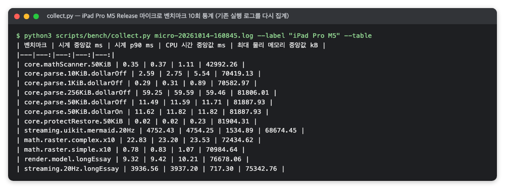

*그림 1. 마이크로 벤치마크 10회 통계(RichMarkdown 검증 때의 명령 출력을 옮긴 화면, 2026-10)*

1. **시계 중앙값·P90**: 두 값이 1% 안이면 측정이 안정적입니다. 인용할 지연 값은 시계 중앙값입니다.
2. **CPU 시간 중앙값**: 프로세스 전체의 CPU 시간이라 시계 시간과 바로 비교하지 않습니다. `core.scanner.50KiB`처럼 CPU 시간이 시계 시간보다 큰 행은, 측정 구간 동안 다른 스레드도 CPU를 썼다는 뜻으로 읽습니다.
3. **최대 물리 메모리**: 테스트 프로세스 전체의 최댓값입니다. 함수 하나가 그만큼 쓴다는 뜻이 아닙니다.
4. **streaming 행**: 청크를 일정 간격에 맞춰 끝까지 흘리는 시간이라, 시계 시간의 대부분이 간격을 맞추는 대기입니다(시계 3,936.56 ms 대 CPU 717.30 ms). 파싱 지연으로 인용하지 않습니다.

다음은 XCTest가 직접 출력하는 원시 값의 형식을 보여 주는 예입니다. 숫자는 프로젝트마다 다릅니다.

```
measured [Clock Monotonic Time, s] average: 0.011, relative standard deviation: 0.857%,
  values: [0.011281, 0.011302, ..., 0.011614], performanceMetricID:com.apple.XCTPerformanceMetric_WallClockTime, baselineName: "", baselineAverage: , maxPercentRelativeStandardDeviation: 10.000%
measured [CPU Time, s] average: 0.012, relative standard deviation: 0.874%, values: [...]
```

그림 2는 실기기 Release 실행 로그에서 50 KiB 파싱 테스트의 두 줄을 골라낸 것입니다. 시계 시간 값 10개가 0.011281–0.011614초에 모여 있어 상대 표준편차가 0.857%입니다.

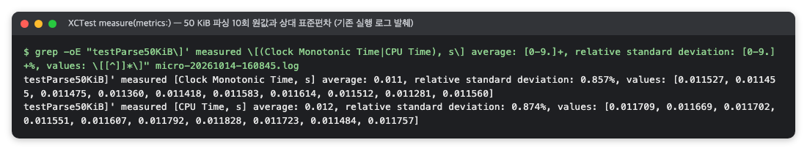

*그림 2. XCTest가 출력한 50 KiB 파싱 10회 원시 값(RichMarkdown 검증 때의 명령 출력을 옮긴 화면, 2026-10)*

- **`values: [...]`**: 예열을 뺀 반복 값(초)입니다.
- **`relative standard deviation: 0.857%`**: 흔들림(표준편차)이 평균의 1% 미만이라는 뜻입니다. 값이 이 정도로 모여 있으면 P90도 중앙값에서 크게 벗어나지 않지만, 두 지표가 같은 것을 재지는 않으므로 P90은 따로 확인합니다.
- **`average: 0.011`**: 초 단위를 소수 셋째 자리에서 반올림한 값이므로, ms 단위 비교에는 `values`나 수집 스크립트 결과를 씁니다.

앱 실행 시간은 결과 번들에서 측정값만 꺼냅니다. 다음도 출력 형식을 보여 주는 예입니다. 숫자는 프로젝트마다 다릅니다.

```
$ xcrun xcresulttool get test-results metrics --path launch.xcresult | jq '...'
testColdLaunch   Duration (AppLaunch)   [0.202, 0.199, 0.193, 0.196, 0.194]  maxPercentRelativeStandardDeviation: 10
testLaunchToFirstContent   Clock Monotonic Time   [4.743, 4.636, 4.641, 4.611, 4.628]
```

그림 3은 결과 번들에서 두 테스트의 측정값을 꺼낸 실제 출력입니다. 콜드 실행 시간 다섯 값은 0.193–0.202초이고, 첫 화면까지 잰 UI 테스트 값은 4.611–4.743초로 훨씬 큽니다.

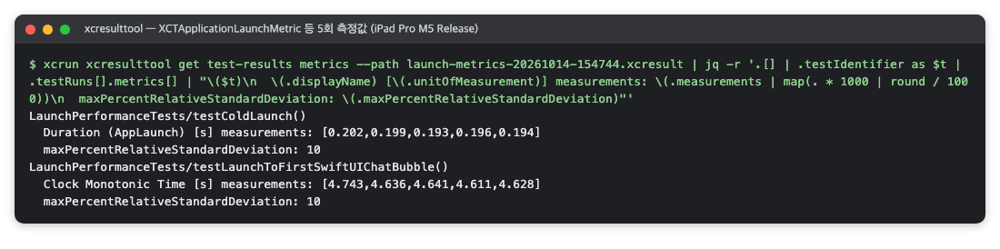

*그림 3. 앱 실행 시간 5회 측정값(RichMarkdown 검증 때의 명령 출력을 옮긴 화면, 2026-10)*

- **`Duration (AppLaunch)`**: 다섯 값의 중앙값과 범위가 앱 콜드 실행(앱 프로세스가 없는 상태에서 처음 띄우는 실행) 시간입니다.
- **UI 테스트로 잰 "첫 화면까지" 값**: XCUITest의 유휴 대기와 화면 조회 시간이 들어간 상한값이라 실행 시간 수치로 쓰지 않습니다.
- **`maxPercentRelativeStandardDeviation: 10`**: XCTest가 측정값과 함께 기록하는 허용 흔들림 상한(%)입니다. 따로 설정하지 않고 기준값도 두지 않으면, 상대 표준편차가 100%를 넘는 지표(메모리 등)가 있어도 테스트는 통과합니다.

### 2.7 주의할 점·한계

- **함수 실행 시간은 화면을 그리는 시간이 아닙니다.** 파싱이 빨라도 화면 갱신이 끊길 수 있습니다. 화면 끊김(hitch, 프레임이 제때 화면에 나가지 못해 툭 끊겨 보이는 현상)은 Instruments로 봅니다.
- **예열한 반복 측정입니다.** 앱을 처음 열었을 때 첫 호출 비용은 대표하지 않습니다.
- **절댓값은 실기기 Release 값만 인용합니다.** 같은 입력이라도 시뮬레이터 Debug 빌드(최적화를 끈 개발용 빌드)의 시간 기준 테스트와 실기기 Release에서 몇 배씩 다를 수 있습니다.
- **10회는 분포의 가운데를 보기에 충분하지만 드문 이상값까지 잡지는 못합니다.** 횟수는 계획에서 정하고 문서에 적습니다.
- **CPU·메모리 지표의 범위를 확인합니다.** 기본 생성자는 프로세스 전체를 잽니다. 스레드 하나만 보려면 `XCTCPUMetric(limitingToCurrentThread: true)`를 써야 합니다.
- **새니타이저 실행에서는 시간 판정을 건너뜁니다.** 새니타이저는 실행 중 메모리 오류(ASan)·데이터 경합(TSan)을 잡도록 빌드에 검사 코드를 넣는 컴파일러 기능입니다. Apple 문서는 ASan이 실행을 2–5배, TSan이 2–20배 느리게 한다고 안내합니다[9]. 동시 빌드 부하나 새니타이저가 있으면 시간 기준 테스트가 오탐으로 실패할 수 있습니다. 그래서 ASan·TSan 런타임이 로드되면(`__asan_init`·`__tsan_init` 심볼 확인) 수치만 로그에 남기고 시간 판정은 하지 않게 만듭니다(코드는 [AddressSanitizer](#5-addresssanitizer--범위-밖-접근해제-후-사용-같은-메모리-손상을-테스트가-도는-동안-잡아내는-컴파일러-기능) 절의 5.5.5). 메모리·경합 검사는 다른 테스트가 그대로 맡습니다.
- **기준값 기능을 쓰지 않으면 XCTest가 스스로 성능 회귀를 실패로 잡지 않습니다.** 회귀는 시뮬레이터의 시간 기준 테스트와 릴리스 전 실기기 재측정으로 잡습니다.


## 3. Instruments와 xctrace — 앱이 도는 동안 CPU 표본·프레임 hitch·메모리·구간을 한 타임라인(.trace)에 기록하고 분석하는 도구

> **요약.** Instruments와 xctrace는 "실기기에서 화면을 조작하는 동안 화면이 끊기는가, 메인 스레드는 시간을 어디에 쓰는가, 메모리가 계속 느는가"에 답합니다. 결과를 읽을 때 가장 중요한 점은 숫자의 범위를 확인하는 것입니다. 요약 표는 트레이스 전체를 세고, 끊김 시간 비율은 분모인 측정 구간 길이에 따라 달라집니다. 그래서 어느 구간·어느 녹화의 값인지, 어느 외부 기준으로 판정했는지를 함께 적습니다.


### 3.1 한눈에 보기

표 5는 이 도구의 기본 정보를 한데 모은 것입니다.

*표 5. Instruments와 xctrace 개요*

| 항목 | 내용 |
|---|---|
| 무엇을 하나 | 앱이 도는 동안 CPU 표본, 프레임 표시 시각(hitch), 메모리, 코드가 표시한 구간을 하나의 타임라인 파일(`.trace`)에 기록하고 분석합니다. |
| 만든 곳·라이선스 | Apple이 만들었고, Xcode에 들어 있어 따로 설치하거나 라이선스를 받을 필요가 없습니다. |
| 쓰는 곳(예) | Q2 성능의 스크롤·스트리밍 화면 끊김(hitch), 메인 스레드 시간 배분, 메모리 증가, 도구 교차 확인에 씁니다. |
| 버전 | 확인 시점 버전은 Xcode 26.6, `xctrace version 16.0`(2026-10)입니다. |
| 공식 문서 | [Profiling apps using Instruments](https://developer.apple.com/tutorials/instruments), 터미널의 `man xctrace` |

### 3.2 무엇을 하는 도구인가

Instruments는 Xcode에 들어 있는 성능 분석 앱입니다[10]. 앱을 실행하면서 여러 종류의 데이터를 같은 시간 축에 기록하고, 기록이 끝나면 그래프와 표로 보여 줍니다. `xctrace`는 같은 기록을 터미널에서 다루는 명령줄 도구로, `.trace` 파일의 녹화·가져오기·내보내기·심볼화(메모리 주소를 함수 이름으로 바꾸는 일)를 맡습니다[11]. xctrace로 녹화한 파일은 Instruments 앱에서 그대로 열립니다.

같은 순서로 반복 녹화하고 결과를 XML로 내보내 숫자를 뽑아야 한다면 녹화는 모두 xctrace로 하고, Instruments 앱은 파일을 눈으로 확인할 때만 씁니다. 데이터 한 종류를 기록하는 단위를 계측기(instrument), 계측기 묶음을 템플릿이라고 합니다. 스크립트에서는 빈 템플릿(Blank)에 필요한 계측기만 `--instrument`로 붙이는 방식이 편합니다. 이 문서에서 쓰는 계측기는 표 6과 같습니다.

*표 6. 이 문서에서 쓰는 계측기*

| 계측기 | 기록하는 것 | 답하는 질문 |
|---|---|---|
| Time Profiler | 1 ms마다 실행 중인 스레드의 호출 스택 | 메인 스레드 시간이 어느 함수로 갔나 |
| Hitches | 프레임 수명, 앱 업데이트·커밋·렌더 단계, hitch | 화면이 제때 바뀌었나 |
| os_signpost | 코드가 남긴 구간의 시작과 끝 | 파싱 구간은 모두 얼마였나, 스트림 측정 구간은 어디인가 |
| Activity Monitor | 앱 프로세스의 physical footprint, 약 1초 간격 | 시나리오 뒤에도 메모리가 계속 느나 |
| CPU Profiler | CPU 사이클 기준 호출 스택 표본 | 어느 함수가 CPU 사이클을 많이 썼나 |

#### 3.2.1 Time Profiler — 1 kHz 표본

Time Profiler는 일정 간격으로 CPU에서 실행 중인 스레드의 호출 스택을 찍습니다. 트레이스 목차에 `sample-rate-micro-seconds="1000"`이 있으면 1 ms 간격이므로 표본 수를 그대로 ms로 읽습니다. 예를 들어 어떤 함수가 메인 스레드 표본 238개에 나타났다면, 그 함수와 하위 호출에서 CPU를 약 238 ms 썼다는 뜻입니다. **inclusive**는 하위 호출을 합친 시간, **self**는 그 함수 자체의 시간입니다. 표본은 실행 중인 스레드만 찍으므로 잠금이나 I/O를 기다린 시간은 들어가지 않습니다.

#### 3.2.2 Hitches — 렌더 루프와 hitch

화면 끊김(hitch)은 프레임이 예정보다 늦게 화면에 표시되어 툭 끊겨 보이는 현상입니다. 화면 한 장이 나가기까지는 여러 단계를 거칩니다. 먼저 앱의 메인 스레드가 화면 변경을 계산해 렌더 서버(화면 합성을 맡는 시스템 프로세스)로 넘깁니다(Core Animation 커밋). 이어서 렌더 서버가 CPU에서 렌더 준비를, GPU에서 실제 렌더를 합니다. 마지막으로 디스플레이가 다음 화면 갱신 신호(vsync, 디스플레이가 다음 프레임을 받을 준비가 됐다고 알리는 주기 신호)에 맞춰 그 결과를 표시합니다. 120 Hz 화면의 프레임 예산(한 프레임에 쓸 수 있는 시간)은 약 8.3 ms이므로 각 단계가 그 안에 끝나야 합니다.

Apple 문서는 프레임마다 표시 예정 시각(presentation time), 그보다 vsync 한 칸 앞의 커밋 마감(commit deadline), 다시 한 칸 앞의 시작 시각(begin time)을 정의합니다[12]. 시작부터 표시 예정까지가 예상 프레임 수명(이중 버퍼에서는 vsync 두 칸)이고, 실제로 화면에 들어간 vsync까지가 실제 프레임 수명입니다. 실제가 예상보다 길면 hitch이고, 그 차이가 hitch 시간입니다. 앱이 커밋 마감을 놓치면 커밋 hitch, 앱은 제때 넘겼지만 렌더 서버가 늦으면 렌더 hitch입니다.

이 단계와 시각을 그린 그림은 Apple 문서에 있습니다. 렌더 파이프라인·커밋 hitch 그림은 "Understanding hitches in your app"에 있고[12], Apple 예제 앱으로 기록한 Hitches 템플릿 화면의 예는 "Improving app responsiveness"에 있습니다[14]. 이 화면에서는 hitch 하나가 입력 처리·커밋·렌더·GPU·프레임 수명 트랙으로 나뉘고, 목록의 Hitch Type 열이 커밋 쪽 문제인지 렌더 쪽 문제인지 알려 줍니다.

**끊김 시간 비율**(Instruments의 hitch time ratio)은 측정 구간(지표를 계산하는 시간 범위) 안 hitch 시간의 합을 구간 길이(초)로 나눈 값(ms/s)입니다. 가상 예시로, 10.45초 동안 8.3 ms짜리 hitch가 20번 났다면 166.7 ÷ 10.45 = 15.9 ms/s입니다. 이 값을 판정하는 외부 기준(플랫폼 제작사·공식 문서가 정한 판정 기준)은 표 7처럼 출처가 두 가지이므로 섞지 않습니다.

*표 7. 끊김 시간 비율의 외부 기준*

| 출처 | 좋음 | 조사 필요 | 나쁨 |
|---|---|---|---|
| Apple Tech Talk 10855[13] | 5 ms/s 미만 | 5–10 ms/s, 조사 필요 | 10 ms/s 초과 |
| Apple 문서 "Understanding hitches in your app"[12] (Organizer Hitches 지표) | 10 ms/s 이하 | 25 ms/s 이하는 경고 | 50 ms/s 이하는 심각, 초과는 즉시 조치 |

같은 값도 기준에 따라 등급이 달라지므로, 판정할 때는 어느 기준인지 함께 적어야 합니다.

#### 3.2.3 os_signpost, Activity Monitor, CPU Profiler

os_signpost는 구간 표시(signpost)를 남기는 API입니다(2.5.3절). 앱 코드가 구간의 시작과 끝을 기록하면 Instruments가 그 구간을 그려 줍니다[15]. 표본을 찍는 Time Profiler와 달리 구간의 시작과 끝이 정확합니다. 그래서 측정 구간은 앱이 직접 남기는 편이 좋습니다. 고정 구간("탭 + 10초")은 스트림이 일찍 끝나면 남은 유휴 시간이 분모에 들어가 비율이 낮게 나오고, 느린 기기에서는 스트림 뒷부분이 구간 밖으로 잘립니다.

Activity Monitor는 physical footprint(앱이 실제로 차지한 메모리)를 약 1초 간격으로 기록합니다. 이 개념은 WWDC18 "iOS Memory Deep Dive"가 설명합니다[16]. CPU Profiler는 시간 간격이 아니라 CPU 사이클 수를 기준으로 표본을 찍으므로 값이 ms가 아니라 사이클입니다. 함수 사이의 상대 비교에만 쓰고, 시간은 Time Profiler로 읽습니다. CPU Profiler 트레이스의 요약은 [xcprof](#4-xcprof--xctrace로-녹화한-cpu-profiler-트레이스를-함수별-비중과-메인-스레드-요약으로-풀어-주는-서드파티-도구)로 할 수 있습니다.

### 3.3 왜 이 도구를 썼나

답하려는 성능 질문은 세 가지입니다. 실기기에서 스크롤하거나 스트리밍할 때 화면이 끊기는가, 메인 스레드는 시간을 어디에 쓰는가, 시나리오 뒤에도 메모리가 계속 느는가입니다. 셋 모두 "실제 화면을 조작하는 동안"의 관찰이 필요합니다. 또 Apple이 측정 도구(Hitches)와 외부 기준(Tech Talk 10855)을 함께 제공하므로, 끊김의 정의를 임의로 정했다는 반론도 피할 수 있습니다. 다른 도구로는 이 조건을 채우기 어려웠습니다.

- **XCTest 성능 지표**: 함수 하나의 반복 측정에는 강하지만 화면 프레임은 보지 못합니다([XCTest 성능 지표](#2-xctest-성능-지표--같은-블록을-반복-실행해-시간cpu메모리앱-실행-시간의-분포를-얻는-measure)).
- **Organizer Hitches·수동 녹화**: Organizer Hitches는 배포한 뒤에야 모이는 데이터이고, 수동 녹화는 조작 시점이 매번 달라 반복할 수 없습니다. 그래서 xctrace와 UI 자동화로 녹화를 스크립트에 넣습니다.

Time Profiler와 os_signpost를 함께 쓰는 데도 이유가 있습니다. 표본 추출과 구간 기록은 서로 다른 방식으로 오차를 내므로, 두 값이 맞으면 한 도구의 버릇이 만든 숫자가 아니라고 볼 수 있습니다.

### 3.4 준비

```sh
xcrun xctrace version            # 예: xctrace version 16.0 (17F113)
xcrun xctrace list instruments | grep -n -x -E 'Activity Monitor|Allocations|CPU Profiler|Hitches|Points of Interest|Time Profiler|os_signpost'
xcrun devicectl list devices     # 기기의 CoreDevice 식별자 확인
```

- 기기에서 개발자 모드를 켜고 Mac과 페어링합니다. 측정은 충전 중·열 상태 정상·잠금 해제 상태에서 합니다(잠기면 빈 트레이스가 남습니다).
- CI 가상 머신에는 실기기가 없으므로 보통 릴리스 전에 사람이 직접 실행합니다.

### 3.5 사용 방법

#### 3.5.1 시나리오 스크립트의 흐름

시나리오마다 같은 순서를 스크립트로 고정합니다([XCUITest와 접근성 감사](ios-testing.md#4-xcuitest와-접근성-감사--앱을-실제로-조작하는-ui-테스트와-화면의-접근성-문제를-자동으로-찾는-감사)의 성능 시나리오 절 참고).

1. 측정용 스킴을 준비하고, 앱과 UI 테스트를 Release로 빌드합니다(`build-for-testing`).
2. UI 테스트를 백그라운드로 띄우고 준비 완료 표지(`PERF_READY`)를 기다립니다.
3. `xcrun xctrace record`로 녹화를 시작하고, "Ctrl-C to stop the recording"이 나오면 기기에 Darwin 알림(프로세스끼리 이름만 주고받는 시스템 알림)을 보냅니다. 테스트는 알림을 받은 뒤 시나리오를 실행합니다.
4. xctrace가 제한 시간에 스스로 끝나면 트레이스를 요약합니다.

#### 3.5.2 녹화 명령

```sh
xcrun xctrace record --device <하드웨어 UDID> \
  --instrument "Time Profiler" --instrument Hitches \
  --time-limit 20s --no-prompt \
  --output <결과 폴더>/<시나리오>.hitches.trace \
  --attach <앱 이름>
```

- `--device`: 녹화할 기기입니다. CoreDevice 식별자가 아니라 하드웨어 UDID를 받으므로, 스크립트가 `devicectl device info details`로 알아내 넘깁니다.
- `--time-limit`: 이 시간이 지나면 xctrace가 스스로 녹화를 끝내고 저장합니다. `--no-prompt`는 권한 확인 창 없이 진행합니다.
- `--attach <앱>`: UI 테스트가 이미 띄운 앱에 붙습니다. 콜드 실행은 시작부터 봐야 하므로 `--launch -- <번들 ID> <앱 인자>`로 xctrace가 직접 띄웁니다.

앱 인자로 자동 재생을 켜면 UI 테스트 없이 xctrace가 앱을 띄우고, 앱이 녹화 시작 알림 1초 뒤 스스로 시나리오를 시작하게 할 수 있습니다. UI 테스트가 켜는 접근성 모드가 빠진다는 장점이 있습니다.

```sh
xcrun xctrace record --device <하드웨어 UDID> \
  --instrument "Time Profiler" --instrument Hitches --instrument os_signpost \
  --time-limit 25s --no-prompt --output <시나리오>-auto.hitches.trace \
  --launch -- <번들 ID> -<자동 재생 인자> <값>
```

CPU Profiler는 Hitches·Activity Monitor와 한 녹화에 함께 넣을 수 없습니다("Remove Instruments recording CPU Counters"). 같은 시나리오를 묶음(hitches, cpu, memory)마다 따로 실행해야 하므로, 묶음이 다르면 다른 실행의 숫자입니다.

#### 3.5.3 트레이스 내보내기

```sh
xcrun xctrace export --input <트레이스> --toc
xcrun xctrace export --input <트레이스> \
  --xpath '/trace-toc/run[@number="1"]/data/table[@schema="hitches"]'
```

목차(TOC)에서 확인할 곳은 네 군데입니다.

1. **`<device>`**: 어느 기기·OS에서 녹화했는지
2. **`<end-reason>Time limit reached`**: 제한 시간까지 정상 녹화했는지
3. **`sample-rate-micro-seconds="1000"`**: Time Profiler 표본 간격이 1 ms인지
4. **`<table schema="…">`**: 어떤 표를 내보낼 수 있는지(hitch는 `hitches`, 프레임 수명은 `hitches-frame-lifetimes`, Time Profiler는 `time-profile`, signpost 구간은 `os-signpost-interval`)

그림 4는 실기기 트레이스의 목차 발췌로, 네 곳이 모두 보입니다. iPad Pro 11-inch (M5)·iPadOS 26.6.2에서 녹화했고, 종료 사유는 `Time limit reached`이며, `time-sample` 표의 표본 간격은 1000 마이크로초입니다.

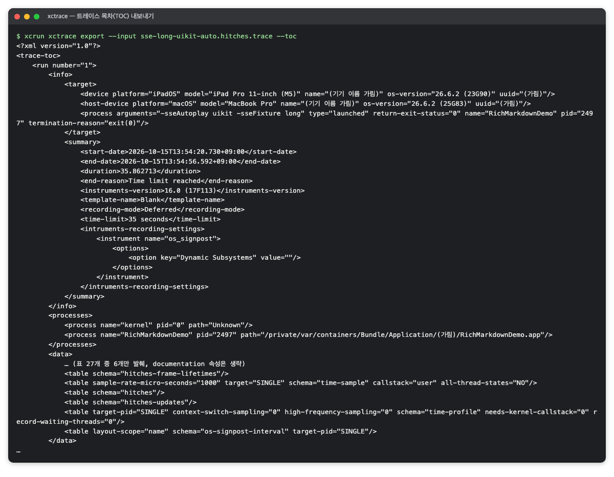

*그림 4. 트레이스 목차 내보내기(RichMarkdown 검증 화면, 2026-10)*

내보낸 XML은 사람이 읽기 어려워 요약 스크립트가 필요합니다. 요약 스크립트는 (1) 측정 구간을 UI 테스트 로그의 `PERF_WINDOW … start_epoch= end_epoch=`나 signpost 구간으로 정하고(기기·Mac 시계가 맞다고 가정하고, 경계에 300 ms 정도 여유를 둠), (2) 구간 안 hitch의 수·합계·최댓값·비율을 내고, (3) 메인 스레드 표본을 함수별로 모아 ms로 내고, (4) 최대 physical footprint를 냅니다.

### 3.6 결과 읽는 법

#### 3.6.1 Hitches 트랙과 요약 표

Instruments 화면은 다음 순서로 읽습니다.

1. **Hitches 트랙의 빨간 막대**가 hitch 하나입니다. 막대가 모인 곳이 끊김이 몰린 시간대입니다.
2. **PointsOfInterest 레인의 구간**이 앱이 남긴 측정 구간입니다.
3. **Time Profiler 트랙**은 CPU 사용량입니다. 측정 구간 안에 사용량이 몰려 있는지 봅니다.
4. **Summary: Hitches 표**의 Count는 건수, Duration은 hitch 시간의 합, Min·Avg·Max는 한 건의 길이입니다. 120 Hz에서 8.33 ms는 한 프레임, 16.67 ms는 두 프레임 늦었다는 뜻입니다.

그림 5는 SwiftUI 화면의 자동 재생 스트리밍을 녹화한 트레이스입니다. 빨간 막대가 PointsOfInterest의 `swiftui short 20Hz` 구간에 몰려 있고, Summary: Hitches 표는 84건, 합계 716.68 ms, 최대 16.67 ms(두 프레임 늦음)를 보여 줍니다.

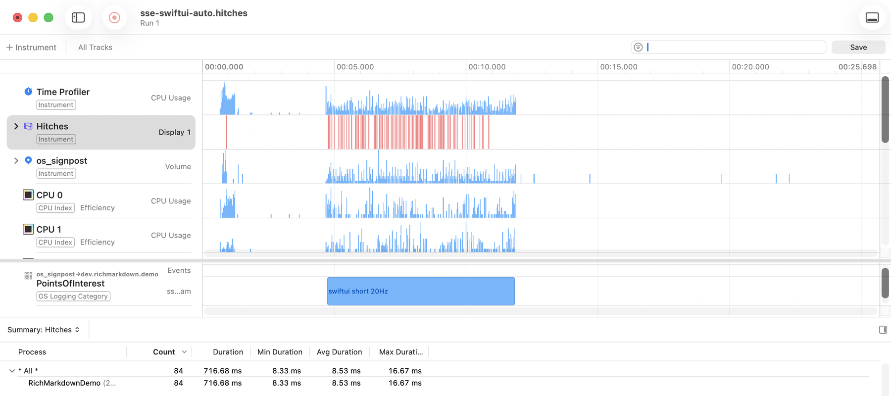

*그림 5. 트레이스 전체 hitch가 84건이던 회차(RichMarkdown 검증 화면, 2026-10)*

요약 스크립트 출력(JSON)에는 구간 안 hitch의 `count`·`total_ms`·`max_ms`·`ratio_ms_per_s`·`window_s`가 있습니다(가상 예시: 20건, 166.7 ms, 15.94 ms/s, 구간 10.45초).

반면 Instruments의 요약 표는 트레이스 전체를 셉니다. 가상 예시로, 스트림이 시작되기 전에 난 hitch가 1건 있으면 "트레이스 전체 84건"과 "스트림 구간 83건"처럼 값이 다릅니다. 숫자를 옮길 때는 범위를 구분합니다.

#### 3.6.2 hitch 수가 회차마다 갈리는 이유 — 시작 위상과 목격자 프레임

같은 빌드·같은 입력이어도 hitch 수는 열 배 넘게 갈리는데 메인 스레드 사용량은 몇 %만 다른 경우가 있습니다(실제 사례는 [적용 사례](../case-study/richmarkdown.md)). 그림 6은 그림 5와 같은 빌드·같은 시나리오(`swiftui short 20Hz`)의 다른 회차로, hitch가 4건(합계 33.33 ms)뿐이라 84건이던 그림 5와 스무 배 넘게 차이 납니다.

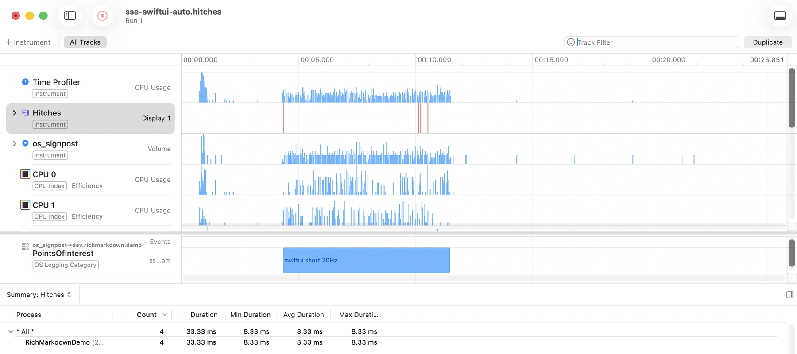

*그림 6. 같은 빌드에서 hitch가 4건이던 회차(RichMarkdown 검증 화면, 2026-10)*

이 현상의 원인 두 가지는 트레이스를 관찰해 추론했습니다. 신뢰도는 '가능성 높음(likely)' 수준이며, Apple 문서는 hitch를 세는 규칙을 이 수준까지 설명하지 않습니다.

- **시작 위상**(작업 시작 시각이 vsync 주기의 어느 지점에 걸리는지): 청크를 50 ms마다 절대 시각 일정으로 보내면, 50 ms가 120 Hz vsync 간격(8.33 ms)의 정확히 6배라 첫 청크의 시작 위상이 스트림 내내 거의 유지됩니다. 업데이트가 vsync 뒤 어느 지점에서 시작하느냐에 따라 같은 작업이 커밋 마감 안에 들어가기도 하고 넘기기도 합니다. 시작 위상이 우연히 위험한 지점에 걸린 회차만 hitch가 많아, 결과가 "많음"과 "적음" 두 무리로 갈립니다.
- **목격자 프레임**(늦은 프레임이 화면에 머무는 동안 대신 표시된 다른 프레임): 예상 프레임 수명보다 늦은 앱 프레임이라고 모두 hitch로 세지는 않습니다. hitch로 표시된 프레임은 모두, 늦은 프레임의 수명 동안 화면에 다른 프레임(대개 앱 업데이트 없이 렌더 서버가 그린 스피너)이 표시된 경우였습니다. 화면에 다른 움직임이 없으면 늦은 프레임도 hitch로 세지 않았습니다.

정리하면 hitch 수는 작업량을 그대로 비추지 않고, 시작 위상과 화면의 다른 움직임을 거쳐 걸러진 값입니다. 그래서 한 회차 값으로 결론을 내리지 않고 여러 회차와 짝 비교를 씁니다. 작업량은 메인 스레드 점유 시간(busy ms/s, 1초 동안 메인 스레드가 일한 시간)으로, 늦음은 지연 초과 시간(late excess ms/s)으로 함께 봅니다. 지연 초과 시간은 `round(수명 ÷ 기준 vsync 간격) > 2`인 앱 프레임마다 수명에서 vsync 두 칸을 뺀 값을 더해 구간 초로 나눈 값입니다. 이때 기준 주사율이 순간 실제 주사율과 다를 수 있음을 함께 기록합니다. 또 같은 시드(난수 생성의 시작값)가 같은 예정 시작 오프셋을 배정해도 깨어남 지연(예정 시각보다 늦게 깨어나는 정도)까지 같지는 않습니다. 그래서 두 빌드가 같은 실제 시작 위상을 거쳤다고 단정하지 않습니다.

#### 3.6.3 os_signpost, CPU Profiler, Time Profiler, 메모리

- **signpost 구간**: Summary: Intervals 표의 Count는 구간 수, Duration은 합, Avg·Max는 한 구간의 길이이며 트레이스 전체 기준입니다. 구간 수가 실제 실행 횟수(측정 N회 + 예열 1회)와 맞는지부터 확인합니다. signpost는 코드가 표시한 구간만 보여 주므로 구간 밖이나 다른 스레드의 일은 들어가지 않습니다.
- **CPU Profiler 호출 트리**: Cycles 열은 호출 스택 어딘가에 있던 표본의 사이클 합(inclusive)과 전체 대비 비율, Self Cycles는 그 함수가 스택 맨 안쪽(leaf)에 있던 표본의 사이클입니다. 가장 무거운 경로를 위에서부터 따라가되, 비율은 사이클 비중이라 ms로 바꾸지 않습니다. 이 화면도 트레이스 전체 기준입니다.
- **Time Profiler 값**: 표본 하나가 1 ms라 바로 시간으로 읽고, 교차 확인(Time Profiler·signpost·XCTClockMetric이 1% 안에서 일치하는지)으로 검증합니다.
- **Activity Monitor 메모리**: 시나리오 전후 physical footprint의 최댓값과 변화를 봅니다. 이 값은 총량이므로, 늘어난 내역(캐시 등)은 이 계측기로 확인한 것이 아니라 해석입니다.

그림 7은 UIKit 화면의 긴 스트리밍 트레이스에서 라이브러리가 남긴 signpost 레인입니다. `rebuild`·`parse`·`raster` 구간이 `uikit long 20Hz` 구간을 따라 촘촘히 찍혀 있고, Summary: Intervals 표는 트레이스 전체 기준으로 `parse` 140개, 합계 258.36 ms처럼 구간 수와 합을 보여 줍니다.

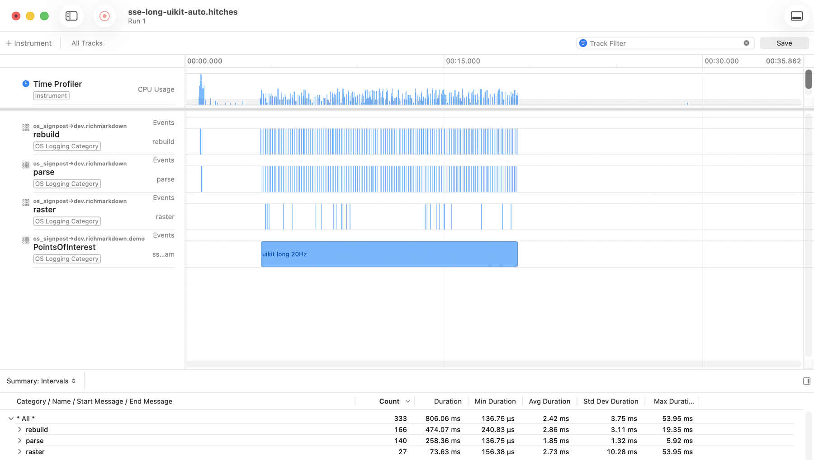

*그림 7. 라이브러리 signpost 구간과 요약(RichMarkdown 검증 화면, 2026-10)*

그림 8은 SwiftUI 스트리밍 시나리오를 CPU Profiler로 따로 녹화한 호출 트리입니다. 가장 무거운 경로는 런루프(`__CFRunLoopRun`, 85.4%)를 거쳐 SwiftUI 뷰 그래프 갱신(`ViewGraphRootValueUpdater.updateGraph`, 29.2%)으로 이어지며, 이 비율은 트레이스 전체의 사이클 비중이지 시간이 아닙니다.

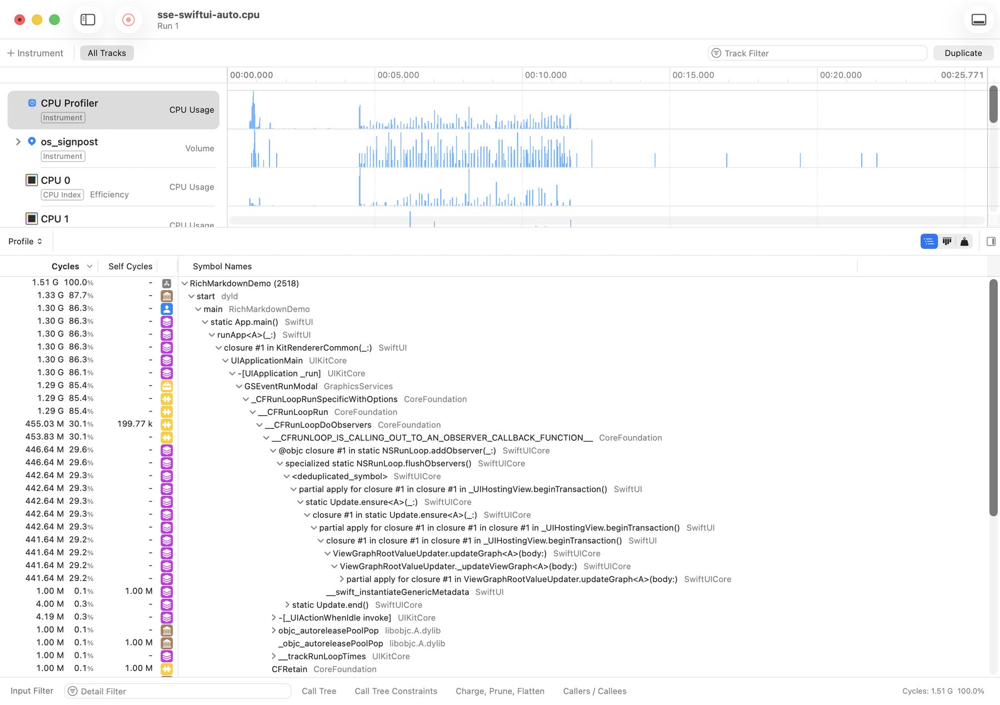

*그림 8. CPU Profiler 호출 트리(RichMarkdown 검증 화면, 2026-10)*

### 3.7 주의할 점·한계

**숫자를 옮길 때**

- 요약 표는 트레이스 전체를 셉니다. 측정 구간 기준 값과 다를 수 있으니 범위를 함께 적습니다.
- 끊김 시간 비율은 분모(구간 길이)에 따라 달라집니다. 고정 구간이 실제 스트림보다 길면 비율이 낮아지므로, 앱이 남긴 구간으로 다시 계산합니다.
- 녹화 묶음이 다르면 다른 실행입니다. hitch·CPU Profiler·메모리 값을 한 실행의 숫자처럼 섞어 말하지 않습니다.

**해석할 때**

- UI 테스트가 켠 접근성 모드도 결과에 들어갑니다([XCUITest와 접근성 감사](ios-testing.md#4-xcuitest와-접근성-감사--앱을-실제로-조작하는-ui-테스트와-화면의-접근성-문제를-자동으로-찾는-감사)).
- Time Profiler의 ms는 CPU 실행 시간입니다. "메인 스레드 238 ms"를 "화면이 238 ms 멈췄다"로 읽지 않습니다. 함수 이름의 일부 문자열로 표본을 모으면 관계없는 스택 프레임까지 세는 과대 집계가 생깁니다.
- "누수 징후 없음"은 이 시나리오·시간 범위에서 메모리가 계속 늘지 않았다는 뜻이지, 누수가 없다는 증명이 아닙니다.

**측정을 돌릴 때**

- 기기가 잠겨 있으면 빈 트레이스가 남습니다. 회차마다 잠금 해제를 기다리고, signpost 구간이 비면 그 회차를 다시 잽니다.
- 같은 기기에서 측정 두 개를 동시에 돌리면 테스트 러너가 재시작되어 데이터가 무효가 됩니다. 기기마다 잠금 폴더로 중복 실행을 막습니다.
- xctrace가 기기에서 앱을 띄우다 멈춰 스스로 끝나지 않을 수 있습니다. 제한 시간에 여유를 더한 뒤 SIGTERM을 보내고, 그래도 남으면 강제 종료합니다.
- "Timed out waiting for device to boot"로 끝나면 `devicectl`로 기기를 깨운 뒤 다시 시도합니다.
- `xctrace export`는 심볼 정리 중 segfault(종료 코드 139)로 끝나는 일이 잦습니다. 요약 스크립트가 여러 번 재시도하게 만듭니다.
- Allocations 데이터는 녹화는 되지만 `xctrace export`로 읽을 수 없어 Instruments 앱에서만 볼 수 있습니다.

**공유할 때**: 트레이스 목차와 xcprof 결과의 기기 이름(소유자 이름이 들어 있을 수 있음)은 공유 전에 가립니다.


## 4. xcprof — xctrace로 녹화한 CPU Profiler 트레이스를 함수별 비중과 메인 스레드 요약으로 풀어 주는 서드파티 도구

> **요약.** xcprof는 "CPU Profiler 트레이스를 사람 손을 거치지 않고 요약해, 어느 함수가 CPU 사이클을 많이 썼는지 알 수 있는가"에 답하는 서드파티 도구입니다. 결과를 읽을 때 가장 중요한 점은 비율(%)만 믿는 것입니다. `inclusive_ms`·`self_ms`는 표본 비율에 구간 길이를 곱한 추정치라 실제 시간이 아니며, 시간은 Time Profiler로 따로 읽습니다.


### 4.1 한눈에 보기

표 8은 이 도구의 기본 정보를 한데 모은 것입니다.

*표 8. xcprof 개요*

| 항목 | 내용 |
|---|---|
| 무엇을 하나 | xctrace로 녹화한 `.trace`를 읽어 CPU 표본, 상위 함수, 메인 스레드 요약을 Markdown이나 JSON으로 냅니다. |
| 만든 곳·라이선스 | Axiom 프로젝트(GitHub `CharlesWiltgen/Axiom`)의 서드파티 도구이고, 라이선스는 MIT입니다. Apple 공식 도구가 아닙니다. |
| 쓰는 곳(예) | Q2 성능에서 측정 스크립트의 CPU Profiler 녹화를 요약(함수별 사이클 비중)하는 데 씁니다. 본문 수치의 시간은 Time Profiler로 읽습니다. |
| 버전 | 확인 시점 버전은 Axiom 플러그인 27.5.0에 든 xcprof(출력 표기 `0.1.0-dev`, 2026-10)입니다. |
| 공식 문서 | [xcprof Reference](https://charleswiltgen.github.io/Axiom/reference/xcprof-ref) |

### 4.2 무엇을 하는 도구인가

Instruments 트레이스는 `xctrace export`로 XML을 꺼낼 수 있지만, 그대로 읽기는 어렵습니다. 같은 값을 처음 한 번만 `id`로 적고 이후에는 `ref`로 가리키는 압축 형식이기 때문입니다. xcprof는 이 참조를 풀어 호출 스택을 복원하고, 함수별로 모아 요약합니다. 하위 명령은 표 9의 네 가지입니다.

*표 9. xcprof 하위 명령*

| 하위 명령 | 하는 일 |
|---|---|
| `doctor` | xctrace가 있는지, 계측기·기기가 몇 개인지 확인 |
| `record` | 프리셋(cpu·memory 등)으로 새 트레이스 녹화 |
| `analyze` | 기존 트레이스 요약 |
| `compare` | 두 트레이스의 함수별 CPU 비중 비교, CI 게이트용 판정 |

`analyze`가 읽는 것은 CPU Profiler의 `cpu-profile` 표이고, Time Profiler의 `time-profile` 표는 읽지 않습니다[17]. 그래서 Time Profiler·Hitches 녹화는 직접 만든 요약 스크립트로, CPU Profiler 녹화는 xcprof로 요약하는 분업이 됩니다([Instruments와 xctrace](#3-instruments와-xctrace--앱이-도는-동안-cpu-표본프레임-hitch메모리구간을-한-타임라인trace에-기록하고-분석하는-도구)).

함수별 값은 두 종류입니다.

- **비율(%)**: 전체 CPU 사이클 가운데 그 함수가 차지한 몫입니다. 정확한 값입니다.
- **ms**: 표본 비율에 분석 구간 길이를 곱한 추정치입니다. 실제 시간이 아닙니다(4.6.1절).

### 4.3 왜 이 도구를 썼나

측정 스크립트는 시나리오마다 CPU Profiler 트레이스를 남깁니다. 이 도구로 답하려는 질문은 "Instruments 앱을 열지 않고 스크립트 안에서 이 트레이스를 요약할 수 있는가"입니다. 사람이 앱에서 트레이스를 하나씩 열어 숫자를 옮기면 반복할 수 없고, 옮겨 적다가 실수가 생깁니다. `xctrace export`의 XML을 직접 읽으려면 앞에서 본 참조를 스스로 풀어야 합니다.

다만 xcprof는 Apple 도구가 아니므로 숫자의 정의를 소스로 확인해야 합니다. 실제로 `inclusive_ms`의 뜻을 소스(`analyze.go`)로 확인하다가, 이 값이 시간이 아니라 추정치라는 함정을 찾았습니다[18]. 메인 스레드 시간은 Time Profiler 표에서 계산하고 xcprof 결과에서는 비율(%)만 읽으면 이 함정을 피할 수 있습니다.

### 4.4 준비

xcprof는 Axiom Claude Code 플러그인에 들어 있습니다. 플러그인 캐시 안의 `tools/xcprof`에 있고, 세션 훅이 PATH에 넣어 주므로 `xcprof`로 부를 수 있습니다. 측정 스크립트는 `XCPROF=<경로>` 환경 변수로 다른 경로를 지정할 수 있게 합니다. 내부에서 `xcrun xctrace`를 부르므로 Xcode가 있어야 합니다[19].

```sh
xcprof doctor --human
# xcprof doctor ok=true
#   xctrace: xctrace version 16.0 (...) (<Xcode 경로>/usr/bin/xctrace)
#   instruments: 61 · devices: 22
xcprof --help    # doctor·record·analyze·compare, analyze 옵션(--json --both --start-ms --end-ms --hang-threshold-ms --user-binary --dsym)
```

그림 9는 `xcprof --help`의 전체 출력입니다. 네 하위 명령과 함께 record의 녹화 대상·프리셋, analyze의 구간 지정(`--start-ms`·`--end-ms`)과 심볼화(`--dsym`), compare의 회귀 판정(`--threshold-pct`·`--fail-on-regression`) 옵션이 나옵니다.


*그림 9. xcprof 도움말(RichMarkdown 검증 화면, 2026-10)*

CI에서는 보통 쓰지 않습니다. 요약할 CPU Profiler 트레이스가 실기기 측정에서만 나오기 때문입니다.

### 4.5 사용 방법

#### 4.5.1 측정 스크립트 안에서

CPU Profiler 녹화를 요약하는 함수의 골격은 다음과 같습니다.

```sh
range=$(python3 <요약 스크립트> "$trace" --ui-log "$ui_log" --window "$window" --window-only)
for _ in 1 2 3 4 5 6 7 8 9 10; do
    XCPROF_TRACE_ROOT="$OUT_DIR" "$XCPROF" analyze "$trace" --json --dsym "$DSYM" $range \
        > "$base.$window.xcprof.json" 2> "$base.$window.xcprof.err" && break
done
```

1. 요약 스크립트의 `--window-only`가 UI 테스트 로그의 측정 구간을 트레이스 시각으로 바꿔 `--start-ms A --end-ms B`만 출력합니다.
2. `xcprof analyze`가 그 구간 안의 CPU Profiler 표본만 요약해 JSON으로 저장합니다. `XCPROF_TRACE_ROOT`는 xcprof가 트레이스를 다루는 기준 폴더입니다.
3. `--dsym`에는 같은 빌드의 dSYM(주소를 함수 이름으로 바꾸는 디버그 기호 파일)을 넘겨, Release 빌드의 주소를 함수 이름으로 바꿉니다. 빌드 직후 dSYM을 결과 폴더에 복사해 두면, 같은 빌드 슬롯을 다시 빌드해도 트레이스와 맞는 dSYM이 남습니다.
4. 내부의 `xctrace export`가 심볼 정리 중 segfault로 자주 끝나므로, 성공할 때까지 최대 10번 다시 시도합니다.

#### 4.5.2 직접 실행

```sh
xcprof analyze <시나리오>.cpu.trace --start-ms 1812 --end-ms 12234
```

구간을 지정하지 않으면 트레이스 전체를 요약합니다.

- `--json`: 스크립트가 읽을 한 줄 JSON을 냅니다. `--both`는 Markdown 다음에 JSON을 냅니다.
- `--dsym <경로>`: 심볼화에 쓸 dSYM입니다. 주지 않으면 UUID로 Spotlight에서 찾고, 못 찾은 주소는 그대로 둡니다.
- `--hang-threshold-ms`: 메인 스레드 표본 사이 간격이 이 값을 넘으면 "후보 정지"로 셉니다(기본 250 ms).

#### 4.5.3 두 트레이스 비교

```sh
xcprof compare baseline.trace current.trace --human
xcprof compare baseline.trace current.trace --fail-on-regression --threshold-pct 5   # 회귀면 종료 코드 3
```

`compare`는 함수별 CPU 사이클 비중 변화를 퍼센트포인트로 냅니다. 두 녹화가 같은 작업을 했어야 그 차이가 코드 변경을 뜻합니다[17]. 회차마다 흔들리는 실기기 스트리밍 시나리오에서는 이 조건을 맞추기 어렵습니다.

### 4.6 결과 읽는 법

다음은 출력 형식을 보여 주는 예입니다. 숫자는 프로젝트마다 다릅니다. `analyze`의 Markdown 출력입니다.

```
## Summary
target: <앱>   device: <기기> <OS>   duration: 20.602 s
scope: 1812–12234ms (3438 samples in window)
## Support
cpu: present   memory: not_exportable
## CPU
__CFRunLoopRun                84.0% (~8512ms)  samples 2808
AG::Graph::UpdateStack::update()  71.2% (~6851ms)  samples 2260
## Main thread
samples 3236   max gap 907ms   candidate stalls 1
## Top user-code frames
...
## Notes
ms is approximate (sample-share × window)...  unsymbolicated addresses: 9511
```

그림 10은 실기기 SwiftUI 스트리밍 CPU 트레이스를 1812–12234 ms 구간으로 요약한 실제 출력입니다. 위 예와 같은 숫자가 나오며, Notes의 마지막 줄은 `--dsym` 없이 실행해 주소 9,511개를 함수 이름으로 바꾸지 못했다고 알려 줍니다.


*그림 10. SwiftUI 스트리밍 CPU 트레이스의 `analyze` 요약(RichMarkdown 검증 화면, 2026-10)*

1. **Summary**: 대상 앱, 기기·OS, 녹화 길이, 분석 구간입니다. `3438 samples in window`는 구간 안에 CPU Profiler 표본이 3,438개 있었다는 뜻입니다.
2. **Support**: 이 트레이스에서 읽을 수 있는 데이터 종류입니다. `memory: not_exportable`은 데이터가 없다는 뜻이 아니라 `xctrace export`로 꺼낼 수 없다는 뜻입니다.
3. **CPU 표**: 함수별 inclusive·self 비율과 괄호 안 추정 ms, 표본 수입니다.
4. **Main thread**: 메인 스레드 표본 수, 비중, 표본 사이 최대 간격, 후보 정지 건수입니다. 도구 스스로 근삿값이라고 밝히며, 실제 멈춤(hang)인지는 Hangs 계측기로 확인합니다.
5. **Top user-code frames**: 앱 바이너리에 속한 함수입니다(라이브러리가 정적 링크되면 앱에 속합니다).
6. **Notes**: 근삿값 경고와 심볼화 결과입니다. `--dsym`을 주지 않으면 주소가 함수 이름으로 바뀌지 않았다는 메모가 나옵니다.

JSON 필드는 표 10처럼 읽습니다.

*표 10. `analyze` JSON 필드 읽는 법*

| 필드 | 뜻 | 읽는 법 |
|---|---|---|
| `cpu_samples`, `scope.samples_in_scope` | 구간 안 CPU Profiler 표본 수 | 표본 간격이 시간으로 고정되지 않으므로 ms로 읽지 않습니다. |
| `hot_frames[].samples` | 그 함수가 호출 스택에 있던 표본 수 | 함수 사이의 상대 비교에만 씁니다. |
| `inclusive`, `self` | 그 함수가 있던 표본의 사이클 합 | 원시 값입니다. |
| `inclusive_pct`, `self_pct` | 전체 사이클 대비 비율 | 정확한 값이며, 상대 비중으로 읽습니다. |
| `inclusive_ms`, `self_ms` | 표본 비율 × 구간 길이 | 시간이 아니므로 인용하지 않습니다. |
| `main_thread` | 메인 스레드 표본·비중·최대 간격·후보 정지 | 근삿값입니다. |
| `notes` | 근삿값 경고, 심볼화 실패 수 | 반드시 함께 읽습니다. |

그림 11은 측정 스크립트가 남긴 JSON에서 표 10의 필드를 `jq`로 뽑은 것입니다. `cpu_samples`와 `scope.samples_in_scope`가 모두 3438이고, `__CFRunLoopRun`의 `inclusive_pct` 84.01과 `inclusive_ms` 8512.2가 나란히 나옵니다.


*그림 11. 측정 스크립트가 남긴 xcprof JSON의 필드 발췌(RichMarkdown 검증 화면, 2026-10)*

#### 4.6.1 함정: `inclusive_ms`는 시간이 아니다

위 예에서 `__CFRunLoopRun`의 `inclusive_ms`는 8,512.2 ms입니다. 구간이 10.4초이니 메인 런루프가 구간의 82% 동안 일한 것처럼 보이지만, 이 값은 다음 식으로 만든 추정치입니다.

```text
inclusive_ms = samples ÷ 구간 안 전체 표본 × 구간 길이(초) × 1000
             = 2808 ÷ 3438 × 10.422 × 1000 ≈ 8512.2
```

xcprof 소스에도 같은 내용이 적혀 있습니다(`tools/xcprof/analyze.go`, 커밋 `e8d66c4`)[18].

```go
// analyze.go L92 — 필드 정의
InclusiveMS  float64 `json:"inclusive_ms"`  // approx wall-time (sample share × window)

// analyze.go L133 — 계산식
frames[i].InclusiveMS = round1(float64(frames[i].Samples) / float64(totalSamples) * windowSec * 1000)
```

왜 실제보다 크게 나올까요? CPU Profiler는 CPU가 일할 때만 표본을 찍습니다. 그래서 "표본의 82%에 나타났다"는 "CPU가 한 일의 82%"라는 뜻이지 "구간 시간의 82%"가 아닙니다. 여기에 구간 길이를 곱하면 CPU가 구간 내내 쉬지 않고 일했다고 가정하는 셈이라 값이 부풀려집니다. 같은 이유로 `AG::Graph::UpdateStack::update()`의 6,851 ms를 "SwiftUI 그래프 갱신에 6.85초를 썼다"로 읽으면 안 됩니다. 같은 시나리오를 Time Profiler로 따로 녹화하면 구간 안 메인 스레드 작업량이 훨씬 작게 나옵니다.

JSON의 `notes`에도 "ms is approximate (sample-share × window), since cycle-weight is cycles, not time"이라고 적혀 있습니다. 사이클을 시간으로 바꾸려면 코어별 클럭 주파수가 필요한데, 트레이스에는 그 정보가 없기 때문입니다[17]. 그래서 xcprof 결과에서는 비율만 상대 비중으로 읽고, 시간은 Time Profiler(1 kHz 표본) 값으로 읽습니다.

### 4.7 주의할 점·한계

- `inclusive_ms`·`self_ms`는 추정치입니다. 시간으로 인용하지 않습니다.
- 비율(%)도 CPU 사이클 비중일 뿐이라, 화면이 멈춘 시간이나 메인 스레드가 기다린 시간은 알 수 없습니다.
- `analyze`는 CPU Profiler(`cpu-profile`)만 읽습니다. Time Profiler·Hitches 트레이스에 실행하면 `cpu: not_present`, 표본 0개로 나옵니다. Allocations·Leaks 데이터는 `not_exportable`로 표시됩니다.
- Release 빌드는 맞는 dSYM이 있어야 함수 이름이 나옵니다. 풀리지 않은 주소가 많으면 `<deduplicated_symbol>`로 묶인 프레임도 생깁니다. 상위 함수 목록에 라이브러리 함수가 보이지 않는다고 해서 라이브러리 비용이 없다고 결론 내리지 않습니다.
- 메인 스레드 "후보 정지"는 표본 사이 간격으로 추정한 값입니다. 실제 멈춤인지는 Hangs 계측기로 확인합니다.
- 내부의 `xctrace export`가 segfault로 끝나는 일이 잦습니다. 4.5.1절의 스크립트처럼 다시 시도해야 하며, 실패하면 빈 JSON과 `.err` 파일이 남습니다.
- 서드파티 개발 버전(`0.1.0-dev`)입니다. 플러그인 버전이 바뀌면 출력 필드나 동작이 바뀔 수 있으므로, 수치를 인용할 때는 쓴 버전을 함께 남깁니다.
- 요약 결과의 `summary.device`에 기기 이름이 들어 있습니다. 기기 이름에는 소유자 이름이 들어갈 수 있으므로 공유 전에 가립니다.
- `compare`는 두 녹화가 같은 작업을 했다는 전제가 필요합니다.


## 5. AddressSanitizer — 범위 밖 접근·해제 후 사용 같은 메모리 손상을 테스트가 도는 동안 잡아내는 컴파일러 기능

> **요약.** AddressSanitizer(ASan)는 "외부 C 인터페이스·시스템 프레임워크와의 경계를 포함한 코드가 실행 중 메모리를 망가뜨리는가"에 답합니다. 결과를 읽을 때 가장 중요한 점은 테스트 실패와 ASan 보고를 구분하는 것입니다. ASan 실행에서 테스트가 실패해도 `ERROR: AddressSanitizer` 보고가 없으면 메모리 오류가 아닌 다른 원인(커진 스택 프레임 등)을 찾습니다. 또 보고 0건은 테스트가 실제로 실행한 코드 가운데 검사 코드가 들어간 부분에서만 의미가 있습니다.


### 5.1 한눈에 보기

표 11은 이 도구의 기본 정보를 한데 모은 것입니다.

*표 11. AddressSanitizer 개요*

| 항목 | 내용 |
|---|---|
| 무엇을 하나 | 버퍼 범위 밖 접근, 해제한 메모리 사용 같은 메모리 손상을 테스트가 도는 동안 찾아 보고합니다. |
| 만든 곳·라이선스 | LLVM 기반 컴파일러 기능입니다. Clang과 Swift 컴파일러가 지원하고 Xcode에 들어 있어, 따로 설치하거나 라이선스를 받지 않습니다. |
| 쓰는 곳(예) | Q1 오류·안전에서 외부(C·Rust·JavaScriptCore) 경계를 지나는 코드의 메모리 안전을 확인하는 데, 그리고 릴리스 전 새니타이저 검증 단계에 씁니다. |
| 버전 | 확인 시점 버전은 Xcode 26.6 내장(Swift 6.3.3, 2026-10)입니다. |
| 실행 환경(예) | iOS 시뮬레이터, Debug 빌드, 패키지 테스트에서 실행합니다. |
| 공식 문서 | [Diagnosing memory, thread, and crash issues early](https://developer.apple.com/documentation/xcode/diagnosing-memory-thread-and-crash-issues-early) |

### 5.2 무엇을 하는 도구인가

배열 끝을 넘어 읽거나 이미 해제한 메모리를 다시 쓰는 오류는 바로 크래시가 나지 않는 경우가 많습니다. 대신 엉뚱한 값이나 보안 취약점으로 남기 때문에 일반 테스트로는 잘 드러나지 않습니다. AddressSanitizer(이하 ASan)는 프로그램이 자기 것이 아닌 메모리를 읽거나 쓰는 바로 그 순간을 잡아내는 새니타이저입니다.

ASan은 두 부분으로 동작합니다. 빌드할 때는 컴파일러가 모든 메모리 접근 앞에 검사 코드를 넣고, 실행할 때는 런타임 라이브러리가 메모리 할당을 관리합니다.

- **할당 주변의 금지 구역**: ASan은 `malloc`·`free`를 자체 구현으로 바꿉니다. 할당한 블록 앞뒤에 접근 금지 구역(red zone)을 두고, 해제한 블록은 바로 재사용하지 않고 격리 대기열(quarantine)에 넣습니다[9].
- **섀도 메모리**: 앱 메모리 8바이트마다 1바이트짜리 "섀도" 값을 따로 두고, 그 8바이트 중 몇 바이트를 써도 되는지 적어 둡니다. 0이면 전부 사용 가능, k면 앞의 k바이트만 가능, 음수면 전부 금지입니다[21].
- **접근 직전 검사**: 컴파일러가 넣은 코드가 메모리를 읽고 쓰기 직전에 해당 섀도 값을 확인하고, 금지 구역이면 그 자리에서 오류를 보고하고 멈춥니다.

다음은 13바이트를 할당했을 때의 섀도 값을 단순화한 예입니다.

```text
13바이트를 할당하면:  [ 8바이트 전부 사용 가능 ][ 앞 5바이트만 가능 ][ 금지 구역 … ]
섀도 값:                       0                     5                음수
14번째 바이트를 읽으면 → 섀도 값 5가 "앞 5바이트만"이라고 말하므로 범위 밖 → 즉시 보고
```

스택 변수도 같은 방식으로 검사합니다. 함수 안의 배열 앞뒤에 금지 구역을 끼워 넣으므로, ASan 빌드에서는 함수 하나가 쓰는 스택 크기가 커집니다[21]. 이 점은 5.6.1절의 스택 넘침 사례와 이어집니다.

ASan이 찾는 오류와 찾지 않는 오류는 표 12와 같습니다.

*표 12. ASan이 찾는 오류와 찾지 않는 오류*

| 찾는다 | 찾지 않는다 |
|---|---|
| 힙·스택·전역 변수의 범위 밖 접근, 해제 후 사용, 반환 후·범위 밖 스택 사용, 이중 해제[20] | 메모리 누수, 초기화하지 않은 메모리 읽기, 정수 넘침[9] |

비용도 있습니다. Apple 문서 기준으로 메모리를 2–3배 더 쓰고 실행이 2–5배 느려집니다[9]. Clang 문서는 일반적인 감속을 2배로 적습니다[20].

### 5.3 왜 이 도구를 썼나

C 인터페이스로 부르는 네이티브 엔진(예: Rust로 만든 라이브러리)이나 JavaScriptCore 같은 시스템 프레임워크를 쓰는 코드는 포인터와 버퍼를 직접 주고받습니다. 이런 경계에서는 Swift 컴파일러가 보장하는 메모리 안전이 닿지 않는 코드가 생깁니다. 그래서 답하려는 질문은 "이 경계를 포함한 코드가 실행 중 메모리를 망가뜨리는가"입니다.

이 질문은 다른 도구로 대신하기 어렵습니다.

- **Swift 컴파일러**: 안전한 Swift 코드는 컴파일 시점에 검사하지만, C 함수 호출과 unsafe 포인터 코드는 실행해 봐야 압니다.
- **정적 분석(semgrep 등)**: 코드 모양에서 위험 패턴을 찾을 뿐, 실제로 범위 밖을 건드리는지는 모릅니다.
- **Leaks·Memory Graph**: 누수를 찾는 도구라 메모리 손상과는 질문이 다릅니다.

ASan은 Xcode에 들어 있어 의존성을 더하지 않고, 이미 있는 테스트를 옵션 하나로 그대로 돌릴 수 있다는 장점도 있습니다.

### 5.4 준비

Xcode만 있으면 됩니다.

```sh
xcrun swiftc --version
# 예: swift-driver version: 1.148.6 Apple Swift version 6.3.3 (...)
```

ASan을 켜면 전체를 다시 빌드하므로 일반 빌드와 산출물 폴더(`-derivedDataPath`)를 나눕니다. 실행 시간이 일반 테스트의 몇 배라서, 커밋마다 도는 CI 대신 릴리스 전에 따로 돌리는 구성이 흔합니다.

### 5.5 사용 방법

#### 5.5.1 Xcode에서 켜기

Apple 문서에 따르면 Run 동작에서는 스킴 편집기의 Diagnostics에서 Address Sanitizer를 체크하고, Test 동작에서는 활성 테스트 플랜의 구성(configuration)에서 Address Sanitizer 값을 켭니다[9].

#### 5.5.2 명령줄에서 켜기

```sh
xcodebuild test -scheme <패키지>-Package \
  -destination "platform=iOS Simulator,id=<시뮬레이터 ID>" \
  -parallel-testing-enabled NO \
  -skip-testing:<벤치마크 타깃> \
  -derivedDataPath <빌드 출력 폴더>/DerivedData-address \
  -resultBundlePath <결과 폴더>/address.xcresult \
  -enableAddressSanitizer YES
```

- `-enableAddressSanitizer YES`: ASan 검사 코드를 넣어 빌드하고 테스트합니다. `swiftc`의 `-sanitize=address`, `clang`의 `-fsanitize=address`가 같은 옵션입니다[9].
- `-parallel-testing-enabled NO`, `-skip-testing:…`: 병렬 테스트를 끄고, 성능 벤치마크처럼 새니타이저 아래에서 의미 없는 타깃을 뺍니다.
- `-derivedDataPath`: ASan과 TSan의 빌드 산출물을 서로 다른 폴더에 둡니다.

#### 5.5.3 결과 확인

ASan이 오류를 찾으면 로그에 `ERROR: AddressSanitizer`로 시작하는 보고가 남습니다. 실행 스크립트가 테스트 종료 코드와 함께 이 줄 수를 세어 요약 파일에 적게 하면 편합니다.

```sh
grep -c "ERROR: AddressSanitizer" address.log        # 0이면 ASan 보고 없음
grep -E "Test run with|\*\* TEST" address.log        # 번들별 통과 수와 최종 결과
```

#### 5.5.4 실패한 테스트만 다시 돌리기

실패한 테스트만 골라 같은 ASan 빌드로 재현하고, 고친 뒤 같은 명령으로 통과를 확인합니다.

```sh
xcodebuild test -scheme <패키지>-Package \
  -destination "platform=iOS Simulator,id=<시뮬레이터 ID>" -parallel-testing-enabled NO \
  -enableAddressSanitizer YES \
  -only-testing:<테스트 타깃>/<스위트>/<테스트 함수> \
  -only-testing:<테스트 타깃>/<다른 스위트>
```

#### 5.5.5 시간 기준 테스트 다루기

새니타이저는 실행을 몇 배 느리게 하므로, 절대 시간 기준이 있는 테스트는 새니타이저 실행에서 실패할 수 있습니다. 새니타이저 런타임이 로드되면 수치만 남기고 시간 판정을 건너뛰게 고칩니다.

```swift
guard !Self.isRunningUnderSanitizer else { return }

nonisolated static var isRunningUnderSanitizer: Bool {
    let everyImage = UnsafeMutableRawPointer(bitPattern: -2)
    return dlsym(everyImage, "__asan_init") != nil || dlsym(everyImage, "__tsan_init") != nil
}
```

`__asan_init`·`__tsan_init`은 새니타이저 런타임이 초기화할 때 쓰는 심볼이므로, 프로세스 안에서 이 심볼이 보이면 새니타이저 빌드로 실행 중입니다. 메모리 검사 자체는 다른 테스트가 그대로 맡습니다.

### 5.6 결과 읽는 법

#### 5.6.1 크래시는 났지만 ASan 보고는 0건

다음은 출력 형식을 보여 주는 예입니다. 숫자는 프로젝트마다 다릅니다. 실행 요약과 로그를 `grep`으로 골랐습니다.

```
address rc=65 asan_errors=0
... pathological input: deep-blockquote-64
... deepMarkdownDoesNotCrash
Restarting after unexpected exit, crash, or test timeout
Failing tests:
    pathological(id:)
    deepMarkdownDoesNotCrash
** TEST FAILED **
```

그림 12는 스택 넘침 결함을 고치기 전 최종 재실행의 실제 로그 발췌입니다. 요약 파일에는 `address rc=65 asan_errors=0`이 있고, 로그에는 `deep-blockquote-64` 입력과 `deepMarkdownDoesNotCrash` 테스트 바로 뒤에 재시작 줄이 찍혀 있습니다.

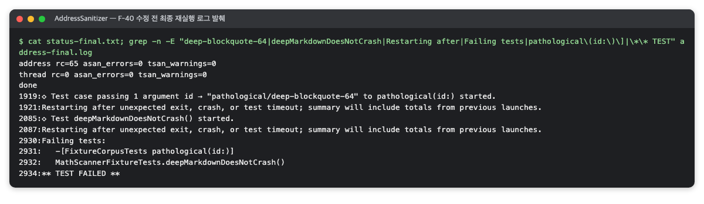

*그림 12. 스택 넘침 결함을 고치기 전 최종 재실행 로그(RichMarkdown 검증 화면, 2026-10)*

1. **`rc=65 asan_errors=0`**: 테스트 명령은 실패(종료 코드 65)했지만 ASan 오류 보고는 0줄입니다. 실패 원인이 ASan이 찾은 메모리 오류가 아니라는 첫 단서입니다.
2. **`Restarting after unexpected exit, crash, or test timeout`**: 바로 앞 줄의 입력과 테스트에서 테스트 프로세스가 죽고 다시 시작됐다는 뜻입니다.
3. **`Failing tests`**: 실패한 테스트 목록에서 공통 입력을 찾습니다.

이런 로그의 흔한 원인은 스택 넘침입니다. 깊게 중첩된 극단 입력(정상 사용에서는 드물지만 구조가 극단적인 입력)을 재귀로 변환할 때, Debug·ASan 빌드에서는 스택 프레임 하나가 커져 협력 스레드(Swift 동시성 작업을 실행하는 스레드 풀의 스레드)의 스택(512 KB)을 넘을 수 있습니다. 모든 경우의 지역 변수를 한 함수가 담거나, 체인 연산(`Array(children.compactMap { … })`)이 단계마다 지연 시퀀스 프레임을 더하면 스택 프레임이 급격히 커집니다.

Release 빌드는 같은 깊이에서도 스택을 훨씬 적게 써서 영향이 없을 수 있습니다. 그래도 Debug로 돌리는 개발자를 위해 변환 함수를 얇은 분기 함수와 경우별 함수로 나누고, 자식 변환을 반복문으로 바꿀 수 있습니다. 고친 뒤에는 퍼징·테스트 입력 전체의 출력이 수정 전과 바이트 단위로 같은지 확인합니다.

정리하면 ASan 실행의 실패를 곧바로 "메모리 오류"로 읽지 않습니다. ASan 보고 줄이 있는지부터 보고, 없으면 크래시의 다른 원인(ASan이 키운 스택 프레임 등)을 찾습니다. 첫 실행 로그에도 같은 크래시가 있었는데 결함 대장(찾은 결함을 번호·발견 경로·수정·회귀 테스트와 함께 모은 목록)에 시간 기준 실패로만 적혔다면, 원시 로그를 다시 보고 원인을 정정합니다.

#### 5.6.2 수정 후: 모두 통과, 보고 0건

다음은 출력 형식을 보여 주는 예입니다. 숫자는 프로젝트마다 다릅니다.

```
Test run with 95 tests in 12 suites passed after 8.1 seconds.
Test run with 93 tests in 9 suites passed after 40.3 seconds.
Test run with 16 tests in 3 suites passed after 2.0 seconds.
Test run with 29 tests in 5 suites passed after 6.5 seconds.
Test run with 129 tests in 14 suites passed after 22.7 seconds.
[baseline] 50KiB parse ms p50=346.5 p95=360.1 max=361.0
** TEST SUCCEEDED **
ERROR: AddressSanitizer count: 0
```

그림 13은 같은 결함을 고친 뒤 최종 재실행의 실제 로그 발췌입니다. 다섯 번들(95·93·16·29·129개)이 모두 통과했고, `[baseline]` 줄의 P50은 346.5 ms이며, ASan 보고 줄 수는 0입니다.

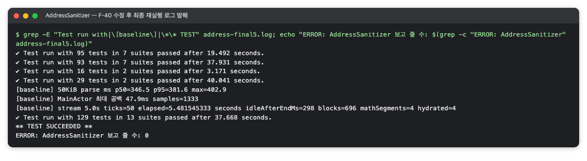

*그림 13. 스택 넘침 결함을 고친 뒤 최종 재실행 로그(RichMarkdown 검증 화면, 2026-10)*

1. **`Test run with N tests … passed`**: 테스트 번들별 통과 수입니다. 합계가 그 실행의 통과 수입니다.
2. **`[baseline] … p50=346.5`**: 시간 기준(예: 300 ms)을 넘었지만 테스트는 통과했습니다. 새니타이저 실행에서는 시간 판정을 건너뛰고 수치만 남기기 때문입니다. 이 값을 다른 실행의 값과 섞어 인용하지 않습니다.
3. **`** TEST SUCCEEDED **`와 보고 줄 수 0**: 모든 테스트가 통과했고, ASan 오류 보고가 한 줄도 없었다는 뜻입니다.

번들마다 외부 경계(C 인터페이스, JavaScriptCore 등)를 지나는지 표로 적어 두면 0건의 범위를 설명하기 쉽습니다.

반대로 ASan이 오류를 찾았다면 로그에 `ERROR: AddressSanitizer heap-use-after-free on address …`처럼 오류 종류와 주소가 나오고, 이어서 접근한 위치의 호출 스택이 나옵니다(Clang 문서의 예[20]).

### 5.7 주의할 점·한계

- **0건의 범위**: 테스트가 실제로 실행한 경로 가운데, ASan 옵션으로 컴파일한 Swift·C 코드에서 오류가 탐지되지 않았다는 뜻입니다.
- **계측되지 않은 코드**: 미리 빌드한 XCFramework(여러 플랫폼용 바이너리를 묶은 배포 형식, 예: Rust 엔진)나 시스템 프레임워크 내부에는 검사 코드가 들어가지 않습니다. 검사된 것은 그 경계를 부르는 Swift 쪽 코드와, 그 코드가 넘기고 돌려받는 메모리입니다. 그런 엔진의 주된 방어는 입력 상한(수식 길이, 이미지 크기 등)이고 ASan은 보조 확인입니다.
- **다른 플랫폼은 따로**: Android의 JNI(Java·Kotlin 코드가 네이티브 코드를 부르는 통로) 경로 같은 곳은 별도 새니타이저로 실행해야 합니다.
- **찾지 않는 오류**: 메모리 누수, 초기화하지 않은 메모리 읽기, 정수 넘침은 대상이 아닙니다.
- **실행한 경로만 봄**: 테스트가 지나가지 않은 코드는 검사되지 않으므로 커버리지와 함께 읽습니다. 이 실행에 넣지 않은 UI 테스트·벤치마크·스냅샷 테스트의 경로도 마찬가지입니다.
- **느려짐**: Apple 문서 기준 2–5배입니다. 시간 기준 테스트는 따로 다뤄야 합니다.
- **스택 크기 변화**: ASan은 스택 프레임을 키웁니다. ASan 빌드의 크래시가 메모리 오류가 아니라 스택 넘침일 수 있으므로 보고 줄부터 확인합니다.
- **TSan과 동시 사용 불가**: 한 빌드에 ASan과 ThreadSanitizer를 함께 켤 수 없어 따로 실행합니다([ThreadSanitizer](#6-threadsanitizer--동기화-없이-두-스레드가-같은-메모리에-접근하는-데이터-경합을-테스트가-도는-동안-찾는-컴파일러-기능)).
- **CI 밖이면 유효 기간이 있음**: 커밋마다 도는 CI 게이트에 없다면, 코드가 바뀐 뒤 릴리스 전에 다시 돌려야 결과가 유효합니다.


## 6. ThreadSanitizer — 동기화 없이 두 스레드가 같은 메모리에 접근하는 데이터 경합을 테스트가 도는 동안 찾는 컴파일러 기능

> **요약.** ThreadSanitizer(TSan)는 "여러 스레드가 함께 쓰는 구조가 실제 실행에서 경합 없이 동작하는가"에 답하며, Swift 6 컴파일러가 믿고 넘어간 면제 지점(`@unchecked Sendable` 등)을 실행 중에 확인합니다. 결과를 읽을 때 가장 중요한 점은 종료 코드가 아니라 `WARNING: ThreadSanitizer` 보고 유무로 판단하는 것입니다. 보고 0건은 테스트가 실제로 함께 지나간 경로에서만 경합이 없었다는 뜻입니다.


### 6.1 한눈에 보기

표 13은 이 도구의 기본 정보를 한데 모은 것입니다.

*표 13. ThreadSanitizer 개요*

| 항목 | 내용 |
|---|---|
| 무엇을 하나 | 동기화 없이 두 스레드가 같은 메모리에 접근하는 데이터 경합을 테스트가 도는 동안 찾아 보고합니다. |
| 만든 곳·라이선스 | LLVM 기반 컴파일러 기능입니다. Clang과 Swift 컴파일러가 지원하고 Xcode에 들어 있어, 따로 설치하거나 라이선스를 받지 않습니다. |
| 쓰는 곳(예) | Q1 오류·안전에서 백그라운드 파싱·공유 캐시처럼 스레드가 함께 쓰는 구조의 경합을 확인하는 데, 그리고 릴리스 전 새니타이저 검증 단계에 씁니다. |
| 버전 | 확인 시점 버전은 Xcode 26.6 내장(Swift 6.3.3, 2026-10)입니다. |
| 실행 환경(예) | iOS 시뮬레이터, Debug 빌드, 패키지 테스트에서 실행합니다. iOS·iPadOS 실기기에서는 쓸 수 없습니다. |
| 공식 문서 | [Diagnosing memory, thread, and crash issues early](https://developer.apple.com/documentation/xcode/diagnosing-memory-thread-and-crash-issues-early) |

### 6.2 무엇을 하는 도구인가

데이터 경합은 여러 스레드가 적절한 동기화 없이 같은 메모리에 접근할 때 생깁니다. 매번 일어나지 않아 일반 테스트로 잡기 어렵고, 프로그램을 예측할 수 없게 만들며 메모리 손상으로 이어질 수도 있습니다[9].

ThreadSanitizer(이하 TSan)는 ASan과 같은 새니타이저의 하나로, 빌드할 때 모든 메모리 읽기·쓰기 앞에 기록 코드를 넣습니다. 실행 중에는 접근마다 어느 스레드가 언제 어디를 읽었는지 썼는지를 남기고, 같은 위치를 건드린 두 접근 가운데 실행 순서가 정해지지 않았고 적어도 하나는 쓰기인 것을 찾아 보고합니다. 초기화하지 않은 뮤텍스나 스레드 누수 같은 다른 스레드 문제도 찾습니다[9].

단순화해서 설명하면, TSan은 앱 메모리 8바이트마다 최근 접근 몇 개를 섀도 메모리(앱 메모리와 짝지어 따로 두는 기록용 메모리)에 적어 둡니다. 섀도 항목 하나에는 스레드 번호, 그 스레드의 논리 시계, 쓰기 여부, 접근 크기가 들어 있습니다. 새 접근이 오면 이전 접근과 비교해 "다른 스레드이고, 적어도 하나가 쓰기이고, 둘 사이에 순서를 보장하는 동기화가 없었다"면 경합으로 보고합니다[24].

다음은 TSan이 잡는 전형적인 코드입니다. `@unchecked Sendable`로 컴파일러에게 "스레드 안전하다"고 약속만 하고, 실제로는 잠금 없이 값을 바꿉니다.

```swift
import Dispatch

final class Counter: @unchecked Sendable {
    var value = 0
}

let counter = Counter()
DispatchQueue.concurrentPerform(iterations: 1000) { _ in
    counter.value += 1
}
print(counter.value)
```

이 코드는 Swift 6 언어 모드(`-swift-version 6`)에서 경고 없이 컴파일되지만, TSan을 켜고 실행하면 그 자리에서 경합을 보고합니다.

```sh
xcrun swiftc -swift-version 6 -sanitize=thread counter.swift -o counter && ./counter
```

실행하면 다음과 같은 보고가 나옵니다. 형식을 보여 주는 예시 출력이며, 주소와 숫자는 실행마다 다릅니다.

```
==================
WARNING: ThreadSanitizer: Swift access race (pid=12345)
  Modify access of Swift variable at 0x000100a04010 by thread T2:
    #0 closure #1 in variable initialization expression of counter.swift:9 ...
  Previous write access of Swift variable at 0x000100a04010 by main thread:
    #0 closure #1 ... counter.swift:9 ...
  Location is heap block of size 32 at 0x000100a04000 allocated by main thread:
    #0 swift_allocObject ...
SUMMARY: ThreadSanitizer: Swift access race counter.swift:9 in closure #1
==================
996
ThreadSanitizer: reported 5 warnings
```

보고는 두 접근(작업 스레드 T2의 수정, 메인 스레드의 이전 쓰기)의 호출 스택, 그 메모리가 어디서 할당되었는지, 한 줄 요약(`SUMMARY:`) 순서로 나옵니다. 이 예에서는 1,000이 아니라 996이 출력되어 증가 일부가 사라졌습니다. 경합은 이렇게 결과를 조용히 틀리게 만들 수 있습니다.

그림 14는 위 코드를 macOS에서 실제로 빌드해 실행한 출력입니다. 보고 순서가 같고, 마지막에 996과 `ThreadSanitizer: reported 5 warnings`가 찍힌 뒤 프로세스가 중단(Abort trap: 6)됩니다.

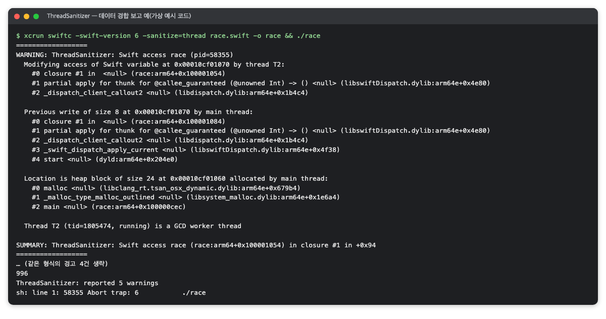

*그림 14. 가상 예시 코드의 TSan 경합 보고(RichMarkdown 검증 화면, 2026-10)*

비용은 ASan보다 큽니다. Apple 문서 기준으로 메모리를 5–10배 더 쓰고 실행이 2–20배 느려집니다[9]. Clang 문서는 일반적인 감속을 5–15배로 적어 두 출처의 범위가 다릅니다[22]. 또 Apple 문서에 따르면 TSan은 iOS·iPadOS 앱을 실기기에서 진단할 수 없고, 시뮬레이터나 64비트 macOS 앱에서만 씁니다[9].

#### 6.2.1 ASan과 함께 켤 수 없는 이유

Clang 사용자 설명서는 `-fsanitize=address`, `-fsanitize=thread`, `-fsanitize=memory` 가운데 둘 이상을 한 프로그램에 함께 쓸 수 없다고 명시합니다[23]. Swift 컴파일러도 같은 제약을 겁니다.

```sh
xcrun swiftc -sanitize=address,thread hello.swift -o hello
# error: argument '-sanitize=thread' is not allowed with '-sanitize=address'
```

그림 15는 이 명령을 실제로 실행한 화면입니다. 컴파일러가 두 옵션의 조합 자체를 오류로 거부합니다.

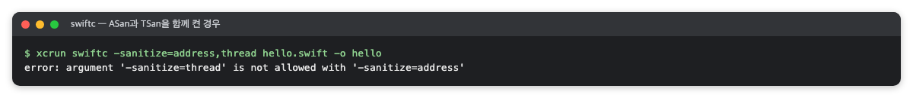

*그림 15. ASan과 TSan을 한 빌드에 함께 켠 경우(RichMarkdown 검증 화면, 2026-10)*

설명서는 이유를 따로 적지 않습니다. 다만 두 도구는 각자 앱 메모리에 대응하는 섀도 메모리를 자기 방식(ASan은 8바이트당 1바이트, TSan은 8바이트당 섀도 항목 여러 개)으로 배치하고, 런타임 라이브러리도 따로 씁니다[24]. 그래서 같은 테스트를 ASan 빌드와 TSan 빌드로 한 번씩 따로 실행합니다([AddressSanitizer](#5-addresssanitizer--범위-밖-접근해제-후-사용-같은-메모리-손상을-테스트가-도는-동안-잡아내는-컴파일러-기능)).

#### 6.2.2 Swift 6 엄격 동시성 검사와의 관계

`swift-tools-version: 6.0` 패키지는 언어 모드를 낮추는 설정이 없으면 Swift 6 언어 모드로 컴파일되며, 이 모드는 데이터 경합을 컴파일 시점에 막습니다[25]. 그런데도 TSan을 돌리는 이유는 컴파일러가 검사하지 않는 지점이 있기 때문입니다.

- **검사 면제 표시**: `@unchecked Sendable`은 "이 타입은 스레드 안전하다"는 개발자의 약속이고, 컴파일러는 그 타입을 검사하지 않습니다[25]. `nonisolated(unsafe)`도 같은 성격의 면제입니다. 문서상 스레드 안전한 `NSCache`를 메인 액터와 작업 스레드가 함께 쓰는 캐시나, TextKit이 메인 스레드에서 부르는 첨부 뷰 코드에 이런 표시가 흔합니다. 소스에서 `grep -rn "@unchecked Sendable\|nonisolated(unsafe)"`로 면제 지점을 먼저 세어 둡니다.
- **Swift 밖의 코드**: C·Objective-C 쪽 선언은 컴파일러가 안전성을 판단할 정보가 부족할 수 있습니다[25]. C 인터페이스로 네이티브 엔진을 부르는 코드가 여기에 해당합니다.

두 검사의 차이는 표 14와 같습니다.

*표 14. Swift 6 엄격 동시성 검사와 ThreadSanitizer 비교*

| 구분 | Swift 6 엄격 동시성 검사 | ThreadSanitizer |
|---|---|---|
| 언제 | 컴파일 시점 | 테스트 실행 시점 |
| 범위 | 모든 Swift 코드(면제 표시 제외) | 테스트가 실행한 경로 중 계측된(검사 코드가 들어간) 코드 |
| 놓치는 것 | `@unchecked Sendable`·`nonisolated(unsafe)`로 면제한 곳, Swift 밖 코드의 동기화 | 실행되지 않은 경로, 계측되지 않은 바이너리, 테스트 중 실제로 함께 일어나지 않은 접근 |
| 비용 | 빌드 오류로 드러남, 실행 비용 없음 | 실행 2–20배 느려짐[9] |

두 검사는 서로를 대신하지 않습니다. 컴파일러가 넓게 막고, 컴파일러가 믿고 넘어간 면제 지점이 실제 실행에서도 안전한지를 TSan이 확인하는 관계입니다. 앞의 `Counter` 예시가 이 관계를 보여 줍니다. Swift 6 컴파일은 통과했지만 TSan이 실행 중에 경합을 찾았습니다.

### 6.3 왜 이 도구를 썼나

파싱을 메인 스레드 밖에서 하고 최신 결과만 메인 액터에서 화면에 반영하는 구조에서는, 파싱 결과와 이미지 캐시를 메인 액터와 작업 스레드가 함께 씁니다. 그래서 답하려는 질문은 "이 구조가 실제 실행에서 경합 없이 동작하는가"입니다.

이 질문은 다른 수단으로 대신하기 어렵습니다.

- **Swift 6 컴파일러**: 이미 켜져 있지만, 앞에서 본 면제 지점은 검사하지 않습니다.
- **코드 리뷰**: 경합은 타이밍에 따라 나타나므로 코드를 읽는 것만으로는 확인하기 어렵습니다.
- **Main Thread Checker**: UI API를 메인 스레드 밖에서 부르는 실수만 찾는 도구라 질문이 다릅니다[9].

의존성을 더하지 않고 이미 있는 테스트를 옵션 하나로 그대로 돌릴 수 있다는 장점은 ASan과 같습니다(5.3절).

### 6.4 준비

Xcode와 iOS 시뮬레이터만 있으면 됩니다. 실기기에서는 쓸 수 없으므로 시뮬레이터를 고릅니다. 실행 시간이 길어 커밋마다 도는 CI 대신 릴리스 전에 따로 돌리는 구성이 흔한 점은 ASan과 같습니다(5.4절).

### 6.5 사용 방법

#### 6.5.1 Xcode에서 켜기

켜는 위치는 ASan과 같습니다(5.5.1절). Run 동작의 스킴 편집기 Diagnostics와 Test 동작의 테스트 플랜 구성에서 Address Sanitizer 대신 Thread Sanitizer를 켜고[9], 둘을 동시에 켜지 않습니다.

#### 6.5.2 명령줄에서 켜기

```sh
xcodebuild test -scheme <패키지>-Package \
  -destination "platform=iOS Simulator,id=<시뮬레이터 ID>" \
  -parallel-testing-enabled NO \
  -skip-testing:<벤치마크 타깃> \
  -derivedDataPath <빌드 출력 폴더>/DerivedData-thread \
  -resultBundlePath <결과 폴더>/thread.xcresult \
  -enableThreadSanitizer YES
```

- `-enableThreadSanitizer YES`: TSan 기록 코드를 넣어 빌드하고 테스트합니다. `swiftc`의 `-sanitize=thread`, `clang`의 `-fsanitize=thread`가 같은 옵션입니다[9].
- 나머지 옵션은 ASan 실행과 같습니다(병렬 테스트 끔, 벤치마크 제외). 빌드 산출물은 ASan과 다른 폴더에 둡니다.

#### 6.5.3 결과 확인

TSan이 경합을 찾으면 로그에 `WARNING: ThreadSanitizer`로 시작하는 보고와 두 접근의 호출 스택이 남습니다. ASan(5.5.3절)처럼 실행 스크립트가 테스트 종료 코드와 함께 이 줄 수를 세어 요약 파일에 적게 합니다.

```sh
grep -c "WARNING: ThreadSanitizer" thread.log     # 0이면 TSan 보고 없음
grep -E "Test run with|\*\* TEST" thread.log      # 번들별 통과 수와 최종 결과
```

#### 6.5.4 시간 기준 테스트 다루기

TSan은 실행을 크게 느리게 하므로 절대 시간 기준(예: 50 KiB 파싱 P50 < 300 ms)에 걸릴 수 있습니다. 새니타이저 런타임(`__tsan_init` 등)이 로드되면 수치만 남기고 시간 판정을 건너뛰게 고칩니다. 코드는 위 [AddressSanitizer 절의 5.5.5](#555-시간-기준-테스트-다루기)에 있습니다. 고친 뒤에는 해당 테스트만 골라 TSan으로 다시 돌려 통과를 확인합니다.

```sh
xcodebuild test -scheme <패키지>-Package \
  -destination "platform=iOS Simulator,id=<시뮬레이터 ID>" -parallel-testing-enabled NO \
  -enableThreadSanitizer YES \
  -only-testing:<테스트 타깃>/<시간 게이트 스위트> \
  -only-testing:<테스트 타깃>/<다른 스위트>
```

### 6.6 결과 읽는 법

다음은 출력 형식을 보여 주는 예입니다. 숫자는 프로젝트마다 다릅니다. 최종 재실행 로그에서 `grep`으로 골랐습니다.

```
Test run with 95 tests in 12 suites passed after 14.2 seconds.
Test run with 93 tests in 9 suites passed after 121.974 seconds.
Test run with 16 tests in 3 suites passed after 4.8 seconds.
Test run with 29 tests in 5 suites passed after 12.0 seconds.
Test run with 129 tests in 14 suites passed after 51.3 seconds.
[baseline] 50KiB parse ms p50=593.9 p95=640.2 max=641.0
** TEST SUCCEEDED **
WARNING: ThreadSanitizer count: 0
```

그림 16은 TSan 최종 재실행의 실제 로그 발췌입니다. 다섯 번들이 모두 통과했고, 두 번째 번들이 121.974초 걸렸으며, TSan 보고 줄 수는 0입니다.

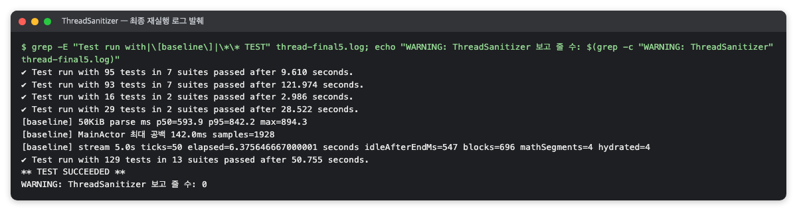

*그림 16. TSan 최종 재실행 로그(RichMarkdown 검증 화면, 2026-10)*

1. **`Test run with N tests … passed`**: 읽는 법은 ASan 결과(5.6.2절)와 같습니다.
2. **`passed after … seconds`**: TSan의 감속이 보입니다. ASan 실행에서 40초대이던 번들이 TSan에서는 120초대로 늘어나기도 합니다.
3. **`[baseline] … p50=593.9`**: 시간 기준을 넘었지만, 새니타이저 실행이라 시간 판정을 건너뛰고 수치만 남겼습니다.
4. **`** TEST SUCCEEDED **`와 보고 줄 수 0**: 모든 테스트가 통과했고 경합 보고가 한 줄도 없었다는 뜻입니다.

테스트 실패와 경합 보고는 구분해서 읽어야 합니다. 첫 실행이 `TEST FAILED`여도 경합 보고는 0줄일 수 있습니다. 작성 중이던 테스트, 편집 중이던 RED 테스트(구현보다 먼저 실패하도록 써 둔 테스트), 감속 때문에 시간 기준을 넘은 테스트가 실패 원인일 수 있기 때문입니다. TSan의 결과는 종료 코드가 아니라 `WARNING: ThreadSanitizer` 보고 유무로 판단합니다.

### 6.7 주의할 점·한계

- **0건의 범위**: 테스트가 실제로 실행한 경로 가운데, TSan 옵션으로 컴파일한 코드에서 경합이 탐지되지 않았다는 뜻입니다.
- **함께 일어난 접근만 봄**: TSan은 실행 중 실제로 일어난 접근끼리만 비교합니다. 두 스레드가 경합하는 경로를 테스트가 함께 지나가지 않으면 찾지 못합니다.
- **계측되지 않은 코드**: 미리 빌드한 XCFramework(예: Rust 엔진)와 시스템 프레임워크(JavaScriptCore) 내부는 계측되지 않습니다. 검사된 것은 그 경계를 부르는 Swift 쪽 코드입니다.
- **실기기·다른 플랫폼 미실행**: TSan은 iOS 실기기에서 쓸 수 없어 시뮬레이터에서만 돕니다. 실기기에서만 나타나는 스레드 타이밍은 확인하지 못합니다. Android 같은 다른 플랫폼은 별도 도구로 봐야 합니다.
- **컴파일러 검사와 별개**: Swift 6 언어 모드의 컴파일 시점 검사를 통과했다고 TSan이 필요 없어지지 않고, TSan 0건이 면제 표시(`@unchecked Sendable` 등)의 안전을 모든 경우에 증명하지도 않습니다.
- **느려짐**: Apple 문서 기준 2–20배입니다. 시간 기준 테스트는 따로 다뤄야 합니다.
- **CI 밖이면 유효 기간이 있음**: ASan과 같습니다(5.7절). CI 게이트에 없다면 코드가 바뀐 뒤 릴리스 전에 다시 돌립니다.


## 참고문헌

[1] Apple, "Performance Tests", Apple Developer Documentation, <https://developer.apple.com/documentation/xctest/performance-tests>. 성능 지표를 모으고 기준값보다 크게 나빠지면 실패시키는 방법.

[2] Apple, "measure(metrics:block:)", Apple Developer Documentation, <https://developer.apple.com/documentation/xctest/xctestcase/measure(metrics:block:)>. 지정한 지표로 블록을 측정하는 API.

[3] Apple, "measure(metrics:options:block:)", Apple Developer Documentation, <https://developer.apple.com/documentation/xctest/xctestcase/measure(metrics:options:block:)>. 반복 횟수 등 측정 옵션을 함께 넘기는 API.

[4] Apple, "XCTMeasureOptions.iterationCount", Apple Developer Documentation, <https://developer.apple.com/documentation/xctest/xctmeasureoptions/iterationcount>. 반복 횟수와 첫 실행을 버리는 규칙.

[5] Apple, "XCTClockMetric", Apple Developer Documentation, <https://developer.apple.com/documentation/xctest/xctclockmetric>. 단조 시계로 경과 시간을 재는 지표.

[6] Apple, "XCTCPUMetric", Apple Developer Documentation, <https://developer.apple.com/documentation/xctest/xctcpumetric>. CPU 시간·사이클·완료 명령 수.

[7] Apple, "XCTMemoryMetric", Apple Developer Documentation, <https://developer.apple.com/documentation/xctest/xctmemorymetric>. 블록 전후 물리 메모리 차이.

[8] Apple, "XCTApplicationLaunchMetric", Apple Developer Documentation, <https://developer.apple.com/documentation/xctest/xctapplicationlaunchmetric>. 앱 실행 시간 지표.

[9] Apple, "Diagnosing memory, thread, and crash issues early", Apple Developer Documentation, <https://developer.apple.com/documentation/xcode/diagnosing-memory-thread-and-crash-issues-early>. Xcode 새니타이저(ASan·TSan·UBSan·Main Thread Checker) 사용법, 명령줄 옵션, 탐지하지 않는 오류, TSan의 실기기 미지원, 메모리·속도 비용(실행 속도 ASan 2–5배, TSan 2–20배).

[10] Apple, "Profiling apps using Instruments", Apple Developer Tutorials, <https://developer.apple.com/tutorials/instruments>. Apple 공식 Instruments 튜토리얼(행 분석, Time Profiler 사용).

[11] Apple, "xctrace", Xcode 매뉴얼 페이지(`man xctrace`). xctrace 전용 웹 문서가 없어 로컬 매뉴얼 페이지가 정본입니다.

[12] Apple, "Understanding hitches in your app", Apple Developer Documentation, <https://developer.apple.com/documentation/xcode/understanding-hitches-in-your-app>. 렌더 루프, 커밋·렌더 hitch, 프레임 수명, Organizer Hitches 지표 기준(10/25/50 ms/s).

[13] Apple, "Explore UI animation hitches and the render loop", Tech Talks 10855, <https://developer.apple.com/videos/play/tech-talks/10855/>. 끊김 시간 비율과 5/10 ms/s 기준.

[14] Apple, "Improving app responsiveness", Apple Developer Documentation, <https://developer.apple.com/documentation/xcode/improving-app-responsiveness>. Time Profiler·Hitches 템플릿으로 행과 hitch를 찾는 방법.

[15] Apple, "Recording Performance Data", Apple Developer Documentation, <https://developer.apple.com/documentation/os/recording-performance-data>. os_signpost 구간 기록.

[16] Apple, "iOS Memory Deep Dive", WWDC18, <https://developer.apple.com/videos/play/wwdc2018/416/>. 앱 memory footprint의 구성.

[17] Charles Wiltgen, "xcprof Reference (Structured xctrace Capture and Analysis)", Axiom 문서 사이트, <https://charleswiltgen.github.io/Axiom/reference/xcprof-ref>. doctor·record·analyze·compare 레퍼런스. Apple 공식 도구가 아니라서 이 사이트와 소스가 1차 출처입니다.

[18] Charles Wiltgen, "Axiom/tools/xcprof/analyze.go (커밋 e8d66c4)", GitHub, <https://github.com/CharlesWiltgen/Axiom/blob/e8d66c430a6f09c823ed7db0fb8ccd8d19dbb4bf/tools/xcprof/analyze.go#L92>. JSON 필드 정의와 `inclusive_ms` 계산식(L92, L133).

[19] Apple, "Xcode command-line tool reference", Apple Developer Documentation, <https://developer.apple.com/documentation/xcode/xcode-command-line-tool-reference>. xcprof가 내부에서 부르는 xctrace의 역할. 자세한 옵션은 `man xctrace`.

[20] LLVM Project, "AddressSanitizer", Clang 문서, <https://clang.llvm.org/docs/AddressSanitizer.html>. LLVM 공식 문서. 탐지하는 오류 종류, 일반적인 감속 2배, 오류 보고 예.

[21] Google, "AddressSanitizerAlgorithm", google/sanitizers Wiki, <https://github.com/google/sanitizers/wiki/AddressSanitizerAlgorithm>. 섀도 메모리와 금지 구역, 스택 변수 계측 방식.

[22] LLVM Project, "ThreadSanitizer", Clang 문서, <https://clang.llvm.org/docs/ThreadSanitizer.html>. LLVM 공식 문서. 일반적인 감속 5–15배.

[23] LLVM Project, "Clang Compiler User's Manual", Clang 문서, <https://clang.llvm.org/docs/UsersManual.html>. `-fsanitize=address`·`thread`·`memory`를 한 프로그램에 함께 쓸 수 없다는 제약.

[24] Google, "ThreadSanitizerAlgorithm", google/sanitizers Wiki, <https://github.com/google/sanitizers/wiki/ThreadSanitizerAlgorithm>. 메모리 접근 계측과 섀도 상태(스레드 번호·논리 시계) 구조.

[25] Swift.org, "Data Race Safety", Swift 6 Concurrency Migration Guide, <https://www.swift.org/migration/documentation/swift-6-concurrency-migration-guide/dataracesafety>. Swift 6 언어 모드의 컴파일 시점 경합 방지와 `@unchecked Sendable`의 검사 면제.
