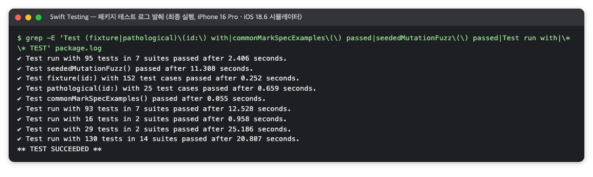
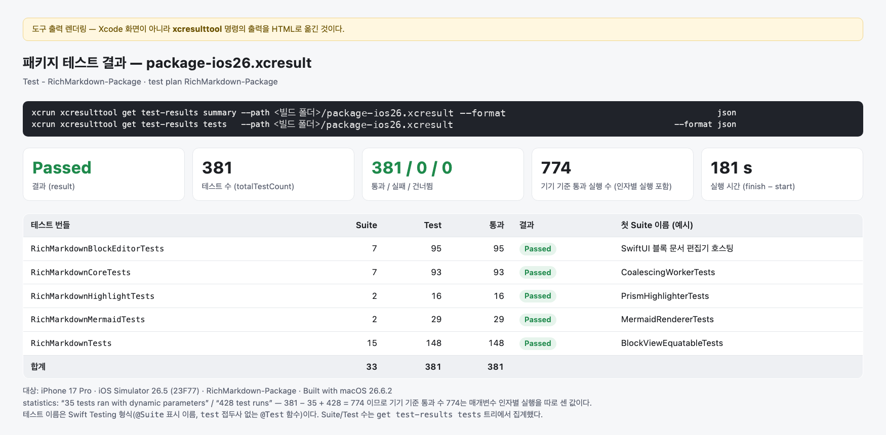
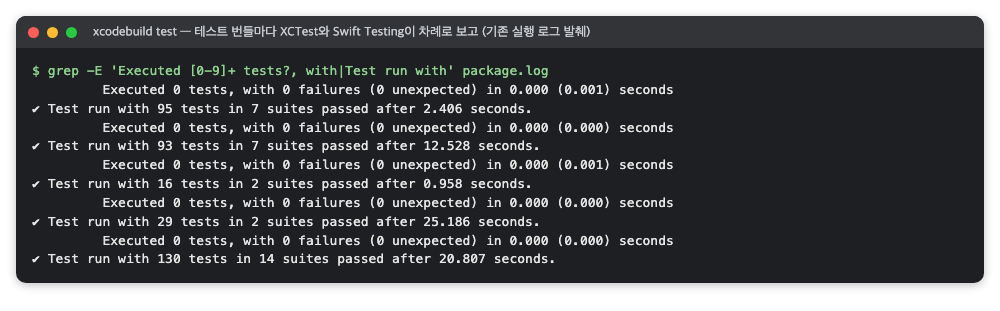
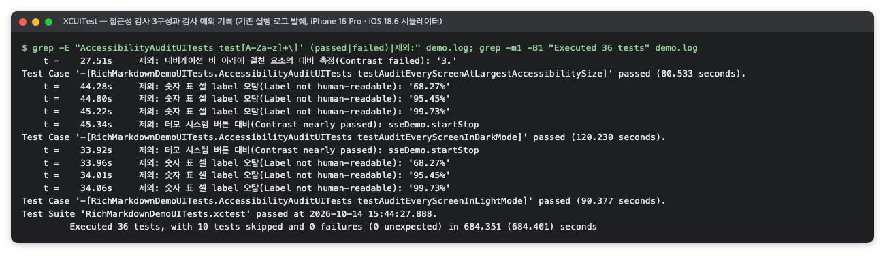
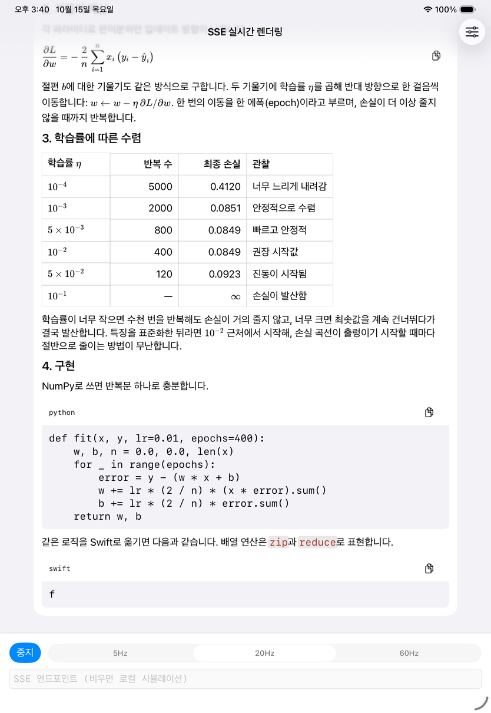
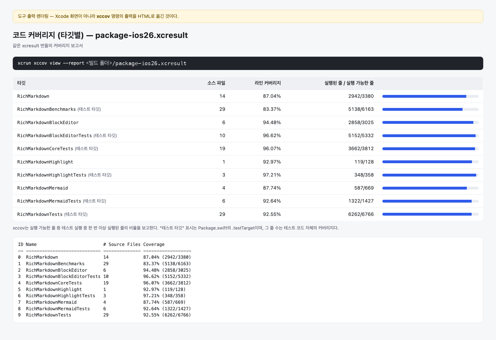
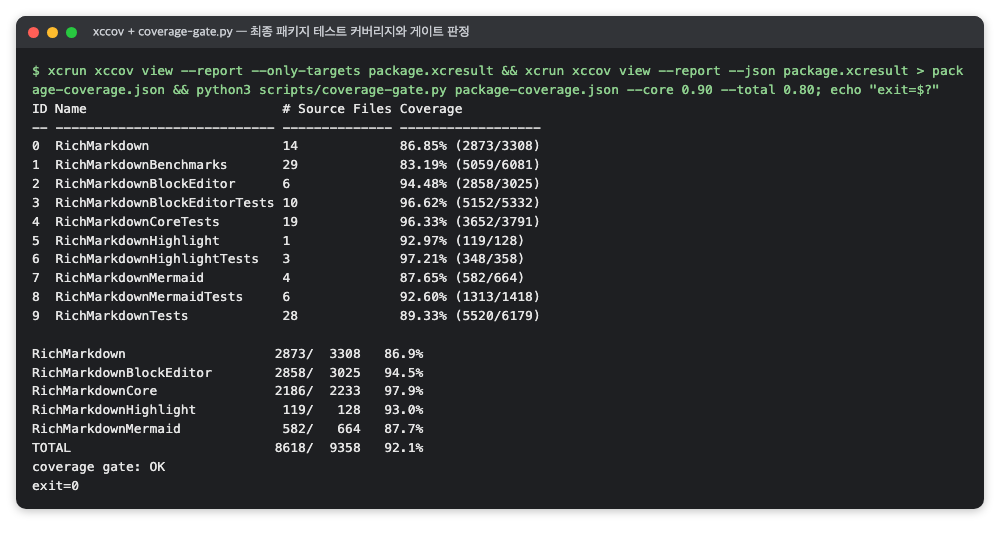
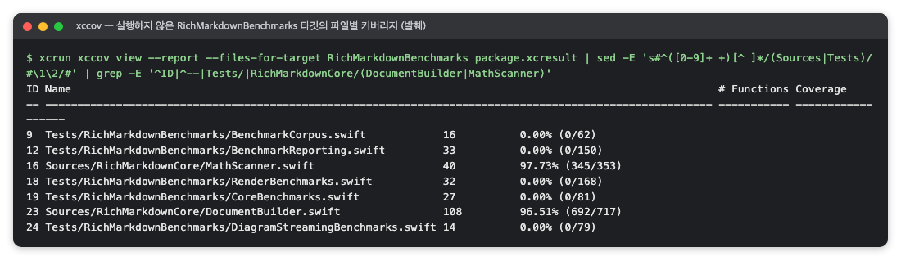
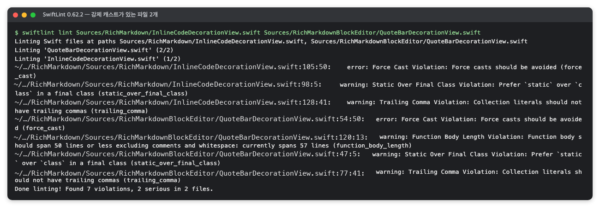
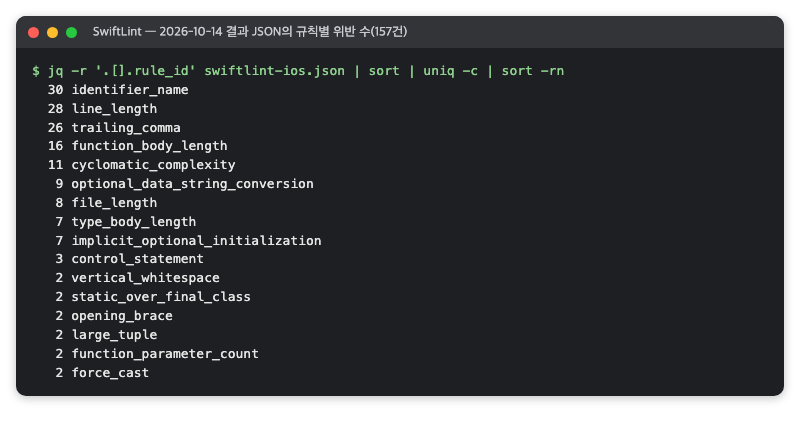

# iOS 테스트·품질 도구 — Swift Testing · XCTest · XCUITest와 접근성 감사 · xccov · SwiftLint

> **요약.** 이 문서의 다섯 도구는 iOS 코드가 정해 둔 기댓값대로 동작하는가(Q1 오류), 그리고 테스트가 닿는 범위와 코드 관례가 유지되는가(Q4 유지보수)에 함께 답합니다. Swift Testing은 함수 단위 검사를, XCTest는 UI 테스트·성능 측정의 실행 기반과 결과 번들(xcresult)을, XCUITest와 접근성 감사는 실제 앱 화면의 조작 흐름과 접근성을 맡습니다. xccov는 그 결과 번들에서 커버리지를 읽고, SwiftLint는 코드를 실행하지 않고 관례에서 벗어난 곳을 찾습니다. 결과를 읽을 때 가장 중요한 점은 숫자를 로그 줄이 아니라 xcresult와 판정 스크립트 출력에서 읽고, 그 숫자가 무엇을 세는지(테스트 함수인지 입력별 케이스인지, 어느 타깃인지, 어떤 규칙인지)를 함께 적는 것입니다.

처음 보는 용어는 [용어 풀이](../glossary.md)에 모아 두었습니다.

에이전트용 압축판: `skills/verify/references/platform-ios.md`(명령·함정), `skills/verify/references/tools.md`(도구 지도)

## 차례

- [1. 들어가며](#1-들어가며)
- [2. Swift Testing — Swift 코드가 정해 둔 기댓값을 내는지 함수 단위로 검사하는 테스트 프레임워크](#2-swift-testing--swift-코드가-정해-둔-기댓값을-내는지-함수-단위로-검사하는-테스트-프레임워크)
- [3. XCTest — Xcode의 기본 테스트 프레임워크이자, UI 테스트·성능 측정과 결과 번들(xcresult)의 기반](#3-xctest--xcode의-기본-테스트-프레임워크이자-ui-테스트성능-측정과-결과-번들xcresult의-기반)
- [4. XCUITest와 접근성 감사 — 앱을 실제로 조작하는 UI 테스트와, 화면의 접근성 문제를 자동으로 찾는 감사](#4-xcuitest와-접근성-감사--앱을-실제로-조작하는-ui-테스트와-화면의-접근성-문제를-자동으로-찾는-감사)
- [5. xccov — xcresult의 코드 커버리지를 타깃·파일·함수·줄 단위로 읽는 Xcode 명령행 도구](#5-xccov--xcresult의-코드-커버리지를-타깃파일함수줄-단위로-읽는-xcode-명령행-도구)
- [6. SwiftLint — Swift 소스의 스타일 문제와 위험한 관용구를 규칙으로 찾는 린터](#6-swiftlint--swift-소스의-스타일-문제와-위험한-관용구를-규칙으로-찾는-린터)
- [참고문헌](#참고문헌)

## 1. 들어가며

파서 함수 하나를 고치고 PR을 올리기 전에 테스트를 돌렸다고 해 봅시다. 로그에는 `Executed 0 tests`라는 줄과 `Test run with … tests … passed`라는 줄이 번갈아 찍힙니다. 커버리지 표에는 이번에 실행하지도 않은 벤치마크 타깃에까지 비율이 나옵니다.

어느 숫자를 보고서에 옮겨야 할지 헷갈리는 까닭은 도구마다 세는 대상이 다르기 때문입니다. 이 문서는 iOS에서 오류(Q1)와 유지보수(Q4)를 확인하는 도구 다섯 개를 실제로 쓰는 순서에 맞춰 묶었습니다.

1. **코드 단위로 검사합니다.** [Swift Testing](#2-swift-testing--swift-코드가-정해-둔-기댓값을-내는지-함수-단위로-검사하는-테스트-프레임워크)으로 함수가 정해 둔 값을 내는지, 고정 입력 수백 건에 같은 검사를 돌려도 통과하는지 확인합니다. `xcodebuild test`에 `-resultBundlePath`와 `-enableCodeCoverage YES`를 함께 주면 결과와 커버리지가 결과 번들(xcresult) 하나에 남습니다.
2. **앱 화면에서 검사합니다.** [XCUITest와 접근성 감사](#4-xcuitest와-접근성-감사--앱을-실제로-조작하는-ui-테스트와-화면의-접근성-문제를-자동으로-찾는-감사)가 앱을 띄워 조작하고, 라이트·다크·큰 글자 구성마다 접근성 감사를 돌립니다. 이 UI 테스트와 성능 측정을 실행하는 기반은 [XCTest](#3-xctest--xcode의-기본-테스트-프레임워크이자-ui-테스트성능-측정과-결과-번들xcresult의-기반)입니다.
3. **결과 번들을 읽습니다.** 두 프레임워크의 결과는 같은 xcresult 번들에 담기므로, 테스트 수와 건너뛴 수는 XCTest 절의 `xcresulttool` 사용법(3.5.2절)과 결과 읽는 법(3.6절)대로 꺼냅니다.
4. **커버리지를 읽습니다.** [xccov](#5-xccov--xcresult의-코드-커버리지를-타깃파일함수줄-단위로-읽는-xcode-명령행-도구)가 같은 번들에서 타깃·파일·줄 단위 커버리지를 읽습니다. 모듈별 값과 CI 판정은 파일 단위로 다시 계산한 판정 스크립트 출력에서 가져옵니다.
5. **코드를 실행하지 않고 훑습니다.** [SwiftLint](#6-swiftlint--swift-소스의-스타일-문제와-위험한-관용구를-규칙으로-찾는-린터)는 테스트와 따로 소스만 읽어, 관례에서 벗어난 곳과 강제 캐스트 같은 위험한 관용구를 찾습니다.

1~4단계의 결과는 모두 xcresult 번들에 남습니다. 그래서 숫자가 서로 어긋나 보이면 번들부터 열어 보고, 로그 줄은 보조 자료로만 씁니다.

처음 읽는다면 Swift Testing(2절)에서 테스트 함수 수와 입력별 실행 수를 구분하는 법을 익힌 뒤, XCTest의 결과 번들(3.2.2절)과 결과 읽는 법(3.6절), xccov(5절) 순서로 읽기를 권합니다. 화면 흐름과 접근성은 4절에서, 코드 관례는 6절에서 이어서 봅니다.

함수 시간·화면 끊김·메모리와 스레드 안전은 같은 결과 번들을 쓰더라도 묻는 질문이 다르므로 [iOS 성능·안전 도구](ios-performance.md)에서 따로 다룹니다.


## 2. Swift Testing — Swift 코드가 정해 둔 기댓값을 내는지 함수 단위로 검사하는 테스트 프레임워크

> **요약.** Swift Testing은 "같은 검사를 입력 수백 건에 하나씩 돌리고, 실패하면 어느 입력인지 바로 알 수 있는가"에 답하는 Xcode 내장 테스트 프레임워크입니다. 결과를 읽을 때 가장 중요한 점은 테스트 함수 수와 입력별 실행 수(test cases·test runs)를 구분하고, 그 숫자를 로그 줄이 아니라 xcresult(Xcode가 남기는 테스트 결과 번들)의 집계에서 읽는 것입니다.


### 2.1 한눈에 보기

표 1은 이 도구의 기본 정보를 한데 모은 것입니다.

*표 1. Swift Testing 개요*

| 항목 | 내용 |
|---|---|
| 무엇을 하나 | `@Test`를 붙인 함수를 실행하고 `#expect`·`#require`로 결과를 검사해 통과·실패를 보고합니다. 입력 목록을 받아 같은 함수를 입력마다 실행하는 매개변수 테스트도 지원합니다. |
| 만든 곳·라이선스 | Apple과 Swift 프로젝트(`swiftlang/swift-testing`)가 만들고, 라이선스는 Apache-2.0(Runtime Library Exception 포함)입니다. Xcode에 들어 있습니다. |
| 쓰는 곳(예) | Q1 오류의 테스트 입력 전수 검사, 퍼징(무작위로 바꾼 입력을 대량으로 넣는 테스트), 파싱 CI 게이트(실패하면 병합을 막는 자동 검사)에 씁니다(검증 단계: 기능 검증·CI). |
| 버전 | 확인 시점 버전은 Xcode 26.6 내장, Swift 6.3.3(2026-10)입니다. 패키지는 `swift-tools-version: 6.0` 이상이 필요합니다. |
| 공식 문서 | [Swift Testing](https://developer.apple.com/documentation/testing), [Implementing parameterized tests](https://developer.apple.com/documentation/testing/parameterizedtesting) |

### 2.2 무엇을 하는 도구인가

파서 함수를 고쳤을 때 예전 입력이 여전히 같은 결과를 내는지 매번 손으로 확인하기는 어렵습니다. 테스트는 "이 입력을 넣으면 이런 결과가 나와야 한다"를 코드로 적어 두고 기계가 대신 확인하게 하는 장치입니다. Swift Testing에서는 평범한 Swift 함수에 `@Test`를 붙이면 테스트가 되고, 관련된 테스트를 한 타입으로 묶은 것을 스위트(`@Suite`)라고 부릅니다.

결과가 맞는지는 두 매크로로 검사합니다. `#expect(조건)`은 조건이 거짓이면 실패를 기록하고 테스트를 계속 진행합니다. `#require(조건)`은 실패하면 그 자리에서 테스트를 멈추며, 옵셔널 값을 꺼낼 때도 씁니다[3].

입력이 수백 건이라면 매개변수 테스트(parameterized test)를 씁니다. 입력 목록을 `@Test(arguments:)`로 넘기면 같은 함수가 입력마다 한 번씩 실행되고, 입력 하나하나가 결과에 따로 나타나는 "테스트 케이스"가 됩니다. 그래서 실패하면 어느 입력이 실패했는지 바로 보이고, 그 입력만 다시 실행할 수 있습니다[2].

다음은 테스트 입력(테스트에 넣는 고정 입력 파일, fixture)마다 같은 검사를 돌리는 코드의 형태입니다. 매개변수 방식과 반복문 방식을 나란히 두었습니다.

```swift
@Suite struct FixtureCorpusTests {
    // 입력 파일마다 테스트 케이스 하나가 만들어진다.
    @Test(arguments: FixtureSupport.corpusIDs)
    func fixture(id: String) throws {
        let input = try FixtureSupport.text(id: id)
        #expect(try Parser.parse(input).isValid)
    }

    // 반복문 방식: 결과가 테스트 하나로만 남으므로 메시지에 입력 번호를 넣는다.
    @Test func specExamples() throws {
        for example in try FixtureSupport.specExamples() {
            #expect(elapsed(example) < .seconds(1), "example \(example.number)")
        }
    }
}
```

두 방식은 결과의 모양이 다릅니다. 매개변수 테스트는 입력마다 결과가 남고, 반복문 테스트는 결과가 하나만 남습니다. Apple의 WWDC24 세션도 매개변수 테스트를 "반복문으로 여러 번 도는 테스트와 개념은 같지만, 인자별 결과를 따로 보고 인자 하나만 다시 실행할 수 있다"고 비교합니다[5]. 반복문 테스트의 실패 메시지에 입력 번호를 넣는 것은 이 차이를 메우기 위해서입니다.

한 가지 더 알아 둘 동작은 병렬 실행입니다. Swift Testing은 기본적으로 스위트 안의 테스트를 병렬로 실행합니다[4]. 그래서 시간을 재는 스위트처럼 서로 간섭하면 안 되는 스위트에는 차례로 실행하라는 표시(`.serialized`)를 붙입니다.

### 2.3 왜 이 도구를 썼나

이 도구로 답하려는 질문은 두 가지입니다. 같은 검사를 공용 입력 모음(여러 플랫폼·저장소가 함께 쓰는 테스트 입력 묶음, 코퍼스라고도 부름)의 입력 수백 건에 하나씩 돌렸을 때 실패한 입력을 바로 찾을 수 있는가, 그리고 그 검사가 커밋마다 자동으로 반복되는가입니다.

첫 질문에는 매개변수 테스트가 답합니다. 입력마다 결과가 따로 남으므로 실패한 입력이 결과에 그대로 드러납니다. 두 번째 질문에는 Swift Testing이 Xcode에 들어 있다는 점이 답합니다. 따로 설치할 것 없이 CI에서 `xcodebuild`로 그대로 돌릴 수 있습니다.

다른 선택지로는 이 두 조건을 함께 채우기 어려웠습니다. 표 2는 검토했지만 고르지 않은 대안입니다.

*표 2. 고르지 않은 대안과 이유*

| 대안 | 고르지 않은 이유 |
|---|---|
| XCTest만 사용 | 매개변수 테스트가 없어 입력마다 메서드를 만들거나, 반복문 안에서 입력을 메시지로 남겨야 합니다. XCTest는 성능 측정과 UI 테스트에 남겨 둡니다([XCTest](#3-xctest--xcode의-기본-테스트-프레임워크이자-ui-테스트성능-측정과-결과-번들xcresult의-기반)). |
| 서드파티 테스트 프레임워크 | 의존성이 늘고, 같은 기능을 Xcode 기본 도구가 이미 제공합니다. |

그렇다고 XCTest를 버린 것은 아닙니다. 두 프레임워크는 한 테스트 타깃 안에 함께 둘 수 있습니다. UI 자동화(`XCUIApplication`)와 성능 측정(`XCTMetric`)은 Swift Testing이 지원하지 않으므로, Apple은 이런 테스트에 XCTest를 계속 쓰라고 안내합니다[5].

### 2.4 준비

Swift Testing은 Xcode에 들어 있어 따로 설치하지 않습니다. 버전만 확인합니다.

```sh
xcodebuild -version   # 예: Xcode 26.6
swift --version       # 예: Apple Swift version 6.3.3
```

패키지는 `Package.swift`의 `swift-tools-version: 6.0` 이상이어야 합니다. CI는 macOS 러너에서 Xcode를 선택하고, 설치된 iPhone 시뮬레이터 중 최신 iOS를 골라 테스트를 실행하도록 구성합니다.

### 2.5 사용 방법

#### 2.5.1 패키지 테스트 전체 실행

```sh
xcodebuild test -scheme <패키지>-Package \
  -skip-testing:<벤치마크 타깃> \
  -parallel-testing-enabled NO \
  -destination 'platform=iOS Simulator,name=<시뮬레이터 이름>,OS=<iOS 버전>' \
  -resultBundlePath <빌드 출력 경로>/package.xcresult \
  -enableCodeCoverage YES
```

- `<패키지>-Package`: 패키지의 모든 타깃 테스트를 묶는 자동 생성 스킴입니다. 라이브러리 제품과 같은 이름의 스킴은 빌드 전용이라 테스트 동작이 없을 수 있으므로 `xcodebuild -list`로 확인합니다.
- `-skip-testing:<벤치마크 타깃>`: XCTest 성능 측정 타깃을 뺍니다([XCTest 성능 지표](ios-performance.md#2-xctest-성능-지표--같은-블록을-반복-실행해-시간cpu메모리앱-실행-시간의-분포를-얻는-measure)).
- `-resultBundlePath`: 결과를 xcresult 번들(테스트 결과·로그·커버리지를 한데 담은 결과 폴더)로 남깁니다. 결과를 꺼내는 법은 [XCTest](#3-xctest--xcode의-기본-테스트-프레임워크이자-ui-테스트성능-측정과-결과-번들xcresult의-기반)에 있습니다.

여러 단계(JavaScript 회귀, 호스트 빌드, 패키지 테스트, 앱 테스트, 커버리지 검사)를 로컬에서 한 번에 돌리려면 위 명령을 셸 스크립트로 감싸고 단계별 종료 코드를 출력하게 합니다. 시뮬레이터와 로그 위치는 환경 변수로 바꿀 수 있게 둡니다.

#### 2.5.2 `swift test`가 아니라 `xcodebuild`인 이유

UIKit·WebKit·JavaScriptCore 같은 iOS 프레임워크에 의존하는 타깃과 그 테스트는 macOS 호스트에서 `swift test`로 검증할 수 없습니다. 이런 패키지의 전체 테스트는 iOS 시뮬레이터에서 `xcodebuild`로 실행하고, 호스트에서는 Foundation만 쓰는 타깃만 `swift build --target <모듈>`로 빌드합니다. "호스트의 `swift test`를 UIKit 타깃 검증 근거로 쓰지 않는다"는 원칙을 문서에 적어 두면 좋습니다.

예외도 있습니다. Foundation만 쓰는 모듈의 퍼징처럼 호스트에서 돌려도 의미가 같은 경우에는 `swift test --no-parallel`을 쓸 수 있습니다.

#### 2.5.3 일부만 실행하기와 퍼징 설정

한 모듈만 돌릴 때는 `-only-testing:<테스트 타깃>`을 붙입니다.

퍼징(fuzzing)의 규모를 환경 변수로 바꿀 때는 주의할 점이 있습니다. `xcodebuild`로 시뮬레이터에서 돌릴 때는 변수 이름 앞에 `TEST_RUNNER_`를 붙여야 테스트 프로세스에 전달됩니다.

```sh
TEST_RUNNER_<앱>_FUZZ_ITERATIONS=100000 \
TEST_RUNNER_<앱>_FUZZ_SEED=0x5EED \
xcodebuild test -scheme <패키지>-Package \
  -only-testing:<테스트 타깃> \
  -destination 'platform=iOS Simulator,name=<시뮬레이터 이름>,OS=<iOS 버전>'
```

실패를 그대로 다시 만들 수 있는 퍼징 테스트는 다음 순서로 짭니다.

1. 시드(난수 생성의 시작값, seed)를 고정한 난수 생성기를 만듭니다. 시드와 반복 횟수는 기본값을 두고 환경 변수로 덮어씁니다. 다른 플랫폼과 입력을 비교하려면 같은 알고리즘과 시드를 씁니다.
2. 반복마다 공용 입력 모음에서 입력 하나를 고르고, 기호 삽입·글자 삭제·구간 복제·줄바꿈 변형·앞부분만 남기기 같은 변형을 여러 번 적용합니다.
3. 크래시 없음, 변환 왕복 뒤 원문 동일, 범위·UTF-8 경계, 입력 상한 준수, 입력당 처리 시간 상한을 검사합니다.
4. 실패하면 입력을 최소화해 회귀 폴더에 `<시드>-<반복 번호>.md`로 저장하고 `Issue.record`로 실패를 남깁니다. 이 파일이 회귀 테스트 입력(고친 결함이 다시 생기면 걸리도록 남겨 두는 최소 재현 입력)의 출발점이 됩니다.

### 2.6 결과 읽는 법

다음은 출력 형식을 보여 주는 예입니다. 숫자는 프로젝트마다 다릅니다. `xcodebuild test`의 로그에서 Swift Testing 결과 줄만 골랐습니다.

```
Test run with 95 tests in 12 suites passed after 3.201 seconds.
Test run with 93 tests in 9 suites passed after 5.870 seconds.
Test case passing 152 arguments ... fixture(id:) with 152 test cases passed
Test pathological(id:) with 25 test cases passed after 0.412 seconds.
Test specExamples() passed after 2.044 seconds.
Test seededMutationFuzz() passed after 11.308 seconds.
** TEST SUCCEEDED **
```

1. **`Test run with N tests in M suites`**: 테스트 번들 하나가 끝날 때 한 줄씩 나옵니다. 번들마다 나온 N을 더하면 그 실행의 테스트 함수 수입니다.
2. **`fixture(id:) with 152 test cases`**: 매개변수 테스트입니다. 함수 수에는 1로 들어가고, 입력별 실행은 "test cases"로 따로 셉니다.
3. **`specExamples() passed`**: 반복문으로 입력 여러 건을 도는 테스트입니다. 입력 수는 함수 수에도 케이스 수에도 나타나지 않습니다.
4. **`seededMutationFuzz() passed after 11.308 seconds`**: 퍼징 전체에 걸린 시간입니다.
5. **`** TEST SUCCEEDED **`**: `xcodebuild`가 내는 최종 판정입니다. 실패가 하나라도 있으면 `** TEST FAILED **`가 나오고 종료 코드가 0이 아닙니다.

그림 1은 RichMarkdown 검증의 최종 패키지 테스트 로그에서 같은 줄을 골라낸 화면입니다. 다섯 번들이 보고한 95·93·16·29·130을 더하면 테스트 함수 363개이고, `fixture(id:)`의 152건과 `pathological(id:)`의 25건은 이 수와 따로 세는 매개변수 케이스입니다.



*그림 1. 최종 패키지 테스트의 Swift Testing 결과 줄 (RichMarkdown 검증 때의 명령 출력을 옮긴 화면, 2026-10)*

같은 결과를 xcresult 번들에서 요약해 볼 수도 있습니다. 다음도 출력 형식을 보여 주는 예입니다.

```
$ xcrun xcresulttool get test-results summary --path package.xcresult
result: Passed
totalTestCount: 381   passedTests: 381   failedTests: 0   skippedTests: 0
35 tests ran with dynamic parameters · 428 test runs
devices: <시뮬레이터 이름> <iOS 버전>
```

- **`totalTestCount`**: 실행한 테스트 함수 수입니다. 매개변수 테스트는 인자가 몇 개든 1로 셉니다.
- **`test runs`**: 매개변수 함수를 인자별로 푼 실행 수입니다. 기기 하나에서 돌리면 매개변수 케이스 수와 같습니다. 매개변수가 없는 함수까지 더한 기기 기준 실행 수(위 예에서는 381 − 35 + 428 = 774)와는 다르므로, 보고서에는 함수 수·매개변수 케이스 수·기기 기준 실행 수를 나눠 적습니다.
- 테스트 이름이 `test` 접두사 없는 함수 이름이거나 `@Suite`의 표시 이름이면 Swift Testing 테스트입니다.

그림 2는 통합 브랜치에서 돌린 다른 실행의 결과 번들을 정리한 화면이라 숫자가 그림 1과 다릅니다. 테스트 함수 381개가 모두 통과했고, 기기 기준 통과 실행 수 774는 매개변수 함수 35개를 인자별 실행 428회로 풀어 나머지 함수와 더한 값입니다(381 − 35 + 428).



*그림 2. 통합 브랜치 패키지 테스트의 xcresult 요약 (RichMarkdown 검증 때의 명령 출력을 옮긴 화면, 2026-10)*

### 2.7 주의할 점·한계

- **통과는 해당 테스트가 명시한 조건과 맞는다는 뜻입니다.** 명세 예제를 "크래시 없음·시간"만 검사하고 기대 출력과 자동으로 대조하지 않았다면, 통과를 명세 준수로 읽지 않습니다.
- **플랫폼끼리 테스트 수를 비교하지 않습니다.** JUnit은 매개변수 케이스를 하나씩 세고 Swift Testing은 함수 하나로 세므로, 같은 검사도 숫자가 크게 다릅니다.
- **매개변수 케이스 수는 xcresult 집계로 셉니다.** 로그의 `Test case passing … started` 줄 수로 세면, 인자 값에 줄바꿈이 든 케이스가 여러 줄로 나뉘어 빠집니다.
- **반복문 테스트는 입력별로 다시 실행할 수 없습니다.** 하나가 실패하면 메시지의 입력 번호로 입력을 찾아야 합니다.
- **퍼징에서 크래시가 없었다는 결과는 생성기가 만든 입력의 범위 안에서만 의미가 있습니다.** 공유 CI 러너가 잠시 느려지면 시간 상한을 넘을 수 있으므로, 상한을 넘으면 같은 입력을 몇 번 다시 재서 가장 빠른 값으로 판정하는 방식을 고려합니다.
- **환경 변수가 전달되는지 확인합니다.** CI 수동 실행 입력이 `TEST_RUNNER_` 접두사 없이 설정되면 시뮬레이터의 테스트 프로세스에 전달되지 않을 수 있습니다.
- **시간 기준 테스트는 회귀 방지 기준입니다.** 회귀 방지 기준은 나빠지면 CI를 실패시키려고 프로젝트가 정한 값입니다. 시뮬레이터의 Debug 빌드(최적화를 끈 개발용 빌드)에서 시간을 재는 CI 게이트는 사용자가 체감하는 성능의 근거가 아닙니다([XCTest 성능 지표](ios-performance.md#2-xctest-성능-지표--같은-블록을-반복-실행해-시간cpu메모리앱-실행-시간의-분포를-얻는-measure)).


## 3. XCTest — Xcode의 기본 테스트 프레임워크이자, UI 테스트·성능 측정과 결과 번들(xcresult)의 기반

> **요약.** XCTest는 "앱 화면이 실제로 그려지고 조작되는가", "함수 하나와 앱 실행이 얼마나 걸리는가"처럼 Swift Testing이 다루지 않는 질문에 답하고, 모든 테스트 결과를 xcresult 번들 하나에 남깁니다. 결과를 읽을 때 가장 중요한 점은 `Executed 0 tests`를 실패로, 건너뜀을 통과로 오해하지 않고, 실제 테스트 수를 xcresult나 `Test run with` 줄에서 읽는 것입니다.


### 3.1 한눈에 보기

표 3은 이 도구의 기본 정보를 한데 모은 것입니다.

*표 3. XCTest 개요*

| 항목 | 내용 |
|---|---|
| 무엇을 하나 | `XCTestCase`를 상속한 클래스의 `test…` 메서드를 실행하고 `XCTAssert…` 함수로 결과를 검사합니다. 단위 테스트 외에 성능 측정(`measure`)과 UI 테스트의 실행 기반이 됩니다. |
| 만든 곳·라이선스 | Apple이 만들었고, Xcode에 들어 있는 시스템 프레임워크입니다. |
| 쓰는 곳(예) | Q1 오류(앱 화면 조작 테스트·접근성 감사), Q2 성능(`measure`), CI 앱 테스트 단계에 씁니다. |
| 버전 | 확인 시점 버전은 Xcode 26.6, `xcresulttool` 24757(2026-10)입니다. |
| 공식 문서 | [XCTest](https://developer.apple.com/documentation/xctest), [Running tests and interpreting results](https://developer.apple.com/documentation/xcode/running-tests-and-interpreting-results) |

### 3.2 무엇을 하는 도구인가

XCTest는 Swift Testing보다 먼저 있던 Xcode의 테스트 프레임워크입니다. 테스트는 `XCTestCase`를 상속한 클래스 안에 이름이 `test`로 시작하는 메서드로 쓰고, `XCTAssertEqual`·`XCTAssertTrue` 같은 단언 함수로 결과를 검사합니다. 단언 함수는 "이 값은 저 값과 같아야 한다"를 확인하고, 틀리면 실패를 기록합니다. Apple 문서는 XCTest를 "단위 테스트, 성능 테스트, UI 테스트를 만들고 실행하는" 프레임워크로 소개합니다[7].

다음은 크기별로 만든 입력이 정해진 바이트 크기에 맞는지 검사하는 XCTest 예입니다.

```swift
final class CorpusTests: XCTestCase {
    @MainActor
    func testCorpusMatchesSizeRule() throws {
        for kib in Corpus.sizesKiB {
            let text = try Corpus.make(kib: kib)
            let bytes = text.utf8.count
            XCTAssertLessThanOrEqual(bytes, kib * 1024)
            XCTAssertGreaterThan(bytes, kib * 1024 - 4, "스칼라 경계에서만 잘려야 한다")
        }
    }
}
```

#### 3.2.1 Swift Testing과의 관계

그렇다면 Swift Testing이 나온 뒤에도 XCTest가 필요한 이유는 무엇일까요? 두 프레임워크는 경쟁 관계가 아니라 역할을 나눠 맡습니다. 두 프레임워크의 테스트가 한 타깃에 공존할 수 있고, Swift Testing이 지원하지 않는 UI 자동화(`XCUIApplication`)와 성능 측정(`XCTMetric`)에는 XCTest를 계속 쓴다는 WWDC24 세션 "Meet Swift Testing"의 안내는 위 [Swift Testing](#2-swift-testing--swift-코드가-정해-둔-기댓값을-내는지-함수-단위로-검사하는-테스트-프레임워크) 절 2.3에서 보았습니다[5]. Apple 문서 "Migrating a test from XCTest"는 한 소스 파일 안에 두 프레임워크의 테스트를 섞어 쓸 수도 있다고 적고 있습니다[4].

`xcodebuild test`는 테스트 번들마다 XCTest와 Swift Testing의 실행기를 차례로 돌리고, 두 결과를 같은 결과 번들에 담습니다. 그래서 표 4처럼 번들 단위로 프레임워크를 나누면 역할이 분명해집니다.

*표 4. 테스트 번들별 프레임워크 분담(예)*

| 테스트 번들(예) | 프레임워크 | 하는 일 |
|---|---|---|
| 패키지 모듈별 테스트 | Swift Testing | 기능 검사, 테스트 입력 검사, 퍼징 |
| 벤치마크 타깃 | XCTest | 성능 측정(`measure(metrics:)`), 표준 CI에서는 건너뜀 |
| 앱 단위 테스트 | Swift Testing | 앱 구성 요소 단위 테스트 |
| 앱 UI 테스트 | XCTest(XCUITest) | 앱 화면 조작, 접근성 감사, 성능 시나리오 구동 |

실행 방식도 다릅니다. Swift Testing이 기본적으로 병렬로 실행하는 것(2.2절)과 달리, Apple 문서에 따르면 XCTest는 한 클래스의 테스트를 차례로 실행합니다[4].

#### 3.2.2 결과 번들(xcresult)

테스트를 돌린 뒤 "무엇이 통과했고 무엇을 건너뛰었는가"를 나중에 다시 확인하려면 결과가 파일로 남아야 합니다. `xcodebuild test`에 `-resultBundlePath`를 주면 실행 결과가 `.xcresult` 번들 하나에 저장됩니다. 이 번들에는 테스트별 통과·실패·건너뜀, 빌드·실행 로그, 테스트가 붙인 첨부 파일(접근성 감사 화면 캡처 등), 코드 커버리지, 성능 측정값이 함께 들어 있습니다.

번들은 Xcode에서 열어 볼 수도 있지만[8], 스크립트에서는 `xcresulttool`로 필요한 부분을 JSON으로 꺼냅니다[10].

### 3.3 왜 이 도구를 썼나

XCTest로 답하려는 질문은 세 가지입니다. 앱 화면이 실제로 그려지고 조작되는가, 접근성 감사를 통과하는가, 그리고 함수 하나와 앱 실행이 실기기(시뮬레이터가 아닌 실제 기기)에서 얼마나 걸리는가입니다. 앞의 둘은 UI 테스트, 마지막은 성능 측정이 필요한 질문이라 Swift Testing으로는 테스트를 쓸 수 없습니다.

결과를 xcresult로 남긴다는 점도 이 도구를 고른 이유입니다. 스크립트가 원시 결과로 CSV와 그래프를 만들고 본문 표에는 그 값만 옮겨 적으면, 숫자의 출처가 하나로 모입니다. 테스트 결과와 성능 측정값이 같은 형식의 번들에 남으므로 `xcresulttool` 하나로 모두 읽을 수 있습니다.

표 5는 검토했지만 고르지 않은 대안입니다.

*표 5. 고르지 않은 대안과 이유*

| 대안 | 고르지 않은 이유 |
|---|---|
| Swift Testing만 사용 | UI 자동화와 성능 측정 API가 없습니다. |
| 서드파티 UI 테스트 도구 | 의존성이 늘고, Xcode의 접근성 감사·결과 번들과 바로 이어지지 않습니다. |
| 로그 텍스트만 파싱 | 출력 형식이 바뀌면 깨지고, 첨부 파일·측정값을 함께 얻기 어렵습니다. 로그 파싱은 보조로만 씁니다. |

### 3.4 준비

XCTest와 `xcresulttool`은 Xcode에 들어 있어 따로 설치하지 않습니다.

```sh
xcodebuild -version                         # 예: Xcode 26.6
xcrun xcresulttool version                  # 예: xcresulttool version 24757
xcrun xcresulttool help get test-results    # summary·tests·test-details·activities·insights·metrics
```

CI에서는 각 잡이 만든 xcresult를 아티팩트(잡이 남기는 결과 파일)로 올리고 보관 기간을 정해 둡니다.

### 3.5 사용 방법

#### 3.5.1 테스트를 실행하고 결과 번들 남기기

다음은 앱 단위 테스트와 UI 테스트를 테스트 플랜으로 묶어 함께 돌리는 예입니다.

```sh
xcodebuild test \
  -project <앱>.xcodeproj \
  -scheme <scheme> -testPlan <테스트 플랜> \
  -destination 'platform=iOS Simulator,name=<시뮬레이터 이름>,OS=<iOS 버전>' \
  -resultBundlePath <빌드 출력 경로>/app.xcresult
```

커밋마다 도는 CI에는 `-only-testing:<단위 테스트 타깃>`으로 빠른 단위 테스트만 넣고, 느린 UI 테스트는 수동 실행 잡으로 분리하는 구성이 흔합니다([XCUITest와 접근성 감사](#4-xcuitest와-접근성-감사--앱을-실제로-조작하는-ui-테스트와-화면의-접근성-문제를-자동으로-찾는-감사)).

성능 측정 테스트는 환경 변수가 있을 때만 돌게 하고, 없으면 `XCTSkip`으로 건너뛰게 만들 수 있습니다. 이렇게 하면 일반 실행 결과에는 "건너뜀"이 함께 나옵니다.

#### 3.5.2 xcresulttool로 결과 꺼내기

```sh
# 전체 요약: 결과, 테스트 수, 통과·실패·건너뜀, 기기, 매개변수 통계
xcrun xcresulttool get test-results summary --path app.xcresult

# 테스트 트리: 번들 → 스위트 → 테스트 → 인자별 실행
xcrun xcresulttool get test-results tests --path app.xcresult

# 성능 측정값(XCTest metrics): 지표 이름, 단위, 반복별 값
xcrun xcresulttool get test-results metrics --path metrics.xcresult

# 번들에 무엇이 들어 있는지: 커버리지·진단·테스트 결과·로그 유무
xcrun xcresulttool get content-availability --path app.xcresult
```

출력은 JSON이라 `jq`로 필요한 필드만 고를 수 있습니다. 예를 들어 매개변수 테스트 하나의 인자 수는 다음과 같이 셉니다.

```sh
xcrun xcresulttool get test-results tests --path package.xcresult \
  | jq -c '.. | objects | select(.nodeIdentifier? == "<스위트>/<함수>(id:)") | {name, result, arguments: (.children|length)}'
# 예: {"name":"fixture(id:)","result":"Passed","arguments":152}
```

테스트가 붙인 첨부 파일(화면 캡처 등)은 `xcrun xcresulttool export attachments --path <xcresult> --output-path <폴더>`로 내보냅니다. 코드 커버리지는 [xccov](#5-xccov--xcresult의-코드-커버리지를-타깃파일함수줄-단위로-읽는-xcode-명령행-도구)로 읽습니다.

성능 결과를 모으는 스크립트는 `xcresulttool`의 `get log --type action`으로 xcresult에 담긴 테스트 출력을 읽고, 측정 줄이 없으면 `get test-results metrics` 값으로 대신하게 만들 수 있습니다([XCTest 성능 지표](ios-performance.md#2-xctest-성능-지표--같은-블록을-반복-실행해-시간cpu메모리앱-실행-시간의-분포를-얻는-measure)).

### 3.6 결과 읽는 법

다음은 출력 형식을 보여 주는 예입니다. 숫자는 프로젝트마다 다릅니다. `xcresulttool`의 요약 JSON을 `jq`로 줄였습니다.

```
title:            Test - <scheme>
result:           Passed
totalTestCount:   61
passedTests:      51
skippedTests:     10
failedTests:      0
statistics:       3 tests ran with dynamic parameters · 10 test runs
devices:          <시뮬레이터 이름> <iOS 버전>
testNodes:        Unit test bundle / UI test bundle
```

1. **`totalTestCount`**: 단위 테스트(Swift Testing)와 UI 테스트(XCTest)를 합친 수입니다. 두 프레임워크의 결과가 한 번들에 들어 있습니다.
2. **`passedTests`**: 실제로 돌아서 통과한 수입니다.
3. **`skippedTests`**: 환경 변수 없이 건너뛴 성능 측정이나 문서 캡처용 테스트가 여기에 들어갑니다. 전체 수에서 건너뜀을 따로 적어야 "실제로 돌린 수"가 맞습니다.
4. **`N tests ran with dynamic parameters` · `M test runs`**: 매개변수 테스트 N개가 인자별로 M번 실행됐다는 통계입니다.
5. **`Unit test bundle` / `UI test bundle`**: 테스트 트리의 최상위 번들입니다.

그림 3은 RichMarkdown 데모 앱의 결과 번들에 같은 요약을 실행한 화면입니다. 전체 61개 가운데 51개가 통과하고 10개를 건너뛰었으며, 최상위 번들은 단위 테스트 번들과 UI 테스트 번들 두 개입니다.


*그림 3. 데모 앱 결과 번들 요약 (RichMarkdown 검증 때의 명령 출력을 옮긴 화면, 2026-10)*

패키지 테스트 로그에서는 번들마다 두 실행기의 보고 줄이 번갈아 나옵니다. 다음도 출력 형식을 보여 주는 예입니다.

```
Executed 0 tests, with 0 failures (0 unexpected) in 0.001 (0.003) seconds
Test run with 95 tests in 12 suites passed after 3.201 seconds.
Executed 0 tests, with 0 failures (0 unexpected) in 0.000 (0.002) seconds
Test run with 93 tests in 9 suites passed after 5.870 seconds.
```

- **`Executed 0 tests`**: XCTest 실행기의 보고입니다. Swift Testing만 있는 번들에는 XCTest 테스트가 없으므로 0이 나옵니다. 테스트가 돌지 않았다는 뜻이 아닙니다.
- **`Test run with N tests`**: 바로 이어서 나오는 Swift Testing 실행기의 보고입니다. 실제 테스트 수는 이 줄에서 읽습니다.

그림 4는 실제 패키지 테스트 로그에서 이 두 종류의 줄만 골라낸 화면입니다. 다섯 번들 모두 `Executed 0 tests` 줄 다음에 `Test run with N tests` 줄이 이어지고, 테스트 수는 뒤의 줄에만 나옵니다.



*그림 4. 테스트 번들마다 XCTest와 Swift Testing이 차례로 보고하는 모습 (RichMarkdown 검증 때의 명령 출력을 옮긴 화면, 2026-10)*

### 3.7 주의할 점·한계

- **"Executed 0 tests"를 실패나 누락으로 읽지 않습니다.** Swift Testing만 있는 번들에서는 XCTest 쪽 수가 항상 0입니다. CI에 `Executed [0-9]+ tests` 줄로 테스트 수를 검사하는 잡이 있다면, 그 잡의 테스트가 어느 프레임워크인지 확인하고 실제 결과는 `Test run with` 줄이나 xcresult에서 봅니다.
- **건너뜀은 통과가 아닙니다.** "실패 0"만 보지 말고 건너뛴 이유를 확인합니다. 예를 들어 기준 이미지가 특정 시뮬레이터 전용인 스냅샷 스위트는 다른 기기에서 건너뛰므로, 별도 실행으로 확인해야 합니다.
- **결과 번들에는 기기 이름과 로컬 경로가 들어 있습니다.** 실기기 성능 결과의 `metrics` 출력에는 기기에 붙인 이름이 그대로 나옵니다. 번들이나 JSON을 공유하기 전에 확인합니다.
- **`xcresulttool`의 출력 형식은 Xcode 버전에 따라 바뀔 수 있습니다.** 예전 명령(`get object`)은 사용 중단 예정으로 표시되어 있으므로 스크립트는 `get test-results` 계열을 씁니다. 확인한 Xcode 26.6에서는 도움말에 없는 `--format json`을 붙여도 출력이 같았습니다(기본 출력이 JSON).
- **통과는 정해 둔 기댓값과 맞는다는 뜻입니다.** UI 테스트가 통과해도 실제 사용자가 보는 화면 전체를 검증한 것은 아닙니다. 접근성도 자동 감사만으로는 VoiceOver 실사용 확인을 대신하지 못합니다.


## 4. XCUITest와 접근성 감사 — 앱을 실제로 조작하는 UI 테스트와, 화면의 접근성 문제를 자동으로 찾는 감사

> **요약.** XCUITest는 "사용자가 조작하는 흐름이 실제 앱 화면에서 동작하는가"에, 접근성 감사(`performAccessibilityAudit`)는 "라이트·다크·큰 글자에서 접근성 기준을 지키는가"에 답합니다. 결과를 읽을 때 가장 중요한 점은 감사 통과가 "예외 밖의 문제가 0건"이라는 뜻일 뿐이라는 것입니다. 어떤 예외가 걸렸는지와 VoiceOver 실사용 확인이 남았는지를 함께 봅니다.


### 4.1 한눈에 보기

표 6은 이 도구의 기본 정보를 한데 모은 것입니다.

*표 6. XCUITest와 접근성 감사 개요*

| 항목 | 내용 |
|---|---|
| 무엇을 하나 | 테스트 프로세스가 앱을 띄워 버튼을 누르고 스크롤하며 화면 요소를 확인합니다. `performAccessibilityAudit`은 현재 화면의 접근성 문제(대비, 설명 누락, 터치 영역 등)를 찾아 테스트를 실패시킵니다. |
| 만든 곳·라이선스 | Apple이 만들었습니다. XCTest 위에서 도는 UI 자동화 API(현행 문서에서는 XCUIAutomation 프레임워크[11])이며 Xcode에 들어 있습니다. |
| 쓰는 곳(예) | Q1 오류(앱 수준 흐름, 라이트·다크·큰 글자 접근성 감사), Q2 성능(실기기 측정의 앱 조작), CI 수동 실행 잡에 씁니다. |
| 버전 | 확인 시점 버전은 Xcode 26.6(2026-10)입니다. 접근성 감사는 iOS 17 이상에서 동작합니다. |
| 공식 문서 | [XCUIAutomation](https://developer.apple.com/documentation/xcuiautomation), [performAccessibilityAudit(for:_:)](https://developer.apple.com/documentation/xcuiautomation/xcuiapplication/performaccessibilityaudit(for:_:)), [Perform accessibility audits for your app - WWDC23](https://developer.apple.com/videos/play/wwdc2023/10035/) |

### 4.2 무엇을 하는 도구인가

단위 테스트는 뷰나 함수를 직접 불러 검사합니다. 하지만 사용자가 겪는 문제는 화면을 누르고 스크롤하고 다른 화면으로 넘어가는 흐름에서 생기는 경우가 많습니다. XCUITest는 이 흐름을 사람 대신 재현하는 UI 테스트 도구입니다.

XCUITest는 앱 바깥의 별도 테스트 프로세스에서 앱을 조작합니다. `XCUIApplication`으로 앱을 띄우고[12], `app.buttons["<식별자>"]`처럼 화면 요소를 찾아 누르거나 끌고, 원하는 요소가 나타날 때까지 기다립니다. 요소를 찾는 통로는 접근성 정보입니다. 화면 낭독기(VoiceOver)가 읽는 이름·역할·위치를 테스트도 똑같이 읽습니다. 그래서 요소를 조회할 때마다 앱은 접근성 정보를 계산해 넘겨야 하고, 이 비용은 뒤의 성능 측정에서 다시 문제가 됩니다.

UI 테스트는 표 7처럼 목적별로 클래스를 나누면 CI 구성이 쉬워집니다.

*표 7. 목적별 UI 테스트 클래스(예)*

| 클래스(예) | 확인하는 것 |
|---|---|
| 화면 표시 테스트 | 주요 화면의 표시와 조작 |
| 환경 변형 테스트 | 다크 모드, 극단 글자 크기, 셀 재사용 |
| 접근성 감사 테스트 | 전 화면 감사(라이트·다크·최대 글자) |
| 성능 전용 테스트 | 앱 실행 시간, 실기기 트레이스 시나리오 구동(환경 변수가 있을 때만 실행) |
| 문서 캡처 테스트 | README용 캡처(문서 갱신 전용) |

#### 4.2.1 접근성 감사

`performAccessibilityAudit`은 Xcode의 Accessibility Inspector(화면의 접근성 정보를 살피는 Xcode 도구)가 하는 검사를 UI 테스트 안에서 실행합니다. WWDC23 세션은 이 호출이 "현재 화면을 Inspector와 같은 방식으로 감사한다"고 설명합니다[15]. 감사 종류는 대비(contrast), 요소 설명(sufficientElementDescription), 터치 영역(hitRegion), 글자 크기 대응(dynamicType), 잘린 글자(textClipped) 등입니다[14]. 감사는 발견한 문제마다 처리기(closure)를 불러, 그 문제를 무시할지 테스트 코드가 정하게 합니다.

감사 테스트는 구성마다 앱을 한 번 띄워 루트 목록과 각 화면을 차례로 감사하도록 만듭니다. 구성은 세 가지가 기본입니다.

1. 라이트 모드(기본 실행)
2. 다크 모드(앱이 받는 실행 인자로 전환)
3. 최대 접근성 글자 크기(`-UIPreferredContentSizeCategoryName UICTContentSizeCategoryAccessibilityXXXL`)

화면마다 캡처를 결과에 붙이고 감사를 돌립니다. 스트리밍 화면은 스트림이 끝난 뒤의 최종 화면을 검사합니다. 한 화면의 실패가 나머지 화면 검사를 막지 않도록 `continueAfterFailure = true`로 두고, iOS 17 미만에서는 `XCTSkip`으로 건너뜁니다.

#### 4.2.2 감사 예외 설계

감사에는 오탐(문제가 아닌데 문제로 잡는 경우)이 있어 예외를 둡니다. 예외는 넓게 끄지 않고 감사 종류·문구·화면·요소를 좁혀서 겁니다. 예외를 적용하면 그 사실을 결과에 "제외: …" 활동으로 남깁니다.

감사 종류 단위로 빼는 방법은 `.all.subtracting([.dynamicType, .textClipped])` 형태입니다. 뺄 때는 이유를 코드 주석에 남깁니다. 흔한 이유는 표 8과 같습니다.

*표 8. 감사 종류 단위로 빼는 이유(예)*

| 뺀 감사 | 이유 예 |
|---|---|
| `dynamicType` | 고정 크기 비트맵(수식 이미지 등)이 Dynamic Type 크기로 다시 렌더되는 경우입니다. 실제 확대는 다른 테스트가 따로 검증합니다. |
| `textClipped` | 서로 다른 종류의 인라인 요소가 섞인 문단에서 접근성 프레임 측정이 어긋나는 오탐입니다. 스크린샷으로 잘림이 없음을 확인합니다. |

개별 문제 단위의 예외는 감사 문구와 대상 요소를 함께 좁힙니다. 이유 예는 표 9와 같고, 그 밖의 문제는 모두 실패로 보고합니다.

*표 9. 개별 문제 단위 예외(예)*

| 감사 문구 | 대상 | 이유 예 |
|---|---|---|
| 대비 실패·근접(`Contrast failed`/`nearly passed`) | 내비게이션 바 아래로 걸친 요소 | 스크롤로 바 아래에 걸친 요소는 반투명 바 재질을 배경으로 측정됩니다. 바 밖의 같은 요소는 통과합니다. |
| `Contrast failed` | 다크 모드 표 머리글 | 실제 대비는 충분한데, 셀 테두리 픽셀이 짧은 글자의 픽셀보다 많아 감사가 테두리를 글자색으로 잡습니다. 색상 값과 픽셀 수를 주석에 남깁니다. |
| `Label not human-readable` | '68.27%' 같은 숫자+퍼센트 표 셀 | label이 화면 글자 그대로인데 감사 규칙이 식별자처럼 보는 오탐으로 판단했습니다. VoiceOver의 실제 낭독은 별도 확인이 필요합니다. |
| `Contrast nearly passed` | 시스템 기본 `.borderedProminent` 버튼 | 라이브러리가 아닌 샘플 화면 요소입니다. |

감사는 실제 결함도 찾습니다. 예를 들어 접근성 특성이 없는 단독 뷰에서 "Hit area is too small"이 나오면 `accessibilityTraits`를 지정해 고칩니다.

### 4.3 왜 이 도구를 썼나

답하려는 질문은 두 가지입니다. 라이브러리를 실제 앱 화면에 넣었을 때 사용자가 조작하는 흐름이 동작하는가, 그리고 라이트·다크·큰 글자에서 접근성 기준을 지키는가입니다.

단위 테스트로는 첫 질문에 답할 수 없습니다. 단위 테스트는 뷰를 직접 만들어 검사하므로 내비게이션·스크롤·키보드 입력 같은 앱 수준 동작을 보지 못합니다. 두 번째 질문도 구성 × 화면 수가 많아 사람이 매번 확인하기 어렵습니다. 표 10은 검토했지만 고르지 않은 대안입니다.

*표 10. 고르지 않은 대안과 이유*

| 대안 | 고르지 않은 이유 |
|---|---|
| 사람이 직접 화면 확인 | 반복할 수 없고, 구성 × 화면 수를 매번 보기 어렵습니다. 출시 전 VoiceOver 실사용 확인은 사람 몫으로 남깁니다. |
| Accessibility Inspector 수동 실행 | 기준은 같지만 사람이 화면마다 돌려야 합니다. UI 테스트 안의 감사는 결과가 xcresult에 남습니다. |
| 서드파티 UI 자동화 도구 | 의존성이 늘고, Xcode의 접근성 감사와 바로 이어지지 않습니다. |

XCUITest는 실기기 성능 측정에서 앱을 조작하는 데도 씁니다. 사람 손으로 스크롤하면 회차마다 속도가 달라지므로, 같은 조작을 같은 순서로 반복하려면 자동화가 필요합니다.

### 4.4 준비

XCUITest는 Xcode에 들어 있어 따로 설치하지 않습니다. 앱 프로젝트에 UI 테스트 타깃과 테스트 플랜이 있어야 합니다. 감사 API는 iOS 17 이상에만 있으므로[13], 앱의 최소 지원 OS가 더 낮다면 그 OS에서는 감사 테스트를 건너뜁니다.

실기기 성능 측정에는 개발자 모드를 켠 기기, 서명 팀, `xcrun devicectl`·`xcrun xctrace`가 필요합니다.

### 4.5 사용 방법

#### 4.5.1 UI 테스트와 접근성 감사

```sh
# 단위 테스트 + UI 테스트 전체
xcodebuild test -project <앱>.xcodeproj \
  -scheme <scheme> -testPlan <테스트 플랜> \
  -destination 'platform=iOS Simulator,name=<시뮬레이터 이름>,OS=<iOS 버전>' \
  -resultBundlePath <빌드 출력 경로>/app.xcresult

# 접근성 감사만
xcodebuild test -project <앱>.xcodeproj \
  -scheme <scheme> -testPlan <테스트 플랜> \
  -destination 'platform=iOS Simulator,name=<시뮬레이터 이름>,OS=<iOS 버전>' \
  -only-testing:<UI 테스트 타깃>/<감사 테스트 클래스>
```

GitHub Actions에서는 UI 테스트를 커밋마다 돌리지 않고, 워크플로 수동 실행 입력(예: `ui_tests`)을 켰을 때만 도는 잡으로 분리하는 구성이 안정적입니다. 이 잡은 성능 전용 클래스를 `-skip-testing`으로 뺍니다.

#### 4.5.2 성능 측정에서 XCUITest가 앱을 조작하는 방식

실기기 성능 측정에서는 셸 스크립트가 시나리오를 하나씩 실행합니다.

```sh
DEVICE=<기기 식별자> OUT_DIR=<결과 폴더> DEVELOPMENT_TEAM=<팀> \
  <시나리오 스크립트> <시나리오 이름>
```

스크립트와 성능 전용 UI 테스트는 다음 순서로 맞물립니다.

1. 스크립트가 Release(최적화를 켠 배포용 빌드 설정)로 `build-for-testing`을 한 뒤, `TEST_RUNNER_<앱>_PERF=1`을 주고 `test-without-building -only-testing:…/<시나리오>`로 테스트 하나를 실행합니다. 이 변수가 없으면 성능 테스트는 건너뜁니다.
2. 테스트가 앱을 띄워 해당 화면으로 들어가고, 첫 렌더를 기다린 뒤 준비 완료 표지(예: `PERF_READY`)를 출력합니다.
3. 스크립트가 `xctrace`를 앱에 붙여 녹화를 시작하고, `devicectl device notification post`로 녹화 시작 알림을 기기에 보냅니다.
4. 알림을 받은 테스트가 시나리오를 실행합니다(버튼을 누르고 N초 대기, 화면 좌표로 N페이지 스크롤 등).
5. 테스트가 측정 구간(지표를 계산하는 시간 범위)을 `PERF_WINDOW`처럼 출력하고, 녹화가 제한 시간으로 끝날 때까지 앱을 살려 둡니다.

조작을 좌표 드래그와 고정 대기로 하는 것은 시나리오 중 화면 요소 조회를 줄이기 위해서입니다. 앞에서 본 것처럼 요소를 조회할 때마다 앱 메인 스레드가 접근성 정보를 계산해야 하기 때문입니다.

### 4.6 결과 읽는 법

다음은 출력 형식을 보여 주는 예입니다. 숫자는 프로젝트마다 다릅니다. UI 테스트 로그에서 감사 결과와 예외 기록만 골랐습니다.

```
제외: Contrast failed — 내비게이션 바 아래 요소 '3.'
Test Case '-[AuditUITests testAuditEveryScreenMaxTextSize]' passed (112.4 seconds).
제외: Label not human-readable — 표 셀 3개
제외: Contrast nearly passed — 시작 버튼
Test Case '-[AuditUITests testAuditEveryScreenDark]' passed (95.0 seconds).
Test Case '-[AuditUITests testAuditEveryScreenLight]' passed (88.7 seconds).
Executed 36 tests, with 10 tests skipped and 0 failures (0 unexpected) in 780.2 seconds
```

1. **`제외: …` 줄**: 예외가 적용된 문제입니다. 각 테스트의 `passed` 줄 바로 위에 그 테스트에서 걸린 예외가 나옵니다.
2. **`… passed (80–120 seconds)`**: 예외 밖의 문제가 0건이라 통과했다는 뜻입니다. 구성 하나에 1~2분이 걸릴 수 있습니다.
3. **`Executed N tests, with K tests skipped and 0 failures`**: UI 테스트 번들 전체 결과입니다. 건너뛴 K개가 성능·문서 캡처 전용 테스트라면 실제로 돈 테스트는 N − K개입니다.

그림 5는 RichMarkdown 데모 앱의 UI 테스트 로그에서 같은 줄을 골라낸 화면입니다. 세 구성이 모두 통과했고, 최대 글자 구성에서는 내비게이션 바 아래로 밀린 목록 번호 '3.' 하나가, 다크·라이트 구성에서는 숫자 표 셀 3개와 시작·중지 버튼 하나가 예외로 기록됐습니다.



*그림 5. 접근성 감사 세 구성의 통과와 예외 기록 (RichMarkdown 검증 때의 명령 출력을 옮긴 화면, 2026-10)*

예외 목록에 있어도 이번 실행에서 걸리지 않은 예외는 로그에 나오지 않습니다. 예외는 해당 문제가 생겼을 때만 기록됩니다.

그림 6은 성능 측정과 감사의 대상인 SSE(SwiftUI) 화면을 스트리밍 도중에 캡처한 것입니다. 하단의 시작·중지 버튼이 로그의 `sseDemo.startStop`이고, 이 버튼과 5Hz·20Hz·60Hz 선택이 성능 측정 UI 테스트와 감사 테스트가 누르는 요소입니다. 감사는 스트림이 끝난 뒤의 최종 화면을 검사하므로 이 캡처는 요소의 위치만 보여 주며, 시뮬레이터 Debug 빌드에서 찍어 성능 수치의 근거도 아닙니다.



*그림 6. 측정·감사 대상인 SSE(SwiftUI) 화면의 스트리밍 중간 상태 (RichMarkdown 검증 화면, 2026-10)*

### 4.7 주의할 점·한계

- **감사는 화면에 보이는 요소만 검사합니다.** 그래서 화면마다 감사를 따로 걸고, 스크롤해야 보이는 부분은 감사 범위 밖일 수 있음을 기록합니다.
- **자동 감사는 VoiceOver 실사용을 대신하지 못합니다.** 읽는 순서나 실제 듣기 경험은 출시 전에 사람이 확인해야 합니다.
- **예외는 결함을 가릴 수 있습니다.** 예외마다 근거(색상 값, 픽셀 수, 바 위치)를 코드 주석에 남기고 조건을 좁힙니다. 새 예외를 더할 때도 같은 기준을 지킵니다.
- **UI 테스트가 켠 접근성 모드는 성능 측정값에 영향을 줍니다.** UI 자동화가 화면을 조회하는 비용은 스트림 시작 전에만 생깁니다. 하지만 자동화가 켠 접근성 모드 때문에 SwiftUI는 스트림 중에도 접근성 트리(화면 요소의 접근성 정보를 계층으로 엮은 구조)를 유지하느라 메인 스레드 시간을 쓸 수 있습니다. 프레임워크마다 비용이 크게 다르므로, 성능 비교에는 UI 테스트 없이 자동 재생으로 같은 시나리오를 돌린 측정을 함께 둡니다.
- **이 비용의 의미는 사용자에 따라 다릅니다.** 접근성 트리 유지 비용은 보조 기술 사용자에게도 생길 수 있지만, XCUITest 모드가 VoiceOver 실사용과 같은 부하인지는 따로 확인해야 합니다.
- **XCUITest 조작 자체에도 시간이 걸립니다.** 드래그마다 앱이 유휴 상태가 될 때까지 기다리므로 한 번에 수 초가 걸릴 수 있습니다. "첫 화면까지" 같은 실행 시간 측정에 UI 테스트를 쓰면, 결과는 이 대기와 조회 시간이 들어간 상한값입니다.
- **공유 CI에서는 결과가 흔들립니다.** 공유 가상 머신에서는 첫 WebView 초기화 시간 초과, 접근성 감사 시간 초과, 입력 지연처럼 실행마다 다른 이유로 실패할 수 있습니다. 로컬 시뮬레이터에서 통과한다면 수동 실행 잡으로 분리하되, 그 대가로 UI 회귀가 커밋마다 잡히지 않는다는 점을 문서에 적습니다.


## 5. xccov — xcresult의 코드 커버리지를 타깃·파일·함수·줄 단위로 읽는 Xcode 명령행 도구

> **요약.** xccov는 "테스트가 코드의 어디까지 닿는가, 그리고 그 수준이 커밋마다 유지되는가"에 답합니다. 결과를 읽을 때 가장 중요한 점은 타깃 표의 숫자를 그대로 인용하지 않는 것입니다. 정적 링크 때문에 같은 파일이 여러 타깃에 겹쳐 나오고 실행하지 않은 타깃에도 비율이 찍히므로, 모듈 값은 파일 단위로 다시 계산한 값을 씁니다.


### 5.1 한눈에 보기

표 11은 이 도구의 기본 정보를 한데 모은 것입니다.

*표 11. xccov 개요*

| 항목 | 내용 |
|---|---|
| 무엇을 하나 | 커버리지를 켜고 실행한 테스트의 결과 번들(xcresult)에서 타깃·파일·함수별 라인 커버리지와 줄별 실행 횟수를 사람이 읽는 표나 JSON으로 보여 줍니다. |
| 만든 곳·라이선스 | Apple이 만들었고, Xcode에 들어 있는 명령행 도구(`xcrun xccov`)입니다. |
| 쓰는 곳(예) | Q4 유지보수의 모듈별 라인 커버리지와 커버리지 CI 게이트에 씁니다. |
| 버전 | 확인 시점 버전은 Xcode 26.6 내장(2026-10)입니다. 별도 버전 표기는 없습니다. |
| 공식 문서 | `man xccov`, [Determining how much code your tests cover](https://developer.apple.com/documentation/xcode/determining-how-much-code-your-tests-cover) |

### 5.2 무엇을 하는 도구인가

테스트가 모두 통과해도, 테스트가 한 번도 실행하지 않은 코드는 검증되지 않은 채로 남습니다. 라인 커버리지는 실행할 수 있는 코드 줄 가운데 테스트가 한 번이라도 실행한 줄의 비율로, 이런 빈 곳을 찾는 지표입니다. 커버리지를 켜고 테스트를 돌리면 빌드할 때 줄마다 실행 횟수를 세는 코드가 들어가고, 실행 결과가 xcresult 번들에 저장됩니다[17].

`man xccov`에 따르면 Xcode는 두 가지 커버리지 파일을 만듭니다[16]. 커버리지 보고서(`xccovreport`)에는 타깃·소스 파일·함수별 라인 커버리지 비율이, 커버리지 아카이브(`xccovarchive`)에는 파일별 원시 실행 횟수가 들어 있습니다. xccov는 이 둘을 사람이 읽는 형식이나 기계가 읽는 JSON으로 보여 주고, 두 결과를 비교(`diff`)하거나 합칠(`merge`) 수도 있습니다.

보는 단위는 표 12의 네 가지입니다.

*표 12. 보는 단위별 옵션*

| 옵션 | 보여 주는 것 |
|---|---|
| `--only-targets` | 타깃(빌드 산출물)별 커버리지 |
| `--files-for-target <타깃>` | 한 타깃 안의 파일별 커버리지 |
| `--functions-for-file <파일>` | 한 파일 안의 함수별 커버리지와 줄 범위 |
| `--archive --file <경로>` | 한 파일의 줄별 실행 횟수(0이면 실행되지 않은 줄) |

### 5.3 왜 이 도구를 썼나

답하려는 질문은 "테스트가 코드의 어디까지 닿는가, 그리고 그 수준이 커밋마다 유지되는가"입니다. 실행되지 않은 줄은 어떤 테스트로도 검증되지 않았다는 뜻이므로, 테스트를 보강할 곳을 찾는 지표로 씁니다.

특히 커밋마다 유지되는지를 보려면 사람이 화면에서 보는 보고서로는 부족했습니다. xccov는 Xcode에 들어 있어 의존성을 더하지 않고 CI에서 바로 쓸 수 있고, JSON 출력이 있어 기준 미달을 스크립트로 판정할 수 있습니다. 표 13은 검토했지만 고르지 않은 대안입니다.

*표 13. 고르지 않은 대안과 이유*

| 대안 | 고르지 않은 이유 |
|---|---|
| Xcode 화면의 Coverage 보고서 | 같은 데이터지만 사람이 열어 봐야 하고, CI 판정에 쓸 수 없습니다. |
| `llvm-cov` 직접 사용 | 프로파일 데이터와 바이너리 경로를 직접 찾아 넘겨야 합니다. xccov는 xcresult 하나만 받습니다. |
| 서드파티 커버리지 서비스 | 외부 업로드와 의존성이 늘고, 판정은 저장소 안 스크립트로 충분합니다. |

Android는 같은 질문에 Kover(JVM 단위 테스트)와 JaCoCo(계측 테스트) 같은 다른 도구를 씁니다. 도구와 합산 방식이 달라서 두 플랫폼의 비율을 소수점까지 비교하지 않습니다.

### 5.4 준비

xccov는 Xcode에 들어 있습니다. 테스트를 실행할 때 `-enableCodeCoverage YES`와 `-resultBundlePath`를 함께 줘야 커버리지가 결과 번들에 남습니다.

```sh
xcrun --find xccov            # 예: /Applications/Xcode.app/Contents/Developer/usr/bin/xccov
xcrun xccov help              # view·diff·merge 사용법
xcrun xcresulttool get content-availability --path package.xcresult   # "hasCoverage" : true 확인
```

CI에서는 테스트 잡 안에서 커버리지를 켜고 테스트를 실행한 뒤, 같은 잡에서 커버리지 CI 게이트를 돌립니다.

### 5.5 사용 방법

#### 5.5.1 표로 보기

결과 번들 경로는 각 환경의 빌드 출력 경로로 바꿉니다.

```sh
# 타깃별
xcrun xccov view --report --only-targets package.xcresult

# 한 타깃의 파일별
xcrun xccov view --report --files-for-target <타깃> package.xcresult

# 한 파일의 함수별
xcrun xccov view --report --functions-for-file <파일 이름>.swift package.xcresult

# 한 파일의 줄별 실행 횟수: 먼저 파일 목록에서 경로를 찾는다
xcrun xccov view --archive --file-list package.xcresult
xcrun xccov view --archive --file <소스 파일 절대 경로> package.xcresult
```

줄별 출력은 `134: 0`처럼 "줄 번호: 실행 횟수" 형태입니다. 실행 횟수가 0인 줄이 테스트가 닿지 않은 곳입니다.

#### 5.5.2 CI 게이트: 핵심 모듈과 전체 기준

CI 게이트는 JSON으로 뽑은 보고서를 저장소의 판정 스크립트로 검사합니다. 기준 숫자는 프로젝트가 정합니다(예: 핵심 모듈 90%, 전체 80%).

```sh
xcrun xccov view --report --json package.xcresult > package-coverage.json
python3 scripts/coverage-gate.py package-coverage.json --core 0.90 --total 0.80
```

판정 스크립트는 다음 순서로 계산합니다.

1. JSON의 모든 타깃에서 경로에 `/Sources/`가 들어간 파일만 고르고, 의존성 소스(`/checkouts/`)는 뺍니다.
2. 같은 파일이 여러 타깃에 나오면 실행된 줄 수가 가장 큰 항목 하나만 씁니다. 같은 소스가 여러 테스트 번들에 정적으로 링크되어 중복으로 나타나기 때문입니다.
3. `Sources/<모듈>/` 단위로 줄 수를 더해 모듈별·전체 비율을 냅니다.
4. 핵심 모듈이나 전체가 기준 미만이면 종료 코드 1로 끝납니다. 핵심 모듈 파일이 하나도 없으면 2로 끝납니다. `--json <파일>`을 주면 계산 결과를 파일로도 남깁니다.

로컬 래퍼 스크립트가 CI와 다른 기준(예: 예전 CI 게이트의 80%)을 쓰고 있지 않은지도 확인합니다. 로컬과 CI의 기준이 다르면 로컬 통과가 CI 통과를 보장하지 않습니다.

### 5.6 결과 읽는 법

다음은 출력 형식을 보여 주는 예입니다. 숫자는 프로젝트마다 다릅니다. 타깃별 출력과 판정 스크립트 출력을 이어 붙였습니다.

```
$ xcrun xccov view --report --only-targets package.xcresult
LibCore      86.85% (2873/3308)
LibEditor    94.48% (...)
LibHighlight 92.97% (...)
LibCoreTests 92.55% (...)
LibBenchmarks 83.37% (...)

$ python3 scripts/coverage-gate.py package-coverage.json --core 0.90 --total 0.80
LibCore      86.9%
LibEditor    94.5%
Core         97.9% (2186/2233)
TOTAL        92.1% (8618/9358)
coverage gate: OK
exit=0
```

- **라이브러리 타깃 행**: 그 모듈 소스의 "실행된 줄 / 실행 가능한 줄"입니다. `86.85% (2873/3308)`처럼 비율과 줄 수를 함께 봅니다.
- **테스트 타깃 행**(`…Tests`): 테스트 코드 자체와, 그 번들에 정적으로 링크된 라이브러리 소스를 함께 센 값입니다. 라이브러리 커버리지로 읽지 않습니다.
- **핵심 모듈 행이 없을 수 있습니다.** 별도 산출물 없이 테스트 번들에 정적으로 링크되는 모듈은 타깃 표에 나타나지 않습니다. 이런 모듈의 커버리지는 파일 항목을 모아야 보이고, 판정 스크립트가 필요한 이유가 여기에 있습니다. 판정 스크립트의 모듈별 값은 xccov 타깃 표에는 없는 값입니다.
- **실행하지 않은 타깃에도 비율이 찍힙니다.** `-skip-testing`으로 건너뛴 벤치마크 타깃은 결과 번들의 테스트 트리에 없는데도 타깃 행에 비율이 나옵니다. 파일 단위로 펼치면 해당 타깃의 테스트 파일은 `0.00%`이고, 정적으로 링크된 라이브러리 소스에는 다른 테스트 번들이 실행한 줄이 그대로 반영되어 보입니다. 테스트 파일이 모두 0%라면 그 번들은 실행되지 않은 것이므로, 이 행은 인용하지 않습니다.
- **`TOTAL`**: 모든 모듈을 합친 값입니다.
- **`coverage gate: OK`, `exit=0`**: 기준을 모두 넘어 통과했다는 뜻입니다. 미달이면 `coverage gate: FAIL — Core …% < 90%` 형태로 이유가 나오고 종료 코드가 1입니다.

그림 7은 통합 브랜치 결과 번들의 타깃별 커버리지를 표로 옮긴 화면입니다. 라이브러리 타깃 RichMarkdown은 87.04%(2942/3380)이고, 핵심 모듈 RichMarkdownCore는 테스트 번들에 정적으로 링크되어 표에 행이 없습니다.



*그림 7. 통합 브랜치 결과 번들의 타깃별 라인 커버리지 (RichMarkdown 검증 때의 명령 출력을 옮긴 화면, 2026-10)*

그림 8은 최종 패키지 테스트의 결과 번들에 타깃 표와 판정 스크립트를 이어서 실행한 화면입니다. 타깃 표에 없던 RichMarkdownCore가 판정 스크립트 출력에는 97.9%(2186/2233)로 나오고, 전체 92.1%로 기준을 넘어 `coverage gate: OK`와 종료 코드 0으로 끝났습니다.



*그림 8. 최종 패키지 테스트의 커버리지와 게이트 판정 (RichMarkdown 검증 때의 명령 출력을 옮긴 화면, 2026-10)*

그림 9는 실행하지 않은 벤치마크 타깃을 파일 단위로 펼친 화면입니다. `Tests/RichMarkdownBenchmarks` 아래 테스트 파일은 모두 `0.00%`이고, 정적으로 링크된 RichMarkdownCore 소스만 다른 번들이 실행한 줄이 반영되어 96~97%로 보입니다.



*그림 9. 실행하지 않은 벤치마크 타깃의 파일별 커버리지 (RichMarkdown 검증 때의 명령 출력을 옮긴 화면, 2026-10)*

### 5.7 주의할 점·한계

- **"실행했다"는 "맞게 동작함을 확인했다"가 아닙니다.** 결과를 검사하지 않고 지나가기만 하는 테스트도 커버리지를 올립니다. 커버리지가 높아도 플랫폼 간 비교(iOS·Android 결과가 같은지 맞춰 보는 일)나 퍼징 같은 다른 방식이 결함을 더 찾을 수 있습니다. 다만 플랫폼 간 비교로도 두 구현이 같은 방식으로 틀린 경우는 찾지 못합니다.
- **분기 커버리지는 재지 않습니다.** 한 줄 안의 조건 중 어느 쪽이 실행됐는지는 라인 커버리지로 알 수 없습니다.
- **컴파일된 Swift 코드만 셉니다.** 의존성(외부 패키지·미리 빌드된 바이너리)은 판정에서 빠지고, 번들된 JavaScript 같은 Swift가 아닌 자산도 대상이 아닙니다. 그런 자산은 별도 회귀 테스트로 확인해야 합니다.
- **타깃 표의 숫자를 그대로 인용하지 않습니다.** 정적 링크 때문에 같은 파일이 여러 타깃에 중복으로 나오고, 실행하지 않은 타깃에도 비율이 찍힙니다. 모듈 값은 파일별 최댓값으로 다시 계산한 판정 스크립트 출력을 씁니다.
- **CI 게이트의 범위는 그 검사가 읽는 결과 번들까지입니다.** 앱 테스트의 커버리지는 패키지 테스트의 CI 게이트에 들어가지 않습니다.
- **기준값은 프로젝트가 정한 회귀 방지 기준입니다.** "충분히 테스트했다"는 외부 기준이 아니라 "나빠지면 CI를 실패시킨다"는 장치로 읽습니다. 저장소에 브랜치 보호 규칙이 없으면 CI 게이트가 실패해도 병합이 막히지 않으므로, CI 실패와 병합 차단을 구분해서 확인합니다.


## 6. SwiftLint — Swift 소스의 스타일 문제와 위험한 관용구를 규칙으로 찾는 린터

> **요약.** SwiftLint는 "Swift 코드가 흔한 관례에서 얼마나 벗어나 있는가"에 답하는 린터입니다. 결과를 읽을 때 가장 중요한 점은 위반 건수를 결함 개수로 읽지 않는 것입니다. 건수는 규칙 구성과 코드 시점에 따라 달라지는 스타일 경향이고, 동작 위험이 있는 강제 캐스트 같은 항목만 건별로 판단합니다.


### 6.1 한눈에 보기

표 14는 이 도구의 기본 정보를 한데 모은 것입니다.

*표 14. SwiftLint 개요*

| 항목 | 내용 |
|---|---|
| 무엇을 하나 | Swift 소스를 규칙에 비춰 이름·길이·형식 같은 스타일 문제와 강제 캐스트 같은 위험한 관용구를 찾습니다. |
| 만든 곳·라이선스 | Realm 저장소(GitHub `realm/SwiftLint`)의 오픈소스 프로젝트이고, 라이선스는 MIT입니다. |
| 쓰는 곳(예) | Q4 유지보수에서 코드가 흔한 관례를 얼마나 벗어났는지(기본 규칙 위반 건수와 규칙별 분포) 볼 때, 복잡도·규모 단계와 함께 씁니다. |
| 버전 | 확인 시점 버전은 0.62.2(2026-10)입니다. |
| 공식 문서 | <https://github.com/realm/SwiftLint> · <https://realm.github.io/SwiftLint/rule-directory.html> |

### 6.2 무엇을 하는 도구인가

린터(linter)는 코드를 실행하지 않고, 정해진 규칙에 맞지 않는 곳을 알려 주는 도구입니다. SwiftLint는 Swift 커뮤니티의 스타일 관례를 규칙으로 만들어 두었고, 위반마다 경고(warning) 또는 오류(error)로 등급을 매깁니다[18].

규칙에는 두 종류가 섞여 있습니다. 짧은 변수 이름, 너무 긴 줄, 너무 긴 함수 같은 스타일 규칙이 있고, 실패하면 앱을 멈추는 강제 캐스트(`as!`) 같은 위험 관용구 규칙이 있습니다[19]. 어떤 규칙을 켜고 기준을 얼마로 할지는 저장소의 `.swiftlint.yml` 설정 파일로 정합니다. 설정 파일이 없으면 결과는 SwiftLint 기본 규칙과 기본 기준으로 돌린 값입니다.

### 6.3 왜 이 도구를 썼나

유지보수 쪽에서 답하려는 질문은 "AI가 쓴 Swift 코드가 흔한 관례에서 얼마나 벗어나 있는가"입니다. 이 질문에는 특정 팀의 취향보다 널리 쓰이는 기본 규칙이 기준이어야 하고, 다른 팀원도 같은 도구로 다시 확인할 수 있어야 합니다. 그래서 두 플랫폼에서 가장 널리 쓰는 기본 검사 도구를 고르는 편이 좋습니다(Android는 Android lint).

다른 도구와는 보는 것이 다릅니다. 보안 패턴은 semgrep이, 함수 복잡도 분포는 lizard가 따로 봅니다. SwiftLint의 `cyclomatic_complexity` 규칙도 복잡도를 보지만, 기준값(경고 10, 오류 20)이 lizard의 경고 기준(15 초과)과 달라 복잡도 수치로는 따로 인용하지 않습니다.

### 6.4 준비

```sh
swiftlint version        # 예: 0.62.2
brew install swiftlint   # 설치
```

**CI 포함 여부를 확인합니다.** CI에 SwiftLint 단계가 없으면 건수는 한 번 돌린 결과일 뿐이고, CI 게이트 역할을 하지 않습니다.

### 6.5 사용 방법

**1. 파일 몇 개를 먼저 봅니다.** 저장소 루트에서 실행합니다.

```sh
swiftlint lint Sources/<모듈>/<파일 A>.swift Sources/<모듈>/<파일 B>.swift
```

**2. 같은 범위를 JSON으로 남깁니다.** 항목마다 `file`·`line`·`character`·`rule_id`·`severity`·`reason`이 있습니다. 범위는 소스 폴더로 제한하고(테스트·의존성 제외), 명령과 범위를 결과 옆에 기록해 둡니다.

```sh
swiftlint lint --quiet --reporter json Sources > <출력 폴더>/swiftlint-ios.json
```

코드가 바뀌면 숫자도 달라지므로 어느 커밋에서 돌렸는지 함께 적습니다.

**3. 규칙별로 셉니다.** 결과 JSON을 `jq`로 묶으면 어떤 종류가 많은지 바로 보입니다.

```sh
jq -r '.[].rule_id' swiftlint-ios.json | sort | uniq -c | sort -rn
jq -r '.[].severity' swiftlint-ios.json | sort | uniq -c       # 경고·오류 수
```

**4. 규칙 하나의 기준을 확인합니다.** `swiftlint rules <규칙 이름>`은 그 규칙의 기본 설정과 위반 예를 보여 줍니다. 예를 들어 `swiftlint rules force_cast`를 실행하면 기본 등급이 `error`임을 알 수 있습니다.

**팀 규칙으로 쓰려면** 설정 파일로 규칙과 기준을 정하고, 기존 위반은 `--write-baseline`으로 기준선(baseline) 파일에 남긴 뒤 `--baseline`으로 새 위반만 보게 할 수 있습니다(`swiftlint help lint`에 나오는 옵션). `--strict`는 경고도 오류로 올립니다. 어느 방식을 쓸지는 팀이 정할 일입니다.

### 6.6 결과 읽는 법

다음은 출력 형식을 보여 주는 예입니다. 숫자는 프로젝트마다 다릅니다. 강제 캐스트가 있는 두 파일을 검사한 결과입니다.

```
Sources/Lib/InlineCodeDecorationView.swift:105:50: error: Force Cast Violation: Force casts should be avoided (force_cast)
Sources/Lib/InlineCodeDecorationView.swift:12:3: warning: Static Over Final Class Violation: ... (static_over_final_class)
Sources/Lib/QuoteBarDecorationView.swift:40:60: error: Force Cast Violation: Force casts should be avoided (force_cast)
Sources/Lib/QuoteBarDecorationView.swift:88:1: warning: Trailing Comma Violation: ... (trailing_comma)
Sources/Lib/QuoteBarDecorationView.swift:20:10: warning: Function Body Length Violation: ... (function_body_length)
Done linting! Found 7 violations, 2 serious in 2 files.
```

1. **한 줄의 구조**: `파일:줄:열: 등급: 규칙 설명 Violation: 이유 (규칙 이름)` 순서입니다. `…:105:50: error: Force Cast Violation`은 105번째 줄 50번째 열의 강제 캐스트입니다.
2. **`error`와 `warning`**: 등급은 규칙의 기본 설정을 따릅니다. 마지막 줄의 `2 serious`가 오류 수입니다.
3. **종료 코드**: 오류가 있으면 종료 코드 2로 끝납니다. CI에 넣으면 이 코드로 단계가 실패합니다.

그림 10은 RichMarkdown의 두 파일을 SwiftLint 0.62.2로 실제 검사한 출력입니다. 두 파일에서 강제 캐스트 오류 2건과 경고 5건이 나와 `Found 7 violations, 2 serious in 2 files`로 끝났습니다.



*그림 10. 강제 캐스트가 있는 두 파일을 검사한 결과 (RichMarkdown 검증 때의 명령 출력을 옮긴 화면, 2026-10)*

규칙별 분포는 다음과 같은 모양입니다. 이것도 출력 형식을 보여 주는 예입니다.

```
$ jq -r '.[].rule_id' swiftlint-ios.json | sort | uniq -c | sort -rn
  30 identifier_name
  28 line_length
  26 trailing_comma
  16 function_body_length
  11 cyclomatic_complexity
   2 force_cast
```

위 세 줄이 가장 많은 스타일 항목(짧은 변수 이름·줄 길이·후행 쉼표)입니다. 오류 등급이라고 해서 모두 위험한 코드는 아닙니다. 오류의 상당수는 `identifier_name`으로, 반복문의 `i`나 바이트 변수 `b`처럼 한 글자 이름이 기본 기준(2글자 미만은 오류)에 걸린 경우입니다. `type_body_length`·`file_length`도 기준을 넘으면 오류가 됩니다.

그림 11은 RichMarkdown 검증 보고서에 실은 결과 157건을 규칙별로 센 전체 출력입니다. 짧은 변수 이름·줄 길이·후행 쉼표 세 규칙이 84건으로 절반을 넘고, 동작 위험이 있는 `force_cast`는 2건입니다.



*그림 11. 검증 보고서에 실은 결과 157건의 규칙별 분포 (RichMarkdown 검증 때의 명령 출력을 옮긴 화면, 2026-10)*

#### 6.6.1 강제 캐스트를 어떻게 판단하나

강제 캐스트(`as!`)는 타입이 맞지 않으면 앱을 멈춥니다. 스타일 항목과 달리 동작 위험이 있으므로 건별로 판단합니다. 다음은 안전한 경우의 전형입니다.

```swift
public final class QuoteBarDecorationView: UIView {
    override public class var layerClass: AnyClass { CAShapeLayer.self }
    // ...
    private var shapeLayer: CAShapeLayer { layer as! CAShapeLayer }
}
```

`UIView`는 `layerClass`가 돌려준 클래스로 자기 레이어를 만듭니다. 이 뷰는 `layerClass`가 `CAShapeLayer`를 돌려주므로 `layer`는 항상 `CAShapeLayer`이고, 캐스트는 실패하지 않습니다. 이 근거를 적고 결함이 아니라고 판정합니다. 같은 모양이면 같은 근거를 적용합니다.

### 6.7 주의할 점·한계

- **위반 건수는 결함 개수가 아닙니다.** 설정 파일 없이 기본 규칙으로 돌린 결과이고, 대부분 스타일 항목입니다.
- **규칙 구성이 바뀌면 숫자도 바뀝니다.** 줄 길이 기준을 바꾸거나 한 글자 반복 변수를 허용하면 건수가 크게 줄어듭니다. 팀 규칙을 정하기 전까지는 스타일 경향 정도로만 읽습니다.
- **코드 시점에 따라 바뀝니다.** 어느 날짜·커밋의 값인지 적고, 이후 코드의 현재 위반 수로 인용하지 않습니다.
- **커밋마다 보지 않으면 새 위반이 드러나지 않습니다.** CI에 없으면 새 위반이 생겨도 자동 검사 실패로 나타나지 않습니다.
- **문서 주소를 확인합니다.** 프로젝트 웹사이트(`realm.github.io/SwiftLint/`)는 API 문서로 열릴 수 있으므로, 설치와 설정은 README를 보는 편이 낫습니다.


## 참고문헌

[1] Apple, "Swift Testing", Apple Developer Documentation, <https://developer.apple.com/documentation/testing>. 프레임워크 개요와 API 목록.

[2] Apple, "Implementing parameterized tests", Apple Developer Documentation, <https://developer.apple.com/documentation/testing/parameterizedtesting>. `@Test(arguments:)`로 입력마다 테스트 케이스를 만드는 방법.

[3] Apple, "Expectations and confirmations", Apple Developer Documentation, <https://developer.apple.com/documentation/testing/expectations>. `#expect`·`#require`와 비동기 확인.

[4] Apple, "Migrating a test from XCTest", Apple Developer Documentation, <https://developer.apple.com/documentation/testing/migratingfromxctest>. XCTest 단언과의 대응표, 한 파일에 섞어 쓰기, 실행 순서 차이(Swift Testing은 기본 병렬 실행).

[5] Apple, "Meet Swift Testing", WWDC24, <https://developer.apple.com/videos/play/wwdc2024/10179/>. 기본 구성 요소, XCTest와의 공존, UI 자동화·성능 측정은 XCTest를 쓰라는 안내.

[6] Swift 프로젝트, "swiftlang/swift-testing", GitHub, <https://github.com/swiftlang/swift-testing>. 오픈소스 저장소와 라이선스.

[7] Apple, "XCTest", Apple Developer Documentation, <https://developer.apple.com/documentation/xctest>. 단위·성능·UI 테스트 프레임워크 개요.

[8] Apple, "Running tests and interpreting results", Apple Developer Documentation, <https://developer.apple.com/documentation/xcode/running-tests-and-interpreting-results>. Xcode에서 테스트를 실행하고 결과를 읽는 방법.

[9] Apple, "Performance Tests", Apple Developer Documentation, <https://developer.apple.com/documentation/xctest/performance-tests>. `measure`로 지표를 모으고 기준값과 비교하는 방법.

[10] Apple, "xcresulttool", Xcode 매뉴얼 페이지(`man xcresulttool`). 결과 번들 도구의 명령 목록. 웹 문서가 따로 없어 Xcode에 들어 있는 매뉴얼 페이지가 1차 출처입니다.

[11] Apple, "XCUIAutomation", Apple Developer Documentation, <https://developer.apple.com/documentation/xcuiautomation>. UI 자동화 API 개요. 현행 문서에서 UI 테스트 API는 XCTest가 아니라 이 프레임워크 아래에 있습니다.

[12] Apple, "XCUIApplication", Apple Developer Documentation, <https://developer.apple.com/documentation/xcuiautomation/xcuiapplication>. 테스트 대상 앱을 띄우고 감시하고 종료하는 객체.

[13] Apple, "performAccessibilityAudit(for:_:)", Apple Developer Documentation, <https://developer.apple.com/documentation/xcuiautomation/xcuiapplication/performaccessibilityaudit(for:_:)>. 접근성 감사 API 선언(iOS 17 이상).

[14] Apple, "XCUIAccessibilityAuditType", Apple Developer Documentation, <https://developer.apple.com/documentation/xcuiautomation/xcuiaccessibilityaudittype>. 감사 종류 목록(contrast, dynamicType, hitRegion, textClipped 등).

[15] Apple, "Perform accessibility audits for your app", WWDC23, <https://developer.apple.com/videos/play/wwdc2023/10035/>. UI 테스트에서 접근성 감사를 자동화하고 문제를 걸러 내는 방법.

[16] Apple, "xccov", Xcode 매뉴얼 페이지(`man xccov`). xccov의 명령(`view`·`diff`·`merge`)과 커버리지 보고서·아카이브의 구성. 웹 문서가 따로 없어 Xcode에 들어 있는 매뉴얼 페이지가 1차 출처입니다.

[17] Apple, "Determining how much code your tests cover", Apple Developer Documentation, <https://developer.apple.com/documentation/xcode/determining-how-much-code-your-tests-cover>. Xcode에서 코드 커버리지를 켜고 읽는 방법.

[18] Realm, "realm/SwiftLint", GitHub, <https://github.com/realm/SwiftLint>. 설치(`brew install swiftlint`), `swiftlint lint` 사용법, `.swiftlint.yml` 설정을 설명하는 README.

[19] Realm, "Rule Directory Reference", SwiftLint 문서, <https://realm.github.io/SwiftLint/rule-directory.html>. 규칙 전체 목록과 규칙별 기본 설정(확인 시점 문서는 0.65.1 기준이라, 설치한 0.62.2에는 없는 규칙이 실려 있을 수 있음, 2026-10).
